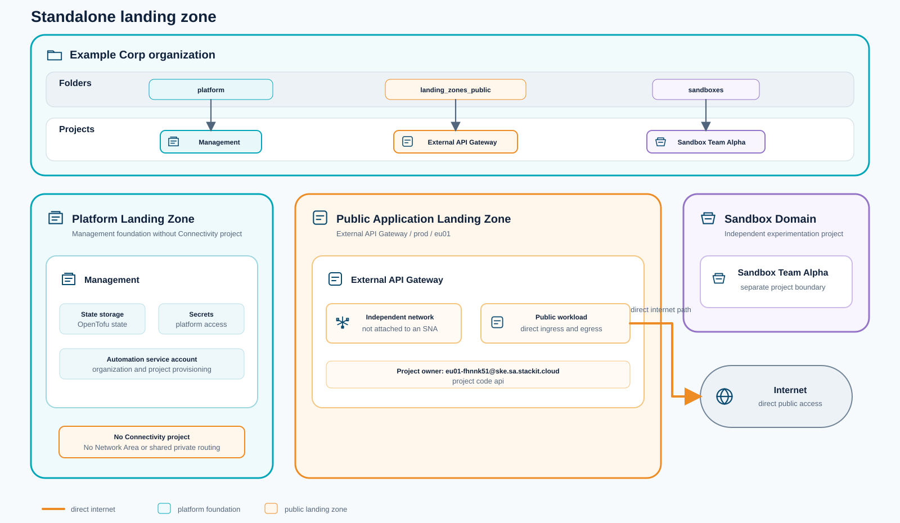
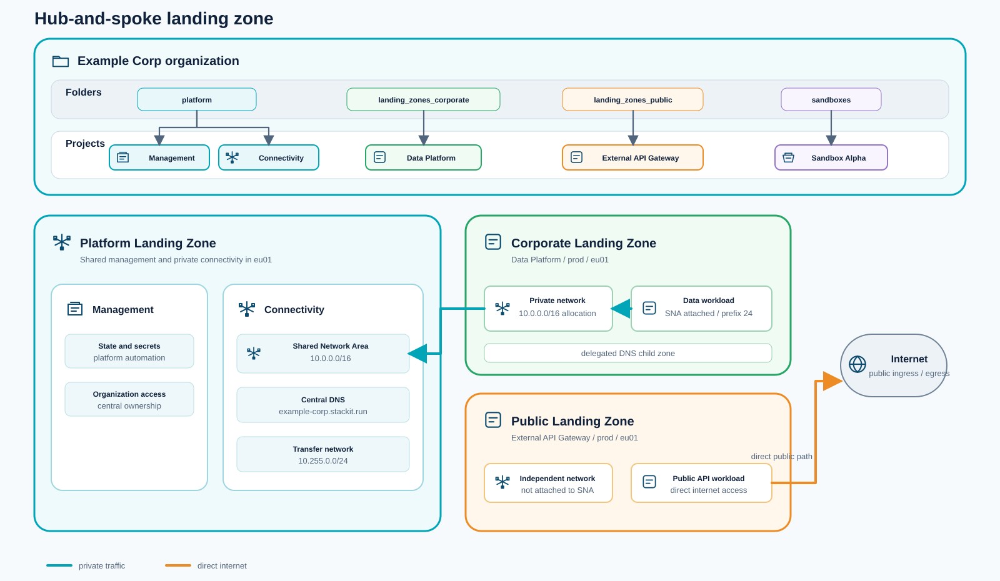
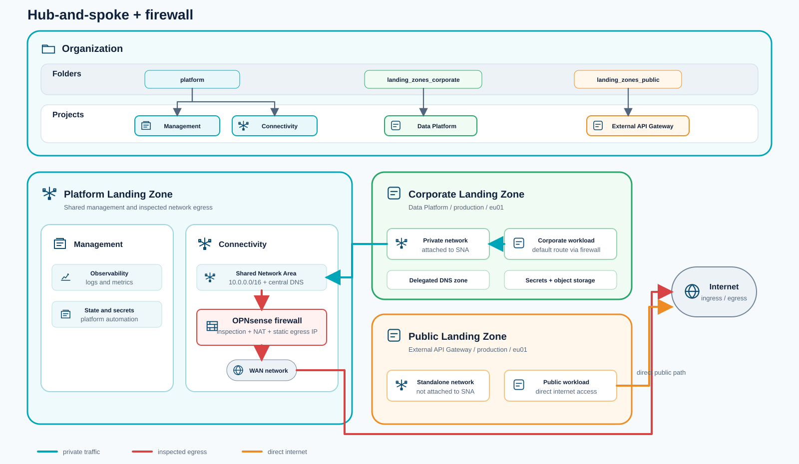
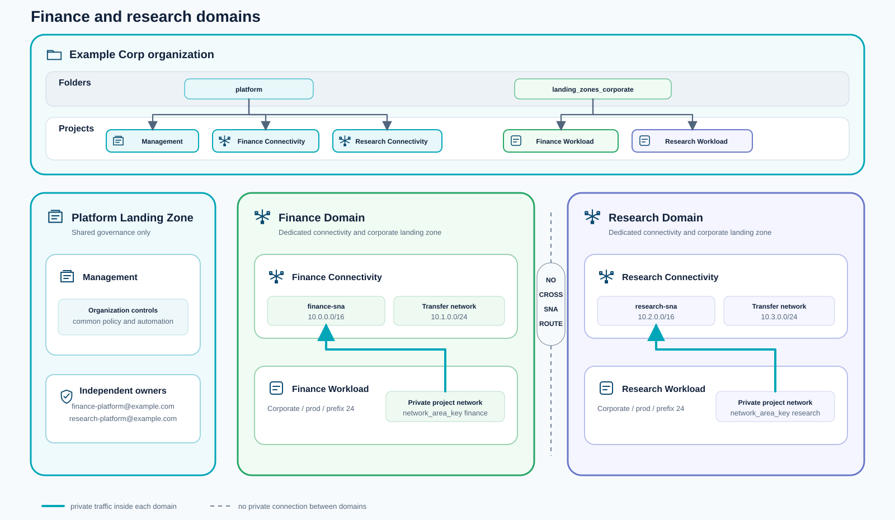
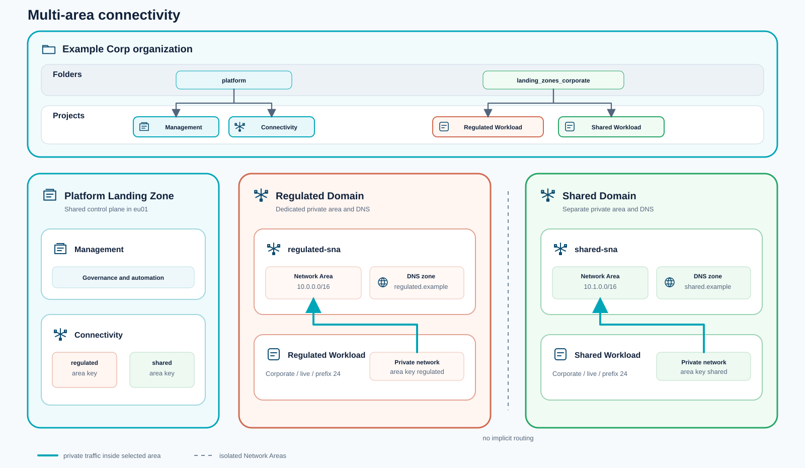
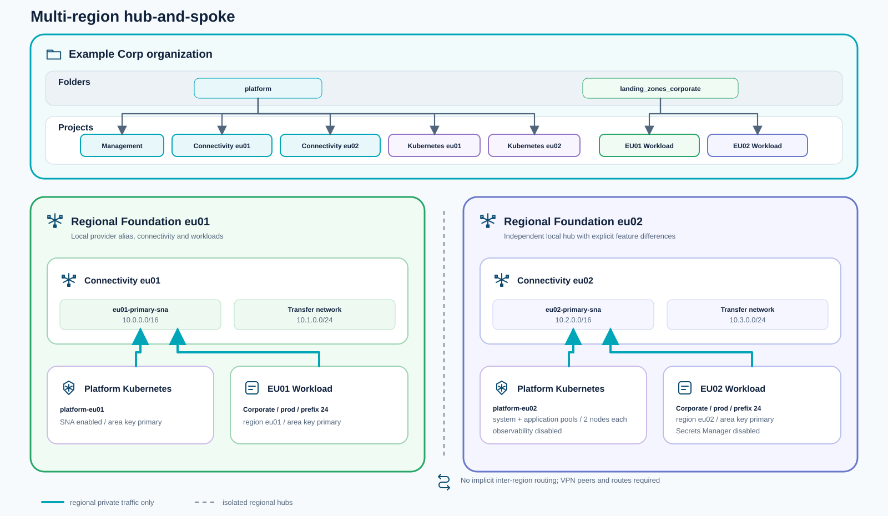
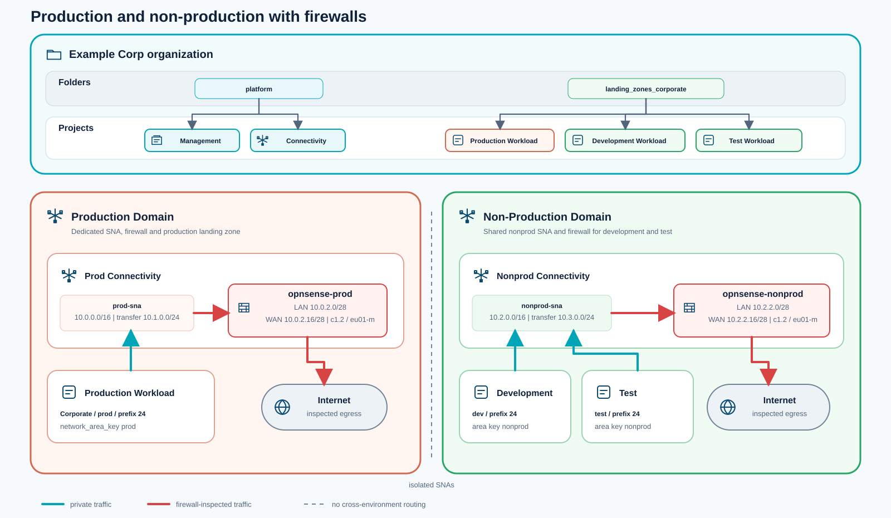
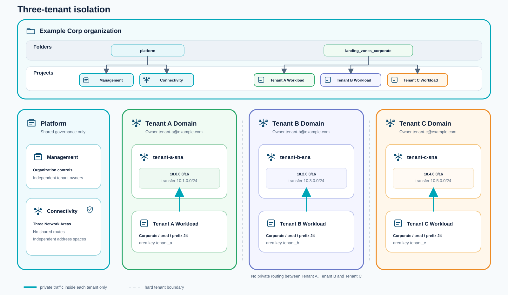

<a id="architecture"></a>
# Architektur

[English](architecture.md) | [Deutsch](architecture.de.md)

Dieses Repository ist ein produktionsbereites OpenTofu-/Terraform-Framework für die Bereitstellung einer STACKIT Landing Zone. Es provisioniert die vollständige Cloud-Grundlage: Governance-Hierarchie, Identitäts- und Zugriffsverwaltung, gemeinsame Netzwerke, optionale Firewall, DNS, Geheimnisverwaltung, Observability sowie wiederholbare Projektvorlagen pro Workload.

Alles wird aus sechs Modulen unter `src/modules/` zusammengesetzt und in `src/main.tf` verdrahtet. Ein einzelnes `terraform apply` mit einer der vollständigen Referenzkonfigurationen aus `src/config/` stellt die gesamte Plattform bereit.

<a id="two-layer-model"></a>
## Zweischichtenmodell

```
Organization
├── Platform Landing Zone   ← managed by platform team, provisioned once
│   ├── Management project  (automation, state, secrets, observability)
│   ├── Connectivity project (network hub, firewall, DNS)
│   └── DevOps project      (optional managed Git)
└── Application Landing Zones  ← one per workload/environment
    ├── Corporate LZ        (attached to shared network, routed via firewall)
    └── Public LZ           (standalone network, internet-facing)
```

Die **Platform Landing Zone** ist die unternehmensweite Grundlage. Sie wird einmal bereitgestellt und vom Plattformteam verantwortet. Sie schafft Governance-Struktur, gemeinsame Netzwerkinfrastruktur und Automatisierungswerkzeuge, auf denen alle Workloads aufbauen.

Eine **Application Landing Zone** wird einmal pro Workload und Umgebung instanziiert (z. B. `data-prod`, `api-staging`). Jede Instanz ist ein isoliertes STACKIT-Projekt mit vorbereiteten Netzwerken, RBAC, Secrets und Speicher: bereit für die Nutzung durch ein Team, ohne verbleibende Plattformentscheidungen.

<a id="modules"></a>
## Module

Alle Module liegen unter `src/modules/`. Das Root `src/main.tf` ruft sie in Abhängigkeitsreihenfolge auf.

| Modul | Ordner im Repository | Erstellte Bestandteile |
|---|---|---|
| `governance` | `src/modules/governance/` | Resource-Manager-Ordnerhierarchie, RBAC auf Organisationsebene, benutzerdefinierte Rollen |
| `management` | `src/modules/management/` | Automatisierungsprojekt: Dienstkonto, Terraform-State-Bucket, Secrets Manager, Observability |
| `connectivity` | `src/modules/connectivity/` | Netzwerk-Hub: Network Area, WAN-Routingtabelle, optionale Firewall-VM, DNS-Zonen |
| `devops` | `src/modules/devops/` | Optionales DevOps-Projekt mit verwalteter Git-Instanz |
| `landing-zone` | `src/modules/landing-zone/` | Projekt pro Workload: Netzwerk, RBAC, Secrets Manager, Object Storage, DNS-Unterzone, Routing |
| `sandboxes` | `src/modules/sandboxes/` | Leichtgewichtige Sandbox-Projekte für Experimente |
| `firewall-config` | `src/modules/firewall-config/` | Optional: Übertragung von Regeln, NAT und Internethärtung über die API an die OPNsense-Appliance |

### Governance

Erstellt die Resource-Manager-Ordnerhierarchie unter der Root-Organisation. Standardordner:

- **Platform**: übergeordneter Ordner für alle Plattformprojekte (Management, Connectivity, DevOps)
- **Landing Zones - Corporate**: übergeordneter Ordner für netzwerkverbundene Workload-Projekte
- **Landing Zones - Public**: übergeordneter Ordner für internetseitige Workload-Projekte
- **Sandboxes**: übergeordneter Ordner für kurzlebige Sandbox-Projekte

Verwaltet außerdem Rollenzuweisungen auf Organisationsebene für Eigentümer (`organization_owners`) und Auditoren mit Lesezugriff (`organization_auditors`).

Quelle: `src/modules/governance/`

### Management

Provisioniert das zentrale Automatisierungsprojekt (`<company_code>-pltfm-mgmt-prod`). Enthält:

- **Dienstkonto**: Wird von CI/CD-Pipelines zum Ausführen von Terraform verwendet. Unterstützt OIDC-Föderation (z. B. GitHub Actions), damit sich Pipelines ohne langlebige Schlüssel authentifizieren.
- **Object-Storage-Buckets**: Einer für Terraform-Remote-State, einer für allgemeine Plattformnutzung.
- **Secrets-Manager-Instanz**: Speichert Plattformgeheimnisse wie Dienstkontoschlüssel und Zugangsdaten.
- **Observability-Instanz** (optional): Zentrale Logs, Metriken und Traces mit konfigurierbarer Aufbewahrung. Aktiviert über die Variable `observability`.

Quelle: `src/modules/management/`

<a id="connectivity"></a>
### Konnektivität

Erstellt ein Netzwerk-Hub-Projekt pro konfigurierter Konnektivitätsdomäne. Jede Corporate Landing Zone wird ausdrücklich einer Domäne zugeordnet. Dies ist das komplexeste Modul.

#### Network Area

Eine STACKIT Network Area (SNA) definiert einen gemeinsamen privaten IP-Adressraum auf Organisationsebene. Netzwerke von Corporate Landing Zones in derselben SNA können sich ohne zusätzliches Peering über private IPs erreichen.

Die Konfiguration bestimmt den Adressplan der Area:

```hcl
network_area = {
  ranges                = ["10.0.0.0/16"]   # total address space
  transfer_network      = "10.255.0.0/24"   # internal STACKIT routing fabric
  min_prefix_length     = 24                # smallest subnet a landing zone may request
  max_prefix_length     = 28                # largest subnet a landing zone may request
  default_prefix_length = 25               # default if landing zone doesn't specify
}
```

<a id="multiple-network-areas"></a>
#### Mehrere Network Areas

`connectivity.network_areas` erstellt mehrere unabhängige Konnektivitätsdomänen. Es handelt sich um eine Map mit stabilen, aussagekräftigen Schlüsseln. Diese können beliebige Geschäfts-, Sicherheits-, Mandanten-, Konnektivitäts- oder Regionsgrenzen darstellen, etwa `regulated`, `tenant_a`, `private_connectivity`, `eu01` oder `eu02`. Sie sind nicht auf Entwicklungs- und Produktionsumgebungen beschränkt.

Jeder Schlüssel erstellt seine eigene SNA, sein Connectivity-Projekt, seine WAN-Routingtabelle und seine DNS-Standardwerte. Corporate Landing Zones wählen ihre Domäne mit `network_area_key`; DNS-Zonen verwenden `dns_zones.<zone>.network_area_key`. Platform Kubernetes verwendet `platform_kubernetes.<key>.network.network_area_key`. Connectivity-Projekte erhalten Labels mit der SNA-ID und dem entsprechenden Schlüssel; die Ausgaben `*_by_area` verwenden dieselben Schlüssel.

Verwenden Sie mehrere SNAs nur, wenn eine private Netzwerkgrenze erforderlich ist. Geeignete Gründe sind regulatorische Trennung, Mandantenisolation in einer gemeinsamen unternehmensweiten STACKIT-Organisation sowie Geschäftsbereiche mit unabhängigen Eigentümern, Adressplänen oder externen Konnektivitätsanforderungen. Siehe [die vollständige Regulated-/Shared-Konfiguration](../src/config/hub-and-spoke-multi-area.tfvars), [die Finance-/Research-Konfiguration](../src/config/hub-and-spoke-finance-research.tfvars) und [die Tenant-Isolation-Konfiguration](../src/config/hub-and-spoke-tenant-isolation.tfvars).

<a id="shared-services-across-snas"></a>
#### Gemeinsame Dienste über SNA-Grenzen hinweg

Ein STACKIT-Projekt kann genau einer SNA zugeordnet sein. Ein zentral betriebener privater Dienst, etwa eine interne Git-Plattform, kann daher nicht direkt sowohl an eine `prod`- als auch an eine `nonprod`-SNA angeschlossen werden. SNAs haben außerdem keinen gemeinsamen privaten Routingpfad.

Wählen Sie mehrere SNAs nur, wenn diese Einschränkung beabsichtigt ist. Gemeinsame Dienste müssen öffentliche oder SaaS-Dienste sein, die durch IAM und Netzwerkbeschränkungen geschützt werden, pro SNA dupliziert werden oder über ausdrückliche externe Endpunkte wie Site-to-Site-VPN über das Internet verbunden sein. Letzteres bringt zusätzliche Betriebs- und Sicherheitsverantwortung mit sich und muss separat entworfen und geprüft werden. Eine gemeinsame SNA mit separaten Projekten, IAM-Rollen und Subnetzzuweisungen ist meist die einfachere Wahl, wenn Workloads häufig privaten Zugriff auf dieselben Plattformdienste benötigen.

Die bisherige Eingabe `connectivity.network_area` bleibt für Einzel-Area-Bereitstellungen unterstützt und wird dem Schlüssel `default` zugeordnet. Bestehende skalare Connectivity-Ausgaben referenzieren weiterhin diese bisherige Standard-Area.

<a id="multi-region-deployments"></a>
#### Regionsübergreifende Bereitstellungen

Das Root-Modul unterstützt über statische STACKIT-Provider-Aliase eine Single-Stack-Topologie in `eu01` und `eu02`. Jede Region erhält ihren eigenen Connectivity-Hub, ihre SNA, Landing Zones und optional einen Platform-Kubernetes-Cluster; wählen Sie die Region ausdrücklich in der Konfiguration. Provider-Aliase können nicht dynamisch ausgewählt werden. Unterstützung einer weiteren Region erfordert daher einen entsprechenden Provider-Alias und regionale Modulinstanzen.

Regionale Hubs bleiben standardmäßig isoliert. Regionsübergreifende Konnektivität erfordert ausdrückliche externe VPN-Endpunkte und Routen; sie wird nicht vom Multi-Region-Szenario erstellt. Siehe [die vollständige Multi-Region-Konfiguration](../src/config/hub-and-spoke-multi-region.tfvars).

<a id="wan-routing-table"></a>
#### WAN-Routingtabelle

Eine Routingtabelle namens `wan` wird mit einer einzelnen Standardroute erstellt:

```
0.0.0.0/0 → internet
```

Dies ist die Route für ausgehenden Verkehr des WAN-Netzwerks der Firewall. Der Verkehr gelangt über das STACKIT-Standardgateway direkt ins Internet.

<a id="dns-zones"></a>
#### DNS-Zonen

Eine oder mehrere DNS-Zonen werden im Connectivity-Projekt erstellt und dienen als autoritative Zonen der Plattform. Unterzonen werden automatisch an einzelne Landing Zones delegiert. Subdomains sind bei von STACKIT bereitgestellten Domains wie .stackit.run nicht erlaubt.

Beispiel: Ist die Hub-Zone `example-corp.stackit.run.`, erhält eine Landing Zone für den Workload `data` in `prod` in der Region `eu01` die delegierte Unterzone `data-prod-eu01-example-corp.stackit.run.`.

<a id="firewall-vm-optional"></a>
#### Firewall-VM (optional)

Wenn `connectivity.firewall` gesetzt ist, wird eine VM mit OPNsense (bereitgestellt als `.qcow2`-Image) und zwei Netzwerkschnittstellen angelegt:

| Schnittstelle | STACKIT-Netzwerk | Zweck |
|---|---|---|
| `vtnet0` (WAN) | `wan_network`: mit der WAN-Routingtabelle verbunden | Ausgehender Internetverkehr, mit zugewiesener statischer öffentlicher IP |
| `vtnet1` (LAN) | `lan_network`: dediziertes privates Subnetz | Interner Next-Hop für den gesamten Verkehr der Corporate Landing Zones |

Die LAN-IP der Firewall wird als `firewall_next_hop_ip` exportiert und an jede Corporate Landing Zone übergeben, damit ihre Standardroute darauf zeigen kann. Alles, was die Plattform nach außen sendet, durchquert daher die Appliance.

Beide Schnittstellen sind DHCP-Clients und beziehen die festen, von STACKIT zugewiesenen Adressen. Das Image startet nahezu ohne Richtlinie: nur die zwei Standardregeln `allow LAN to any` (IPv4 und IPv6), keine Gateways, keine statischen Routen, kein IPsec und Outbound NAT auf `automatic`. Es filtert nichts, bis eine Richtlinie übertragen wird.

> [!WARNING]
> Nach dem ersten Apply antwortet die Web-GUI auf der öffentlichen IP dem gesamten Internet. Sie verwendet weiterhin das im Image enthaltene `root`-Passwort, das bei jeder Kopie identisch ist. Port 443 ist offen, 80 und 22 sind es nicht, und vor der WAN-Schnittstelle liegt keine Security Group. Das Übertragen der Richtlinie schließt den Zugriff; lassen Sie eine Bereitstellung deshalb nicht zwischen den beiden Applies stehen – siehe [OPNsense-Firewall konfigurieren](getting-started.de.md#configure-opnsense-firewall). Die GUI ausschließlich an die LAN-Schnittstelle zu binden (**System → Settings → Administration → Listen Interfaces**) ist die vom Regelsatz unabhängige Alternative.

<a id="high-availability-optional"></a>
#### Hochverfügbarkeit (optional)

Eine einzelne Appliance ist ein Single Point of Failure für jede Corporate Landing Zone: Sie ist deren Standardroute. Mit `connectivity.firewall.ha` wird daraus ein aktives/passives CARP-Paar.

| | Primary | Backup |
|---|---|---|
| Availability Zone | `firewall.zone` | `firewall.ha.backup_zone` (muss abweichen) |
| LAN-Adresse | `.4` von `lan_network_range` | `.5` |
| WAN-Adresse | `.4` von `wan_network_range` | `.5` |
| Öffentliche IP | eigene, statisch | eigene, statisch |
| CARP advskew | 0 (gewinnt die Wahl) | 100 |

Eine virtuelle CARP-IP im LAN – standardmäßig `.6` von `lan_network_range` – ersetzt die LAN-Adresse des Primary in der Ausgabe `firewall_next_hop_ip`. Die Landing-Zone-Routen zeigen dadurch auf die VIP statt auf einen Knoten. Bei einem Failover wechselt die VIP in etwa einer Sekunde zum überlebenden Knoten; die Routen ändern sich nie.

**CARP läuft im Unicast-Modus** (OPNsense >= 24.7). Das ist keine Präferenz: Das STACKIT-Fabric liefert Verkehr *an* die virtuelle CARP-MAC, verwirft aber Ankündigungen *von* ihr. Multicast-CARP endet deshalb in Split-Brain. Das Modul verweigert die Konfiguration eines Knotens, dessen OPNsense kein Unicast-Feld `peer` besitzt.

Zwei Dinge werden außerhalb des OPNsense-Providers übertragen, da dieser immer nur mit dem Primary kommuniziert:

- `modules/connectivity/scripts/configure-ha.sh` schreibt während des Apply die knotenspezifische Hälfte auf jede Appliance: CARP-VIP, `advskew`, pfsync-Peer und XMLRPC-Synchronisierungsziel. Das sind genau die Einstellungen, die die Konfigurationssynchronisierung nicht repliziert. Das Skript authentifiziert sich mit der Appliance-Anmeldung und funktioniert daher auch auf dem Backup, das keinen API-Schlüssel hat und nie einen benötigt.
- `modules/firewall-config/scripts/sync-ha-peer.sh` repliziert die Richtlinie nach jeder Änderung zum Backup. Die XMLRPC-Synchronisierung von OPNsense wird nur beim Speichern in der GUI ausgelöst, nie bei API-Schreibvorgängen. Ohne dies läuft auf dem Backup ein leerer Regelsatz, der Verkehr verschluckt, sobald es CARP-Master wird. Ein Failover-Test ohne Richtliniensynchronisierung maß einen Ausfall von 86 Sekunden, gegenüber etwa einer Sekunde mit Synchronisierung.

Der Alias `fw_cluster` und die Regeln `allow-fw-carp` / `allow-fw-pfsync`, die die Kommunikation der Knoten erlauben, werden bei aktiviertem HA automatisch in `firewall_config` eingefügt, mit Sequenzen 90 und 91 – vor jeder Regel der Beispielrichtlinie. Sie stehen nicht in den `.tfvars`, weil eine darüber platzierte Regel `block-lz-to-lz` die Wahl und die Zustandssynchronisierung unbemerkt unterbricht.

### Landing Zone

Wird einmal pro Workload/Umgebung über `for_each` auf der Variablen `landing_zones` instanziiert. Jede Instanz erstellt ein vollständig isoliertes STACKIT-Projekt mit:

- **STACKIT-Projekt**: Je nach Flag `corporate` unter dem Corporate- oder Public-Ordner platziert.
- **Netzwerk**: Corporate Landing Zones erhalten ein geroutetes Netzwerk an der gemeinsamen Network Area; öffentliche Landing Zones erhalten ein eigenständiges Netzwerk.
- **Routingtabelle** (nur Corporate + Firewall): Eine projektspezifische Routingtabelle mit einer einzelnen Standardroute zur LAN-IP der Firewall:
  ```
  0.0.0.0/0 → <firewall_lan_ip>
  ```
  Ohne Firewall verwenden Corporate Landing Zones Ost-West-Routing über die Network Area, verlassen die Plattform aber direkt über die WAN-Routingtabelle ins Internet.
- **RBAC**: Rollenzuweisungen für das Anwendungsteam, pro Landing Zone in der Liste `role_assignments` definiert.
- **Secrets Manager**: Isolierte Instanz für Workload-Geheimnisse.
- **Object-Storage-Buckets**: Einer für Anwendungsdaten, einer für Terraform-State.
- **DNS-Unterzone**: Von der Zone des Connectivity-Hubs delegiert (nur Hub-Spoke- und Firewall-Varianten).
- **Dienstkonto**: Auf den Workload begrenztes Dienstkonto mit rotierendem Schlüssel im Secrets Manager.

Das Flag `corporate` ist der entscheidende Schalter:

| `corporate` | Netzwerkanbindung | Standardroute | DNS |
|---|---|---|---|
| `true` | Gemeinsame Network Area | Firewall-LAN-IP (falls Firewall bereitgestellt), sonst Internet über WAN-Tabelle | Vom Hub delegierte Unterzone |
| `false` | Eigenständiges Netzwerk | Direkt ins Internet | Keine DNS-Delegation |

Quelle: `src/modules/landing-zone/`

<a id="landing-zone-on-kubernetes"></a>
### Landing Zone auf Kubernetes

Jeder Eintrag in `landing_zone_namespace_services` erhält einen Mandantenbereich des gemeinsamen Plattformclusters: einen eigenen Namespace, ein begrenztes Dienstkonto mit einer auf diesen Namespace beschränkten Role und optional eine Kyverno-Richtlinie, die direkte Secret-Verwaltung blockiert, sodass Zugangsdaten über den Secrets Manager kommen müssen.

Der Beispiel-Workload hinter `sample_load` ist Demomaterial und nicht Teil des Landing-Zone-Vertrags. Er stellt einen Pod, eine Gateway-API-Route und einen DNS-Eintrag bereit, die gemeinsam den funktionierenden Pfad aus dem Internet zu einem Namespace belegen. Entfernen Sie ihn, sobald echte Workloads einziehen.

Quelle: `src/_landing-zone-kubernetes.tf`, `src/modules/namespace-service-demo/`

<a id="devops-optional"></a>
### DevOps (optional)

Provisioniert ein separates DevOps-Projekt (`<company_code>-pltfm-devops-prod`) mit einer verwalteten Git-Instanz (Gitea oder gleichwertig, gesteuert durch `git_flavor`). Der Netzwerkzugriff kann über `allowed_network_ranges` auf bestimmte CIDR-Bereiche eingeschränkt werden. Standardmäßig deaktiviert; Aktivierung durch Setzen der Variablen `devops`.

Quelle: `src/modules/devops/`

<a id="sandboxes-optional"></a>
### Sandboxes (optional)

Provisioniert ein oder mehrere leichtgewichtige STACKIT-Projekte unter dem Sandboxes-Ordner für Experimente und PoCs. Jede Sandbox ist ein minimales Projekt mit Eigentümer: keine gemeinsamen Netzwerke oder Plattformintegration. Nützlich zum Testen vor der Übernahme von Workloads in eine vollwertige Landing Zone.

Quelle: `src/modules/sandboxes/`

<a id="deployment-flavors"></a>
## Bereitstellungsvarianten

Vollständige Referenzkonfigurationen stehen in `src/config/` bereit. Die folgenden Diagramme konzentrieren sich bewusst auf Topologiegrenzen, Verkehrswege und die Projekte, die Nutzer erhalten, statt auf jede provisionierte Ressource. Wählen Sie die Konfiguration passend zu Ihren Netzwerk- und Isolationsanforderungen; [Erste Schritte](getting-started.de.md#deployment-flavours) beschreibt die Bereitstellung.

### Standalone

Die einfachste Konfiguration. Sie provisioniert Governance, Management, eine Sandbox und eine öffentliche Landing Zone mit unabhängigem Netzwerk. Es werden weder gemeinsame Network Area noch Connectivity-Hub erstellt.



Konfiguration: [`standalone.tfvars`](../src/config/standalone.tfvars)

### Hub-Spoke

Ergänzt einen Connectivity-Hub mit gemeinsamer Network Area und zentralem DNS. Die Corporate Data Platform tritt der privaten Area bei, während die öffentliche API-Landing-Zone ein unabhängiges Netzwerk behält.



Konfiguration: [`hub-and-spoke.tfvars`](../src/config/hub-and-spoke.tfvars)

### Hub-Spoke + Firewall

Erweitert die Hub-Spoke-Topologie um eine OPNsense-Firewall. Corporate-Verkehr verwendet die Appliance für zentrale Inspektion und konsistenten Egress, während die öffentliche Landing Zone direkt angebunden bleibt.



Konfiguration: [`hub-and-spoke-firewall.tfvars`](../src/config/hub-and-spoke-firewall.tfvars)

### Finance + Research

Erstellt unabhängige private Konnektivitätsdomänen für zwei Geschäftsbereiche derselben Organisation. Jeder Bereich hat einen eigenen Eigentümer, Adressplan, ein Connectivity-Projekt, eine Network Area und eine Workload-Landing-Zone.



Konfiguration: [`hub-and-spoke-finance-research.tfvars`](../src/config/hub-and-spoke-finance-research.tfvars)

### Multi-Area

Trennt regulierte und gemeinsam genutzte Workloads in unterschiedliche Network Areas und DNS-Zonen. Zwischen den beiden privaten Domänen gibt es kein implizites Routing.



Konfiguration: [`hub-and-spoke-multi-area.tfvars`](../src/config/hub-and-spoke-multi-area.tfvars)

### Multi-Region

Erstellt unabhängige regionale Hubs in `eu01` und `eu02`, jeweils mit eigener Network Area, Workload-Landing-Zone und Platform-Kubernetes-Cluster. Regionsübergreifende Konnektivität ist bewusst nicht implizit.



Konfiguration: [`hub-and-spoke-multi-region.tfvars`](../src/config/hub-and-spoke-multi-region.tfvars)

### Prod / Nonprod + Firewalls

Trennt Produktion und Nichtproduktion in unabhängige Network Areas mit dedizierten OPNsense-Firewalls. Entwicklung und Test teilen die Nichtproduktionsdomäne, bleiben aber separate Landing Zones.



Konfiguration: [`hub-and-spoke-prod-nonprod-firewall.tfvars`](../src/config/hub-and-spoke-prod-nonprod-firewall.tfvars)

### Tenant Isolation

Erstellt drei private Mandantendomänen innerhalb einer Organisation. Jeder Mandant erhält eine dedizierte Network Area, einen Adressplan, eine Workload-Landing-Zone und einen Eigentümer ohne privates Routing zu den anderen Mandanten.



Konfiguration: [`hub-and-spoke-tenant-isolation.tfvars`](../src/config/hub-and-spoke-tenant-isolation.tfvars)

<a id="network-topology"></a>
## Netzwerktopologie

Die acht Bereitstellungsvarianten bauen auf drei grundlegenden Netzwerkmodi auf. Diese unterscheiden sich darin, was das Connectivity-Modul bereitstellt und wie Landing-Zone-Verkehr geroutet wird.

### Standalone

Kein Connectivity-Modul. Jede Landing Zone hat ein unabhängiges Netzwerk mit direktem Internetzugang. Kein gemeinsamer IP-Adressraum, keine private Ost-West-Konnektivität, keine DNS-Föderation.

```
[LZ Project A]──internet
[LZ Project B]──internet
```

### Hub-Spoke

Das Connectivity-Modul stellt eine Network Area und eine WAN-Routingtabelle bereit. Alle Corporate Landing Zones treten der Network Area bei und können sich über private IPs erreichen. Die Standardroute ist die WAN-Routingtabelle (Internet-Egress ohne Inspektion).

```
[LZ Corporate A] ──┐
[LZ Corporate B] ──┤── Network Area (10.0.0.0/16) ──── internet (WAN table)
[LZ Corporate C] ──┘
[LZ Public D]   ──── standalone ──── internet
```

### Hub-Spoke + Firewall

Erweitert Hub-Spoke: Eine Firewall-VM befindet sich im Connectivity-Projekt. Jede Corporate Landing Zone leitet den gesamten Verkehr (`0.0.0.0/0`) über die LAN-IP der Firewall. Die WAN-Schnittstelle der Firewall besitzt eine statische öffentliche IP für eine konsistente Egress-Identität.

```
[LZ Corporate A] ──┐  routing: 0.0.0.0/0 → 10.0.0.4 (firewall LAN)
[LZ Corporate B] ──┤── Network Area (10.0.0.0/16) ──→ [Firewall VM]
[LZ Corporate C] ──┘                                    vtnet1 (LAN) 10.0.0.4
                                                         vtnet0 (WAN) ──→ internet
                                                                         (static public IP)
[LZ Public D]   ──── standalone ──── internet
```

Verkehrsfluss für eine Corporate Landing Zone (Firewall-Variante):

1. Eine VM in der LZ sendet ein Paket an ein beliebiges Ziel.
2. Der Routingtabelleneintrag `0.0.0.0/0 → 10.0.0.4` leitet es an die LAN-Schnittstelle der Firewall (`vtnet1`) weiter.
3. Die Firewall prüft das Paket und führt NAT über `vtnet0` (WAN) unter Verwendung der statischen öffentlichen IP aus.
4. Antwortverkehr erreicht die öffentliche IP; die Firewall übersetzt zurück und liefert an die ursprüngliche VM.

Ost-West-Verkehr zwischen Corporate LZs bleibt innerhalb der Network Area und kann durch Firewallrichtlinien erlaubt oder verboten werden.

<a id="site-to-site-vpn-optional"></a>
## Site-to-Site-VPN (optional)

Jede Hub-Spoke-Variante kann ein IPsec-VPN im Connectivity-Projekt terminieren und so die Network Area mit lokalen Systemen oder einer anderen Cloud verbinden. Aktivieren Sie es über den Block `connectivity.vpn` – siehe das auskommentierte Beispiel in `src/config/hub-and-spoke.tfvars`.

Das Gateway ist hochverfügbar: Es betreibt zwei Tunnel in separaten Availability Zones mit jeweils eigener öffentlicher IP. Da beide Seiten die Adresse der anderen benötigen, erfolgt die Einführung in zwei Applies: Provisionieren Sie das Gateway mit `connections = {}`, lesen Sie `tofu output connectivity_vpn_public_ips`, konfigurieren Sie den entfernten Peer und ergänzen Sie dann die Verbindung.

Pre-Shared Keys bleiben außerhalb des Konfigurationsobjekts in der separaten Variablen `vpn_pre_shared_keys`, damit die Tunneltopologie weiterhin commitbar ist:

```bash
export TF_VAR_vpn_pre_shared_keys='{"onprem"={"tunnel1"="<20+ chars>","tunnel2"="<20+ chars>"}}'
```

Routen zu entfernten Präfixen werden automatisch über die Network Area verteilt, sodass jede Corporate Landing Zone den entfernten Standort ohne Konfiguration pro Spoke erreicht.

<a id="what-goes-through-the-firewall"></a>
### Welcher Verkehr durch die Firewall fließt

In der Firewall-Variante laufen zwei der vier Verkehrsrichtungen sauber durch die Appliance. Keine VPN-Richtung lässt sich mit dem verwalteten Gateway filtern: Eine wird beim Versuch unterbrochen, die andere lässt sich überhaupt nicht umleiten.

| Richtung | Durch die Firewall? | Mechanismus |
|---|---|---|
| LZ → Internet | Ja, standardmäßig | Die Standardroute der Landing-Zone-Routingtabelle zeigt auf die LAN-Adresse der Firewall. Benötigt zusätzlich einen `outbound_nat`-Eintrag; andernfalls erreicht Verkehr die Appliance und endet dort. |
| LZ → LZ | Ja, standardmäßig | `system_routes = false` unterdrückt Projekt-zu-Projekt-Routen, sodass Spoke-zu-Spoke auf die Standardroute fällt. Benötigt eine statische Route zurück in die Network Area; andernfalls verlässt der Verkehr die Appliance über WAN, und Egress-NAT schreibt die Quelladresse um. |
| LZ → on-premises (VPN) | **Nein** | Das VPN-Präfix hat Vorrang vor `0.0.0.0/0` und umgeht daher die Appliance. |
| on-premises → LZ (VPN) | **Nein** | Direkte Lieferung an den Spoke über die von STACKIT verwaltete Routingtabelle. Nicht umleitbar. |

Eingehender VPN-Verkehr umgeht die Appliance, weil `static_routes` einer VPN-Verbindung als *dynamische* Routen über die Network Area verteilt werden und ein entferntes Präfix immer spezifischer als `0.0.0.0/0` ist. Das VPN-Gateway selbst leitet über eine von STACKIT verwaltete Routingtabelle weiter, die weder geändert noch neu zugewiesen werden kann.

> [!WARNING]
> `dynamic_routes = false` behebt die ausgehende Richtung nicht, sondern unterbricht sie. Ausgehender Verkehr läuft dann durch die Firewall, während eingehender sie weiterhin umgeht; der zustandsbehaftete Filter verwirft den einseitigen Verkehr, den er sieht.

Wenn VPN-Verkehr geprüft werden muss, terminieren Sie den Tunnel auf der OPNsense-Appliance selbst statt auf dem verwalteten Gateway. Sie ist bereits die Standardroute jeder Corporate Landing Zone, sodass beide Richtungen symmetrisch bleiben. Der Preis dafür ist der Verlust der aktiven/aktiven HA des verwalteten Gateways.


<a id="resource-naming"></a>
## Ressourcenbenennung

Alle Ressourcen folgen einer einheitlichen, durch `company_code` gesteuerten Konvention:

```
<company_code>-<layer>-<component>-<env>
```

| Beispielname | Bedeutung |
|---|---|
| `exc-pltfm-mgmt-prod` | Management-Projekt |
| `exc-pltfm-hub-prod` | Connectivity-(Hub-)Projekt |
| `exc-pltfm-devops-prod` | DevOps-Projekt |
| `exc-lz-data-prod` | Application Landing Zone für Workload `data` in `prod` |
| `exc-sbx-*` | Sandbox-Projekte |

`exc` ist der `company_code` aus der Beispielkonfiguration. Ersetzen Sie ihn durch das Kürzel Ihrer Organisation.
