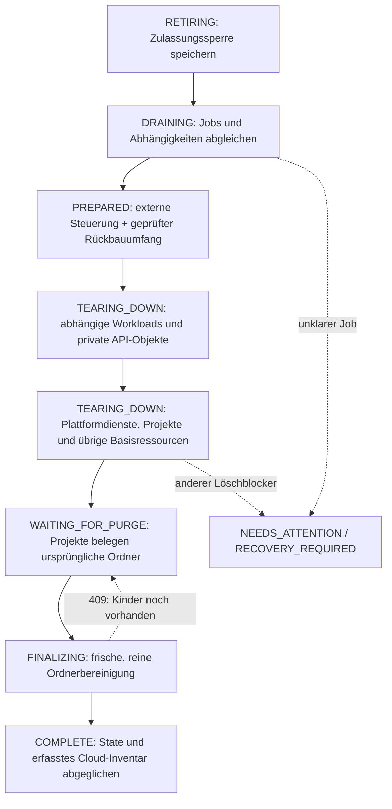

# Gestufter Destroy und Rückbau von Landing Zones

[English](destroy-lifecycle-concept.md) | [Deutsch](destroy-lifecycle-concept.de.md)

Status: Architekturvorschlag, am 2026-11-23 anhand der aktuellen Quellen geprüft.
Abgestimmte Richtung: gestufter Rückbau mit sofortiger Sperre für Neuanlagen und
späterer Ordnerbereinigung. Projekte bleiben in ihren ursprünglichen Ordnern.
Dieses Dokument implementiert weder Destroy-Befehl, Workflow, API oder
Berechtigungsänderung noch eine Cloud-Operation. Bezug:
[Accelerator #22](https://github.com/stackitcloud/stackit-landing-zone/issues/22)
und [Provider #1075](https://github.com/stackitcloud/terraform-provider-stackit/issues/1075).

## 1. Empfehlung und aktuelle Grenze

Destroy wird als dauerhaft nachverfolgbarer Lebenszyklus behandelt, nicht als ein
einziger synchroner Befehl. Freigegebene Ressourcen abbauen, Projektlöschung
anstoßen, den Bereinigungsnachweis während der endgültigen STACKIT-Löschung
aufbewahren und anschließend die ursprünglichen Ordner entfernen. Zwischen den
Phasen wird der Job-Container freigegeben; kein Runner wartet mehrere Tage.

[STACKIT dokumentiert](https://docs.stackit.cloud/platform/resource-manager/how-tos/delete-folders/),
dass Projekte die Ordnerlöschung noch bis zu sieben Tage blockieren können. Das
Provider-Issue ist weiterhin offen; die
[letzte Antwort des Teams](https://github.com/stackitcloud/terraform-provider-stackit/issues/1075#issuecomment-6012663511)
kündigt weitere Arbeiten ohne verbindlichen Liefertermin an. Das ist eine
API-Grenze, keine durch ein Provider-Upgrade zugesicherte Korrektur der Reihenfolge.

„Soft deleted“ bedeutet hier, dass das Projekt beziehungsweise sein Container noch
auf die endgültige Entfernung wartet. Daraus folgt **keine** Wiederherstellbarkeit:
Die [Projektlöschungs-Dokumentation](https://docs.stackit.cloud/platform/resource-manager/how-tos/delete-a-project/)
beschreibt den Vorgang als unumkehrbar; der Ressourcenabbau beginnt sofort.
Weder sieben verstrichene Tage noch ein leerer Terraform-State beweisen den Abschluss.

Verschieben von Projekten, Quarantäneordner, automatische Wiederherstellung,
Force-Purge-Abkürzungen, mehrtägiges `time_sleep` und das Vergessen noch vorhandener
Ressourcen im State sind nicht Teil der Lösung. Die ursprüngliche Hierarchie bleibt
während der Wartephase erhalten.

## 2. Bereits vorhanden und noch zu entwickeln

Der Configurator unterstützt bereits den Application-Plan-Zweck `destroy`.
Solche Pläne dürfen keine Create-, Update- oder Replace-Aktionen enthalten. Eine
gesonderte Bestätigung bindet die Ausführung an Instanz und gespeichertes Artefakt.
Siehe [Application-Ausführung](../landing-zone-configurator/docs/application-execution-lifecycle.de.md)
und [Service](../landing-zone-configurator/app/apps/api/src/applications/service.ts).
Das ist noch kein vollständiger, State-übergreifender Plattformrückbau mit
Nachverfolgung der endgültigen Cloud-Löschung.

Der native Root kombiniert Governance-Ordner und Organisations-IAM mit Management,
Connectivity, Plattformdiensten und optionalen Workload-Projekten. Application-
Bestellungen können separate States besitzen. Das Management-Modul erzeugt außerdem
State-Bucket, Zugangsdaten und Secrets Manager. Ein einzelner Ressourcengraph beschreibt
somit weder alle externen Application-Abhängigkeiten noch garantiert er das Überleben
seines eigenen Backends.

Der gepinnte Provider ist `0.114.0`. Seine
[Folder-Delete-Implementierung](https://github.com/stackitcloud/terraform-provider-stackit/blob/v0.114.0/stackit/internal/services/resourcemanager/folder/resource.go)
ruft die API auf und meldet einen Fehler bei nicht leerem Ordner. Seine
[Project-Read-Implementierung](https://github.com/stackitcloud/terraform-provider-stackit/blob/v0.114.0/stackit/internal/services/resourcemanager/project/resource.go)
entfernt ein Projekt bei einer Forbidden-Antwort aus dem State. Die Koordination muss
daher Berechtigungsverlust, versteckte Projekte und tatsächliche Abwesenheit
unterscheiden; der State allein reicht als Löschinventar nicht aus. Auch im für
dieses Konzept geprüften Provider-`main` besteht die Ordnergrenze weiterhin.

Alle folgenden Lebenszyklusnamen, UI-Aktionen und Hilfswerkzeuge sind Vorschläge.
Der native Accelerator bleibt ohne Configurator, Anwendungsdatenbank,
kundenseitigen Git-Dienst oder gehostetes SaaS-Konto nutzbar.

## 3. Umfang, Zuständigkeit und sofortige Sperre

Unterstützt werden sollen einzelne Application-Instanzen, eine Platform Landing
Zone einschließlich ihrer abhängigen Applications sowie ausdrücklich ausgewählte
Test-/Demo-Batches. Eine dauerhaft gebundene Deployment-Identität mit Organisation
und State-Zuordnung bestimmt das Ziel, nicht allein Name oder Präfix. Die Sperre
gilt für diese Landing Zone über alle veröffentlichten Plattformrevisionen,
Templates, Konfigurationen und Workspaces hinweg. Andere Landing Zones derselben
Organisation werden dadurch nicht gesperrt.
Die bestehende Organisation selbst gehört nicht zum Löschumfang.

**Der Start des Rückbaus setzt das Ziel zuerst atomar auf `RETIRING`.** Dies erfolgt
vor dem Warten auf einen Löschplan oder externen Job. Eine monoton steigende
Sperrgeneration und der autorisierte Rückbauauftrag werden gespeichert. Jede weitere
Zulassung und jeder Dispatch prüft den aktuellen Lebenszyklus und die Generation
der übergeordneten Plattform, auch über direkte API- und Datenbankzugänge. Eine
Sperre im Browser reicht nicht.

| Operation nach der Sperre | Regel |
| --- | --- |
| Neue Application-Bestellung oder Projektanlage | Ablehnen, auch über alte veröffentlichte Templates und direkte API-Aufrufe |
| Dienste, Ressourcen, Regionen, Kapazität oder Application-Instanzen ergänzen | Ablehnen, auch bei wartenden Assistant-Vorschlägen und Konfigurationsimporten |
| Neuer Anlage-/Erweiterungsplan, normaler Apply, Upgrade oder bereits freigegebener Erweiterungsplan | Ablehnen; ungenutzte Freigaben ungültig machen und wartenden Dispatch verhindern |
| Status lesen, Nachweise prüfen, Daten exportieren, Löschung beobachten | Innerhalb aktueller Berechtigungen erlauben |
| Freigegebener Rückbau erfasster Ressourcen | Über frische, begrenzte Ausführungsfreigabe erlauben |
| Recovery nach unterbrochenem Job | Prüfung, belegten Stopp, Übernahme vorhandener Ressourcen und sicheren State-Abgleich erlauben; keinen impliziten Apply mit Neuanlagen |
| Konfiguration löschen, Bestellung archivieren oder Workspace entfernen | Darf Sperre und Bereinigungsverpflichtungen nicht entfernen oder freigeben |

Die erneute Prüfung erfolgt bei Bestellanlage, Queue-Zulassung, Ticket-Ausstellung,
Zugangsdatenfreigabe und unmittelbar vor der Ausführung. Ein altes gültiges Artefakt,
Ticket, Template-Abbild oder eine Ausführungsquellenbindung umgeht die Sperre nicht.
Die Plattformzuordnung kommt aus der gespeicherten Bindung und nicht aus frei
übergebenen Aufrufparametern. Auch erfasste Cloud-Eltern-IDs und die ursprüngliche
State-Identität indizieren: Eine Konfigurationskopie oder umbenannte Bindung darf
die Sperre desselben Ziels nicht umgehen. Ausdrücklich lesende Drift-Beobachtung
ist von der Zulassung eines neuen Anlage-/Erweiterungsplans zu unterscheiden.
Eine vom Aufrufer übergebene Phase oder ein Destroy-Flag ist keine Autorisierung:
Die Koordination leitet die zulässige Phase aus dem gespeicherten Auftrag ab und
prüft die tatsächlichen Planwirkungen gegen dessen erfasste Ressourcenidentitäten.

Ein unmittelbar vor der Sperre zugelassener Job muss im Inventar erscheinen.
Unbenutzte Dispatches werden abgebrochen, unbenutzte Tickets widerrufen. Bereits
laufende Schreibvorgänge führen zu `DRAINING`: quellgebundenen sicheren Stopp oder
expliziten Betreiberabgleich anfordern und bereits abgeschlossene Cloud-Operationen
feststellen. Ein schon ausgelöster Cloud-API-Aufruf lässt sich nicht nachträglich
durch ein Datenbankfeld zurücknehmen. Vollständiger Stillstand wird erst nach Prüfung
des Runners und seiner tatsächlichen Auswirkungen zugesichert. Unklare Jobs und
Recovery-Sperren verhindern die erste Löschphase; kein erzwungenes Unlock.

Sperre und Bestell-/Dispatch-Zulassung müssen über dieselbe gespeicherte
Plattformschranke serialisieren. Die Lock-Reihenfolge ist gegen bestehende Quota-,
Publikations-, Instanz- und Ausführungssperren zu prüfen und mit Race-Tests
abzusichern. Keine SQL-Transaktion und keine Runner-Reservierung bleibt während der
Purge-Wartezeit geöffnet.

Im eigenständigen Betrieb stellt der Betriebsprozess dieselbe Schranke her:
automatische Bestell-/Apply-Ausführung für das gewählte Deployment deaktivieren,
Rückbaumanifest verwenden und pro State genau einen freigegebenen Schreiber zulassen.
Ein Administrator mit unabhängigen Cloud-Zugangsdaten kann diesen Prozess trotzdem
umgehen. Optionale IAM-Anpassungen sind gezielt zu prüfen; Organisationsrechte werden
nicht pauschal entfernt.

## 4. Inventar und überlebende Steuerungsressourcen

Vor dem Löschen entsteht außerhalb des Ziels ein dauerhaftes Manifest mit:

- Deployment-/Organisationsidentität, gewählten States samt Lineage, Serial und
  Backend-Referenzen sowie exakten Projekt-UUIDs, Projekt-Container-IDs und
  Ordner-UUIDs/Container-IDs.
- Ursprünglichen Elternbeziehungen, nativen Ressourcenadressen, Eigentums-/Importstatus,
  Quell- und Provider-Lockfiles, Regionen/SNAs und State-übergreifenden Abhängigkeiten.
- Aktiven Bestellungen, Jobs und Tickets, geteilten Diensten sowie anderweitig
  verwendeten Organisations-IAM-Zuweisungen.
- Aufzubewahrenden Daten, Backups, Objektversionen, Object Lock/Aufbewahrung,
  benötigten Secrets, externem DNS/Delegation und einer berechtigten Löschidentität.
- Freigegebenem Umfang, Sperrgeneration, Phasenartefakten, Löschbeobachtungen,
  Fehlern, Versuchen und einer signierten beziehungsweise gehashten Nachweiskette.
  Normale Oberfläche und Logs enthalten keine Geheimnisse.

Präfixe und Test-Labels helfen beim Finden, berechtigen aber nicht zum Löschen aller
Treffer. Unbekannte/fremde Kindressourcen und Ressourcen in mehreren States brauchen
Prüfung. Insbesondere Organisationsrollen können auch andere Landing Zones benötigen;
ein State-Eintrag belegt keine exklusive Zuständigkeit.

Backend, Zugangsdaten, State-Entschlüsselungsmaterial, Löschidentität und Nachweise
müssen bis nach der letzten Ordnerbereinigung überleben. Liegen sie im Management-
oder einem anderen ausgewählten Projekt, zunächst in eine freigegebene externe
Steuerungsumgebung migrieren und Wiederherstellung sowie Lese-/Schreibzugriff prüfen.
Das ist eine gesondert geprüfte Backend-/State-Migration, keine unverschlüsselte
Zwischenkopie und kein Import in einen zweiten gleichzeitig aktiven State.
Die Löschidentität darf nicht ausschließlich von IAM-Zuweisungen abhängen, die der
Destroy selbst entfernt. Der ursprüngliche Bootstrap-Service-Account ist nicht
zwangsläufig noch vorhanden.

Bucket-Inhalte, Versionen, Aufbewahrung und bewusst gesetzte Schutzmechanismen bleiben
maßgeblich. Weder `force_destroy`, Governance-Retention-Bypass, Schlüsselwiderruf noch
Entfernen eines Projekt-Compliance-Locks werden automatisch eingeschaltet.
Ausnahmen und aufzubewahrende Ressourcen entscheidet der Owner ausdrücklich, nicht
ein allgemeines Destroy-Häkchen. Benötigt eine aufzubewahrende Ressource weiterhin
ihr Projekt, bleibt auch dessen endgültige Projekt-/Ordnerlöschung ausgenommen.

## 5. Phasen und Reihenfolge über mehrere States



1. **Abhängigkeiten stilllegen.** Neue Application-Zulassungen sofort schließen.
   Vorhandene Application-States und externe Verbraucher erfassen. Der Platform Owner
   prüft ihre Einbeziehung oder ausdrückliche Entkopplung/Aufbewahrung; das
   Zurückziehen eines Templates allein entfernt keine Verbraucher.
2. **Abhängige Workloads abbauen.** Namespaces/Helm und andere private Provider-Objekte
   entfernen, solange ihre APIs, Zugangsdaten, Routen, DNS und Ausführungsumgebung
   noch verfügbar sind. Applications und ihre States vor der gemeinsam genutzten
   Plattform abbauen.
3. **Plattformressourcen entfernen und Projektlöschung anstoßen.** Auch native
   Workload-Projekte, zentrales Git, Observability und andere ausgewählte Dienste
   einbeziehen. Connectivity und private Runner erst nach dem letzten abhängigen
   privaten API-Zugriff entfernen. Jede SNA/Region ist eine eigene Abhängigkeitsdomäne.
4. **Außerhalb des Executors warten.** Projektlöschaufträge und Beobachtungen speichern.
   Kein belegter Job-Container, dauerhaft wartender GitHub-Runner oder Sieben-Tage-
   Sleep. Ein Executor mit Zugriff auf öffentliche APIs kann später Ordner bereinigen,
   wenn keine privaten APIs mehr benötigt werden.
5. **Ursprüngliche Ordner abschließen.** Frischen Plan beziehungsweise Löschvorgang
   ausschließlich für die erfassten Ordneridentitäten verwenden; gegebenenfalls
   Kinder vor Eltern. Umfang, Rechte, State und verbliebenen Steuerungszugriff erneut
   prüfen. Ursprüngliche Adressen und IDs erhalten.
6. **Nachweis schließen.** Finalen State und erfasste Cloud-Ressourcen abgleichen,
   erforderliche Nachweise behalten und erst dann gesondert freigegebene temporäre
   Steuerungsressourcen entfernen. Secrets erst nach ihrer letzten Betriebs- und
   Recovery-Verwendung beseitigen.

Management darf das zum Abschluss benötigte Backend nicht selbst zerstören.
Dasselbe gilt für ein zentrales Git oder einen kundenseitig installierten Configurator
als einzigen Rückbaukoordinator: Vor dessen Entfernung eine unabhängige Übergabe
exportieren und prüfen. Das Hosting des SaaS-Configurators gehört nicht zum Destroy
einer kundenseitigen Landing Zone.

## 6. Praktischer Workaround für vorhandene Test-/Demo-Umgebungen

Dies ist ein betreuter Betriebsweg mit dem aktuellen API-Verhalten, keine neu
bereitgestellte automatische Phasensteuerung:

1. Kandidaten nach tatsächlichem State und Zuständigkeit gruppieren. Alle erfassten
   Projekt- und Ordner-IDs **vor** dem ersten Destroy sichern, auch bereits auf
   `DELETING` stehende Projekte.
2. Neuanlagen/Automatisierung schließen und laufende Jobs abgleichen. Im eigenständigen
   Betrieb bleibt diese Sperre organisatorisch, bis ein natives Hilfswerkzeug existiert.
3. Externes Backend samt Recovery-Kopie, unabhängige Löschidentität sowie Daten- und
   gemeinsame Ressourcennutzung prüfen. Anhalten, wenn das Ziel noch seinen einzigen
   State oder Schlüssel beherbergt.
4. Mit ursprünglicher kompatibler Quelle und Provider-Lockfile einen vollständigen
   Destroy-Plan für den gewählten State prüfen und genau dieses Artefakt nach Freigabe
   anwenden. Einen teilweise abgebauten Stand nicht mit normalem Apply „reparieren“.
5. Liefert die Ordnerlöschung wegen noch nicht endgültig entfernter Projekte den
   bekannten Kindressourcen-Konflikt, Teil-State und Nachweise behalten. Der native
   Befehl ist weiterhin fehlgeschlagen; sein Exit-Code wird nicht als Erfolg umgedeutet.
   Den übergeordneten Rückbau erst dann als wartend klassifizieren, **wenn tatsächlich
   nur die erwarteten erfassten Ordneraktionen übrig sind**, nicht weitere fehlgeschlagene
   Dienst-, IAM-, Storage- oder Netzwerklöschungen.
6. Verbleibende Projekte/Ordner mit unabhängigem berechtigtem Zugriff beobachten.
   Später einen frischen Destroy-Plan gegen den aktuellen Teil-State erzeugen und
   prüfen. Ausschließlich dieselben noch vorhandenen, nun leeren Ordner abschließen.
   Keinen veralteten Plan wiederverwenden, keine Projekte neu anlegen oder verschieben
   und keine noch zu bereinigenden Ordner aus dem State entfernen.
7. Eine Landing Zone erst nach Cloud-Bereinigung und State-Abgleich schließen. Bei
   Überschreiten des dokumentierten Zeitraums samt vereinbarter Toleranz oder
   ausbleibendem Fortschritt die exakten, nicht geheimen IDs, Status und Request-
   Referenzen an STACKIT eskalieren. Ein künftiger API-Fix oder Support-Eingriff ist
   keine heute zugesicherte Purge-API für Kunden.

Erfolgreich abgebaute Dienste können damit bereits entfernt sein, während Ordner
noch warten. Das verspricht weder sofortiges Abrechnungsende noch die Beendigung
aller Dienste bei Annahme des Projekt-DELETE. Verbliebene Dienste separat prüfen.
Andernorts bereits angestoßene Projektlöschung kann veraltete Ressourcen im State
oder nicht mehr erreichbare Provider-Endpunkte hinterlassen. Kann der ursprüngliche
Root nicht mehr aktualisieren/planen, anhalten und einen geprüften kompatiblen
Cleanup-Adapter/State-Abgleich vorbereiten. Kein Verdecken mit `-refresh=false`,
pauschalem `state rm` oder unbekannten Imports.

### 6.1 Eigenständige Installationen: ein State, zwei Terraform-/OpenTofu-Phasen

Eine ursprünglich ohne Configurator angelegte Installation muss zum Rückbau nicht
in diesen importiert werden. Ihre vorhandene native Konfiguration, Provider-Lockfile,
tfvars und der maßgebliche State sind die Ausgangsbasis. Weder Anwendungsdatenbank,
neuer API-Dienst, STACKIT CLI noch ein zweiter State sind grundsätzlich nötig.
Benötigt werden eine kompatible phasenspezifische HCL-Konfiguration und ein
organisatorischer Betriebsablauf.

Der normale Plan vergleicht Konfiguration und State; ein gespeicherter Plan kann
anschließend ausdrücklich angewendet werden. Siehe
[Terraform Plan](https://developer.hashicorp.com/terraform/cli/commands/plan),
[Terraform Apply](https://developer.hashicorp.com/terraform/cli/commands/apply) und
[OpenTofu Plan](https://opentofu.org/docs/cli/commands/plan/). Diesen Mechanismus nutzen:

| Schritt | HCL-Sollkonfiguration | Prüfkriterium |
| --- | --- | --- |
| Sperre und Vorbereitung | Ursprüngliche Quelle sichern; Rückbau dokumentieren und alle anderen Schreiber stoppen | Richtiger State/Backend, unabhängiger Operator und erfasste Cloud-IDs; abhängige Application-States berücksichtigt |
| Phase A: Ressourcen/Projekte | Gewählte Workloads und Projekte aus der Sollkonfiguration entfernen; ursprüngliche Ordnerdeklarationen und nötigen Bereinigungszugriff behalten | Nur freigegebene Löschungen; keine Ordnerlöschung, Neuanlage, Änderung oder Ersetzung; gleiche Ordneradressen/IDs |
| Warten | Phase-A-Konfiguration und letzten Teil-State behalten; nicht zur aktiven Konfiguration zurückwechseln | Keine normalen Erweiterungen/Applies anderer Operatoren; Purge nachverfolgen, nicht aus fehlendem State-Eintrag ableiten |
| Phase B: Ordner | Frischen Destroy-Plan für den zulässigen Rest erzeugen | Nur erfasste leere Ordner und exklusiv zugeordnete, freigegebene Governance-Reste; keine geteilten/aufzubewahrenden Ressourcen oder benötigtes Backend im Löschumfang |

Projektdeklarationen nicht einfach entfernen und dabei ungültige Modul-Outputs,
Provider-Aliase oder Dienst-Provider-Anmeldung zurücklassen. Native Module mit heute
unbedingt angelegtem Management und anderen Basisdiensten müssen gezielt angepasst
werden. Für bestehende Objekte benötigte Provider und Zugangsdaten bis zu deren
letzter Löschung erhalten. Objekte privater APIs können einen vorgelagerten Teilschritt
vor der Projektentfernung verlangen. Das bleibt Phase A und rechtfertigt keine frühe
Ordnerlöschung.

Das Folgende ist ein **Befehlsmuster nach Erstellung und Prüfung einer kompatiblen
Phase-A-Konfiguration**. Es ist weder ein heute verfügbares LZA-Rückbauflag noch eine
direkt ausführbare Anleitung für einen unveränderten Checkout. `backend.hcl` und
`config.tfvars` stehen für die vorhandenen geprüften Deployment-Eingaben;
Plan-Dateien sind vertraulich zu behandeln.

```sh
# Phase A: normaler Plan/Apply der angepassten Rückbaukonfiguration.
# Ursprüngliche State-Identität, Workspace und externes Backend beibehalten.
terraform init -lockfile=readonly -backend-config=backend.hcl
terraform plan -var-file=config.tfvars -out=phase-a.tfplan
# Prüfen: nur freigegebene Workload-/Projektlöschungen, keine Ordnerlöschungen.
terraform apply phase-a.tfplan
```

State und Konfiguration zwischen den Läufen erhalten. Die Projektlöschung kann
angenommen sein, während der Elternordner noch belegt ist. Projekt-IDs daher vor
ihrem Verschwinden aus dem State erfassen. Das Warten kann vollständig manuell
erfolgen: kein laufender Terraform-Prozess, Scheduler oder Configurator ist nötig.
Beobachtung im STACKIT Portal ist optional; erlaubt die API die abschließende
Ordnerlöschung noch nicht, bleibt die zweite Phase offen.

```sh
# Phase B: später nach Purge, mit gleicher angepasster Konfiguration/Backend/Workspace.
# Nur wenn ALLE verbleibenden verwalteten Ressourcen zur Löschung freigegeben sind.
terraform plan -destroy -var-file=config.tfvars -out=phase-b.tfplan
# Prüfen: nur die bekannten leeren Ordner und freigegebene Governance-Reste.
terraform apply phase-b.tfplan
```

Bei einer mit OpenTofu verwalteten Installation `tofu` statt `terraform` verwenden;
ursprüngliches Werkzeug/Version, Provider-Lockfile, State-Verschlüsselung und Backend
beibehalten. Dies ist keine Aufforderung zum Wechsel der Engine während des Rückbaus.
Meldet die Ordnerlöschung weiterhin den bekannten Kindressourcen-Konflikt, Teil-State
erhalten, warten und später frisch planen. Den fehlgeschlagenen Befehl niemals als
abgeschlossene Löschung werten. Sind noch geteilte/aufzubewahrende Ressourcen im State,
keinen globalen Destroy für Phase B verwenden; zuvor den geprüften nativen
Finalisierungsumfang oder eine freigegebene Eigentums-/State-Trennung herstellen.

Die organisatorische Sperre benennt einen zuständigen Operator, deaktiviert geplante
und manuelle Anlage-/normale Apply-Pipelines für alle verbundenen States, zieht
ungenutzte Freigaben und gespeicherte Erweiterungspläne zurück, stoppt/prüft laufende
Schreiber und dokumentiert `RETIRING` im geschützten Änderungsnachweis/Repository.
Ausführungszugänge werden nur für geprüfte Rückbauschritte verwendet. Wo die
Provider-Verträge es zulassen, können getrennte Ausführungsrechte Neuanlagen zusätzlich
ausschließen; gemeinsame IAM-Rechte nicht pauschal entfernen. Der organisatorische
Rückbauvermerk gilt auch zwischen CLI-Läufen. Variable, lokale Datei oder Terraform-
State-Lock allein erzwingen das nicht gegenüber anderen Administratoren: Eine alte
aktive Konfiguration oder ein noch anwendbarer gespeicherter Erweiterungsplan darf
nicht mehr ausgeführt werden.

Getrennte Governance- und Workload-States können **künftige** Installationen
vereinfachen, sind hierfür aber keine Voraussetzung. Bestehende States werden nicht
automatisch kopiert, aufgeteilt oder geleert. Die empfohlene Produktumsetzung ist der
native Phasenvertrag aus Abschnitt 8 mit unverändertem Normalbetrieb und stabiler
Migration bestehender Adressen. Bis zu seiner Implementierung muss eine kompatible
Rückbaukonfiguration je Quellrevision geprüft werden; der heutige unveränderte LZA
stellt sie noch nicht bereit.

Der zweistufige Mechanismus mit demselben State wurde lokal mit OpenTofu 1.12.6 und
ausschließlich eingebauten `terraform_data`-Ressourcen geprüft: Phase A entfernt ein
Projekt-Pendant und erhält ID des Ordner-Pendants sowie State-Lineage. Phase B entfernt
nur diesen Ordner; derselbe State bleibt leer zurück. Das belegt CLI-Semantik, nicht
STACKIT-Provider-Initialisierung, Cloud-Purge-Dauer oder einen qualifizierten Live-Rückbau
des LZA.

## 7. Purge-Beobachtung, Wiederholungen und wahrheitsgemäßer Abschluss

`delete_requested`, `DELETING`, `purge_unconfirmed` und `verified_absent` werden
getrennt von Jobstatus und State-Mitgliedschaft erfasst. 403, versteckte Listeneinträge,
fehlende Rechte, leerer State oder abgelaufene Zeit belegen keine physische Entfernung.
Auch 404 muss unter einer nachweislich funktionsfähigen, ausreichend berechtigten
Identität eingeordnet werden.

Die API stellt möglicherweise nicht für jedes versteckte Kind einen belastbaren
Purge-Nachweis bereit. Diese Unsicherheit bleibt sichtbar. Die Löschung des erfassten
leeren Ordners abschließen und seine Abwesenheit unter nachweislich funktionierendem,
berechtigtem Zugriff prüfen. Eine nur asynchron angenommene Löschung bleibt offen;
ein fehlgeschlagener Lesezugriff allein ist kein Löschbeleg. Exakt den Kindressourcen-Konflikt als
aufgeschoben behandeln, andere 409 nach Ursache, 401/403 als Zugriffsproblem und
Timeouts/5xx als unklaren Ausgang. Vor Wiederholung einer Mutation mit unbekanntem
Ergebnis zuerst den Ist-Zustand prüfen.

Vorgeschlagen ist eine Beobachtung im Stunden- statt Sekundentakt mit begrenztem
Backoff und Überfälligkeitsalarm. Beobachtungen mit geprüftem Zugriff dürfen
automatisch laufen; tatsächliche Löschungen benötigen aktuelle Autorisierung.
Der Owner kann die automatische Bereinigung leerer Ordner ausdrücklich vorab
freigeben: feste Manifest-IDs, ausschließlich Löschwirkungen und begrenzte Gültigkeit.
Andernfalls wird die letzte Phase frisch freigegeben. Neue Ressourcen, geänderte
Zuständigkeit, abgelaufener Auftrag, unerwartete Effekte oder nicht abgedeckte State-/
Quellenänderungen verlangen erneute Prüfung. Der ursprüngliche gespeicherte Plan
wird nicht Tage später wiederverwendet, nur weil der Rückbauauftrag noch besteht.

`COMPLETE` bedeutet: alle ausgewählten Ressourcen entfernt oder ausdrücklich mit
verbliebenem Verantwortlichen aufbewahrt; keine erfasste Bereinigungspflicht ist
noch ungeklärt. Workload-Abbau, Projekt-Purge, Ordnerbereinigung und Aufbewahrung
getrennt anzeigen. „Weitgehend weg“ ist keine abgeschlossene Landing-Zone-Löschung.
Abgeschlossene/archivierte Bindungen bleiben stillgelegt und werden durch alte
Publikationen nicht erneut bestellbar. Eine neue Landing Zone benötigt eine eigene
neue Identität und Freigabe.

## 8. Native Ausführung und Configurator-Anbindung

Dasselbe vorgeschlagene Manifest und dieselben Phasennachweise unterstützen beide Wege:

| Natives Terraform/OpenTofu | Optionaler Configurator |
| --- | --- |
| Versionierte Quelle, Provider-Lockfile, externer State und Rückbaumanifest | Vorhandene Instanz-/Plattformbindungen und dauerhafte Rückbauaufträge |
| Betreiber oder optionale Kunden-CI führt kurze, geprüfte Läufe aus | API lässt begrenzte Phasenjobs zu und plant Beobachtung/Finalisierung |
| Organisatorisch ein Schreiber beziehungsweise geprüfte Koordination | Vorhandene DB-Koordination von State-Schreibern plus dauerhafte Plattform-Zulassungssperre |
| CLI/CI unterscheidet teilweise abgeschlossen, wartend und fehlgeschlagen | Oberfläche zeigt dieselben Phasen, betroffenen Instanzen und offenen Verpflichtungen |

Nicht auf ungeprüftes natives S3-Conditional-Locking vertrauen; siehe den aktuellen
[eigenständigen Ablauf](../src/application/README.de.md#independent-two-phase-cli-workflow).
Ausführungssperren nur während tatsächlicher Schreibvorgänge halten, nicht während
der siebentägigen Wartezeit. Die dauerhafte Rückbausperre hält normale Schreiber und
Erweiterungsaufträge unabhängig davon fern. Private Executor verwenden das
[Konzept dauerhafter VMs mit frischem Container](private-runner-concept.de.md).

Empfohlen wird ein nativer, dokumentierter Phasenvertrag für eigenständigen Betrieb
und Configurator. Vorgeschlagene Modi, **heute noch nicht verfügbar**:

| Modus | Soll-Ressourcen und zulässige Planwirkungen |
| --- | --- |
| `active` | Bisherige normale Konfiguration; bei stillzulegender Bindung abgewiesen |
| `remove_workloads` | Gewählte Projekte/Ordner und nötigen Steuerungszugriff behalten; abhängige Dienstobjekte in Abhängigkeitsreihenfolge entfernen |
| `remove_projects` | Workloads bereits entfernt; gewählte Projektressourcen entfernen, ursprüngliche Ordner bleiben erhalten |
| `finalize_folders` | Erfasste Projekte blockieren nicht mehr; ausschließlich verbleibende erfasste Ordner/freigegebene Governance-Reste löschen |

Normale gespeicherte Pläne dieser phasenspezifischen Sollkonfigurationen verwenden
und ihre tatsächlichen Wirkungen auf reine Löschungen im freigegebenen Phasenumfang
prüfen. Eine Variable wie „Ordner behalten“ macht aus globalem `plan -destroy` keinen
selektiven Rückbau. Bedingte native Deklarationen und Provider-Initialisierung müssen
gezielt implementiert werden. Keine Filterung eines binären Plans und kein
`-target`/Ressourcenausschluss als Phasenvertrag.

Bestehende State-Identitäten durch ausdrücklich geprüfte `moved`-Migrationen erhalten,
wenn Count/Schlüssel eine Adresse ändern. Historische Roots benötigen einen
paketierten, quellqualifizierten Adapter oder eine separat geprüfte Migration; kein
stilles Upgrade und keine Rekonstruktion während des Löschens. Übergangsweise gilt
der oben beschriebene betreute Betriebsweg. Getrennte Workload-/Governance-States
bleiben eine mögliche spätere Migration und keine ungeprüfte Voraussetzung für die
heutige Bereinigung.

Der Configurator setzt die Sperre in Service-, Datenbank-, Dispatcher- und
Zugangsdatenpfaden durch, nicht nur durch ausgeblendete Buttons. Alte offene Tabs,
Publikationsrevisionen, importierte Konfigurationen und freigegebene alte Artefakte
müssen konsistent abgewiesen werden. Assistant-Vorschläge erteilen keine Ausnahmen.
Lesende Diagnose und bestehende geschützte Recovery bleiben verfügbar, dürfen aber
nicht implizit neue Workloads erzeugen.

Löschnachweise bleiben nach Archivierung einer Application-Bestellung bestehen.
Die bestehende Kapazitätsregel für Bestellungen ändert sich nicht stillschweigend:
Eine neue Unterscheidung zwischen Workload-Abbau, Purge-Abschluss und Slot-Freigabe
braucht ausdrückliche Regelung und Tests. Ein freigegebener Slot erlaubt keine neue
Bestellung auf der bereits stillzulegenden Plattform.

## 9. Abbruch, Berechtigungen und Bedienung

Vor Freigabe werden die genaue Landing Zone, abhängige Applications, aufbewahrte
Ressourcen, Datenverlustfolgen, bekannte Wartezeiten und der überlebende
Löschverantwortliche angezeigt. Der Platform Owner darf eine Plattform stilllegen;
Application-Berechtigungen bleiben auf die autorisierte Bestellung beschränkt.
Eine Unternehmensregel kann einen zweiten Freigebenden verlangen; dies ist keine
generelle neue Pflicht.

Solange noch keine destruktive Aktion ausgeführt wurde, darf ein Abbruch Neuanlagen
erst nach frischer Prüfung aller Jobs, Recovery-Sperren und des aktuellen States
wieder zulassen. Alte Freigaben
bleiben ungültig, normale Pläne müssen neu erstellt werden. Sobald Projektlöschung
oder andere unumkehrbare Schritte begonnen haben, gibt es kein Ein-Klick-Undo und
keinen stillen Wechsel zurück auf `ACTIVE`. Datenwiederherstellung oder Neuaufbau ist
ein separater Plan mit eigener Identität und Freigabe.
Eine berechtigte Pause kann weitere Phasen-Dispatches stoppen; Sperre und Nachweise
bleiben bestehen. Sie stoppt keinen bereits von STACKIT angenommenen Purge und macht
keine Löschung rückgängig. Fortsetzen verlangt aktuelle Autorisierung und Prüfung
abgelaufener oder veränderter Freigabeumfänge.
Pause, Abbruch und Umfangsänderung erhöhen die Sperrgeneration, damit ein alter
wartender Finalisierungsjob danach nicht mehr starten kann.

Vorgeschlagene UI-Zustände: „Rückbau gestartet – Neuanlagen gesperrt“, „Laufende Jobs
abgleichen“, „Ressourcen entfernen“, „Warten auf STACKIT-Projektlöschung“, „Leere
Ordner entfernen“, „Aktion erforderlich“ und „Stillgelegt“. Letzte Beobachtung,
nächsten Prüftermin, betroffene IDs, Aufbewahrungsgrund und Fortsetzen/Prüfen-Aktion
anzeigen. Keine erfundene Prozentzahl für eine vom Anbieter gesteuerte Wartezeit.
Ein Teiljob bleibt teilweise abgeschlossen/fehlgeschlagen, auch wenn der übergeordnete
Lebenszyklus korrekt auf den externen Abschluss wartet.

## 10. Umsetzungspakete und Abnahme

1. **Inventar und Betriebsanleitung:** lesende Erfassung, Eigentums-/State-Abgleich,
   externe Steuerung prüfen und manueller gestufter Workaround. Zunächst eine
   ausdrücklich freigegebene Wegwerf-Umgebung, kein organisationsweiter Sweep.
2. **Zulassungssperre:** dauerhafter Rückbauauftrag, atomare Race-sichere Bestell- und
   Dispatch-Schranken, Job-Stilllegung, Auditierbarkeit und sicherer Abbruch vor Löschung.
3. **Lebenszykluskoordinator und nativer Phasenvertrag:** vorhandenen Application-
   Destroy wiederverwenden, qualifizierte Phasenkonfiguration/Adressmigrationen,
   State-übergreifende Plattformreihenfolge, kurze Jobs, Nachweise und explizite
   Behandlung des erwarteten 409 ergänzen.
4. **Später Abschluss und Batches:** dauerhafte Beobachtungen, begrenzte Regel für
   Löschung leerer Ordner, Alarme und unabhängiger Fortschritt je Landing Zone.
5. **Qualifizierte native Adapter:** historische Quellen/Provider-Initialisierung,
   optionale spätere State-Trennung und Deinstallation/Übergabe der Steuerungsumgebung.

Erforderliche Tests umfassen:

- Eine Bestellung im Rennen mit der Sperre wird entweder vorher zugelassen und
  erfasst oder abgewiesen; eine alte unbenutzte Freigabe/ein Ticket darf sie danach
  nicht mehr starten.
- Neuanlagen, Erweiterungen, Upgrades, Importe und alte UI-/API-Aufrufe bleiben über
  alle Revisionen der stillzulegenden Plattform und nach Neustarts gesperrt.
- Ergebnisse laufender Schreiber sind vor dem Rückbau geklärt; Recovery versteckt
  keine Neuanlagen. Bei unklarem Ausgang kein blindes Replay/Unlock.
- Verschachtelte Ordner, mehrere Kind-States/SNAs, fremde Kinder, gemeinsame IAM-/
  Dienstnutzung, fehlender Zugriff und bereits wartende Projekte erhalten die
  exakten Zuständigkeitsgrenzen.
- 409 mit Kindressourcen, versteckte/403/404-Antworten, leerer State und sieben
  verstrichene Tage sind kein Purge-/Erfolgsnachweis. Spätere Löschung des leeren
  Ordners kann den Vorgang abschließen.
- Backend-/Schlüsselerhalt, nicht leere/versionierte/gesperrte Buckets, verlorene
  Zugangsdaten und Selbstlöschung der Steuerung lassen Recovery/Abschluss weiter zu.
- Ein freigegebener Live-Pilot mit Wegwerf-Ressourcen belegt Ressourcenabbau,
  unveränderte Ordner während des Purge, keine Verschiebung und späteren Abschluss
  ohne Neuanlagen. Eigenständigen Betrieb und optionale Configurator-Anbindung
  prüfen, bevor die Funktion als ausgeliefert gilt.

Dieses Konzept führt keinen neuen dauerhaft laufenden CI-Job ein. Bei Implementierung
müssen neue Workflows und ihre Phasengrafik in den
[Workflow-Katalog](workflows.de.md) aufgenommen werden.
