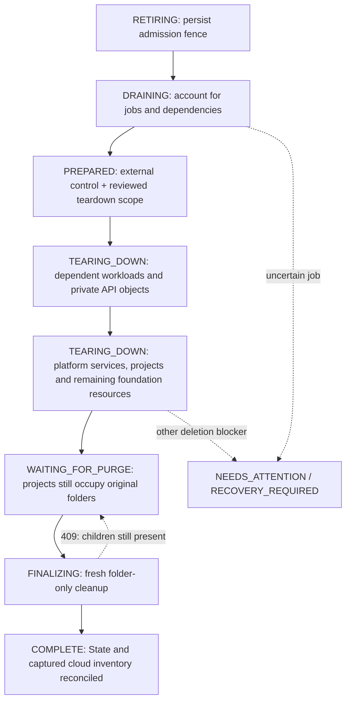

# Staged Destroy and Landing Zone decommissioning

[English](destroy-lifecycle-concept.md) | [Deutsch](destroy-lifecycle-concept.de.md)

Status: architecture proposal, reviewed against current sources on 2026-11-23.
Agreed direction: staged teardown, with an immediate admission freeze and deferred
folder cleanup. Projects stay in their original folders. This document implements
no Destroy command, workflow, API, permission change or cloud operation.
Related: [Accelerator #22](https://github.com/stackitcloud/stackit-landing-zone/issues/22)
and [provider #1075](https://github.com/stackitcloud/terraform-provider-stackit/issues/1075).

## 1. Recommendation and current limitation

Treat Destroy as a durable lifecycle, not one synchronous command. Remove approved
workloads, request project deletion, retain the cleanup record while STACKIT finishes
deletion, and remove the original folders afterwards. Release a job container between
phases; a Runner must not sleep for several days.

[STACKIT documents](https://docs.stackit.cloud/platform/resource-manager/how-tos/delete-folders/)
that a project can prevent folder deletion for up to seven days. The provider issue
is still open; its [latest team response](https://github.com/stackitcloud/terraform-provider-stackit/issues/1075#issuecomment-6012663511)
announces further work without a committed delivery date. This is an API constraint,
not a dependency-ordering fix we can promise through a provider upgrade.

"Soft-deleted" here means a project/container is still awaiting final removal. It
does **not** imply a recoverable project: the [project deletion documentation](https://docs.stackit.cloud/platform/resource-manager/how-tos/delete-a-project/)
describes deletion as irreversible and resource teardown as starting immediately.
Neither seven elapsed days nor an empty State proves completion.

No project relocation, quarantine folder, automatic restore, force-purge shortcut,
multi-day `time_sleep` or forgetting live resources from State is proposed. Keeping
the original parent preserves the hierarchy throughout the waiting period.

## 2. Existing implementation versus proposed work

The current Configurator already supports an Application plan purpose `destroy`.
It rejects create/update/replace actions in such a plan and requires a separate
confirmation bound to the instance and saved artifact. See
[Application execution](../landing-zone-configurator/docs/application-execution-lifecycle.md)
and [the service](../landing-zone-configurator/app/apps/api/src/applications/service.ts).
That is not yet a complete cross-State Platform retirement and cloud-purge lifecycle.

The native root combines governance folders and organization IAM with Management,
Connectivity, platform services and optional workload projects. Application orders
may instead own separate States. The Management module also creates a State bucket,
credentials and Secrets Manager. Consequently, one root's resource graph does not
describe every external Application dependency, nor guarantee its own backend survives.

The pinned provider is `0.114.0`. Its
[folder Delete implementation](https://github.com/stackitcloud/terraform-provider-stackit/blob/v0.114.0/stackit/internal/services/resourcemanager/folder/resource.go)
calls the API and returns an error for a non-empty folder. Its
[project Read implementation](https://github.com/stackitcloud/terraform-provider-stackit/blob/v0.114.0/stackit/internal/services/resourcemanager/project/resource.go)
removes a project from State on a forbidden response. Thus permission loss, hidden
projects and physical absence must be distinguished by the coordinator; State alone
cannot be the deletion inventory. Provider `main` still contains the folder limitation
when inspected for this concept.

The [native retirement adapter](../src/retirement/README.md) implements the
folder-preserving two-phase path for its explicitly supported provider profile,
with offline qualification. The [Configurator foundation](../landing-zone-configurator/docs/retirement.md)
implements durable intent and admission fencing behind a disabled feature flag.
The complete coordinated execution and live qualification are not yet delivered;
remaining lifecycle actions below describe the target contract. Native
Accelerator use must continue to work without a Configurator, application database,
customer Git service or hosted SaaS account.

## 3. Scope, ownership and the immediate freeze

Support an individual Application instance, an entire Platform Landing Zone with
its dependent Applications, or an explicitly selected batch of test/demo Landing
Zones. Identify a target by its durable deployment identity, organization and State
binding, not only a name/prefix. The freeze applies to that Landing Zone across all
of its published platform revisions, templates, configurations and workspaces.
It does not freeze unrelated Landing Zones in the same organization.
The existing organization itself is outside the deletion scope.

**Requesting retirement first changes the target to `RETIRING` atomically.** This
must happen before waiting for a destructive Plan or an external job. Record a
monotonic fencing generation and the authorized intent. Every later admission and
dispatch checks the current parent lifecycle and generation, including direct API
and database entry points; a browser flag is insufficient.

| Operation after the freeze | Policy |
| --- | --- |
| New Application order or project creation | Reject, including old published templates and direct API requests |
| Add services, resources, regions, capacity or Application instances | Reject, including pending Assistant proposals and configuration imports |
| New creation/expansion Plan, normal Apply, upgrade or previously approved expansion Plan | Reject; invalidate unused approvals and prevent queued dispatch |
| Read status, inspect evidence, export data, observe deletion | Allow within current permissions |
| Approved teardown of captured resources | Allow through fresh, scoped execution authorization |
| Recovery after an interrupted job | Allow inspection, verified stop, adoption of existing resources and safe State reconciliation; never an implicit new-resource Apply |
| Delete a configuration, archive an order or remove a workspace | Must not erase or release the retirement fence and cleanup obligations |

Recheck at order creation, admission to queues, ticket issuance, credential release
and the final execution gate. A valid old artifact, ticket, template snapshot or
execution-source binding does not bypass retirement. The parent must be resolved
server-side from the persisted binding, not supplied by a caller. Index captured
cloud parent IDs and the original State identity as well: copying a configuration
or relabeling its binding must not bypass the same target's fence. Explicit read-only
drift observation is distinct from admitting a new creation/expansion Plan.
A caller-supplied phase or Destroy flag is not authorization: the coordinator derives
the permitted phase from the persisted intent and verifies actual plan effects against
its captured resource identities.

A job admitted just before the freeze must appear in the inventory. Cancel unused
dispatches and revoke unused tickets. For already running writers, enter `DRAINING`:
request a source-bound safe stop or explicit operator reconciliation and establish
which remote operations have completed. An already issued cloud API call cannot be
retroactively cancelled by a database flag. Do not claim complete mutation quiescence
until the Runner and remote effects have been checked. Uncertain jobs and recovery
holds prevent the first destructive phase; do not force-unlock them.

The freeze and order/dispatch admission must serialize on the same persisted parent
gate. Audit the lock order against current quota, publication, instance and execution
locks; add race tests rather than introducing an incompatible lock order. Never hold
a SQL transaction or a Runner allocation throughout the purge interval.

Standalone use enforces the equivalent gate in the customer's operational workflow:
disable automatic order/Apply dispatch for the selected deployment, use its retirement
manifest and one approved writer per State. This does not prevent an administrator
from bypassing the workflow with independent cloud credentials. Optional IAM changes
must be scoped and reviewed, never a blanket removal of organization rights.

## 4. Inventory and surviving control resources

Before deletion, create a durable manifest outside the target. It contains:

- Deployment/organization identity; selected States with lineage, serial and backend
  references; exact project UUIDs, project container IDs and folder UUID/container IDs.
- Existing parent relationships, native resource addresses, ownership/import status,
  source/provider lockfiles, regions/SNAs and cross-State dependencies.
- Active orders/jobs/tickets, shared services and organization IAM used elsewhere.
- Retained data, backups, object versions, Object Lock/retention, relevant secrets,
  external DNS/delegation and an authorized cleanup principal.
- Approved scope, fencing generation, phase artifacts, deletion observations, errors,
  attempts and a signed/digested receipt chain. No secrets in normal UI/logs.

A prefix or test label is a discovery aid, not authorization to delete all matches.
Unknown/unmanaged children and resources claimed by multiple States require review.
In particular, organization role assignments may also be used by other Landing Zones;
being present in one State is not proof of exclusive ownership.

Preserve a backend, its credentials, State decryption material, cleanup identity and
receipts until the final folder step is complete. If these are inside Management or
another selected project, first migrate to an approved external control location and
verify restore and read/write access. This is a separately reviewed State/backend
migration, not a temporary unencrypted local copy or an import into a second live State.
The cleanup identity must not rely solely on IAM bindings that the Destroy removes.
Do not assume the bootstrap service account still exists.

Honor bucket contents, versions, retention and deliberate protection settings. Do not
enable `force_destroy`, bypass governance retention, revoke keys or remove a project
compliance lock automatically. Required exceptions or retained resources are explicit
owner decisions, not consequences of a generic Destroy checkbox. A retained resource
that still requires its project also keeps that project/folder out of final deletion.

## 5. Phases and cross-State dependency order



1. **Drain dependencies.** Stop new Application admissions immediately. Enumerate
   existing Application States and external consumers. The Platform Owner reviews
   their inclusion or an explicit detach/retention decision; a template unpublication
   alone does not remove consumers.
2. **Remove dependent workloads.** Destroy namespaces/Helm or other private provider
   objects while their APIs, credentials, routes, DNS and execution domain still exist.
   Retire Application resources/States before the shared platform they consume.
3. **Remove platform resources and request project deletion.** Include standalone
   native workload projects, central Git, Observability and other selected services.
   Remove connectivity and private runners only after the last dependent private API
   operation. Treat every SNA/region as an explicit dependency domain.
4. **Wait outside the executor.** Persist project deletion requests and observations.
   No occupied job container, continuous GitHub runner or seven-day sleep. A public
   API-capable cleanup executor can later finalize folders if private APIs are no
   longer required.
5. **Finalize original folders.** Use a fresh, delete-only plan/operation over the
   captured folder identities; children before parents where applicable. Recheck scope,
   authorization, State and surviving control access. Keep original addresses/IDs.
6. **Close the record.** Reconcile the final State and captured cloud resources,
   retain required evidence, then remove any independently approved temporary control
   resources. Erase secrets only after their final operational/recovery use.

Management cannot destroy the backend used to finish this procedure. Likewise, a
central Git or customer-installed Configurator cannot be its own only cleanup
coordinator. Export and verify an independent handoff before dismantling that control
plane. SaaS Configurator hosting is not part of a customer's Landing Zone Destroy.

## 6. Practical workaround for existing test/demo environments

This is an operator-assisted path using current API behavior, not a newly delivered
automatic phase engine:

1. Group candidates by actual State and ownership. Inventory all captured project and
   folder IDs **before** the first Destroy; include projects already in `DELETING`.
2. Close admissions/automation and drain outstanding jobs. For standalone deployments
   this freeze is operational until a native helper is implemented.
3. Verify an external backend/recovery copy, an independent cleanup identity and all
   data/shared-resource decisions. Stop if a target still hosts its only State or key.
4. With the original compatible source/provider lockfile, review a normal complete
   Destroy Plan for the selected State and apply that exact artifact when authorized.
   Do not use a normal Apply to "repair" a partially destroyed Landing Zone.
5. If projects are pending and folder deletion returns the known children conflict,
   retain the partial State and all evidence. The native command still failed; do not
   turn its exit code into success. Classify the overall retirement as waiting **only
   after verifying that remaining actions are the expected captured folders**, not a
   mixture of failed service, IAM, storage or networking deletions.
6. Observe the remaining projects/folders with independent authorized access. At a
   later time, generate and review a fresh Destroy Plan against the latest partial
   State. Finalize only the same remaining, empty folders. Do not reuse a stale saved
   Plan, re-create projects, reparent them, or remove pending folders from State.
7. Close each Landing Zone only after cloud cleanup and State reconciliation. If
   deletion exceeds the documented interval plus an agreed grace period, or progress
   stalls, escalate the exact non-secret IDs/statuses/request references to STACKIT.
   A future API fix or support intervention is not assumed to be a customer purge API.

This can remove successfully torn-down services while folder cleanup remains pending;
it does not promise that billing or every service ends at project DELETE acceptance.
Verify residual services separately. Project deletion already initiated elsewhere may
leave stale resource entries or unusable provider endpoints. If the original root can
no longer refresh/plan, stop and prepare a reviewed, compatible cleanup adapter/State
reconciliation. Do not mask this with `-refresh=false`, broad `state rm` or unknown imports.

### 6.1 Standalone installations: one State, two OpenTofu phases

An installation originally created without the Configurator does not need to be
imported into it for retirement. Its existing native configuration, provider lockfile,
tfvars and authoritative State are sufficient starting points. No application DB,
new API service, STACKIT CLI or second State is inherently required. The remaining
work is a compatible phase-specific HCL configuration and an operator procedure.

The normal plan compares configuration with State; a saved plan can then be applied
explicitly. See [OpenTofu Plan](https://opentofu.org/docs/cli/commands/plan/) and
[OpenTofu Apply](https://opentofu.org/docs/cli/commands/apply/). Use that mechanism:

| Step | HCL desired configuration | Review condition |
| --- | --- | --- |
| Freeze and preparation | Original source remains preserved; document retirement and close every other writer | Correct State/backend, independent operator and captured cloud IDs; dependent Application States accounted for |
| Phase A: resources/projects | Remove the selected workloads and projects from the desired configuration; keep their original folder declarations and required cleanup access | Only approved deletions; no folder deletion, creates, updates or replacements; retain the same folder addresses/IDs |
| Wait | Keep the Phase-A configuration and latest partial State; do not switch back to the active configuration | No normal expansion/Apply by other operators; verify pending purge rather than assuming State absence proves it |
| Phase B: folders | Use a fresh Destroy Plan for the eligible remainder | Only captured empty folders and exclusively owned eligible governance remain; no shared/retained resources or in-scope backend to destroy |

Do not simply remove project declarations while leaving their module outputs,
provider aliases or service-provider authentication unresolved. Native modules that
currently create Management and other foundations unconditionally require deliberate
adaptation. Keep providers and credentials needed to delete existing objects until
their final use; private API objects may require an earlier substep before projects
can be removed. That is still part of Phase A, not a reason to delete folders early.

The following is a **command pattern after a compatible Phase-A configuration has
been prepared and reviewed**, not a currently supplied LZA teardown flag or a
ready-to-run recipe for an unchanged checkout. `backend.hcl` and `config.tfvars`
represent the deployment's existing reviewed inputs; protect plan files as sensitive.

```sh
# Phase A: ordinary plan/apply of the adapted teardown configuration.
# Keep the original State identity, workspace and external backend.
tofu init -lockfile=readonly -backend-config=backend.hcl
tofu plan -var-file=config.tfvars -out=phase-a.tfplan
# Review: only approved workload/project deletions, no folder deletions.
tofu apply phase-a.tfplan
```

Keep the State and configuration between runs. Project deletion may be accepted
while the parent is still occupied; record these project IDs before they disappear
from State. Waiting can be entirely manual: no running OpenTofu process, scheduler
or Configurator is required. STACKIT-Portal observation is optional; if the API does
not yet allow final folder removal, the second phase must remain pending.

```sh
# Phase B: later, after purge, in the same adapted configuration/backend/workspace.
# Only if ALL remaining managed resources are approved for final removal.
tofu plan -destroy -var-file=config.tfvars -out=phase-b.tfplan
# Review: only the known empty folders and approved governance remainder.
tofu apply phase-b.tfplan
```

OpenTofu and `tofu` are the documentation default. For an existing Terraform-managed
deployment, use the equivalent `terraform` commands and preserve its original engine
and version until a separately reviewed migration. Preserve the provider lockfile,
State encryption and backend; retirement is not an engine migration. If folder deletion still returns
the known children conflict, preserve the partial State, wait and make a fresh plan
later. Never turn the failed command into successful completion. If retained/shared
resources still exist in the State, do not use a global Destroy for Phase B; use the
reviewed native finalization scope or an approved ownership/State separation first.

The organizational freeze names one responsible operator, disables scheduled/manual
creation and normal Apply pipelines for all linked States, withdraws unused approvals
and saved expansion plans, stops/reconciles existing writers and records `RETIRING`
in the protected change record/repository. Only reviewed retirement operations may
use the execution credentials. Where provider contracts permit, separately scoped
execution rights can additionally exclude creation; do not remove shared IAM blindly.
The organizational retirement record remains effective between CLI runs. A variable,
local file or OpenTofu State lock alone cannot enforce this across administrators:
an older active configuration or still-applicable saved expansion plan must not be run.

Separate governance and workload States can simplify **future** deployments, but
are not required for this approach. Legacy States are not copied, split or emptied
automatically. The recommended product implementation is the native phase contract
in section 8, with normal active-mode behavior and stable migration of existing
addresses. Until it is implemented, a compatible teardown configuration must be
reviewed per source revision; the current unchanged LZA does not provide it yet.

The two-phase, same-State mechanism was checked locally with OpenTofu 1.12.6 and only
built-in `terraform_data` resources: Phase A deleted a project analogue, preserving
the folder analogue's ID and State lineage; Phase B deleted only that folder and
left the same State lineage empty. This demonstrates CLI semantics, not STACKIT
provider initialization, cloud purge timing or a qualified live LZA teardown.

## 7. Purge observation, retries and truthful completion

Track `delete_requested`, `DELETING`, `purge_unconfirmed` and `verified_absent`
separately from job status and State membership. A 403, a hidden list entry, a missing
permission, an empty State or elapsed time does not prove physical removal. Even 404
needs interpretation under a known healthy, sufficiently scoped identity.

The API may not expose a reliable purge signal for every hidden child. Keep that
uncertainty explicit. Complete the captured empty-folder deletion and verify absence
under healthy authorized access; an asynchronous acceptance remains pending. A failed
read alone is not a removal receipt.
Classify the exact folder-children conflict as deferred, other 409s by their real
cause, 401/403 as access problems and timeouts/5xx as uncertain outcomes. Inspect before
reissuing a mutation whose result is unknown.

Proposed observation cadence is hours rather than seconds, with bounded backoff and
an overdue alert. Healthy-access observations may run automatically; actual deletes
require current authorization. An owner may explicitly pre-authorize automatic
empty-folder finalization for the fixed manifest IDs, delete-only effects and a bounded
validity period. Otherwise request a fresh final-phase approval. Any new resource,
changed ownership, expired intent, unexpected effects or State/source change outside
the approved policy requires review. Never reuse the initial saved plan several days
later merely because the retirement intent still exists.

`COMPLETE` means all selected resources are removed or explicitly retained with a
recorded surviving owner; no captured cleanup obligations remain unknown. Display
workload teardown, project purge, folder cleanup and retained resources separately.
Operationally "mostly gone" is not a completed Landing Zone deletion.
Completed/archived bindings remain retired and cannot become orderable again through
an old publication. A new Landing Zone requires its own new identity and approval.

## 8. Native execution and Configurator integration

The same proposed manifest and phase receipts support both modes:

| Native OpenTofu (Terraform-compatible) | Optional Configurator |
| --- | --- |
| Versioned source, provider lockfile, external State and retirement manifest | Existing instance/platform bindings plus durable retirement records |
| Operator or optional customer CI executes short, reviewed runs | API admits scoped phase jobs and schedules observation/finalization |
| Organizational single-writer rule / approved coordinator | Existing DB State-write coordination plus durable parent admission fence |
| CLI/CI shows partial/waiting/failure distinctly | UI shows the same phases, affected instances and unresolved obligations |

Do not rely on unverified native S3 conditional locking; see the current
[standalone workflow](../src/application/README.md#independent-two-phase-cli-workflow).
Hold execution locks for actual writes, not the seven-day wait; the persistent
retirement fence separately keeps ordinary writers and expansion requests out.
Private executors follow the [persistent VM/fresh container concept](private-runner-concept.md).

The implementation recommendation is a native, documented phase contract, shared
by standalone use and the Configurator. Proposed modes, **not available today**:

| Mode | Desired resources and permitted plan effects |
| --- | --- |
| `active` | Existing normal configuration; rejected for a retiring binding |
| `remove_workloads` | Keep selected projects/folders and required control access; remove dependent service objects in dependency order |
| `remove_projects` | Workloads already removed; remove the selected project resources while original folders remain |
| `finalize_folders` | Captured projects no longer block removal; delete only the remaining captured folders/approved residual governance |

Use ordinary saved plans of these phase-specific desired configurations and validate
their actual effects as delete-only within the approved phase scope. A variable such
as "keep folders" cannot make a global `plan -destroy` retain declared resources.
Implement native conditional declarations/provider initialization deliberately; do
not filter a binary plan or rely on `-target`/resource exclusions as the phase contract.

Preserve existing State identities through explicit reviewed `moved` migrations
where introducing a count/key changes an address. Historical roots need a packaged,
source-qualified adapter or a separately reviewed migration; do not silently upgrade
or reconstruct them during deletion. The operator-assisted workaround above remains
the transitional path. Separate workload/governance States are a possible future
migration, not an unreviewed prerequisite for cleaning today's environments.

The Configurator must enforce the fence in service/database/dispatcher/credential
paths, not just hide buttons. Old open tabs, old published revisions, imported
configurations and old approved artifacts must be rejected consistently. Assistant
proposals cannot grant exceptions. Read-only diagnostics and existing protected
recovery remain available, but cannot create replacement workloads implicitly.

Keep deletion records after archiving an Application order. The current order-capacity
policy must not silently change: any new distinction between workload removal, purge
completion and slot release needs explicit policy/tests. A released order slot must
not permit a new order on the retiring parent platform.

## 9. Cancellation, permissions and user experience

Show the exact selected Landing Zone, its dependent Applications, retained resources,
data-loss implications, known waits and surviving cleanup operator before approval.
A Platform Owner can retire a platform; Application authority remains scoped to the
authorized order. The policy may add a second approver, but this is not a universal
new requirement.

### Application retirement: decision, notice and execution

The agreed default is that the **Platform Owner decides** whether to retire the
platform and its explicitly listed dependent Application Landing Zones. Requesters
are notified in advance and may export data or clean up their Applications themselves.
Their consent or prior self-service deletion is not a prerequisite. This authority
must be granted explicitly for the selected platform and Applications; being a SaaS
operator or a member of another workspace grants no such permission.

The planned workflow is:

1. Persist the retirement intent and block new orders and expansions immediately.
   Inventory every dependent Application, its requester/current responsible owner,
   authoritative State, running jobs and data-retention obligations.
2. Give affected requesters and current Application owners advance notice naming
   the affected Applications, the reason, the planned deletion time, the responsible
   Platform Owner and the opportunity to export data or perform scoped cleanup.
   Keep the notice visible in the workspace inbox independently of email settings;
   email follows personal topic/language preferences and configured delivery.
   Record recipient resolution, notice and delivery failures. Never interpret an
   SMTP handoff or silence as consent. Unresolved recipients require operator review.
3. Allow an explicitly scheduled preparation window. Its duration is an organizational
   choice, not a fabricated universal deadline. Rescheduling and material scope changes
   update the notice and require a current decision. No destructive dispatch before
   the recorded window ends and required organizational holds are resolved.
4. After that window, the Platform Owner reviews and authorizes named Application
   Destroy plans. Requesters may have completed their own teardown already; reconcile
   those results instead of deleting twice. Otherwise the coordinator executes the
   authorized Application cleanup before shared platform dependencies are removed.
5. Wait for project purge and finalize folders as described above. Notify affected
   users of progress, failures and completion; distinguish workload removal from
   eventual hierarchy cleanup.

No per-requester approval is required by the default. A documented customer policy
may require additional approval, but pending mandatory approval must remain a hold;
it cannot be inferred from a notification or overridden by an ordinary role check.
Shared, retained or externally owned resources must first receive an explicit scope
and dependency resolution; a platform decision is not blanket deletion authority.

This is proposed implementation, not an existing administrative Destroy feature.
The current Application Destroy path selects plans by requester identity. Reusing
its plan validation and execution machinery requires a separately authorized
Platform Owner operation, with the acting owner and affected requester recorded
separately; do not impersonate the requester or bypass existing access checks.
The new retirement notifications and email topic must also be added explicitly to
the [notification contract](../landing-zone-configurator/docs/notifications.md).

### Cancellation and progress

Cancellation before any destructive action can reopen admissions only after a fresh
operator check of all jobs, recovery holds and current State. Invalidate old approvals
and require new ordinary Plans. Once a project delete or other irreversible operation
has started, do not offer a one-click undo or silently return to `ACTIVE`. Data restore
or rebuilding a Landing Zone is a separate plan with its own identity and approval.
An authorized pause can stop future phase dispatch while retaining the fence and
records. It cannot stop a purge already accepted by STACKIT or undo prior deletions.
Resuming requires current authorization and review of any expired or changed scope.
Pause, cancellation and scope changes advance the fencing generation so an old queued
finalization job cannot run after them.

Suggested UI states: "Retiring — new deployments blocked", "Reconciling running
jobs", "Removing resources", "Waiting for STACKIT project removal", "Removing
empty folders", "Action needed" and "Retired". Include last observation, next check,
affected IDs, retained-resource reason and a resume/review action. No fabricated
percentage for a provider-controlled wait. A partial job remains partial/failed even
when the overall lifecycle correctly waits for external completion.

## 10. Delivery slices and acceptance

1. **Inventory and runbook:** read-only discovery, ownership/State reconciliation,
   external control verification and the manual staged workaround. Pilot one approved
   disposable environment; do not start with a broad organization sweep. Supporting
   installations originally created without the Configurator is a required delivery
   item. A qualified OpenTofu runbook with compatible phase HCL may be sufficient;
   a new controller, application DB, Configurator import or State split is not required.
   Document exact supported source versions, commands, prerequisites, pause/resume,
   organizational freeze and completion evidence. The unchanged root is not yet such
   a runbook: qualify its provider initialization and references before publication.
2. **Admission fence:** persistent retirement intent, atomic race-safe admission and
   dispatch gates, job draining, auditability and safe cancellation before deletion.
3. **Lifecycle coordinator and native phase contract:** reuse existing Application
   Destroy, add qualified phase configuration/address migrations, cross-State Platform
   ordering, short jobs, receipts and explicit expected-409 handling. Add the scoped
   Platform Owner operation, advance-notice/preparation window and recipient handling.
4. **Deferred finalization and batches:** durable observations, bounded policy for
   empty-folder deletes, alerts and independent per-Landing-Zone batch progress.
5. **Qualified native adapters:** historical-source/provider-initialization cases,
   optional future State partitioning and control-plane uninstall/handoff.

Required tests include:

- A Platform Owner can coordinate only authorized dependent Applications; advance
  notices and the recorded preparation window precede destructive dispatch. Requester
  self-cleanup is optional, results are reconciled, and email opt-out does not hide
  the inbox notice. Missing required approvals/holds block dispatch, not visibility.

- An order racing the freeze is either admitted before it and accounted for, or
  rejected; it cannot dispatch afterwards on an unused old approval/ticket.
- New orders, expansion, upgrades, imported changes and stale UI/API requests remain
  blocked on every revision of a retiring parent, including after process restart.
- Existing writers have confirmed outcomes before teardown; recovery cannot disguise
  new creates, and unknown results do not trigger blind mutation replay/unlock.
- Nested folders, multiple child States/SNAs, foreign children, shared IAM/services,
  missing access and already-pending projects preserve exact ownership boundaries.
- 409-children, hidden/403/404 responses, an empty State and elapsed seven days are
  not mistaken for purge or final success; later empty-folder deletion can complete.
- Backend/key retention, non-empty/versioned/locked buckets, lost credentials and
  coordinator self-deletion keep recovery and finalization possible.
- A disposable live pilot demonstrates resources gone, original folders retained
  during purge, no relocation, and eventual cleanup with no new resources. Test both
  standalone operation and the optional Configurator path before claiming delivery.

No new long-running CI job is introduced by this concept. Future workflows and their
phase diagram must be added to the [workflow catalogue](workflows.md) when implemented.
