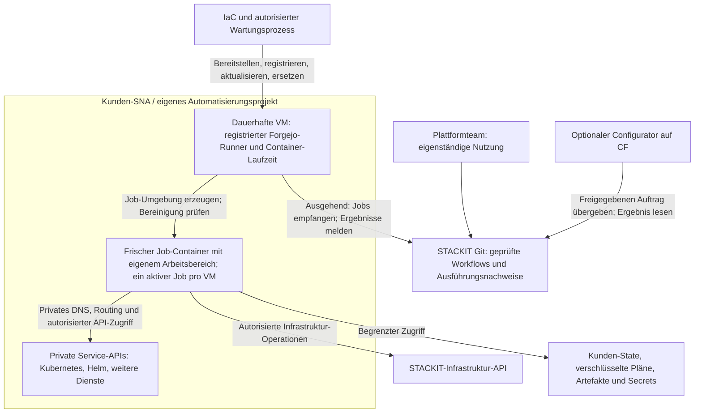

# Private-Runner-Konzept

[English](private-runner-concept.md) | [Deutsch](private-runner-concept.de.md)

Status: Architekturvorschlag vom 16.11.2026. STACKIT Git mit selbst betriebenen
dauerhaften VM-Runnern mit frischer Container-Umgebung pro Job ist die
vereinbarte Richtung. Dieses Dokument schlägt Komponenten, Berechtigungen und
Lebenszyklus vor; es implementiert oder aktiviert sie nicht. Zugehöriges
Feature: [#37](https://github.com/stackitcloud/stackit-landing-zone/issues/37).

## 1. Ziel und Abgrenzung

Platform Services werden über den STACKIT-Provider erstellt. Anschließend kann
ein weiterer Provider zur Konfiguration auf eine private Service-API zugreifen
müssen, beispielsweise Kubernetes oder Helm auf eine Control Plane innerhalb
einer SNA. Entscheidend ist der vom Provider verwendete Endpunkt, nicht allein
die Existenz des Dienstes. Auch Refresh und Plan können diesen Zugriff
benötigen.

Dieser Ausführungsweg soll über STACKIT Git und private VM-Runner bereitstehen.
Der Accelerator bleibt eigenständig nutzbar. Der gehostete Configurator bleibt
auf Cloud Foundry und übergibt optional Aufträge an Git; er erhält keinen
direkten Netzwerkpfad in die Kunden-SNA. Die bisherige CF-Ausführung bleibt für
ihre unterstützten Aufgaben verfügbar. Jede State-Operation hat genau einen
gewählten Executor.

Eine automatische Veröffentlichung privater APIs, permanente Tunnel,
Produktionsdeployments oder die Migration bestehender States gehören nicht zur
Umsetzung dieses Konzeptdokuments.

Die Netzwerkausführung ändert keine Produktgrenzen: Bestehende Namespace-Dienste
zielen ausschließlich auf freigegebenes Platform Kubernetes. Zusätzliche
Namespace-Bausteine für Application-eigene Cluster werden damit nicht
eingeführt. Andere private Service-Provider benötigen jeweils eine eigene
unterstützte Konfigurations- und Berechtigungsintegration.

## 2. Gesamtarchitektur

Git koordiniert die Ausführung in beiden Betriebsarten. Der Configurator führt
keine zweite Warteschlange für private Runner ein und sendet keine Shell-Befehle
an VMs. Die feste Basiskapazität benötigt keinen eigenen
Autoscaling-/Pool-Controller: IaC stellt dauerhafte Hosts bereit, ein
autorisierter Wartungsprozess registriert und aktualisiert sie, Git verteilt
Jobs auf registrierte Runner. Öffentlich eingehendes SSH und eine eingehende
CF-Verbindung in die SNA sind nicht nötig. Administrativer Bootstrap und Wartung
nutzen einen separat autorisierten privaten Verwaltungszugang.

| Komponente | Aufgabe | Explizite Grenze |
| --- | --- | --- |
| STACKIT Git | Versionierte Workflows, Job-Start, Ausführungsidentität und Ergebnisse | Stellt selbst keine SNA-Verbindung her |
| IaC und Wartungsprozess | Feste VM-Kapazität, Image-/Laufzeitregeln, Registrierung, Drain, Updates und Austausch verwalten | Keine VM-Erzeugung pro Job und kein neuer proprietärer Controller nötig |
| Dauerhafte Runner-VM | Git abfragen, Job-Umgebungen erzeugen/bereinigen; zunächst ein aktiver Job pro Host | Hält nur ihre Runner-Identität; Infrastruktur-Verwaltungszugänge werden nicht an Jobs vererbt |
| Frischer Job-Container | Genau einen autorisierten Job mit gepinntem Image, eigenem Arbeitsbereich und begrenzten Zugangsdaten ausführen | Keine Host-Ausführung, privilegierter Modus, Host-Daemon-Socket oder beliebige Host-Mounts |
| State-/Artefaktspeicher | Dauerhafter State, verschlüsselte Pläne, unveränderliche Pakete und Nachweise | Überlebt Container und VM-Austausch; Zugriff nach State/Operation getrennt |
| Secrets-Dienst | Begrenzte Ausführungs- und Registrierungsmittel | Getrennte Provisionierungs-, Runner- und Dienstidentitäten |
| Optionaler Configurator-Adapter | Berechtigungen prüfen, exakt freigegebene Eingaben übergeben, Status/Ergebnisse anzeigen | Erfolgreicher API-Aufruf bedeutet keinen erfolgreichen Apply |

Git-Integration, Container-Regeln und Wartungsautomatisierung benötigen
Umsetzung und Qualifikation; sie sind keine bestehenden Funktionen des
CF-Runners.

## 3. Platzierung und Netzwerkmodell

Ein eigenes Automatisierungsprojekt innerhalb der Platform Landing Zone wird an
die betreffende SNA angebunden. Runner erhalten Subnetze/Security Groups und
einen separat kontrollierten Verwaltungszugang. Ein bestehendes
Management-Projekt kommt erst nach Prüfung von Auswirkungsbereich und
Netzwerkanbindung infrage. Runner gehören weder auf die Connectivity-Firewall
noch in den Zielcluster.

Ein Pool gehört zu genau einer Kundenorganisation, SNA, Region und Umgebung bzw.
Vertrauensdomäne. Prod und Nicht-Prod bleiben getrennt. Stärkere Mandanten- oder
Workload-Grenzen benötigen eigene Pools/Projekte, nicht nur andere Labels. Ein
zentrales Projekt genügt nur, wenn freigegebene Routen tatsächlich alle
gewollten Endpunkte erreichen. Mehrere isolierte SNAs benötigen getrennte
erreichbare Ausführungsbereiche. Runner werden nicht an mehrere
Vertrauensbereiche angebunden, um zusätzliche Pools einzusparen.

| Richtung | Erforderlicher Zweck |
| --- | --- |
| Autorisierte Verwaltung zur VM, privat | Initiale Registrierung und Wartung; auf Verwaltungszugang begrenzen, nie Job-Containern gewähren |
| Runner-Daemon ausgehend über HTTPS | Git-Job-Abfrage, Job-/Ergebnistransport und freigegebene Laufzeitupdates |
| Job-Container ausgehend über HTTPS | Freigegebene Paket-/Image-/Provider-Quellen, State-/Artefaktspeicher, begrenzter Secret-Abruf und benötigte STACKIT-APIs |
| Job-Container zum Dienst, privat | Exakte API-Ziele und Ports, etwa Kubernetes-API; kein pauschaler Zugriff auf alle Spokes |
| DNS | Korrekte Auflösung der Service-Endpunkte einschließlich öffentlicher Resolver-Anforderungen des gewählten SKE-Netzwerkmodus |

VMs benötigen keine öffentliche IP. Kontrollierter ausgehender Verkehr läuft
über den vorgesehenen Netzwerk-/Firewall-Pfad; ein öffentlicher Git-Endpunkt
verlangt keine öffentliche Runner-VM. Zertifikatsprüfung und Zeitsynchronisation
müssen möglich sein. SNA-Mitgliedschaft bestätigt weder Routing, DNS und TLS
noch Dienstberechtigungen. Aus dem tatsächlichen Container-Netz prüfen:
VM-Erreichbarkeit allein genügt nicht. Überlappende Container-Subnetze,
Forwarding/NAT und die von Service-Firewalls beobachtete Quelladresse prüfen.
Git-ACLs müssen die vorgesehenen Egress-Adressen zulassen.

## 4. Native Ausführungsphasen und State-Verantwortung

Die folgenden Namen beschreiben vorgeschlagene Grenzen, keine bereits
vorhandenen Verzeichnisse oder neu unterstützten Befehle.

| Phase | Erzeugt/konfiguriert | Ausführung | State |
| --- | --- | --- | --- |
| Foundation | Governance, Netzwerk, Git, State-/Secret-Referenzen, Automatisierungsprojekt und Runner-Infrastruktur | Vertrauenswürdiger Arbeitsplatz oder geeigneter Runner mit Zugriff auf öffentliche APIs | Foundation- und Runner-Lebenszyklus-States, unabhängig wiederherstellbar |
| Service-Infrastruktur | Managed Service über STACKIT-Provider | Öffentlicher oder privater Runner, explizit gewählt | Eigener Service-Infrastruktur-State |
| Service-Konfiguration | Kubernetes-/Helm- oder andere Ressourcen über private Service-APIs | Qualifizierter privater Pool | Getrennter Service-Konfigurations-State |

Die Foundation muss sich ohne privaten Pool initialisieren lassen. Innerhalb
dieser Phase bleibt der Pool-Lebenszyklus-State unabhängig von Jobs, die im Pool
laufen. IaC verwaltet feste Runner-VMs, Netzwerk, Image-/Laufzeitregeln und
Kapazität. Der Wartungsprozess verwaltet Registrierung, Drain und Rotation der
Zugangsdaten; der Runner verwaltet kurzlebige Job-Container, Arbeitsbereiche und
Bereinigung. Kein zweiter Controller erzeugt oder löscht dieselben
IaC-verwalteten VMs. Runner-Infrastruktur wird über einen unabhängigen
vertrauenswürdigen Ausführungsweg gewartet. Ein Host darf sich nicht selbst
während seines eigenen Wartungs-Applies zerstören oder ersetzen.

Getrennte OpenTofu-Roots, Provider-Konfigurationen und Backend-Schlüssel sind
vorgesehen. Eine reine Aufteilung in Workflow-Schritte oder regelmäßiges
`-target` beseitigt private Provider-Abhängigkeiten bei Refresh/Initialisierung
nicht. Vor der Implementierung ist ein explizites natives Vertrags- und
State-Migrationsdesign erforderlich; der heutige vollständige Root unterstützt
diese Aufteilung noch nicht.

Zwischen Phasen wird ein geprüfter minimaler Output-Vertrag übergeben:
Dienstidentität, Endpunkt, Trust-/CA-Referenz, Generation und zulässiger Pool.
Keine Zugangsschlüssel oder vollständigen States exportieren und nachgelagerten
Jobs keine unbegrenzten Leserechte auf vorgelagerten State geben. Zugangsdaten
werden separat aufgelöst. Nachgelagerte Pläne sind an die Version des
vorgelagerten Vertrags gebunden; relevante Output-Änderungen erfordern einen
neuen Plan.

Bei der Erstbereitstellung kann die private Konfiguration erst geplant werden,
wenn der Dienst existiert und die Bereitschaftsprüfung besteht. Sie erhält daher
eine eigene Prüfung/Freigabe; ein vollständiger initialer Gesamtplan wird nicht
versprochen. Änderungen an zwei States sind nicht atomar. Teilfortschritte
müssen sichtbar bleiben. Beim Abbau zuerst Provider-verwaltete Dienstinhalte
entfernen, danach deren API/Dienst und zuletzt Runner-/Netzwerkinfrastruktur.
Verlorene Endpunkte verlangen einen geprüften Wiederherstellungsweg statt
blinder State-Entfernung.

## 5. Betrieb ohne Configurator

1. Das Plattformteam wählt eine freigegebene Accelerator-/Laufzeitrevision und
   erzeugt Foundation und dauerhafte Runner-VMs über IaC.
2. Ein separat autorisierter Registrierungsschritt verbindet jeden dauerhaften
   VM-Runner mit dem gewählten STACKIT-Git-Repository. Git wird vom Kunden
   kontrolliert; eine vorhandene kompatible Instanz kann genutzt werden.
   Configurator-Datenbank, -Broker oder -Konto werden nicht benötigt.
3. Gewöhnliche PR-/Build-Prüfungen nutzen nach Eignung verwaltete Runner.
   Geprüfte Infrastruktur-Workflows wählen explizit den erforderlichen privaten
   Pool.
4. Die Dienst-Erstellung endet vor der privaten Konfigurationsphase. Der
   Job-Container prüft Output-Vertrag, Verbindung, TLS und Dienstberechtigungen.
5. Plan erzeugt einen verschlüsselten gespeicherten Plan und eine bereinigte
   Prüfzusammenfassung. Apply verlangt die Freigabe genau dieses Plans,
   Quellstands und Ziels und läuft in einem neuen Container auf einer
   verfügbaren VM desselben qualifizierten Pools; er setzt nie den
   Arbeitsbereich des Plans voraus.
6. Ergebnisse, Herkunftsnachweise und Teilfehler bleiben nach
   Container-Bereinigung und VM-Austausch verfügbar.

Ein Runner-Label wie `private-prod-eu01-pool-a` dient der Job-Zuordnung, nicht
der Autorisierung. Registrierung auf den engsten unterstützten
Repository-Bereich begrenzen; Workflow-Änderungen und ausführbare
Ereignisse/Refs kontrollieren. Nicht vertrauenswürdige PRs, Forks und allgemeine
Anwendungs-Builds dürfen keine privilegierten privaten Pools erreichen.
Repository-Schreibzugriff und Ausführungsberechtigung sind getrennte Rollen.
Forgejo-Freigabe-/Schutz-APIs müssen für die tatsächlich betriebene
Managed-Git-Version geprüft werden; GitHub-Environment-Verhalten ist nicht
unverändert vorauszusetzen.

## 6. Betrieb mit Configurator

Dieselben kundeneigenen Git-Workflows und privaten Pools verwenden. Ein
Git-Ausführungsadapter ergänzt den bisherigen CF-Adapter. Private Ausführung
wird nicht als zweiter proprietärer VM-Agent entworfen.

Der Kunde verbindet Git-Instanz/Repository und qualifizierten Pool ausdrücklich
mit Workspace/Organisation. Serverseitige Prüfungen binden angeforderte Phase,
Ziel, State-Schlüssel, Quell- und Eingabeprüfsumme, Engine-/Provider-Versionen,
Pool und handelnde Identität an einen unveränderlichen Auftrag. Ziel-/Pool-Wahl
wird gegen registrierte Metadaten autorisiert, nicht aus Browser-Labels
übernommen.

Der Configurator übergibt einen festgelegten geprüften Workflow mit
unveränderlicher Quellrevision und undurchsichtigen Referenzen auf geschützte
Eingaben. Git erhält keine betreiberweiten Configurator-Secrets. Sensible
Konfiguration, Zugangsdaten, Pläne und Roh-State gehören weder in
Dispatch-Eingaben noch in Git-Logs. Konkrete Git-Dispatch-API, Fixierung des
Quellstands und Zugangsumfang benötigen einen getesteten Integrationsvertrag.

Für Plan liefert Git einen zugeordneten Lauf und einen signierten oder
gleichwertig authentifizierten Ergebnisnachweis. Für Apply dokumentiert der
Configurator die Nutzerfreigabe des exakten gespeicherten Plans. Der ausführende
Workflow prüft vor privilegierter Ausführung einen zeitlich begrenzten, einmalig
nutzbaren Freigabenachweis. Workflow-Start oder Git-Token allein sind keine
solche Freigabe. Der eigenständige Weg liefert eine gleichwertige Freigabe über
kundenseitig kontrollierte Git-Prozesse. Speicherung und Prüfung der Freigabe
müssen vor Aktivierung beider Wege spezifiziert werden. Fehlende
Schutzfunktionen werden nicht stillschweigend durch automatischen Apply ersetzt.

Die Ergebnisübernahme prüft Herkunft, Job-/Auftragsidentität und erwartete
Prüfsummen. Callbacks sind authentifiziert und können durch Polling ergänzt
werden. Entzogene Berechtigungen, abgelaufene Freigaben, Abbruch und veraltete
Konfigurationen müssen verhindern, dass wartende Jobs starten oder Secrets
abrufen. Liefert der Dispatch ein uneindeutiges Ergebnis, zuerst über die
Korrelations-ID abgleichen statt einen zweiten Job zu erzeugen.

Eine Deployment-/State-Operation verwendet genau einen Executor. Ein Wechsel von
CF zu Git ist eine explizite Migration, die Backend, Locking, Ressourcenadressen
und Nachweise offener Operationen erhält. Vorbereitete Pläne oder Applies werden
nicht still zwischen Ausführungs-Engines verschoben.

## 7. Dauerhafte VMs und Job-Container-Lebenszyklus

Die gewählte Basis ist ein fester Pool dauerhafter VM-Hosts mit jeweils
dauerhaft registriertem Forgejo-Runner-Daemon und unterstützter
Container-Laufzeit. Jeder Pipeline-Job erhält eine frische Container-Umgebung,
einen eigenen Arbeitsbereich und temporäre Volumes. Zunächst läuft ein aktiver
Job pro VM; weitere VMs ermöglichen Parallelität. Job-/Service-Container,
Netzwerke und temporäre Dateien gehören ausschließlich zum jeweiligen Job. Plan
und Apply sind getrennte Jobs, auch wenn sie zufällig denselben Host verwenden.

### Bereitstellung und Registrierung

IaC stellt Hosts aus geprüften Images bereit. Ein separat autorisierter Schritt
installiert/konfiguriert gepinnten Runner und Container-Laufzeit, registriert
jeden Runner auf dem engsten unterstützten Repository-Bereich und schützt den
dauerhaften Runner-Zugang auf dem Host. Registrierungsbefugnisse bleiben beim
Wartungsprozess, nicht in Job-Containern. Nur öffentliche Bootstrap-Schlüssel
gehören in cloud-init; Registrierungs- und Ausführungsschlüssel dürfen weder in
User Data noch Images oder IaC-State stehen. Sichere Übergabe und Entfernung des
Bootstrap-Zugangs müssen qualifiziert werden.

Die dauerhafte Registrierung ist beabsichtigt; Forgejos
Ephemeral-Einmalregistrierung ist für dieses Modell keine Voraussetzung. Managed
Git, Server und Runner samt Container-Ausführung, Kapazitätsgrenzen und
Bereinigung gemeinsam pinnen und prüfen. Kein `:host`-Ausführungsbeispiel aus
einer Installationsanleitung übernehmen: Jobs laufen in der freigegebenen
Container-Umgebung. Workflow-Overrides, Container-Optionen, Actions, Mounts und
Service-Container begrenzen und prüfen. Fehlende Durchsetzung ist eine
dokumentierte Kompatibilitätslücke, keine Erlaubnis für beliebige Workflows.

### Job-Ausführung und Bereinigung

1. Nur erlaubten Workflow, Quellstand und Ziel annehmen; eindeutigen
   Arbeitsbereich zuordnen.
2. Container aus einem freigegebenen, per Digest gepinnten Laufzeitimage
   erzeugen, mit Ressourcengrenzen, nach Unterstützung unprivilegiertem
   Job-Benutzer und erforderlichem Netzwerkpfad.
3. Operationsbezogene Ausführungszugänge und geschützte Eingaben abrufen;
   Runner-Registrierungsdateien, SSH-Schlüssel, Host-Home und
   Verwaltungsidentität nicht zugänglich machen.
4. Job ausführen; authentifizierte Ergebnisse und Wiederherstellungsnachweise
   außerhalb der Job-Umgebung sichern.
5. Job-Zugänge nach Unterstützung widerrufen/freigeben. Job-/Service-Container,
   temporäre Volumes/Netze, Arbeitsbereiche und Zugangsmaterial entfernen.
6. Bereinigung vor Annahme des nächsten Jobs prüfen. Lassen sich Bereinigung
   oder Host-Integrität nicht bestätigen, Runner aus der Job-Zuordnung nehmen
   und VM neu aufbauen.

Keinen Host-Docker-/Podman-Socket in Jobs mounten, keine privilegierten
Job-Container oder gemeinsam beschreibbaren Arbeitsbereiche erlauben. Der
Runner-Daemon kann privilegierten Zugriff auf die Container-Laufzeit benötigen;
diese Befugnis bleibt auf dem Host. Job-Container dürfen weder Host-Verwaltung
noch sensible VM-Metadaten erreichen. Ein Container-Ausbruch oder
kompromittierter Runner kann weiterhin nachfolgende Jobs betreffen: Dauerhafte
Hosts werden nur innerhalb derselben freigegebenen Vertrauensdomäne geteilt. Sie
bieten keine frische VM-Isolation zwischen Jobs oder Kunden.

Dienstzugänge sind von der Runner-Identität getrennt und werden für die exakte
Operation über einen autorisierten Secret-Freigabemechanismus aufgelöst. Native
VM-Identität, kurzlebige Zugangsdaten oder OIDC-Föderation werden nicht für
jeden STACKIT-Dienst vorausgesetzt. Sind langlebige Zugänge unvermeidbar, werden
sie im Secrets-Dienst begrenzt und rotiert. Das Löschen eines Containers
widerruft keine kopierten Zugangsdaten.

### Performance und Wartung

Hosts bleiben registriert und betriebsbereit. Normale Job-Zuordnung wartet nicht
auf VM-Erstellung, Bootstrap oder erneute Registrierung. Freigegebene Images
vorladen und geprüfte Provider-/Modulpakete vorbereiten. Unveränderliche oder
nur lesbare Caches nach Vertrauensdomäne und Engine-/Provider-Version trennen;
über kontrollierte Wartung befüllen. Gleichzeitige Schreibzugriffe auf
gemeinsame Provider-Caches vermeiden und Lockfiles/Prüfsummen prüfen. Keine
Backend-Zugänge, Pläne, Roh-States, `.terraform`-Arbeitsverzeichnisse oder
Job-Secrets cachen. Refresh/Plan, Backend-Zugriff und Provider-API-Latenz
bleiben bestehen; Wartezeit, Container-Start, Init, Planung und Bereinigung
getrennt messen.

Für einen aktivierten Pool eine betriebsbereite Host-Anzahl größer null
vorsehen; konkrete Größe, Quoten, AZ-Verteilung und Kosten sind
Dimensionierungsentscheidungen. Die feste VM-Anzahl begrenzt Parallelität; ein
dynamischer Controller ist nicht nötig. Hosts vor Updates/Austausch aus neuer
Job-Zuordnung nehmen (Drain), ihren aktiven Job beenden oder ausdrücklich
abgleichen, Identität rotieren/abmelden, über IaC ersetzen und Ersatz vor
Rückkehr in den Pool prüfen. Keinen aktiven Apply für gewöhnliche Wartung
stoppen; keine interaktive Freigabe innerhalb eines belegten Job-Containers
abwarten.

Betriebsbereite Hosts verursachen auch im Leerlauf VM-/Speicherkosten; Austausch
kann zeitweise zusätzliche Kapazität benötigen. Begrenzte Job- und
Bereinigungszeiten, Plattenlimits und Alarme vorsehen. Diese Fixkosten vor der
Pool-Dimensionierung den gemessenen Startzeitgewinnen gegenüberstellen.

Ein vorgewärmter Einmal-VM-Pool oder Management-Kubernetes kann später für
andere Isolations-/Skalierungsanforderungen bewertet werden. Beides gehört nicht
zur gewählten Basis.

## 8. State, Fehler und Wiederherstellung

| Dauerhafte Information | Verantwortung/Speicherort |
| --- | --- |
| Foundation-, Runner-Infrastruktur- und Service-State | Kunden-Backend mit geprüftem Locking, Zugriffsschutz, Verschlüsselung und Versionierungs-/Restore-Regeln |
| Workflow-/Quell-/Laufzeitherkunft | Kunden-Git plus unveränderliches Artefaktmanifest |
| Gespeicherter Plan und sensible Job-Eingaben | Verschlüsselter Kundenspeicher; begrenzte Aufbewahrung und ausdrücklich autorisierte Leser |
| VM-/Registrierungszuordnung, Zustand, Drain und Bereinigungsstatus | IaC-Bestand, Git-Runner-Datensätze und geschützte Betriebsnachweise; unabhängig von Configurator und Job-Arbeitsbereichen |
| Freigaben und Ergebnisnachweise | Kundenseitige Ausführungsnachweise; bei Nutzung verknüpfte Configurator-Datensätze |
| Registrierungs-, Runner- und Dienstzugänge | Begrenzter Secrets-Dienst und geschützte Host-Konfiguration mit getrenntem Lebenszyklus/Rotation |

Git-Concurrency-Gruppen ersetzen kein Backend-Locking. Verhalten für gewähltes
Backend und Engine prüfen. Wiederherstellungsnachweise vor Container-Bereinigung
sichern; ein unklarer Apply wird nicht hinter erfolgreicher Bereinigung
verborgen. Gespeicherte Pläne sind Secrets, bereinigte Zusammenfassungen keine
Ausführungsartefakte.

Abbruch widerruft künftigen Secret-Zugriff und stoppt wartende Aufträge; ein
laufender Apply kann bereits Ressourcen geändert haben. Job stoppen/abgleichen,
State und Cloud-Auswirkungen prüfen und einen frischen Plan erzeugen. Kein
automatischer Apply-Neustart oder Force-Unlock nur wegen eines verschwundenen
Containers oder einer VM. Runner-/VM-Neustart darf weder unklare Jobs
wiederholen noch verschmutzte Arbeitsbereiche erneut bereitstellen. Unklarheit
über Ressourcenänderungen von fehlgeschlagener Bereinigung/Host-Kompromittierung
trennen; Letzteres erfordert Quarantäne und Austausch, nicht nur einen neuen
Job-Container.

VM-Ausfall betrifft höchstens ihren einen aktiven Job und verringert die
Kapazität. Andere gesunde Hosts können neue Jobs übernehmen. Mehrere Hosts/AZs
benötigen echte Failover- und Kapazitätsprüfungen, bevor Verfügbarkeit zugesagt
wird. Git-Ausfall stoppt neue Aufträge und Freigaben; weder gestoppte aktive
Jobs annehmen noch Apply wiederholen. Host-Heartbeat, Plattenbelegung,
Job-Alter, Bereinigungsfehler, Image-/Laufzeitversionen und freie Kapazität
benötigen Überwachung und einen expliziten Quarantäneweg.

Hosts aus IaC und gepinnten Images neu aufbauen, mit frischer Runner-Identität
registrieren und alte Registrierungen entfernen. State, Secret-Referenzen,
Freigaben, Ergebnisse und VM-/Registrierungsbestand zusammen sichern und
wiederherstellen. Dauerhafte VM-Datenträger sind kein maßgeblicher
Job-/State-Wiederherstellungsspeicher. Ein dokumentierter autorisierter
Arbeitsplatz-Zugang bleibt bei Git-/Pool-Ausfall erhalten, mit denselben
State-Verantwortlichkeiten und Locking-Regeln.

## 9. Umsetzungsschritte und Abnahme

1. **Kompatibilitätsprüfung:** Managed-Git-/Server-/Runner-Versionen, private
   Container-Erreichbarkeit, dauerhafte Registrierung, Dispatch-/Ergebnis-APIs,
   Freigabeverhalten, Container-Regeln und prüfbare Bereinigung bestätigen.
   Kosten, Berechtigungen und unbestätigte Annahmen dokumentieren.
2. **Eigenständiger vollständiger Ablauf:** native States/Roots trennen;
   dauerhaften VM-Runner bereitstellen; private Konfiguration eines bestimmten
   Testdienstes über Kunden-Git in getrennten frischen Containern planen,
   freigeben, anwenden und abbauen.
3. **Lebenszyklusqualifikation:** Rückstände und Zugangsdaten zwischen
   aufeinander- folgenden Jobs, kalte/warme Image- und Init-Zeiten,
   Parallelitäts-/Ressourcengrenzen, Bereinigungsfehler,
   Host-Neustart/Quarantäne, Drain/Austausch und Widerruf prüfen.
4. **Configurator-Adapter:** dieselben Workflows/Pakete, ausdrückliche
   Kundenanbindung, quellgebundene Freigabe, zugeordnete Ergebnisse, Abbruch und
   Executor-Wahl.
5. **Produktionsqualifikation:** unterstützte Dienstmodi, Restore-Übungen,
   Verfügbarkeits-/Kapazitätsnachweise und geprüfte Migration/Betriebsanleitung.

Abnahme muss private DNS-/TLS-/Berechtigungsprüfungen aus Containern,
verweigerten Zugriff vom öffentlichen/geteilten Runner, Plan und Apply in neuen
Containern, abgewiesene fremde Repository-/Pool-Zugriffe,
abgelaufene/wiederholte Freigaben, unveränderte Plan-Artefakte, gleichzeitige
State-Schreiber und verlorene Apply-Antworten nachweisen. Ein zweiter Job auf
derselben VM darf nicht auf Zugangsdaten, Arbeitsbereich oder beschreibbare
Volumes des ersten zugreifen. Isolation von Service-Containern,
Cache-Integrität, Ablehnung von Host-/Privileged-/ Socket-Overrides und
Quarantäne bei fehlgeschlagener Bereinigung prüfen. Drain/Austausch ohne
Unterbrechung eines gesunden Applies, gemessene Start-/Init- Verbesserungen und
eigenständigen Betrieb bei nicht verfügbarem Configurator nachweisen.
Negativfälle ohne Kundensecrets oder Roh-State protokollieren. Kein Wechsel zu
öffentlicher Control Plane oder deaktiviertem TLS.

Offene Designentscheidungen: eigenes oder geprüftes bestehendes
Management-Projekt; Pool-Grenzen und Erreichbarkeit;
Freigabe-/Container-Regel-Kompatibilität von Managed Git; sichere Registrierung
und Zugangsdatenübergabe; prüfbare Bereinigung und Cache-Regeln;
Eingabe-/Ergebnisschemata und Artefaktaufbewahrung; dienstspezifische
Root-/State-Migration; erwartete feste Kapazität, Verfügbarkeit und Kosten.
Diese Punkte brauchen Entscheidungen und Qualifikation statt versteckter
Defaults einer Erstimplementierung.

## 10. Quellen und aktuelle Implementierungsgrenzen

Quellen am 16.11.2026 geprüft. Architektur und vorgeschlagene Verträge sind
unser Entwurf, keine Zusage von Funktionen verwalteter STACKIT-Runner.

- [STACKIT Git Custom Runners](https://docs.stackit.cloud/products/developer-platform/git/how-tos/pipelines-custom-runner/): selbst betriebene Forgejo-Runner, auch für private Netze.
- [Forgejo-Runner-Sicherheit](https://forgejo.org/docs/v15.0/admin/actions/security/): Registrierungsumfang und Risiken selbst betriebener Ausführung; Container-Isolation und Kompatibilität der Managed-Git-Instanz prüfen.
- [Private SKE-Cluster](https://docs.stackit.cloud/products/runtime/kubernetes-engine/how-tos/enable-private-clusters/): SNA-Erreichbarkeit, Routing- und DNS-Voraussetzungen. Die Seite beschreibt private Control Planes derzeit als Private Preview; das Architekturkonzept hebt diese Produktgrenze nicht auf.
- [Bestehende private Ausführungsgrenze](../landing-zone-configurator/docs/accelerator-limitations.de.md#private-kubernetes-api-ausführungsgrenze) und [heutige Ausführungsarchitektur](../landing-zone-configurator/docs/plan-execution.de.md): kein nachgewiesener Kunden-SNA-Pfad vom aktuellen CF-Runner; native Phasentrennung bleibt Umsetzungsarbeit.

Der bestehende GitHub-Actions-Katalog beschreibt aktuelle Repository-Workflows.
Die vorgeschlagene Kundenpipeline auf STACKIT Git ist kein zusätzlich
implementierter Workflow und wird erst nach ihrer Umsetzung als unterstützte
Ausführung dort aufgenommen.
