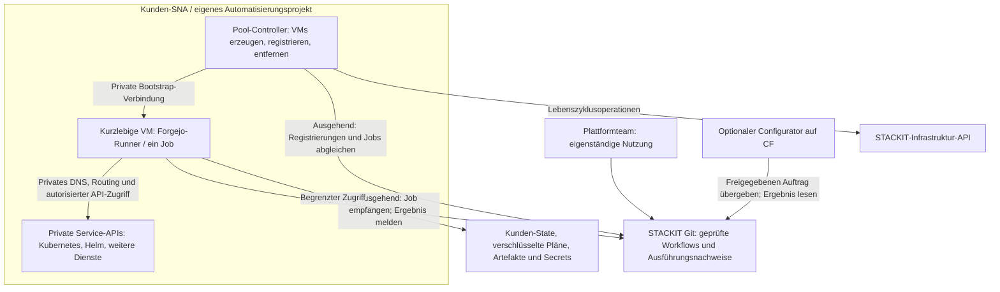

# Private-Runner-Konzept

[English](private-runner-concept.md) | [Deutsch](private-runner-concept.de.md)

Status: Architekturvorschlag vom 16.11.2026. STACKIT Git mit selbst betriebenen
VM-Runnern ist die vereinbarte Richtung. Dieses Dokument schlägt Komponenten,
Berechtigungen und Lebenszyklus vor; es implementiert oder aktiviert sie nicht.
Zugehöriges Feature: [#37](https://github.com/stackitcloud/stackit-landing-zone/issues/37).

## 1. Ziel und Abgrenzung

Platform Services werden über den STACKIT-Provider erstellt. Anschließend kann
ein weiterer Provider zur Konfiguration auf eine private Service-API zugreifen
müssen, beispielsweise Kubernetes oder Helm auf eine Control Plane innerhalb
einer SNA. Entscheidend ist der vom Provider verwendete Endpunkt, nicht allein
die Existenz des Dienstes. Auch Refresh und Plan können diesen Zugriff benötigen.

Dieser Ausführungsweg soll über STACKIT Git und private VM-Runner bereitstehen.
Der Accelerator bleibt eigenständig nutzbar. Der gehostete Configurator bleibt
auf Cloud Foundry und übergibt optional Aufträge an Git; er erhält keinen direkten
Netzwerkpfad in die Kunden-SNA. Die bisherige CF-Ausführung bleibt für ihre
unterstützten Aufgaben verfügbar. Jede State-Operation hat genau einen gewählten
Executor.

Eine automatische Veröffentlichung privater APIs, permanente Tunnel,
Produktionsdeployments oder die Migration bestehender States gehören nicht zur
Umsetzung dieses Konzeptdokuments.

Die Netzwerkausführung ändert keine Produktgrenzen: Bestehende Namespace-Dienste
zielen ausschließlich auf freigegebenes Platform Kubernetes. Zusätzliche
Namespace-Bausteine für Application-eigene Cluster werden damit nicht eingeführt.
Andere private Service-Provider benötigen jeweils eine eigene unterstützte
Konfigurations- und Berechtigungsintegration.

## 2. Gesamtarchitektur

Git koordiniert die Ausführung in beiden Betriebsarten. Der Configurator führt
keine zweite Warteschlange für private Runner ein und sendet keine Shell-Befehle
an VMs. Privater Bootstrap-Verkehr ist auf Controller-zu-Worker-Verbindungen
begrenzt; weder öffentlich eingehendes SSH noch eine eingehende CF-Verbindung in
die SNA ist erforderlich.

| Komponente | Aufgabe | Explizite Grenze |
| --- | --- | --- |
| STACKIT Git | Versionierte Workflows, Job-Start, Ausführungsidentität und Ergebnisse | Stellt selbst keine SNA-Verbindung her |
| Pool-Controller | Sollkapazität abgleichen; Worker erzeugen, registrieren, entfernen und bereinigen | Führt keine Kunden-OpenTofu-Jobs aus; erhält keine allgemeinen Organisations-Owner-Zugangsdaten |
| Worker-VM | Genau einen autorisierten Pipeline-Job mit gepinnter Laufzeit ausführen | Erhält weder VM-Verwaltungsidentität noch Registrierungszugang des Controllers |
| State-/Artefaktspeicher | Dauerhafter State, verschlüsselte gespeicherte Pläne, unveränderliche Pakete und Nachweise | Überlebt die Worker; Zugriff nach State und Operation getrennt |
| Secrets-Dienst | Begrenzte Ausführungs- und Registrierungsmittel | Getrennte Controller-, Worker- und Dienstidentitäten |
| Optionaler Configurator-Adapter | Kundenberechtigungen prüfen, exakt freigegebene Eingaben übergeben, Status und Ergebnisse anzeigen | Erfolgreicher API-Aufruf bedeutet keinen erfolgreichen Apply |

Controller und Git-Integration sind neu zu entwerfende Komponenten, keine bereits
vorhandenen Funktionen des CF-Runners.

## 3. Platzierung und Netzwerkmodell

Ein eigenes Automatisierungsprojekt innerhalb der Platform Landing Zone wird an
die betreffende SNA angebunden. Controller und Worker erhalten getrennte
Subnetze und Security Groups. Ein bestehendes Management-Projekt kommt erst nach
Prüfung von Auswirkungsbereich und Netzwerkanbindung infrage. Worker gehören
weder auf die Connectivity-Firewall noch in den verwalteten Zielcluster.

Ein Pool gehört zu genau einer Kundenorganisation, SNA, Region und Umgebung bzw.
Vertrauensdomäne. Prod und Nicht-Prod bleiben getrennt. Stärkere Mandanten- oder
Workload-Grenzen benötigen eigene Pools/Projekte, nicht nur andere Labels. Ein
zentrales Projekt genügt nur, wenn freigegebene Routen tatsächlich alle gewollten
Endpunkte erreichen. Mehrere isolierte SNAs benötigen getrennte erreichbare
Ausführungsbereiche. Worker werden nicht an mehrere Vertrauensbereiche angebunden,
um zusätzliche Pools einzusparen.

| Richtung | Erforderlicher Zweck |
| --- | --- |
| Controller ausgehend | Git-Runner-Verwaltung, STACKIT-VM-API, begrenzte Secrets und Lebenszyklusnachweise |
| Controller zum Worker, privat | Nur initialer authentifizierter Bootstrap; auf Controller-Quelle begrenzen, danach schließen |
| Worker ausgehend über HTTPS | Git, freigegebene Paket-/Image-/Provider-Quellen, State-/Artefaktspeicher, begrenzter Secret-Abruf und benötigte STACKIT-APIs |
| Worker zum Dienst, privat | Exakte API-Ziele und Ports, etwa Kubernetes-API; kein pauschaler Zugriff auf alle Spokes |
| DNS | Korrekte Auflösung der Service-Endpunkte, einschließlich öffentlicher Resolver-Anforderungen des gewählten SKE-Netzwerkmodus |

Worker benötigen keine öffentliche IP. Kontrollierter ausgehender Verkehr läuft
über den vorgesehenen Netzwerk-/Firewall-Pfad; ein öffentlicher Git-Endpunkt
verlangt keinen öffentlichen Worker. Zertifikatsprüfung und Zeitsynchronisation
müssen möglich sein. SNA-Mitgliedschaft allein bestätigt weder Routing, DNS und
TLS noch Dienstberechtigungen. Diese werden aus der tatsächlichen Job-Umgebung
geprüft, bei Containern einschließlich deren Netzwerk. Git-ACLs müssen die
vorgesehenen Egress-Adressen zulassen.

## 4. Native Ausführungsphasen und State-Verantwortung

Die folgenden Namen beschreiben vorgeschlagene Grenzen, keine bereits
vorhandenen Verzeichnisse oder neu unterstützten Befehle.

| Phase | Erzeugt/konfiguriert | Ausführung | State |
| --- | --- | --- | --- |
| Foundation | Governance, Netzwerk, Git, State-/Secret-Referenzen, Automatisierungsprojekt und Runner-Infrastruktur | Vertrauenswürdiger Arbeitsplatz oder geeigneter Runner mit Zugriff auf öffentliche APIs | Foundation- und Runner-Lebenszyklus-States, unabhängig wiederherstellbar |
| Service-Infrastruktur | Managed Service über STACKIT-Provider | Öffentlicher oder privater Runner, explizit gewählt | Eigener Service-Infrastruktur-State |
| Service-Konfiguration | Kubernetes-/Helm- oder andere Ressourcen über private Service-APIs | Qualifizierter privater Pool | Getrennter Service-Konfigurations-State |

Die Foundation muss sich ohne privaten Pool initialisieren lassen. Innerhalb
dieser Phase bleibt der Pool-Lebenszyklus-State unabhängig von Jobs, die im Pool
laufen. Controller und OpenTofu dürfen nicht dieselben Ressourcen konkurrierend
verwalten: IaC besitzt Controller/Netzwerk, unveränderliches Worker-Profil,
Grenzen und Richtlinien; der Controller besitzt kurzlebige Worker-Instanzen und
Registrierungen. Worker-VMs werden nicht gleichzeitig als feste IaC-Ressourcen
geführt.

Getrennte OpenTofu-Roots, Provider-Konfigurationen und Backend-Schlüssel sind
vorgesehen. Eine reine Aufteilung in Workflow-Schritte oder regelmäßiges
`-target` beseitigt private Provider-Abhängigkeiten bei Refresh/Initialisierung
nicht. Vor der Implementierung ist ein explizites natives Vertrags- und
State-Migrationsdesign erforderlich; der heutige vollständige Root unterstützt
diese Aufteilung noch nicht.

Zwischen Phasen wird ein geprüfter minimaler Output-Vertrag übergeben:
Dienstidentität, Endpunkt, Trust-/CA-Referenz, Generation und zulässiger Pool.
Keine Zugangsschlüssel oder vollständigen States exportieren und nachgelagerten
Jobs keine unbegrenzten Leserechte auf vorgelagerten State geben. Zugangsdaten
werden separat aufgelöst. Nachgelagerte Pläne sind an die Version des vorgelagerten
Vertrags gebunden; relevante Output-Änderungen erfordern einen neuen Plan.

Bei der Erstbereitstellung kann die private Konfiguration erst geplant werden,
wenn der Dienst existiert und die Bereitschaftsprüfung besteht. Sie erhält daher
eine eigene Prüfung/Freigabe; ein vollständiger initialer Gesamtplan wird nicht
versprochen. Änderungen an zwei States sind nicht atomar. Teilfortschritte müssen
sichtbar bleiben. Beim Abbau zuerst Provider-verwaltete Dienstinhalte entfernen,
danach deren API/Dienst und zuletzt Runner-/Netzwerkinfrastruktur. Verlorene
Endpunkte verlangen einen geprüften Wiederherstellungsweg statt blinder
State-Entfernung.

## 5. Betrieb ohne Configurator

1. Das Plattformteam wählt eine freigegebene Accelerator-/Laufzeitrevision und
   erzeugt Foundation und Runner-Profil über IaC.
2. Ein separat autorisierter Registrierungsschritt verbindet Controller/Pool mit
   dem gewählten STACKIT-Git-Repository. Git wird vom Kunden kontrolliert; eine
   vorhandene kompatible Instanz kann genutzt werden. Configurator-Datenbank,
   -Broker oder -Konto werden nicht benötigt.
3. Gewöhnliche PR-/Build-Prüfungen nutzen nach Eignung verwaltete Runner. Geprüfte
   Infrastruktur-Workflows wählen explizit den erforderlichen privaten Pool.
4. Die Dienst-Erstellung endet vor der privaten Konfigurationsphase. Der Worker
   prüft Output-Vertrag, Verbindung, TLS und Dienstberechtigungen.
5. Plan erzeugt einen verschlüsselten gespeicherten Plan und eine bereinigte
   Prüfzusammenfassung. Apply verlangt die Freigabe genau dieses Plans,
   Quellstands und Ziels und kann auf einer frischen VM desselben qualifizierten
   Pools erfolgen.
6. Ergebnisse, Herkunftsnachweise und Teilfehler bleiben nach dem Löschen des
   Workers verfügbar.

Ein Runner-Label wie `private-prod-eu01-pool-a` dient der Job-Zuordnung, nicht der
Autorisierung. Registrierung auf den engsten unterstützten Repository-Bereich
begrenzen; Workflow-Änderungen und ausführbare Ereignisse/Refs kontrollieren.
Nicht vertrauenswürdige PRs, Forks und allgemeine Anwendungs-Builds dürfen keine
privilegierten privaten Pools erreichen. Repository-Schreibzugriff und
Ausführungsberechtigung sind getrennte Rollen. Forgejo-Freigabe-/Schutz-APIs
müssen für die tatsächlich betriebene Managed-Git-Version geprüft werden;
GitHub-Environment-Verhalten ist nicht unverändert vorauszusetzen.

## 6. Betrieb mit Configurator

Dieselben kundeneigenen Git-Workflows und privaten Pools verwenden. Ein
Git-Ausführungsadapter ergänzt den bisherigen CF-Adapter. Private Ausführung
wird nicht als zweiter proprietärer VM-Agent entworfen.

Der Kunde verbindet Git-Instanz/Repository und qualifizierten Pool ausdrücklich
mit Workspace/Organisation. Serverseitige Prüfungen binden angeforderte Phase,
Ziel, State-Schlüssel, Quell- und Eingabeprüfsumme, Engine-/Provider-Versionen,
Pool und handelnde Identität an einen unveränderlichen Auftrag. Ziel-/Pool-Wahl
wird gegen registrierte Metadaten autorisiert, nicht aus Browser-Labels übernommen.

Der Configurator übergibt einen festgelegten geprüften Workflow mit
unveränderlicher Quellrevision und undurchsichtigen Referenzen auf geschützte
Eingaben. Git erhält keine betreiberweiten Configurator-Secrets. Sensible
Konfiguration, Zugangsdaten, Pläne und Roh-State gehören weder in
Dispatch-Eingaben noch in Git-Logs. Konkrete Git-Dispatch-API, Fixierung des
Quellstands und Zugangsumfang benötigen einen getesteten Integrationsvertrag.

Für Plan liefert Git einen zugeordneten Lauf und einen signierten oder
gleichwertig authentifizierten Ergebnisnachweis. Für Apply dokumentiert der
Configurator die Nutzerfreigabe des exakten gespeicherten Plans. Der ausführende
Workflow prüft vor privilegierter Ausführung einen zeitlich begrenzten, einmalig
nutzbaren Freigabenachweis. Workflow-Start oder Git-Token allein sind keine solche
Freigabe. Der eigenständige Weg liefert eine gleichwertige Freigabe über
kundenseitig kontrollierte Git-Prozesse. Speicherung und Prüfung der Freigabe
müssen vor Aktivierung beider Wege spezifiziert werden. Fehlende Schutzfunktionen
werden nicht stillschweigend durch automatischen Apply ersetzt.

Die Ergebnisübernahme prüft Herkunft, Job-/Auftragsidentität und erwartete
Prüfsummen. Callbacks sind authentifiziert und können durch Polling ergänzt
werden. Entzogene Berechtigungen, abgelaufene Freigaben, Abbruch und veraltete
Konfigurationen müssen verhindern, dass wartende Jobs starten oder Secrets
abrufen. Liefert der Dispatch ein uneindeutiges Ergebnis, zuerst über die
Korrelations-ID abgleichen statt einen zweiten Job zu erzeugen.

Eine Deployment-/State-Operation verwendet genau einen Executor. Ein Wechsel von
CF zu Git ist eine explizite Migration, die Backend, Locking, Ressourcenadressen
und Nachweise offener Operationen erhält. Vorbereitete Pläne oder Applies werden
nicht still zwischen Ausführungs-Engines verschoben.

## 7. VM- und Zugangsdaten-Lebenszyklus

Empfohlenes Zielbild: ein kleiner Controller mit ersetzbarer Kapazität und
kurzlebige Worker-VMs für jeweils genau einen Pipeline-Job. Plan und Apply laufen
üblicherweise auf unterschiedlichen VMs mit demselben gepinnten Paket und dem
geschützten gespeicherten Plan.

Der Controller erzeugt einen Worker aus einem geprüften unveränderlichen Image,
verwendet einen VM-spezifischen temporären Bootstrap-Schlüssel im privaten Netz,
installiert die individuelle Runner-Konfiguration und schließt den
Bootstrap-Zugang. Nur der öffentliche Bootstrap-Schlüssel darf in cloud-init
stehen. Registrierungs- und Ausführungsschlüssel gehören weder in User Data noch
in Images oder IaC-State. Sichere Übertragung und anschließende Entfernung des
Bootstrap-Zugangs müssen mit dem gewählten VM-Image nachgewiesen werden.

Git-Registrierungsbefugnisse bleiben beim Controller und werden so eng begrenzt,
wie der Managed Service es erlaubt. Der Worker erhält nur seinen individuellen
Runner-Zugang. Ausführungszugänge werden für das exakte Ziel und die Operation
über einen getrennten autorisierten Secret-Freigabemechanismus abgerufen. Native
VM-Workload-Identität, kurzlebige Dienstzugänge oder OIDC-Föderation werden nicht
für jeden STACKIT-Dienst vorausgesetzt. Sind langlebige Zugangsdaten unvermeidbar,
werden sie eng begrenzt im Secrets-Dienst gehalten und ausdrücklich rotiert bzw.
widerrufen. Eine kurzlebige VM macht Dienstzugangsdaten nicht kurzlebig.

Forgejos Ephemeral-Registrierung hängt von der Version ab. Managed-Git-Server,
Runner, Einmalverhalten und Registrierungs-API müssen gemeinsam geprüft werden.
Serverseitige Einmalregistrierung ist die bevorzugte Produktionsvoraussetzung.
Ein Shutdown-Skript allein beweist nicht, dass kein zweiter Job zugewiesen werden
kann. Fehlt die Funktion, wird die Kompatibilitätslücke dokumentiert und vor dem
Produktivbetrieb eine gleichwertige Begrenzung entworfen und getestet; sie gilt
nicht als bereits gelöst.

Nach Job-Ende VM und Datenträger löschen und Runner abmelden. Wartende,
fehlgeschlagen registrierte und verlorene Worker mit begrenzten Leases und TTLs
abgleichen. Eine Ephemeral-Git-Registrierung löscht selbst keine Cloud-Ressourcen.
Nach unklarem Job-Ausgang die VM ausmustern statt in den freien Pool zurückgeben.
Aktive Jobs, Gesamtzahl der VMs, freie Kapazität und Lebensdauer begrenzen.
Warmkapazität kann bei null starten; Größe und AZ-Verteilung folgen gemessener
Wartezeit und Startlast statt einem festen Leistungsversprechen.

Worker erhalten weder Netzwerkpfad/Zugangsdaten für die Controller-Verwaltung
noch für andere Pools oder die Configurator-Infrastruktur. VM-Metadatenzugriff
aus Job-Containern auf den Bedarf der gewählten Bootstrap-/Laufzeitlösung
begrenzen. Die VM ist die Isolationsgrenze. Container dienen der Paketierung und
bilden keine mandantenübergreifende Sicherheitsgrenze.

## 8. State, Fehler und Wiederherstellung

| Dauerhafte Information | Verantwortung/Speicherort |
| --- | --- |
| Foundation- und Service-State | Kunden-Backend mit geprüftem Locking, Zugriffsschutz, Verschlüsselung und Versionierungs-/Restore-Regeln |
| Workflow-/Quell-/Laufzeitherkunft | Kunden-Git plus unveränderliches Artefaktmanifest |
| Gespeicherter Plan und sensible Job-Eingaben | Verschlüsselter Kundenspeicher; begrenzte Aufbewahrung und ausdrücklich autorisierte Leser |
| Worker-/Registrierungsbestand, Leases, Bereinigungsstatus | Dauerhafter Controller-Lebenszyklusspeicher, unabhängig von Configurator und kurzlebigen Datenträgern |
| Freigaben und Ergebnisnachweise | Kundenseitige Ausführungsnachweise; bei Nutzung verknüpfte Configurator-Datensätze |
| Registrierungs- und Dienstzugänge | Begrenzter Secrets-Dienst; eigener Lebenszyklus und Rotation |

Git-Concurrency-Gruppen ersetzen kein Backend-Locking. Das Verhalten muss für
gewähltes Backend und Engine geprüft werden. Wiederherstellungsnachweise vor dem
Löschen der VM sichern; ein unklarer Apply wird nicht hinter erfolgreicher
Bereinigung verborgen. Gespeicherte Pläne als Secrets behandeln; bereinigte
Zusammenfassungen sind Prüfansichten, keine maßgeblichen Ausführungsartefakte.

Abbruch widerruft künftigen Secret-Zugriff und stoppt wartende Aufträge; ein
laufender Apply kann bereits Ressourcen geändert haben. Job stoppen/abgleichen,
State und Cloud-Auswirkungen prüfen und einen frischen Plan erzeugen. Kein
automatischer Apply-Neustart oder Force-Unlock nur wegen einer verschwundenen VM.
Controller-Neustart stellt Registrierungen und Leases wieder her, ohne unklare
Operationen neu zu starten. Der Controller lässt sich aus IaC und geschützten
Lebenszyklusnachweisen wiederherstellen und darf nicht vom Zielcluster abhängen.

Der Verlust eines Workers betrifft einen Job. Controller-Ausfall stoppt neue
Kapazität, darf aber gesunde laufende Jobs nicht beenden. Redundante Controller
benötigen Leader Election/Leases und Tests gegen doppelte Bereitstellung; zwei
VMs allein belegen keine Hochverfügbarkeit. State, Secret-Referenzen, Freigaben
und Controller-Bestand zusammen sichern und wiederherstellen. Ein dokumentierter
autorisierter Arbeitsplatz-Zugang bleibt als Wiederherstellungsweg bei
Git-/Controller-Ausfall erhalten, mit denselben State-Verantwortlichkeiten und
Locking-Regeln.

## 9. Umsetzungsschritte und Abnahme

1. **Kompatibilitätsprüfung:** Managed-Git-/Server-/Runner-Versionen, private
   Erreichbarkeit, Registrierungs-/Dispatch-/Ergebnis-APIs, Freigabeverhalten und
   Einmalregistrierung prüfen. Kosten, Berechtigungen und unbestätigte Annahmen
   dokumentieren.
2. **Eigenständiger vollständiger Ablauf:** native States/Roots trennen; einen
   kurzlebigen VM-Worker bereitstellen; einen bestimmten Testdienst erzeugen;
   dessen private Konfiguration über Kunden-Git planen, freigeben, anwenden und
   abbauen.
3. **Lebenszyklusqualifikation:** Pool-Grenzen, Kalt-/Warmstarts, getrennte
   Zugangsdaten, Controller-Neustart, Bereinigung wartender/verwaister Worker
   sowie Updates und Berechtigungsentzug.
4. **Configurator-Adapter:** dieselben Workflows/Pakete, ausdrückliche
   Kundenanbindung, quellgebundene Freigabe, zugeordnete Ergebnisse, Abbruch und
   Executor-Wahl.
5. **Produktionsqualifikation:** unterstützte Dienstmodi, Restore-Übungen,
   Verfügbarkeits-/Kapazitätsnachweise und geprüfte Migration/Betriebsanleitung.

Die Abnahme muss private DNS-/TLS-/Berechtigungsprüfungen, verweigerten Zugriff
vom öffentlichen/geteilten Runner, Plan und Apply von qualifizierten privaten
VMs, abgewiesene fremde Repository-/Pool-Zugriffe, abgelaufene/wiederholte
Freigaben, unveränderte Plan-Artefakte, gleichzeitige State-Schreiber, verlorene
Apply-Antworten, Bereinigung sowie eigenständigen Betrieb bei nicht verfügbarem
Configurator nachweisen. Negativfälle ohne Kundensecrets oder Roh-State
protokollieren. Kein automatischer Wechsel zu öffentlicher Control Plane oder
deaktiviertem TLS.

Offene Designentscheidungen: eigenes oder geprüftes bestehendes Management-Projekt;
Pool-Grenzen und Diensterreichbarkeit; Freigabe- und Einmaljob-Kompatibilität von
Managed Git; dauerhafte Controller-Koordination; Zugangsdatenübertragung;
Eingabe-/Ergebnisschemata und Artefaktaufbewahrung; dienstspezifische
Root-/State-Migration; erwartete Kapazität, Verfügbarkeit und Kosten. Diese Punkte
brauchen Entscheidungen und Qualifikation statt versteckter Defaults einer
Erstimplementierung.

## 10. Quellen und aktuelle Implementierungsgrenzen

Quellen am 16.11.2026 geprüft. Architektur und vorgeschlagene Verträge sind unser
Entwurf, keine Zusage von Funktionen verwalteter STACKIT-Runner.

- [STACKIT Git Custom Runners](https://docs.stackit.cloud/products/developer-platform/git/how-tos/pipelines-custom-runner/): selbst betriebene Forgejo-Runner, auch für private Netze.
- [Forgejo-Runner-Sicherheit](https://forgejo.org/docs/v15.0/admin/actions/security/): Registrierungsumfang und versionsabhängiges Ephemeral-Verhalten; Kompatibilität der Managed-Git-Instanz prüfen.
- [Private SKE-Cluster](https://docs.stackit.cloud/products/runtime/kubernetes-engine/how-tos/enable-private-clusters/): SNA-Erreichbarkeit, Routing- und DNS-Voraussetzungen. Die Seite beschreibt private Control Planes derzeit als Private Preview; das Architekturkonzept hebt diese Produktgrenze nicht auf.
- [Bestehende private Ausführungsgrenze](../landing-zone-configurator/docs/accelerator-limitations.de.md#private-kubernetes-api-ausführungsgrenze) und [heutige Ausführungsarchitektur](../landing-zone-configurator/docs/plan-execution.de.md): kein nachgewiesener Kunden-SNA-Pfad vom aktuellen CF-Runner; native Phasentrennung bleibt Umsetzungsarbeit.

Der bestehende GitHub-Actions-Katalog beschreibt aktuelle Repository-Workflows.
Die vorgeschlagene Kundenpipeline auf STACKIT Git ist kein zusätzlich
implementierter Workflow und wird erst nach ihrer Umsetzung als unterstützte
Ausführung dort aufgenommen.
