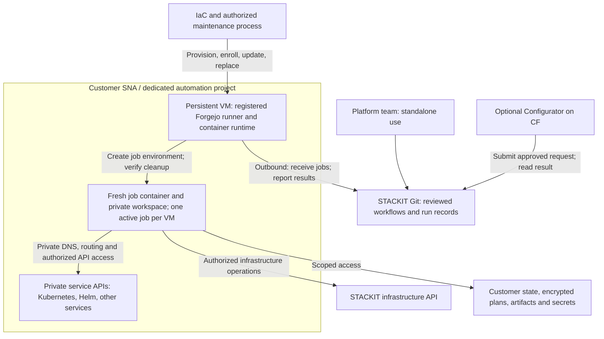

# Private runner concept

[English](private-runner-concept.md) | [Deutsch](private-runner-concept.de.md)

Status: architecture proposal, 2026-11-16. STACKIT Git with customer-operated
persistent VM runners with a fresh container environment per job is the agreed
direction. This document proposes the component, authorization and lifecycle
contracts; it does not implement or enable them. Related feature:
[#37](https://github.com/stackitcloud/stackit-landing-zone/issues/37).

## 1. Objective and boundary

Platform services are created through the STACKIT provider. Their configuration
may then require another provider to contact a private service API, for example
Kubernetes or Helm accessing an SNA-only control plane. Reachability depends on
the endpoint used by that provider, not merely whether the service exists.
Refresh and Plan can need the same access as Apply.

Provide that execution path through STACKIT Git and private VM runners. The
Accelerator must remain independently consumable. The hosted Configurator stays
on Cloud Foundry and optionally submits work to Git; it gains no direct network
path into the customer's SNA. Existing CF execution remains available for its
supported workloads, with one selected executor for each state operation.

No automatic public API exposure, permanent tunnel, production deployment or
migration of existing state is part of this concept.

Private execution does not change product boundaries: existing Namespace
services target approved Platform Kubernetes only. It does not introduce
Namespace Building Blocks for Application-owned clusters. Other private service
providers each require a supported configuration and authorization integration.

## 2. Overall architecture

Git is the common execution coordinator in both operating modes. The
Configurator does not introduce another private-runner queue or send shell
commands to VMs. The fixed-capacity baseline needs no dedicated autoscaling/pool
controller: IaC provisions persistent hosts, an authorized maintenance process
enrolls and updates them, and Git schedules jobs on registered runners. No
public inbound SSH or inbound CF-to-SNA connection is required. Administrative
bootstrap and maintenance use a separately authorized private management path.

| Component | Responsibility | Explicit boundary |
| --- | --- | --- |
| STACKIT Git | Versioned workflows, job dispatch, run identity and results | Does not itself provide SNA connectivity |
| IaC and maintenance process | Own fixed VM capacity, image/runtime policy, enrollment, drain, updates and replacement | No per-job VM creation or new proprietary controller is required |
| Persistent runner VM | Poll Git and create/clean job environments; initially one active job per host | Holds only its runner identity; infrastructure-management credentials are not inherited by jobs |
| Fresh job container | Execute one authorized job with a pinned image, private workspace and scoped credentials | No host execution, privileged mode, host daemon socket or arbitrary host mounts |
| State/artifact storage | Durable state, encrypted saved plans, immutable packages and receipts | Outlives job containers and VM replacement; access separated per state/operation |
| Secrets service | Scoped execution and enrollment material | Separate provisioning, runner and service identities |
| Configurator adapter, optional | Check permissions; submit exact approved input; display status/results | A successful API dispatch is not a successful Apply |

Git integration, container policy and maintenance automation require
implementation/qualification; they are not existing capabilities of the CF
Runner.

## 3. Placement and network model

Use a dedicated automation project within the Platform Landing Zone, attached to
the relevant SNA, with runner subnets/security groups and a separately
controlled management path. An existing management project is an option only
after reviewing its blast radius and network attachment. Do not place runners on
the connectivity firewall or in the target Kubernetes cluster.

A pool belongs to one customer organization, SNA, region and environment/trust
domain. Prod and non-production are separate. Stronger tenant or workload
boundaries require separate pools/projects, not just labels. A central project
is sufficient only where approved routes actually reach every intended endpoint;
multiple isolated SNAs require distinct reachable execution domains. Do not
multi-home a runner across trust boundaries to avoid creating additional pools.

| Direction | Required purpose |
| --- | --- |
| Authorized administration to VM, private | Initial enrollment and maintenance; restrict to the management path, never grant it to job containers |
| Runner daemon outbound HTTPS | Git job polling, job/result transport and approved runtime updates |
| Job container outbound HTTPS | Approved package/image/provider sources, state/artifact storage, scoped secret retrieval and relevant STACKIT APIs |
| Job container to service, private | Exact API destinations/ports, for example Kubernetes API; no blanket access to all spokes |
| DNS | Correct service endpoint resolution, including public resolver requirements of the selected SKE network mode |

VMs need no public IP. Provide controlled egress through the approved network/
firewall path; a public Git endpoint does not require a public runner VM. Allow
necessary certificate validation and time synchronization. SNA membership proves
neither routing, DNS, TLS nor service permissions. Probe from the actual
container network: VM reachability alone is insufficient. Check container subnet
overlap, forwarding/NAT and the source address observed by service firewalls.
Git ACLs must admit the intended egress addresses.

## 4. Native execution phases and state ownership

The following names describe proposed boundaries, not existing directories or
newly supported commands.

| Phase | Creates/configures | Execution | State |
| --- | --- | --- | --- |
| Foundation | Governance, network, Git, state/secrets references, automation project and runner infrastructure | Trusted workstation or suitable public API runner | Foundation and runner lifecycle states, independently recoverable |
| Service infrastructure | Managed service via STACKIT provider | Public or private runner, selected explicitly | Service infrastructure state |
| Service configuration | Kubernetes/Helm or other private-API provider resources | Qualified private pool | Separate service configuration state |

Foundation must support bootstrapping without a private pool. Within it, keep
the pool lifecycle state independent of jobs executed by that pool. IaC owns the
fixed runner VMs, network, image/runtime policy and capacity. The maintenance
process owns enrollment, drain and credential rotation; the runner owns
transient job containers, workspaces and cleanup. No second controller creates
or deletes the same IaC-managed VMs. Runner infrastructure maintenance uses an
independent trusted execution path; a host must not destroy or replace itself
while running its own maintenance Apply.

Use separate OpenTofu roots/provider configurations and backend keys. Splitting
only workflow steps or relying on routine `-target` runs does not remove private
provider refresh/initialization dependencies. This requires an explicit native
contract/state migration design before implementation; today's complete root
cannot be advertised as already supporting this split.

Pass a reviewed minimal output contract between phases: service identity,
endpoint, trust/CA reference, generation and allowed pool. Do not export access
keys or full state, or grant a downstream job unrestricted upstream-state reads.
Credentials are resolved separately. Bind downstream plans to the upstream
contract version and replan when relevant upstream outputs change.

On first creation, private configuration can be planned only after the service
exists and passes readiness checks. It therefore has its own review/approval,
not a promise of one complete initial Plan. Changes to two states are not
atomic; show partial completion explicitly. Remove provider-managed service
contents before deleting their API/service, then retire the runner/network
infrastructure last. Lost endpoints require a reviewed recovery path, not blind
state removal.

## 5. Operation without the Configurator

1. The platform team selects an approved Accelerator/runtime revision and
   bootstraps the foundation and persistent runner VMs through IaC.
2. A separately authorized enrollment step registers each persistent VM runner
   with the chosen STACKIT Git repository. Git is customer-controlled; an
   existing compatible instance may be used. No Configurator database, broker or
   account is required.
3. Ordinary PR/build checks use managed runners where suitable. Reviewed
   infrastructure workflows explicitly select the required private pool.
4. Service creation finishes before the private configuration phase. The job
   container verifies the output contract, connectivity, TLS and service
   permissions.
5. Plan produces an encrypted saved plan plus a sanitized review summary. Apply
   requires approval for that exact plan/source/target and runs in a new
   container on any available VM in the same qualified pool; it never relies on
   the Plan workspace.
6. Results, provenance and partial failures remain available after container
   cleanup and VM replacement.

A runner label such as `private-prod-eu01-pool-a` is a scheduling hint, not an
authorization boundary. Restrict runner registration to the narrowest supported
repository scope; control workflow changes and which events/refs may execute.
Untrusted PRs, forks and general application builds must not reach privileged
private pools. Repository write access and execution authority are separate
roles. Forgejo approval/protection APIs must be qualified on the actual managed
Git version; do not assume GitHub Environment behavior is available unchanged.

## 6. Operation with the Configurator

Use the same customer Git workflows and private pools. Add a Git execution
adapter alongside the current CF adapter; do not redesign private execution as a
second proprietary VM agent.

The customer explicitly connects a Git instance/repository and a qualified pool
to a workspace/organization. Server-side checks bind the requested phase,
target, state key, source digest, input digest, engine/provider versions, pool
and initiating identity to an immutable request. Target/pool selection is
authorized against registered metadata, not accepted from browser labels.

The Configurator submits a fixed reviewed workflow at an immutable source
revision with opaque references to protected inputs. Git receives no
Configurator operator-wide secrets. Sensitive configuration, credentials, plans
and raw state do not belong in dispatch inputs or Git logs. The actual Git
dispatch API, source-pinning behavior and credential scopes need a tested
integration contract.

For Plan, Git returns a correlated run and a signed or equivalently
authenticated result receipt. For Apply, the Configurator records the user's
approval of the exact saved plan; the execution workflow validates a bounded,
single-use approval record before privileged execution. A workflow dispatch or
Git token alone is not that approval. The standalone route supplies equivalent
approval through customer-controlled Git processes. Approval
persistence/verification must be specified before enabling either route;
unsupported protection features are not silently replaced by automatic Apply.

Result ingestion verifies origin, job/request identity and expected digests;
callbacks are authenticated and can be supplemented by polling. Revoked access,
expired approvals, cancellation and stale configurations must prevent queued
work from starting or obtaining secrets. Do not duplicate the job when dispatch
returns an ambiguous result: reconcile by correlation ID first.

One deployment/state operation uses exactly one executor. Changing from CF to
Git is an explicit migration preserving backend, locking, resource addresses and
pending-operation evidence. Do not silently move an existing prepared Plan or
Apply between execution engines.

## 7. Persistent VM and job-container lifecycle

The selected baseline is a fixed pool of persistent VM hosts, each running a
persistently registered Forgejo runner daemon and a supported container runtime.
Each pipeline job receives a fresh container environment, workspace and
temporary volumes. Start with one active job per VM; additional VMs provide
parallelism. Job/service containers, networks and temporary files belong to that
job only. Plan and Apply are separate jobs, even when they happen to use the
same host.

### Provisioning and registration

IaC provisions hosts from reviewed images. A separately authorized enrollment
step installs/configures the pinned runner and container runtime, registers each
runner at the narrowest supported repository scope and protects the persistent
runner credential on the host. Enrollment authority stays in the maintenance
process, not in job containers. Only public bootstrap keys belong in cloud-init;
registration credentials and execution keys must not be embedded in user data,
images or IaC state. Qualify secure delivery and bootstrap access removal.

Persistent registration is intentional; Forgejo ephemeral one-job registration
is not a prerequisite for this model. Pin and qualify managed Git/server/runner
compatibility, container execution, capacity limits and cleanup. Do not copy a
`:host` execution example from setup documentation: jobs must run in the
approved container environment. Enforce/review restrictions on workflow
overrides, container options, actions, mounts and service containers.
Unsupported enforcement is a recorded compatibility gap, not permission to allow
arbitrary workflows.

### Job execution and cleanup

1. Accept only a permitted workflow/source/target and allocate a unique
   workspace.
2. Create a container from the approved digest-pinned runtime image, with
   resource limits, an unprivileged job user where supported and the required
   network path.
3. Obtain operation-scoped execution credentials and protected inputs; do not
   expose runner registration files, SSH keys, host home or management identity.
4. Execute the job; persist authenticated results and recovery evidence
   externally.
5. Revoke/release job credentials where supported. Remove job and service
   containers, temporary volumes/networks, workspaces and credential material.
6. Verify cleanup before accepting another job. If cleanup or host integrity
   cannot be established, remove the runner from scheduling and rebuild the VM.

Do not mount the host Docker/Podman socket into jobs, allow privileged job
containers or share writable working directories. The runner daemon may require
privileged access to the container runtime; that authority stays on the host.
Job containers must not reach host administration or sensitive VM metadata.
Container runtime escape or a compromised runner could still affect subsequent
jobs: persistent hosts are shared only within the same approved trust domain,
never advertised as fresh VM isolation between jobs or customers.

Service credentials are separate from the runner identity and are resolved for
the exact operation through an authorized secret-release mechanism. Do not
assume native VM identity, short-lived credentials or OIDC federation for every
STACKIT service. Where long-lived credentials are unavoidable, scope and rotate
them in the secrets service. Deleting a container does not revoke a copied
credential.

### Performance and maintenance

Keep hosts registered and ready; normal dispatch does not wait for VM creation,
bootstrap or re-registration. Pre-pull approved images and prepare verified
provider/module packages. Use immutable or read-only caches separated by trust
domain and engine/provider version; populate through controlled maintenance.
Avoid concurrent writes to shared provider caches and check lockfiles/checksums.
Never cache backend credentials, plans, raw state, `.terraform` working
directories or job secrets. Refresh/Plan, backend access and provider API
latency remain; measure queueing, container start, init, planning and cleanup
separately.

Specify a nonzero ready host count for an enabled pool; its exact size, quotas,
AZ placement and cost are sizing decisions. Fixed VM count bounds concurrency;
no dynamic controller is required. Drain a host before updates/replacement,
finish or explicitly reconcile its active job, rotate/deregister its identity,
replace through IaC and verify the replacement before returning capacity. Do not
stop an active Apply for routine maintenance or rely on an interactive approval
waiting inside an occupied job container.

Ready hosts incur VM/storage costs while idle; replacement may temporarily
require additional capacity. Set bounded job and cleanup timeouts, disk limits
and alerts. Compare these fixed costs against measured startup savings before
choosing the pool size.

A warm one-job VM pool or management Kubernetes may be evaluated later for other
isolation/scaling needs. Neither is part of the selected baseline.

## 8. State, failures and recovery

| Durable information | Owner/location |
| --- | --- |
| Foundation, runner infrastructure and service state | Customer backend with verified locking, access controls, encryption and version/restore policy |
| Workflow/source/runtime provenance | Customer Git plus immutable artifact manifest |
| Saved plan and sensitive job inputs | Encrypted customer storage; bounded retention and explicit authorized readers |
| VM/registration mapping, health, drain and cleanup status | IaC inventory, Git runner records and protected operations records; independent of Configurator and job workspaces |
| Approvals and result receipts | Customer execution records; Configurator keeps linked records when used |
| Enrollment, runner and service credentials | Scoped secrets service and protected host configuration with separate lifecycle/rotation |

Git concurrency groups are not a substitute for backend locking. Validate lock
behavior against the selected backend/engine. Persist recovery evidence before
container cleanup; never hide an unknown Apply behind a green cleanup result.
Saved plans are secrets; sanitized summaries are not execution artifacts.

Cancellation revokes future secret access and stops queued work; a running Apply
may already have changed resources. Stop/reconcile the job, inspect state and
cloud effects, then create a fresh Plan. No automatic Apply replay or
force-unlock solely because a container or VM disappeared. A runner/VM restart
must not replay an uncertain job or return a dirty workspace to scheduling.
Separate uncertainty about resource changes from failed cleanup/host compromise;
the latter requires quarantine and replacement, not just another job container.

A VM loss affects at most its one active job and reduces available capacity.
Other healthy hosts can serve new jobs; multiple hosts/AZs require actual
failover and capacity tests before claiming availability. A Git outage stops new
dispatch and approval; do not assume active jobs have stopped or retry Apply.
Host heartbeat, disk pressure, job age, cleanup failures, image/runtime versions
and remaining capacity need monitoring and an explicit quarantine path.

Rebuild hosts from IaC and pinned images, enroll them with fresh runner
identities and retire old registrations. Back up and restore state, secrets
references, approvals, results and VM/registration inventory together;
persistent VM disks are not the authoritative job/state recovery store. Keep a
documented authorized workstation recovery path for Git/pool outages with the
same ownership/locking.

## 9. Delivery sequence and acceptance

1. **Compatibility spike:** confirm managed Git/server/runner versions, private
   container reachability, persistent enrollment/dispatch/result APIs, approval
   behavior, container policy and verifiable cleanup. Record costs, permissions
   and unsupported assumptions.
2. **Standalone vertical slice:** separate native states/roots; provision a
   persistent VM runner; Plan, approve, Apply and destroy private configuration
   of a designated test service in separate fresh containers through customer
   Git.
3. **Lifecycle qualification:** sequential-job residue/credential isolation,
   cold/warm image and init timings, concurrency/resource limits, cleanup
   failure, host restart/quarantine, draining/replacement and credential
   revocation.
4. **Configurator adapter:** same workflows/packages, explicit customer binding,
   source-bound approval, correlated results, cancellation and executor
   selection.
5. **Production qualification:** supported service modes, restore drills,
   availability/capacity evidence and a reviewed migration/runbook.

Acceptance must demonstrate private DNS/TLS/authentication from containers,
denial from the public/shared runner, both Plan and Apply in new containers,
blocked foreign-repository/pool access, expired/replayed approvals, unchanged
plan artifacts, simultaneous state writers and lost Apply responses. Run a
second job on the same VM and prove the first job's credentials, workspace and
writable volumes are unavailable. Verify isolation of service containers, cache
integrity, rejection of host/privileged/socket overrides and quarantine on
failed cleanup. Demonstrate draining/replacement without interrupting a healthy
Apply, measured startup/init gains and standalone operation with the
Configurator unavailable. Record negative cases without customer secrets or raw
state. No fallback to a public control plane or disabled TLS is permitted.

Remaining design decisions: dedicated versus approved existing management
project; pool boundaries and reachability; managed Git approval/container-policy
compatibility; secure enrollment/credential delivery; cleanup verification and
cache policy; input/result schemas and artifact retention; service-specific
root/state migration; expected fixed capacity, availability and cost. These need
decisions and qualification, not hidden defaults in an initial implementation.

## 10. Sources and current implementation limits

Sources checked 2026-11-16. The architecture and proposed contracts above are
our design, not a claim of managed STACKIT runner features.

- [STACKIT Git custom runners](https://docs.stackit.cloud/products/developer-platform/git/how-tos/pipelines-custom-runner/): customer-hosted Forgejo runners, including private-network use.
- [Forgejo runner security](https://forgejo.org/docs/v15.0/admin/actions/security/): registration scope and risks of self-hosted execution; verify container isolation and compatibility with the managed Git instance.
- [SKE private clusters](https://docs.stackit.cloud/products/runtime/kubernetes-engine/how-tos/enable-private-clusters/): SNA reachability, routing and DNS prerequisites. The page currently describes private control planes as Private Preview; architecture support does not remove that service limitation.
- [Existing private execution limitation](../landing-zone-configurator/docs/accelerator-limitations.md#private-kubernetes-api-ausführungsgrenze) and [current execution architecture](../landing-zone-configurator/docs/plan-execution.md): no demonstrated customer-SNA path from the current CF Runner; native phase separation remains implementation work.

The existing GitHub Actions catalogue describes current repository workflows.
This proposed customer STACKIT Git pipeline is not an additional implemented
workflow and must not appear as supported execution there until delivered.
