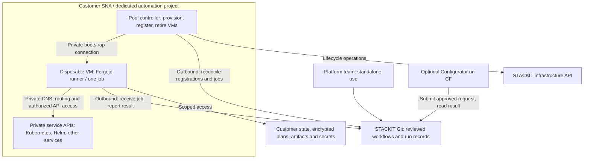

# Private runner concept

[English](private-runner-concept.md) | [Deutsch](private-runner-concept.de.md)

Status: architecture proposal, 2026-11-16. STACKIT Git with customer-operated
VM runners is the agreed direction. This document proposes the component,
authorization and lifecycle contracts; it does not implement or enable them.
Related feature: [#37](https://github.com/stackitcloud/stackit-landing-zone/issues/37).

## 1. Objective and boundary

Platform services are created through the STACKIT provider. Their configuration
may then require another provider to contact a private service API, for example
Kubernetes or Helm accessing an SNA-only control plane. Reachability depends on
the endpoint used by that provider, not merely whether the service exists.
Refresh and Plan can need the same access as Apply.

Provide that execution path through STACKIT Git and private VM runners. The
Accelerator must remain independently consumable. The hosted Configurator stays
on Cloud Foundry and optionally submits work to Git; it gains no direct network
path into the customer's SNA. Existing CF execution remains available for its
supported workloads, with one selected executor for each state operation.

No automatic public API exposure, permanent tunnel, production deployment or
migration of existing state is part of this concept.

Private execution does not change product boundaries: existing Namespace
services target approved Platform Kubernetes only. It does not introduce
Namespace Building Blocks for Application-owned clusters. Other private service
providers each require a supported configuration and authorization integration.

## 2. Overall architecture

Git is the common execution coordinator in both operating modes. The Configurator
does not introduce another private-runner queue or send shell commands to VMs.
Private bootstrap traffic is limited to controller-to-worker connections; no
public inbound SSH or inbound CF-to-SNA connection is required.

| Component | Responsibility | Explicit boundary |
| --- | --- | --- |
| STACKIT Git | Versioned workflows, job dispatch, run identity and results | Does not itself provide SNA connectivity |
| Pool controller | Reconcile desired capacity; create, register, retire and clean up workers | Executes no customer OpenTofu jobs; has no general organization-owner credentials |
| Worker VM | Execute one authorized pipeline job using a pinned runtime | Receives neither the controller's VM-management identity nor its registration credential |
| State/artifact storage | Durable state, encrypted saved plans, immutable packages and receipts | Outlives workers; separate access per state and operation |
| Secrets service | Scoped execution and registration material | Separate controller, worker and service identities |
| Configurator adapter, optional | Check customer permissions; submit exact approved input; display status and results | A successful API dispatch is not a successful Apply |

The controller and Git integration are new components to design, not capabilities
already supplied by the current CF Runner.

## 3. Placement and network model

Use a dedicated automation project within the Platform Landing Zone, attached to
the relevant SNA, with separate controller and worker subnets/security groups.
This may use an existing management project only after reviewing its blast
radius and network attachment. Do not place workers on the connectivity firewall
or in the target Kubernetes cluster.

A pool belongs to one customer organization, SNA, region and environment/trust
domain. Prod and non-production are separate. Stronger tenant or workload
boundaries require separate pools/projects, not just labels. A central project
is sufficient only where approved routes actually reach every intended endpoint;
multiple isolated SNAs require distinct reachable execution domains. Do not
multi-home a worker across trust boundaries to avoid creating additional pools.

| Direction | Required purpose |
| --- | --- |
| Controller outbound | Git runner management, STACKIT VM API, scoped secrets and lifecycle records |
| Controller to worker, private | Initial authenticated bootstrap only; restrict to controller source and close after provisioning |
| Worker outbound HTTPS | Git, approved package/image/provider sources, state/artifact storage, scoped secret retrieval and relevant STACKIT APIs |
| Worker to service, private | Exact API destinations/ports, for example Kubernetes API; no blanket access to all spokes |
| DNS | Correct service endpoint resolution, including public resolver requirements of the selected SKE network mode |

Workers need no public IP. Provide controlled egress through the approved
network/firewall path; a public Git endpoint does not require a public worker.
Allow necessary certificate validation and time synchronization. A subnet's SNA
membership proves neither routing, DNS, TLS nor service permissions. Probe these
from the actual job environment, including its container network if containers
are used. Git ACLs must admit the intended egress addresses.

## 4. Native execution phases and state ownership

The following names describe proposed boundaries, not existing directories or
newly supported commands.

| Phase | Creates/configures | Execution | State |
| --- | --- | --- | --- |
| Foundation | Governance, network, Git, state/secrets references, automation project and runner infrastructure | Trusted workstation or suitable public API runner | Foundation and runner lifecycle states, independently recoverable |
| Service infrastructure | Managed service via STACKIT provider | Public or private runner, selected explicitly | Service infrastructure state |
| Service configuration | Kubernetes/Helm or other private-API provider resources | Qualified private pool | Separate service configuration state |

Foundation must support bootstrapping without a private pool. Within it, keep the
pool lifecycle state independent of jobs executed by that pool. The controller
must not race OpenTofu ownership: IaC owns the controller/network, immutable worker
profile, bounds and policy; the controller owns transient worker instances and
registrations. Worker VMs are not simultaneously listed as fixed IaC resources.

Use separate OpenTofu roots/provider configurations and backend keys. Splitting
only workflow steps or relying on routine `-target` runs does not remove private
provider refresh/initialization dependencies. This requires an explicit native
contract/state migration design before implementation; today's complete root
cannot be advertised as already supporting this split.

Pass a reviewed minimal output contract between phases: service identity,
endpoint, trust/CA reference, generation and allowed pool. Do not export access
keys or full state, or grant a downstream job unrestricted upstream-state reads.
Credentials are resolved separately. Bind downstream plans to the upstream
contract version and replan when relevant upstream outputs change.

On first creation, private configuration can be planned only after the service
exists and passes readiness checks. It therefore has its own review/approval,
not a promise of one complete initial Plan. Changes to two states are not atomic;
show partial completion explicitly. Remove provider-managed service contents
before deleting their API/service, then retire the runner/network infrastructure
last. Lost endpoints require a reviewed recovery path, not blind state removal.

## 5. Operation without the Configurator

1. The platform team selects an approved Accelerator/runtime revision and
   bootstraps the foundation and runner profile through IaC.
2. A separately authorized enrollment step registers the controller/pool with
   the chosen STACKIT Git repository. Git is customer-controlled; an existing
   compatible instance may be used. No Configurator database, broker or account
   is required.
3. Ordinary PR/build checks use managed runners where suitable. Reviewed
   infrastructure workflows explicitly select the required private pool.
4. Service creation finishes before the private configuration phase. The worker
   verifies the output contract, connectivity, TLS and service permissions.
5. Plan produces an encrypted saved plan plus a sanitized review summary. Apply
   requires approval for that exact plan/source/target and can use a fresh VM in
   the same qualified pool.
6. Results, provenance and partial failures remain available after worker deletion.

A runner label such as `private-prod-eu01-pool-a` is a scheduling hint, not an
authorization boundary. Restrict runner registration to the narrowest supported
repository scope; control workflow changes and which events/refs may execute.
Untrusted PRs, forks and general application builds must not reach privileged
private pools. Repository write access and execution authority are separate
roles. Forgejo approval/protection APIs must be qualified on the actual managed
Git version; do not assume GitHub Environment behavior is available unchanged.

## 6. Operation with the Configurator

Use the same customer Git workflows and private pools. Add a Git execution
adapter alongside the current CF adapter; do not redesign private execution as a
second proprietary VM agent.

The customer explicitly connects a Git instance/repository and a qualified pool
to a workspace/organization. Server-side checks bind the requested phase, target,
state key, source digest, input digest, engine/provider versions, pool and
initiating identity to an immutable request. Target/pool selection is authorized
against registered metadata, not accepted from browser labels.

The Configurator submits a fixed reviewed workflow at an immutable source
revision with opaque references to protected inputs. Git receives no Configurator
operator-wide secrets. Sensitive configuration, credentials, plans and raw state
do not belong in dispatch inputs or Git logs. The actual Git dispatch API,
source-pinning behavior and credential scopes need a tested integration contract.

For Plan, Git returns a correlated run and a signed or equivalently authenticated
result receipt. For Apply, the Configurator records the user's approval of the
exact saved plan; the execution workflow validates a bounded, single-use
approval record before privileged execution. A workflow dispatch or Git token
alone is not that approval. The standalone route supplies equivalent approval
through customer-controlled Git processes. Approval persistence/verification must
be specified before enabling either route; unsupported protection features are
not silently replaced by automatic Apply.

Result ingestion verifies origin, job/request identity and expected digests;
callbacks are authenticated and can be supplemented by polling. Revoked access,
expired approvals, cancellation and stale configurations must prevent queued
work from starting or obtaining secrets. Do not duplicate the job when dispatch
returns an ambiguous result: reconcile by correlation ID first.

One deployment/state operation uses exactly one executor. Changing from CF to
Git is an explicit migration preserving backend, locking, resource addresses and
pending-operation evidence. Do not silently move an existing prepared Plan or
Apply between execution engines.

## 7. VM and credential lifecycle

Recommended target: a small controller with replaceable capacity and disposable
worker VMs, each limited to one pipeline job. Plan and Apply normally run on
different VMs, using the same pinned package and protected saved plan.

The controller creates a worker from a reviewed immutable image, uses a
VM-specific temporary bootstrap key over the private network, installs that
worker's runner configuration and closes bootstrap access. Only the public
bootstrap key may enter cloud-init; registration credentials and execution keys
must not be embedded in user data, images or IaC state. Exact secure delivery
and post-bootstrap removal must be demonstrated with the selected VM image.

Keep Git enrollment/registration authority on the controller, scoped as narrowly
as the managed service permits. Deliver only the individual runner credential to
the worker. Execution credentials are obtained for the exact target/operation
through a separate authorized secret-release mechanism. Do not assume native
VM workload identity, short-lived service credentials or OIDC federation exist
for every STACKIT service. Where long-lived credentials are unavoidable, constrain
their scope, keep them in the secrets service and rotate/revoke them explicitly.
Ephemeral workers do not make a service credential ephemeral.

Forgejo ephemeral registration is version-dependent. Qualify both managed Git
server and runner, one-job behavior and the registration API. Server-side
one-job registration is the preferred gate for production. A worker shutdown
script alone does not prove that a second job cannot be assigned. If the feature
is absent, record the compatibility gap and design/test an equivalent bound
before enabling production; do not claim it already works.

Destroy the VM and disks after completion and deregister it. Reconcile idle,
failed-to-register and lost workers with bounded leases and TTLs; ephemeral Git
registration does not itself delete cloud resources. Retire a VM after an
uncertain job outcome rather than returning it to the ready pool. Bound active
jobs, total VMs, idle capacity and lifetime. Warm capacity may start at zero;
size and AZ placement follow measured queue/startup demand, not a fixed promise.

Workers have no route/credential to controller administration, other pools or
Configurator infrastructure. Restrict VM metadata access from job containers to
what the chosen bootstrap/runtime needs. The VM is the isolation boundary;
containers are a packaging choice, not the cross-customer security boundary.

## 8. State, failures and recovery

| Durable information | Owner/location |
| --- | --- |
| Foundation and service state | Customer backend with verified locking, access controls, encryption and version/restore policy |
| Workflow/source/runtime provenance | Customer Git plus immutable artifact manifest |
| Saved plan and sensitive job inputs | Encrypted customer storage; bounded retention and explicit authorized readers |
| Worker/registration inventory, leases, cleanup status | Durable controller lifecycle store, independent of Configurator and disposable disks |
| Approvals and result receipts | Customer execution records; Configurator keeps linked records when used |
| Registration and service credentials | Scoped secrets service; separate lifecycle and rotation |

Git concurrency groups are not a substitute for backend locking. Validate lock
behavior against the selected backend/engine. Persist recovery evidence before
VM deletion; never hide an unknown Apply behind a green cleanup result. Treat
saved plans as secrets and sanitized summaries as non-authoritative review views.

Cancellation revokes future secret access and stops queued work; a running Apply
may already have changed resources. Stop/reconcile the job, inspect state and
cloud effects, then create a fresh Plan. No automatic Apply replay or force-unlock
solely because a VM disappeared. Controller restart recovers registrations and
leases without restarting uncertain operations. Rebuild the controller from IaC
and protected lifecycle records; it cannot depend on the target cluster.

For availability, a worker loss affects one job. A controller outage stops new
capacity but must not terminate healthy running jobs. Redundant controllers need
leader election/leases and duplicate-provisioning tests; two VMs alone do not
establish HA. Back up and restore the state, secrets references, approval records
and controller inventory together. Keep a documented authorized workstation
recovery path for Git/controller outages with the same state ownership/locking.

## 9. Delivery sequence and acceptance

1. **Compatibility spike:** confirm managed Git/server/runner versions, private
   reachability, enrollment/dispatch/result APIs, approval behavior and one-job
   registration. Record costs, permissions and unsupported assumptions.
2. **Standalone vertical slice:** separate native states/roots; deploy one
   disposable VM worker; create a designated test service; Plan, approve, Apply
   and destroy its private configuration through customer Git.
3. **Lifecycle qualification:** pool limits, cold/warm starts, credential
   separation, controller restart, idle/orphan cleanup and upgrades/revocation.
4. **Configurator adapter:** same workflows/packages, explicit customer binding,
   source-bound approval, correlated results, cancellation and executor selection.
5. **Production qualification:** supported service modes, restore drills,
   availability/capacity evidence and a reviewed migration/runbook.

Acceptance must demonstrate successful private DNS/TLS/authentication, denial
from the public/shared runner, both Plan and Apply from qualified private VMs,
blocked foreign-repository/pool access, expired/replayed approvals, unchanged
plan artifacts, simultaneous state writers, lost Apply responses, cleanup and
continued standalone operation with the Configurator unavailable. Record negative
cases without customer secrets or raw state. No automatic fallback to a public
control plane or disabled TLS is permitted.

Remaining design decisions: dedicated versus approved existing management
project; pool boundaries and service reachability; managed Git approval and
single-job compatibility; durable controller coordination; credential delivery;
input/result schemas and artifact retention; service-specific root/state
migration; expected capacity, availability and cost. These require decisions and
qualification, not hidden defaults in an initial implementation.

## 10. Sources and current implementation limits

Sources checked 2026-11-16. The architecture and proposed contracts above are our
design, not a claim of managed STACKIT runner features.

- [STACKIT Git custom runners](https://docs.stackit.cloud/products/developer-platform/git/how-tos/pipelines-custom-runner/): customer-hosted Forgejo runners, including private-network use.
- [Forgejo runner security](https://forgejo.org/docs/v15.0/admin/actions/security/): registration scope and version-specific ephemeral behavior; verify compatibility with the managed Git instance.
- [SKE private clusters](https://docs.stackit.cloud/products/runtime/kubernetes-engine/how-tos/enable-private-clusters/): SNA reachability, routing and DNS prerequisites. The page currently describes private control planes as Private Preview; architecture support does not remove that service limitation.
- [Existing private execution limitation](../landing-zone-configurator/docs/accelerator-limitations.md#private-kubernetes-api-ausführungsgrenze) and [current execution architecture](../landing-zone-configurator/docs/plan-execution.md): no demonstrated customer-SNA path from the current CF Runner; native phase separation remains implementation work.

The existing GitHub Actions catalogue describes current repository workflows.
This proposed customer STACKIT Git pipeline is not an additional implemented
workflow and must not appear as supported execution there until delivered.
