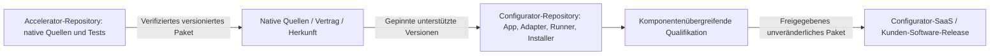

# Konzept zur Repository-Trennung von Accelerator und Configurator

[English](repository-separation-concept.md) | [Deutsch](repository-separation-concept.de.md)

Status: Architekturvorschlag vom 16.11.2026. Vereinbartes Hauptmotiv ist ein
kleinerer, übersichtlicherer Accelerator für Nutzer ohne Configurator. Dieses
Konzept verschiebt keine Dateien, legt keine Repositories an, ändert keine
Workflows und deployt nichts. Repository-Namen und Umsetzungsreihenfolge sind
Vorschläge.

## 1. Nutzerziel und Erfolgskriterien

Der native Accelerator ist ein vollständig eigenständig nutzbares IaC-Produkt.
Gewöhnlicher Checkout, Dokumentation, Validierung und Releases sollen nur das
enthalten, was diese Nutzung benötigt. Terraform-/OpenTofu-Nutzer müssen sich
nicht mit Webanwendung, Datenbankmigrationen, Assistant, Browser-Tests,
CF-Hosting, Installer oder SaaS-Deployment-Setup des Configurators befassen oder
diese installieren.

Die Trennung vereinfacht daher primär das Produkt und erzeugt nicht nur zwei
GitHub-Adressen. Native Eingaben, Modulpfade, State-Adressen, Platform-/Application-
CLI-Nutzung und unterstützte native Hilfswerkzeuge bleiben erhalten. Weder
Configurator-Konto, -API, -Datenbank, -Laufzeit, -Release-Berechtigung noch
Anwendungsabhängigkeit werden Voraussetzung für native Nutzung. Optionale
Anwendungshinweise bleiben kurze Links auf deren eigene Dokumentation.

Die Abnahme misst nativen versionierten Dateibaum, Quell-/Release-Archivinhalt,
Checkout-/Download-Größe, benötigte Werkzeuge und CI-Umfang gegen einen erfassten
Ausgangswert. Dateien bei HEAD zu entfernen beweist keinen kleineren vollständigen
Git-Clone; historische Objekte sind separat zu behandeln (Abschnitt 8).

## 2. Vorgeschlagene Verantwortungsgrenze

| Bleibt in `stackit-landing-zone` | Wechselt in vorgeschlagenes `stackit-landing-zone-configurator` |
| --- | --- |
| Native `src/`-Roots/-Module, Referenz-tfvars, native Provider-Vorgaben und benötigte Helfer | API/UI/Worker, Contracts-/Domain-Code, Assistant und Anwendungsassets |
| Native Modul-/Konfigurationstests und native Release-/Deployment-Verifikation | App-/Unit-/Datenbank-/Browser-/Recovery-Integrationstests und HCL-Adapter |
| Native Architektur, Einstieg, CLI-/Betriebs- und Moduldokumentation | Configurator-Produkt-, Betreiber- und Kundeninstallationsdokumentation |
| Native Validierung, SKU-/Flavor-Prüfung und Accelerator-Release-Workflows | Configurator-Validierung, Modellqualifikation, Betreiber-Provisionierung und Dev-/Prod-Release-Workflows |
| Minimale native Quellpaketierung, Herkunfts- und Kompatibilitätsmetadaten | Runner-Paketierung/-Mirrors, Anwendungs-Quellkompatibilität, SaaS-Infrastruktur, Go-Installer und Kunden-Software-Releases |
| Künftiges optionales Private-Runner-VM-IaC und eigenständige Git-Beispiele, soweit als native Funktion umgesetzt | Optionaler Configurator-Adapter für diesen privaten Ausführungsweg |

HCL-Adapter und anwendungsgeneriertes JSON bleiben Anwendungstools, die den nativen
Quellvertrag konsumieren. Der Accelerator importiert weder `@lzc/domain` noch
verlangt er eine App-Installation zur nativen Release-Erzeugung. Auch über ein
vermeintlich gemeinsames Paket kommt keine große App-Werkzeugkette hinzu.
Ein kleines generisches natives Manifest kann ohne Anwendungsimplementierung
veröffentlicht werden.

Keine gepflegte Kopie nativer Module in einem Configurator-Fork. Ein verifizierter
Quellsnapshot im Release-Paket ist ein Build-Eingang, keine zweite bearbeitbare
Wahrheitsquelle. Die Anwendungspakete des Configurators bleiben zusammen; ein
drittes Shared-Code-Repository ist für die erste Trennung nicht erforderlich.

## 3. Versionierte Abhängigkeit statt Nachbarverzeichnis

Abhängigkeitsrichtung: Configurator → Accelerator. Ein unveränderliches natives
Paket enthält unterstützte Roots/Module, Referenzeingaben und ein Manifest mit
Quellrepository, ursprünglicher Revision, Paketprüfsumme und nativer
Vertragsversion. Benötigte native Assets oder authentifizierte Referenzen gehören
hinein; App-Code, Kunden-State, Zugangsdaten, `.terraform`-Verzeichnisse und
Configurator-Infrastruktur nicht. Interne Modulpfade bleiben zum nativen Checkout
konsistent. Lesbare Versionstags werden zu unveränderlichen Revisionen/Prüfsummen
aufgelöst und dokumentiert, nicht allein als Integritätsbeleg verwendet.

Der Configurator deklariert exakt unterstützte Pakete und Engine-/Provider-/
Laufzeitkompatibilität. Sein Build entpackt verifizierte Quellen an einen eigenen
Ort, generiert/prüft Eingabe- und Vorlagenkataloge über den Adapter und paketiert
das qualifizierte Material zur Ausführung. Tests erhalten einen ausdrücklichen
nativen Quellpfad statt `../../../src` oder der Git-Objektdatenbank des aktuellen
Repositorys. Übergangsweise ist ein separater Checkout einer gepinnten
Accelerator-SHA möglich. Unveränderliche Release-Pakete sind der vorgeschlagene
reguläre Release-Weg.

Bestehende Ausführungsnachweise können mehrere historische native Roots und
Provider-Locks referenzieren. Diese Identitäten und Pakete erhalten. App- und
native Quellrevision werden nach Trennung getrennte Felder. Ein Configurator-
Commit darf nicht als Accelerator-Commit interpretiert werden. Nicht verfügbare
gepinnt-historische Quellen sperren die betroffene Operation, statt auf aktuelles
natives `main` zurückzufallen.

## 4. Pipeline-Aufteilung und Integrationsprüfungen

Heute bestehen elf YAML-Workflows. Vorgeschlagene Zuständigkeit:

| Natives Repository: vier | Configurator-Repository: sieben |
| --- | --- |
| Validate | Validate Configurator |
| Validate STACKIT Flavors | Assistant live regression |
| Verify Deployment | Configurator Bootstrap |
| Publish Release | Configurator Platform |
| | Configurator Runtime |
| | Configurator Release |
| | Configurator Production Release |

Dies ist eine Planungsübersicht, kein vollzogener Workflow-Umzug. Pfade,
Arbeitsverzeichnisse, Caches, native Quellbeschaffung und Veröffentlichungsprüfungen
anpassen. Jedes Repository bekommt einen eigenen korrekten Workflow-Katalog mit
Phasengrafik/Aktualitätsprüfung. Eine optionale Gesamtansicht benennt klar das
zuständige Repository. Native PRs starten nicht standardmäßig die gesamte
Anwendungs-Pipeline.

Native CI verantwortet native Korrektheit. Configurator-CI verantwortet
Anwendungsverhalten und Kompatibilität mit deklarierten nativen Versionen:
Import-/Export-Roundtrips, Erhalt von Eingaben/Defaults, Kompilierung,
Quellprüfungen, gespeicherte Pläne, Upgrade/Recovery und betroffene Assistant-
Fakten. Eine kleine begrenzte Versionsmatrix wird explizit festgelegt; keine
unbegrenzte Zusage für alle historischen Versionen.

Bei komponentenübergreifenden Änderungen beide PRs verknüpfen und die native
Kandidaten-SHA vor Zulassung mit dem Configurator prüfen. Tests mit Kandidatenquellen
sind isoliert und erhalten keine Deployment-/Kundenzugänge. Ein gemergtes/
veröffentlichtes natives Release kann einen Abhängigkeits-Update-PR im Configurator
auslösen, der betroffene Kataloge regeneriert, passende Qualifikation durchläuft
und normal geprüft wird. Keine stille App-Abhängigkeitsänderung, kein automatisches
SaaS-Deployment oder Kunden-Landing-Zone-Upgrade.

Eine eng begrenzte GitHub App kann bei Bedarf Update-PRs erzeugen oder Prüfungen
starten. Das gewöhnliche Workflow-`GITHUB_TOKEN` gilt nur im eigenen Repository.
Öffentliche native Pakete benötigen zum Lesen kein privilegiertes
repositoryübergreifendes Schreib-Token. Wiederverwendbare Workflows über
Repository-Grenzen sind möglich, müssen aber gepinnt und ausdrücklich zugelassen
sein. Sie schaffen weder gemeinsame Commit-Atomarität noch heben sie
Repository-Berechtigungsgrenzen auf.

## 5. Releases und Updates

Accelerator und Configurator veröffentlichen Releases im jeweiligen Repository
mit unabhängigen Versionsreihen. Das Configurator-/Installer-Kompatibilitätsmanifest
nennt unterstützte native Pakete, generiertes Schema, Engine, Provider-Locks,
Worker-Paket und App-Quellstand. Gleiche Versionsnummern beweisen keine
Kompatibilität.

Ein reiner App-Fix kann seine native Abhängigkeit behalten. Neue native Funktionen
werden im Configurator erst nach Adapter-/Domain-/UI-/Runner-/Assistant-Anpassung
und Qualifikation zugelassen. Unterstützte Bestandskonfigurationen und
Bestellungen behalten exakte Ausführungstupel. Das Kundeninstallationsmodell im
[Softwarekonzept](../landing-zone-configurator/docs/customer-installation-concept.de.md)
trennt weiterhin Installationsupdates, Live-Katalogaktualisierung und explizite
Accelerator-/Vorlagen-/Workload-Upgrades mit frischem Plan/Apply.

Native Nutzer beziehen Infrastruktur-Releases weiterhin direkt und installieren
für Fehlerkorrekturen keine App. Softwarekunden erhalten ein vollständiges
kompatibles Anwendungs-/Installer-Paket. Die laufende Instanz muss keine zwei
Repositories klonen oder Anbieter-CI erreichen. Getrennte Quellverantwortung
rechtfertigt keine unversionierten Laufzeitdownloads.

Ein Repository-Wechsel allein verlangt weder Cloud-Ressourcenersatz noch Rotation
von Kunden-State-Schlüsseln oder Workload-State-Migration. Änderungen an
Quellformat, Schema oder Artefaktidentität benötigen eine ausdrückliche
Kompatibilitäts-/Migrationsentscheidung. Eine neue Major-Nummer allein löst das
nicht; auch nicht jeder alte Plan bleibt automatisch ausführbar.

## 6. Heutige Kopplungen mit gezieltem Änderungsbedarf

Die Sichtung zeigt folgende konkrete Migrationspunkte:

- Adapterbefehle und Tests lesen native Variablen/Vorlagen über relative `src/`-
  Pfade. Anwendungsskripte/-Fixtures und native Integrationsprüfungen teilen
  denselben Checkout-Aufbau.
- Runner-Paketierung lädt gepinnte Accelerator-Commits und verwendet `git archive`
  aus der aktuellen Repository-Objektdatenbank, einschließlich historischer
  Application-Roots.
- Buildpack-Quell- und Produktions-Release-Prüfungen benennen
  `stackitcloud/stackit-landing-zone` ausdrücklich und prüfen Workflow-/Ref-/Run-
  Identität.
- Build-Artefakte, Attestierungen, geschützte Buildpack-Tags und Release-Metadaten
  sind an Repository-/Quellidentität gebunden. Eine andere Checkout-URL genügt nicht.
- Configurator-CI startet heute bei nativen `src/**`-Änderungen. Dieser implizite
  Integrationstrigger entfällt nach Auslagerung und braucht begrenzten Ersatz.
- Repository-Dokumentation, Assistant-Quellen, Links und Beitragsanleitung benötigen
  zuständigkeitsgerechte Verweise. Native Anleitung darf nicht weiter App-Prüfungen
  für gewöhnliche native Beiträge voraussetzen.

Vertrauensverträge ausdrücklich aktualisieren. Neue App-Pakete müssen das neue
vertrauenswürdige Repository/Workflow und die nativen Paketidentitäten nachweisen.
Unterstützte alte Pakete behalten ursprüngliche Nachweise und Prüfung. Keine
beliebigen Repositories, Wildcard-Origins oder unsignierten Ersatzpakete zum
Vereinfachen des Übergangs zulassen.

## 7. Migrationsreihenfolge und Betriebsübergang

1. **Inventar/Ausgangswerte:** versionierte Inhalte, Abhängigkeiten, Workflows,
   generierte Assets, offene PRs, Quell-Pins, Release-Tags, Secrets/Environments
   und nötige historische Pakete klassifizieren. Umfang für native Nutzer messen.
2. **Im bisherigen Repository entkoppeln:** native Paket-/Quelleingänge und
   getrennte App-/native Revisionen einführen; vorhandenes natives und
   Anwendungsverhalten beweisen. Keine Kunden-Ressourcenadressen ändern.
3. **App auslagern:** neues Repository mit gewählter Historienstrategie,
   Anwendungspaketen, App-Dokumentation und sieben Workflows erzeugen.
   Urheberschaft/Lizenzhinweise und Quellen-/Herkunftszuordnung erhalten.
   Repository-Schutz, CODEOWNERS, Reviews und Artefaktregeln einrichten.
4. **Betreibervertrauen neu aufbauen:** erforderliche Environments/Reviewer,
   Variablen, begrenzte Zugänge, Runner-Zugriff, Tag-Regeln und Artefakt-/Signaturregeln
   anlegen. Secrets aus geschützter Verwahrung erneut setzen oder bewusst rotieren;
   GitHub-Secret-Werte sind kein gewöhnlicher Repository-Export. Keine Zugänge in
   Issues, Quellen, Migrationslogs oder Kunden-Releases kopieren.
5. **Qualifizieren:** vollständiges Paket aus neuem Repository bauen,
   Manifest-/Quell-Ablehnung und historische native Kompatibilität prüfen,
   nötige lokale/CI-/Modellqualifikation durchführen. Danach ausdrücklich
   autorisierten Dev-Übergang und Laufzeitprüfungen durchführen. Getesteten
   Wiederherstellungsweg zum zuvor unterstützten Release vorbereiten.
6. **Genau einen Schreiber umschalten:** alte Configurator-Änderungswege deaktivieren,
   bevor neue dieselbe Stage verwalten. Backend-Schlüssel, CF-App-/Routennamen,
   Datenbanken und Infrastruktur-IDs erhalten. GitHub-Concurrency-Gruppen
   koordinieren nicht repositoryübergreifend; genau einen aktiven Deployer plus
   geprüftes State-/Deployment-Locking verwenden. Produktion wird separat geprüft
   aktiviert.
7. **Natives HEAD verschlanken:** App-Baum/-Workflows und reine App-Abhängigkeiten/
   -Dokumentation aus dem nativen Arbeitsbaum entfernen. Benötigte native Helfer
   und kurzen optionalen App-Link erhalten. Beide Workflow-Grafiken aktualisieren
   und App-freie native Releases prüfen. Dokumentation und ausgewählte Issues/PRs
   überleiten, ohne historische Herkunftsnachweise zu beschädigen. Vorübergehende
   Doppelpflege beenden.

Offene Änderungen vor Auslagerung koordinieren. Kurzes Übergangsfenster mit
Änderungsstopp oder abgestimmter Merge-Plan verhindert zwei gepflegte App-Kopien.
Der Repository-Umzug autorisiert keine gleichzeitige Umsetzung von
Kundenanmeldung, Installer oder privaten Runnern. Diese unabhängigen Vorhaben auf
stabile Versionsverträge aufsetzen.

## 8. Git-Historie, Archive und tatsächliche Größe

App-Verzeichnis aus neuen Commits entfernen verkleinert Arbeitsbaum und neu
zusammengestellte native Pakete. Blobs aus alten Commits/Tags verschwinden dadurch
nicht aus einem vollständigen Clone. Getrennt messen: aktueller nativer Quellbaum,
neue Release-/Archivgröße, flacher Checkout und vollständiger historischer Clone.

Zunächst bestehende native Repository-Historie und unveränderliche Quellreferenzen
erhalten. Saubere native Release-Pakete und unterstützte Shallow-Checkout-Anleitung
für Nutzer ohne Historienbedarf anbieten. GitHubs automatisch erzeugte Archive
historischer Monorepo-Tags bleiben historische Archive und werden nicht als
bereinigte native Pakete umetikettiert. Dokumentierter neuer nativer Download
muss tatsächlich das native Paket wählen, kein altes Gesamt-Repository-Archiv.

App-Historienextraktion/-Filterung kann andere Commit-IDs erzeugen. Ursprüngliche
und neue Herkunft sowie alte Release-Metadaten zuordnen statt vorhandene
Ausführungsnachweise umzuschreiben. Nicht voraussetzen, dass die neue App-Historie
alle für Runner-Paketierung benötigten historischen nativen Commits enthält.

Wird später eine kleinere vollständige Remote-Historie gefordert, sind
Historienumschreibung/Repository-Ersatz und Legacy-Archivierung eine eigene
störende Migration mit ausdrücklicher Freigabe und vollständigem Referenz-/
Aufbewahrungsplan. Das gehört nicht zur ersten Trennung und darf keine Pins von
gehostetem SaaS, Kunden oder alten nativen Modulen zerstören. Native Einfachheit
und schlanke reguläre Distribution sollen ohne erzwungene Historienumschreibung
entstehen.

## 9. Aufwand, Risiken und Abnahme

Vorläufige Einschätzung aus den gesichteten Kopplungen, kein abgeschlossenes
Migrationsaudit: etwa **10–20 technische Personentage** für produktionssichere
Trennung einschließlich Abhängigkeitspaketierung, CI-/Vertrauensänderungen,
Dokumentation, Kompatibilitätsprüfungen und Betriebsübergang. Rein mechanische
Dateiauslagerung kann 2–4 Tage dauern, ist aber keine Produktionsabnahme.
Review-Wartezeit, gehostete Build-/Deploy-Dauer, Organisationsberechtigungen und
unerwartete Kompatibilitätslücken können die Kalenderdauer verlängern. Neue
Installer-/Anmelde-/Private-Runner-Funktionen sind nicht enthalten.

Die Abnahme muss zeigen:

- Native Nutzer laden/klonen das schlanke aktuelle Produkt und führen dokumentierte
  Init-/Validate-/Tests sowie Platform-/Application-CLI ohne Configurator-Setup aus.
- Neue native Pakete, Werkzeugvoraussetzungen und native CI enthalten keine reinen
  App-Pakete/-Tests, Hosting- oder Release-Berechtigungen. Größenvergleich explizit
  dokumentieren und HEAD von Historie trennen.
- Configurator reproduzierbar aus verifizierten nativen Paketen bauen; deklarierte
  ältere Quellen-/Plan-/Recovery-Tupel bleiben unterstützt oder bekommen geprüfte
  Migrationen.
- Komponentenübergreifende Änderungen erhalten Integrationsprüfungen und können
  weder automatisch deployen noch ungeprüfte native Funktionen einführen.
- Gefälschte bzw. falsche Repository-Artefakte, Refs, Workflow-Identitäten und
  geänderte Prüfsummen werden abgewiesen; Secrets/Änderungsrechte bleiben begrenzt.
- Dev-Übergang, Einzelschreiber, Produktionsfreigabe und Wiederherstellung werden
  separat nachgewiesen. Native Ressourcenidentitäten und Kunden-State bleiben.
- Beide Repositories haben korrekte zweisprachige Dokumentation, Workflow-Zuständigkeit
  und Versions-/Update-Anleitungen; das native README bleibt auf native Nutzer
  ausgerichtet.

Offen: endgültiger App-Repository-Name/Sichtbarkeit, Historienstrategie,
nativer Paketvertrag/Supportzeitraum, repositoryübergreifende
Automatisierungsidentität, Ablage optionalen eigenständigen Runner-IaC und
Cutover-Release. Das Hauptziel für Nutzer ist vereinbart; Umsetzung braucht eine
separate Beauftragung.

## 10. Referenzen

- [Native Architektur](architecture.de.md), [eigenständiger Einstieg](getting-started.de.md) und [zweiphasiger CLI-Ablauf](../src/application/README.de.md#independent-two-phase-cli-workflow).
- [Heutige Workflows](workflows.de.md), [Configurator-Entwicklung](../landing-zone-configurator/docs/development.de.md), [Runner-Paketierung](../landing-zone-configurator/deploy/runner/package.sh), [Buildpack-Vertrauen](../landing-zone-configurator/infra/ci/buildpack-source.mjs) und [Produktions-Quellprüfung](../landing-zone-configurator/infra/ci/production-release.mjs): Nachweise heutiger Kopplung, kein bereits migriertes Verhalten.
- [Kundeninstallationskonzept](../landing-zone-configurator/docs/customer-installation-concept.de.md) und [Private-Runner-Konzept](private-runner-concept.de.md): ergänzende Konzepte mit unabhängiger Umsetzung.
- [GitHub-Token-Umfang](https://docs.github.com/en/actions/concepts/security/github_token), [wiederverwendbare Workflows](https://docs.github.com/en/actions/reference/workflows-and-actions/reusing-workflow-configurations) und [Concurrency](https://docs.github.com/en/actions/how-tos/write-workflows/choose-when-workflows-run/control-workflow-concurrency): berücksichtigte Repository-Grenzen.
