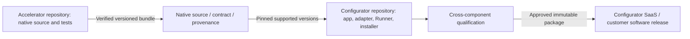

# Accelerator and Configurator repository separation concept

[English](repository-separation-concept.md) | [Deutsch](repository-separation-concept.de.md)

Status: architecture proposal, 2026-11-16. The agreed primary motivation is a
smaller, clearer Accelerator for users who do not use the Configurator. This
concept does not move files, create repositories, change workflows or deploy
anything. Repository names and implementation sequence below are proposals.

## 1. Consumer objective and success criteria

The native Accelerator is a complete independently usable IaC product. Its normal
checkout, documentation, validation and releases should contain only what that
use needs. A user who chooses Terraform/OpenTofu should not have to navigate or
install the Configurator's web application, database migrations, Assistant,
browser tests, CF hosting, installer or SaaS deployment setup.

The separation is therefore primarily a product simplification, not merely two
GitHub URLs. Preserve native inputs, module paths, state addresses, Platform/
Application CLI operation and supported native helper tools. No Configurator
account, API, database, runtime, release permission or application dependency
becomes a prerequisite for native use. Optional references to the application
are short links to its own documentation.

Acceptance measures the native tracked tree, source/release archive contents,
checkout/download footprint, required toolchain and CI scope. Compare these with
a recorded pre-split baseline. Do not claim a smaller full Git clone solely from
removing files at HEAD; historical objects need separate treatment (section 8).

## 2. Proposed ownership boundary

| Stays in `stackit-landing-zone` | Moves to a proposed `stackit-landing-zone-configurator` |
| --- | --- |
| Native `src/` roots/modules, reference tfvars, native provider constraints and required helpers | API/UI/worker, contracts/domain code, Assistant and application assets |
| Native module/configuration tests and native release/deployment verification | App/unit/database/browser/recovery integration suites and HCL adapter |
| Native architecture, getting-started, CLI/operations and module documentation | Configurator product, operator and customer-installation documentation |
| Native validation, SKU/flavor verification and Accelerator release workflows | Configurator validation, model qualification, operator provisioning and Dev/Prod release workflows |
| Minimal native source packaging, provenance and compatibility metadata | Runner packaging/mirrors, application source compatibility, SaaS infrastructure, Go installer and customer software releases |
| Future optional private-runner VM IaC and standalone Git examples, if delivered as native features | Optional Configurator adapter for that private execution path |

The HCL adapter and app-generated JSON remain application tooling consuming the
native source contract. The Accelerator must not import `@lzc/domain`, require
app installation to produce a native release, or acquire a large app toolchain
through a supposedly shared package. A small generic native manifest can be
published without depending on application implementation.

Do not duplicate native modules in a maintained Configurator fork. A verified
vendored source snapshot inside a release package is a build input, not another
editable source of truth. Keep the Configurator's application packages together;
a third shared-code repository is not required for the initial split.

## 3. Versioned dependency instead of a neighboring directory

The dependency direction is Configurator → Accelerator. Publish an immutable
native bundle containing the supported roots/modules, reference inputs and a
manifest with source repository, original revision, package digest and native
contract version. Include required native assets or authenticated references;
exclude app code, customer state, credentials, `.terraform` directories and
Configurator infrastructure. Keep internal module paths consistent with the
native checkout. Human version tags are resolved and recorded with immutable
revisions/digests, never treated as sufficient integrity evidence alone.

The Configurator declares exact supported bundles plus engine/provider/runtime
compatibility. Its build extracts the selected verified source to a dedicated
location, generates/checks input and template catalogues through its adapter,
and packages the qualified material for execution. Tests take an explicit native
source directory rather than `../../../src` or the current repository's Git
object database. During transition, a separate checkout at a pinned Accelerator
SHA is an option; consuming immutable release bundles is the proposed normal
release path.

Existing execution records may refer to several historical native roots and
provider locks. Preserve those source identities and packages; the app source
revision and native source revision are distinct fields after the split. A
Configurator commit must not be interpreted as an Accelerator commit. Failure to
obtain a pinned historical source blocks the affected operation, not a fallback
to current native `main`.

## 4. Pipeline split and integration checks

There are currently eleven YAML workflows. The proposed ownership is:

| Native repository: four | Configurator repository: seven |
| --- | --- |
| Validate | Validate Configurator |
| Validate STACKIT Flavors | Assistant live regression |
| Verify Deployment | Configurator Bootstrap |
| Publish Release | Configurator Platform |
| | Configurator Runtime |
| | Configurator Release |
| | Configurator Production Release |

This is a planning inventory, not an implemented workflow move. Adapt paths,
working directories, caches, native source acquisition and publication guards.
Each repository gets its own accurate workflow catalogue/phase map and freshness
check; an optional combined presentation must clearly identify the owning repo.
Native PRs should not run the entire application pipeline by default.

Native CI owns native correctness. Configurator CI owns application behavior and
compatibility with its declared native versions: import/export roundtrips,
input/default preservation, compilation, source guards, saved plans, upgrade/
recovery and Assistant facts when affected. A small bounded supported-version
matrix is explicit; "all historical versions forever" is not a support promise.

For cross-component changes, link the two PRs and test the candidate native SHA
against the Configurator before admitting it. Candidate-source tests are isolated
and receive no deployment/customer credentials. A merged/published native release
can open a Configurator dependency-update PR, which regenerates affected
catalogues, runs applicable qualification and gets normal review. It must not
silently change the app dependency, deploy SaaS or upgrade customer Landing Zones.

A narrowly scoped GitHub App can create update PRs or dispatch checks when needed.
The workflow's ordinary `GITHUB_TOKEN` is repository-scoped. Public native bundle
reads need no privileged cross-repository write token. Cross-repository reusable
workflows are possible but must be pinned and explicitly permitted; they do not
restore same-commit atomicity or remove repository authorization boundaries.

## 5. Release and update behavior

Publish Accelerator and Configurator releases from their respective repositories
on independent version tracks. The Configurator/installer compatibility manifest
names supported native bundles, generated schema, engine, provider locks, worker
package and app source. Matching version numbers are not compatibility proof.

An app-only fix can retain its native dependency. A new native capability is
available in the Configurator only after adapter/domain/UI/Runner/Assistant work
and qualification admit it. Old supported configurations and orders retain exact
execution tuples. The customer installation model in the [software concept](../landing-zone-configurator/docs/customer-installation-concept.md)
continues to distinguish installation updates, live catalogue refresh and
explicit Accelerator/template/workload upgrades with fresh Plan/Apply.

Existing native users continue to consume native releases directly. They do not
install the app to receive infrastructure fixes. Software customers receive a
complete compatible application/installer package; their running instance does
not need to clone two repositories or access vendor CI. Independent source
ownership does not justify unversioned runtime downloads.

Changing repository alone need not replace cloud resources, rotate customer state
keys or migrate workload state. Any source format, schema or artifact-identity
change requires an explicit compatibility/migration decision, not an automatic
major-version label or an assumption that every old plan remains executable.

## 6. Current couplings that need deliberate work

The inspected repository contains the following concrete migration points:

- Adapter commands and tests read native variables/templates through relative
  `src/` paths. Application scripts/fixtures and native integration checks share
  the same checkout layout.
- Runner packaging fetches pinned Accelerator commits and uses `git archive` from
  the current repository object database, including historical application roots.
- Buildpack-source and production-release guards name
  `stackitcloud/stackit-landing-zone` explicitly and verify workflow/ref/run identity.
- Build artifacts, attestations, protected buildpack tags and release metadata
  are tied to repository/source identity; changing a checkout URL is insufficient.
- Configurator CI currently triggers for native `src/**` changes. That implicit
  integration trigger disappears after extraction and needs a bounded replacement.
- Repo documentation, assistant sources, links and contributor instructions need
  ownership-aware references; native guidance must not keep listing app checks as
  requirements for an ordinary native contribution.

Update trust contracts explicitly. New app packages must prove the new trusted
repository/workflow and native bundle identities. Supported old packages keep
their original proofs and verification path; do not accept arbitrary repos,
wildcard origins or unsigned replacements to ease the cutover.

## 7. Migration sequence and operating cutover

1. **Inventory/baseline:** classify tracked content, dependencies, workflows,
   generated assets, open PRs, source pins, release tags, secrets/environments and
   required historical packages. Measure the standalone consumer footprint.
2. **Decouple in place:** introduce explicit native bundle/source inputs and
   separate app/native revisions while still in the monorepo; prove existing
   native and application behavior. No customer resource-address changes.
3. **Extract the app:** create the new repository with chosen history strategy,
   application packages, app documentation and its seven workflows. Preserve
   authorship/license notices and source/provenance mappings. Establish repository
   protection, CODEOWNERS, reviews and artifact publication policies.
4. **Rebuild operator trust:** recreate required Environments/reviewers, variables,
   scoped credentials, runner access, tag rules and artifact/signing policies.
   Re-provision secrets from protected custody or rotate deliberately; GitHub
   secret values are not an ordinary repository export. Do not copy credentials
   into issues, source, migration logs or a customer release.
5. **Qualify:** build a complete new-repo package, prove manifest/source rejection
   and historical native compatibility, run required local/CI/model qualification,
   then perform an explicitly authorized Dev cutover and runtime checks. Prepare
   tested recovery to the previously supported release.
6. **Switch one writer:** disable old Configurator mutation paths before allowing
   new ones to manage the same stage. Preserve backend keys, CF app/route names,
   databases and infrastructure IDs. Repository-local GitHub concurrency groups
   do not coordinate across repos; use a single active deployer plus verified
   state/deployment locking. Production is a separate reviewed activation.
7. **Slim the native HEAD:** remove the app tree/workflows and app-only dependency/
   documentation from the native working tree, retain native-required helpers and
   a short optional app link. Update both workflow maps and verify native releases
   exclude application payload. Redirect documentation and selected issues/PRs
   without breaking historical provenance. End the temporary dual-maintenance lane.

Coordinate open changes before extraction; a short cutover freeze or coordinated
merge plan avoids maintaining two application copies. The repository move is not
permission to implement customer authentication, installer or private runners at
the same time. Stage these independent projects against stable version contracts.

## 8. Git history, archives and actual size

Removing the app directory from new commits makes the working tree and newly
selected native bundles smaller. It does not remove blobs reachable through old
commits/tags from a complete clone. Record these as separate measurements:
current native source size, new release/archive size, shallow checkout and full
historical clone size.

Initially preserve the existing native repository history and immutable source
references. Offer clean native release bundles and supported shallow checkout
instructions for users who do not need history. GitHub's automatically generated
archives for historical monorepo tags remain historical archives; do not relabel
them as cleaned native-only packages. Ensure the documented new native download
actually selects the native bundle instead of a legacy whole-repository archive.

An app history extraction/filter can create different commit IDs; preserve
original-to-new provenance and old release metadata instead of rewriting existing
execution records. Do not assume the migrated app's Git history contains every
historical native commit needed by Runner packaging.

If reducing the original remote's full historical storage later becomes a
requirement, treat history rewriting/repository replacement and legacy archival
as a separate disruptive migration requiring explicit approval and a complete
reference/retention plan. It is not part of the initial split and must not destroy
pins needed by deployed SaaS, customers or old native modules. Native simplicity
and lean normal distribution should be delivered without forcing this rewrite.

## 9. Effort, risks and acceptance

Preliminary estimate based on the inspected couplings, not a completed migration
audit: roughly **10–20 engineering person-days** for a production-safe split,
including dependency packaging, CI/trust changes, documentation, compatibility
checks and operating cutover. Mechanical file extraction alone might take 2–4
days but is not production acceptance. Review queues, hosted build/deploy time,
organization permissions and unexpected compatibility gaps may extend elapsed
time. New installer/authentication/private-runner features are excluded.

Acceptance must prove:

- A native user downloads/clones the slim current product and performs documented
  init/validate/tests and Platform/Application CLI use without Configurator setup.
- New native bundles, native tool requirements and native CI exclude app-only
  packages, tests, hosting and release permissions; the footprint comparison is
  explicit and separates HEAD from history.
- Configurator builds reproducibly from verified native bundles; declared older
  source/plan/recovery tuples remain supported or have reviewed migrations.
- Cross-component changes get integration checks and cannot auto-deploy or
  introduce unreviewed native capabilities.
- Forged/wrong-repository artifacts, refs, workflow identities and altered digests
  are rejected; secrets and mutation rights remain scoped.
- Dev cutover, single-writer behavior, production approval and recovery are
  independently evidenced; native resource identities and customer state stay put.
- Both repositories have truthful bilingual docs, workflow ownership and supported
  version/update instructions; the remaining native README is native-first.

Decisions still needed: final app repository name/visibility, history preservation
strategy, native bundle contract/support window, cross-repo automation identity,
where optional standalone runner IaC lives and which release performs cutover.
The primary consumer goal is agreed; implementation authorization is separate.

## 10. References

- [Native architecture](architecture.md), [standalone getting started](getting-started.md) and [two-phase CLI workflow](../src/application/README.md#independent-two-phase-cli-workflow).
- [Current workflow inventory](workflows.md), [Configurator development](../landing-zone-configurator/docs/development.md), [Runner packaging](../landing-zone-configurator/deploy/runner/package.sh), [buildpack trust](../landing-zone-configurator/infra/ci/buildpack-source.mjs) and [production source validation](../landing-zone-configurator/infra/ci/production-release.mjs): current coupling evidence, not already migrated behavior.
- [Customer-installed software concept](../landing-zone-configurator/docs/customer-installation-concept.md) and [private runner concept](private-runner-concept.md): complementary concepts with independent implementation work.
- [GitHub token scope](https://docs.github.com/en/actions/concepts/security/github_token), [reusable workflows](https://docs.github.com/en/actions/reference/workflows-and-actions/reusing-workflow-configurations) and [concurrency](https://docs.github.com/en/actions/how-tos/write-workflows/choose-when-workflows-run/control-workflow-concurrency): repository boundaries considered in this proposal.
