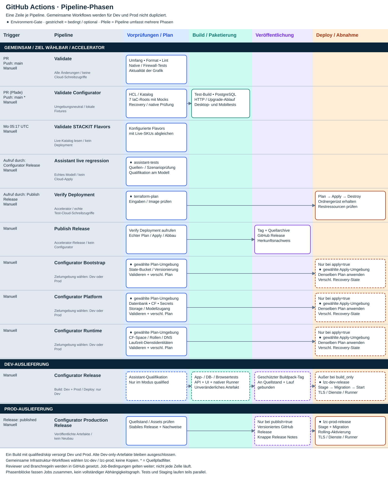

<a id="github-actions-workflows"></a>
# GitHub-Actions-Workflows

[English](workflows.md) | [Deutsch](workflows.de.md)

Dies ist der Einstieg zum Auswählen und Starten einer Pipeline. Workflow-Namen
verlinken direkt auf ihre **Actions**-Seiten; **Quelltext**-Links zeigen die
ausführbare Definition. Die elf aktuellen Repository-Workflows sind unten
aufgeführt. Historische Einträge und von GitHub verwaltete Workflows sind
[separat aufgeführt](#other-entries-in-the-actions-sidebar).

**Ein Merge deployt den Configurator nicht.** Infrastrukturläufe starten manuell.
Produktion verwendet veröffentlichte GitHub Releases und benötigt eine manuelle
Freigabe im eigenen geschützten Environment. Workflow-Start und Freigabe seines
geschützten Deployment-Jobs sind getrennte Schritte.

<a id="phases-at-a-glance"></a>
## Phasen auf einen Blick



[SVG in voller Größe öffnen](diagrams/generated/workflow-phases.de.svg).
Jede Pipeline erhält eine Zeile: Blau zeigt Vorprüfungen/Plan, Türkis Build und
Paketierung, Violett Veröffentlichung und Orange Deploy/Abnahme. Pfeile verbinden
Phasen desselben Workflows. Gestrichelte Kästen kennzeichnen bedingte Schritte,
keine fehlgeschlagenen oder übersprungenen Ausführungen. Die Raute markiert ein
Environment-Gate; Reviewer und Branchregeln werden in GitHub konfiguriert.

Gemeinsame Workflows und solche mit wählbarer Zielumgebung stehen einmal oben.
Die getrennten Dev- und Prod-Auslieferungen folgen darunter. **Configurator
Release** baut auch die gemeinsamen Produktionseingaben; sein Deploy-Job zielt
auf Dev. Produktion verwendet kompatible veröffentlichte Assets ohne erneuten
Build. Ein Build mit skip oder qualified kann Dev und Prod versorgen; historische
Dev-only-Artefakte bleiben ausgeschlossen.
Die Grafik fasst Phasen zusammen, nicht jeden Schritt oder jede Abhängigkeit.
Browserabnahme/Runner-Paketierung und CF-Staging laufen teilweise parallel.
Der Aufruf von **Verify Deployment** führt echte Test-Cloud-Änderungen und
Bereinigung aus, auch in der Vorprüfungsphase von **Publish Release**.

<a id="which-workflow-do-i-need"></a>
## Welchen Workflow benötige ich?

| Aufgabe | Workflow |
| --- | --- |
| Accelerator-Änderungen ohne Ressourcenbereitstellung prüfen | **Validate** |
| Änderungen an Configurator, Katalog, Datenbank, Browser und Operator-IaC prüfen | **Validate Configurator** |
| Assistant-Antworten gegen das echte Modell testen | **Assistant live regression** |
| Neue Configurator-Version einschließlich API/UI und Runner bereitstellen | **Configurator Release**, nicht Publish Release |
| Eigenen State-Speicher, verwaltete Dienste oder CF-Identitäten des Configurators ändern | **Configurator Bootstrap**, **Platform** oder **Runtime** |
| Echte Accelerator-Bereitstellung und Bereinigung ausführen | **Verify Deployment** |
| Accelerator-GitHub-Release nach echter Bereitstellungsprüfung veröffentlichen | **Publish Release** |
| Konfigurierte Maschinen-Flavors mit dem aktuellen STACKIT-Katalog vergleichen | **Validate STACKIT Flavors** |

<a id="current-repository-workflows"></a>
### Dev-Release ohne Live-Qualifikation des Assistant

**Configurator Release** auf **main** verwenden. **release_mode=skip** (Standard)
wählen, wenn keine neue Live-Qualifikation des Assistant nötig ist; **qualified**
führt die vollständige wiederholte Live-Suite aus. Änderungen an Assistant-Fakten/
-Fähigkeiten benötigen weiterhin quellgebundene Qualifikation gemäß Beitragsanleitung.
Überspringen behauptet keine Qualifikation und entfernt keine fehlgeschlagenen
Nachweise.

Für Dev mit anschließendem Prod **build_only=false** und **release_run_id** leer
lassen, Dev-**runner_pool_size** wählen (beispielsweise `2`). Build, Datenbank-/
Browser-/native Prüfungen und geschützte Buildpack-Veröffentlichung laufen einmal,
danach das manuell freigegebene **lzc-dev-release**-Deployment. Die Assistant-
Laufzeiteinstellung bleibt in beiden Modi erhalten. Kein Kunden-Infrastruktur-
Apply wird dadurch autorisiert.

Nach Erfolg des **gesamten Laufs** dessen numerische Run-ID in **Configurator
Production Release** auf derselben `main`-Revision verwenden: **publish=true**,
kuratierter Versionstag (aktuell **v2.1.0**) und **derselbe release_mode**.
Veröffentlichung und **lzc-prod-release**-Freigabe verwenden unveränderte Pakete;
Configurator Release nicht nur für einen zusätzlichen Prod-Build erneut starten.
Ist Dev nicht gewünscht, im ersten Lauf **build_only=true** wählen. Produktion
baut nicht neu.

Ein neues `skip`-Manifest vermerkt umgebungsunabhängigen Umfang,
`assistantQualified=false` und `assistantQualification=skipped`; der Job heißt
**build-skip**. `qualified` verlangt weiter erfolgreiche Live-Qualifikation.
Bestehende Builds lassen sich über **release_run_id** später ohne Neubau nach Dev
übernehmen, unter Quell-/Tag- und Artefaktprüfung. Historische Artefakte mit
**dev-skip-assistant-qualification** bleiben auf Dev beschränkt und nicht
promotierbar. Veröffentlichte **accepted-assistant-limitations**-Releases bleiben
für kompatible erneute Deployments lesbar. Beide alten Modi sind keine neue
Laufauswahl. Eine fehlgeschlagene Qualifikation lässt sich nicht als `skip`
umetikettieren.


### Produktionsrelease und Infrastruktur

[Configurator Production Release](https://github.com/stackitcloud/stackit-landing-zone/actions/workflows/configurator-production.yml) · [Quelle](../.github/workflows/configurator-production.yml) veröffentlicht ein stabiles Release und deployt erst nach manueller Freigabe von `lzc-prod-release`. Eingaben: `version` (Standard `v2.1.0`), `publish` (Standard `true`), `release_run_id` (für Veröffentlichung erforderlich) und `release_mode` (Standard `skip`, alternativ `qualified`). Einen vollständig erfolgreichen **Configurator Release** von derselben `main`-Revision mit demselben Modus verwenden, unabhängig davon, ob dieser Dev deployt oder `build_only=true` genutzt hat. Ein zweiter Build ist nicht erforderlich. `skip` dokumentiert die übersprungene Assistant-Qualifikation, ohne historische Dev-only-Artefakte umzudeuten. Alle Prüfungen außerhalb der Inferenz bleiben verpflichtend.

Ein veröffentlichtes stabiles GitHub Release mit den erforderlichen quellgebundenen Assets startet den Workflow ebenfalls. Veröffentlichung über `GITHUB_TOKEN` setzt im selben Lauf fort und benötigt kein zweites Ereignis. `publish=false` deployt ein bestehendes kompatibles veröffentlichtes Release nach neuer manueller Freigabe. Pre-Releases und beliebige Artefakte werden abgelehnt. Produktion verwendet unveränderliche angehängte Anwendungs-/Runner-Assets, begrenzte CF-Zugänge und Rolling Deployment mit drei Web-Repliken.

Bootstrap, Platform und Runtime akzeptieren jetzt `environment` (Standard `lzc-dev`, alternativ `lzc-prod`). Plan-/Apply-Environments und Schreibwarteschlangen folgen der ausgewählten Stage. Prod Platform wählt die Replica-Set-Datenbank; Prod Runtime ergänzt eigene DNS-Zone, öffentliche Domain und Space-begrenzte Konten. Der lokale verschlüsselte Bootstrap `operator-project` importiert ein bestehendes Betreiberprojekt und provisioniert seine eigene projektbegrenzte Identität. Siehe [vollständiges Produktionshandbuch](../landing-zone-configurator/docs/production.de.md) für Bootstrap, Bindings, Zugangsrotation und Wiederherstellung.

## Aktuelle Repository-Workflows

**Automatisch** beschreibt Repository-Ereignisse, keinen manuellen Klick.
**Wiederverwendbar** bedeutet, dass ein anderer Workflow ihn über `workflow_call`
aufrufen kann; dies ist keine separate UI-Freigabe. Alle elf Definitionen bieten
`workflow_dispatch`, aber Berechtigungen, Branch-Beschränkungen, Operatorschalter
und Umgebungsschutz gelten weiterhin.

<!-- BEGIN GENERATED WORKFLOW INVENTORY -->
| Pipeline | Trigger | Geltungsbereich |
| --- | --- | --- |
| [Validate](https://github.com/stackitcloud/stackit-landing-zone/actions/workflows/validate.yml) · [Quelle](../.github/workflows/validate.yml) | PR<br>Push: main<br>Manuell | Alle Änderungen / keine Cloud-Schreibzugriffe |
| [Validate Configurator](https://github.com/stackitcloud/stackit-landing-zone/actions/workflows/validate-configurator.yml) · [Quelle](../.github/workflows/validate-configurator.yml) | PR (Pfade)<br>Push: main *<br>Manuell | Umgebungsneutral / lokale Fixtures |
| [Validate STACKIT Flavors](https://github.com/stackitcloud/stackit-landing-zone/actions/workflows/validate-stackit-flavors.yml) · [Quelle](../.github/workflows/validate-stackit-flavors.yml) | Mo 05:17 UTC<br>Manuell | Live-Katalog lesen / kein Deployment |
| [Assistant live regression](https://github.com/stackitcloud/stackit-landing-zone/actions/workflows/assistant-live.yml) · [Quelle](../.github/workflows/assistant-live.yml) | Aufruf durch: Configurator Release<br>Manuell | Echtes Modell / kein Cloud-Apply |
| [Verify Deployment](https://github.com/stackitcloud/stackit-landing-zone/actions/workflows/verify-deployment.yml) · [Quelle](../.github/workflows/verify-deployment.yml) | Aufruf durch: Publish Release<br>Manuell | Accelerator / echte Test-Cloud-Schreibzugriffe |
| [Publish Release](https://github.com/stackitcloud/stackit-landing-zone/actions/workflows/publish-release.yml) · [Quelle](../.github/workflows/publish-release.yml) | Manuell | Accelerator-Release / kein Configurator |
| [Configurator Bootstrap](https://github.com/stackitcloud/stackit-landing-zone/actions/workflows/configurator-bootstrap.yml) · [Quelle](../.github/workflows/configurator-bootstrap.yml) | Manuell | Zielumgebung wählen: Dev oder Prod |
| [Configurator Platform](https://github.com/stackitcloud/stackit-landing-zone/actions/workflows/configurator-platform.yml) · [Quelle](../.github/workflows/configurator-platform.yml) | Manuell | Zielumgebung wählen: Dev oder Prod |
| [Configurator Runtime](https://github.com/stackitcloud/stackit-landing-zone/actions/workflows/configurator-runtime.yml) · [Quelle](../.github/workflows/configurator-runtime.yml) | Manuell | Zielumgebung wählen: Dev oder Prod |
| [Configurator Release](https://github.com/stackitcloud/stackit-landing-zone/actions/workflows/configurator-release.yml) · [Quelle](../.github/workflows/configurator-release.yml) | Manuell | Build: Dev + Prod / Deploy: nur Dev |
| [Configurator Production Release](https://github.com/stackitcloud/stackit-landing-zone/actions/workflows/configurator-production.yml) · [Quelle](../.github/workflows/configurator-production.yml) | Release: published<br>Manuell | Veröffentlichte Artefakte / kein Neubau |
<!-- END GENERATED WORKFLOW INVENTORY -->

Der genaue Configurator-Pfadfilter steht im verlinkten YAML. Ein übersprungener
reiner Accelerator-Job bei einem Configurator-PR ist beabsichtigt und keine
Bereitstellung. Machen Sie einen pfadgefilterten Job nicht global zur
Pflichtprüfung, ohne sicherzustellen, dass er für jeden relevanten PR ein Ergebnis meldet.

<a id="start-a-workflow-in-the-github-ui"></a>
## Workflow in der GitHub-Oberfläche starten

1. Öffnen Sie den [Actions-Tab](https://github.com/stackitcloud/stackit-landing-zone/actions)
   des Repositorys oder den Workflow-Link in der Tabelle.
2. Wählen Sie den Workflow und anschließend **Run workflow**. Verwenden Sie **main**
   für gewöhnliche betriebliche Läufe; eine Branch-Auswahl überschreibt keine Job-/Umgebungsschranken.
3. Füllen Sie die folgenden Eingaben aus und starten Sie den Lauf. Eine fehlende
   Schaltfläche kann auf unzureichende Repository-Berechtigungen, deaktivierte
   Actions oder eine Definition ohne `workflow_dispatch` auf dem Standardbranch
   hinweisen. Alte Seitenleisteneinträge belegen nicht, dass ein Workflow noch existiert.
4. Verfolgen Sie den neuen Lauf. Bei einem geschützten Job muss ein berechtigter
   Prüfer **Review deployments** verwenden, die Umgebung auswählen und freigeben.
   PR-Merge-Freigabe/Admin-Bypass gibt eine Bereitstellung **nicht** frei.
5. Prüfen Sie den gesamten Lauf, nicht nur den erfolgreichen Dispatch oder den
   ersten grünen Job. Ein angenommener Dispatch kann bei deaktivierter
   Freigabeschranke trotzdem übersprungene Jobs enthalten.

<a id="manual-start-and-inputs"></a>
### Manueller Start und Eingaben

| Workflow | Eingaben und Voraussetzungen |
| --- | --- |
| Validate / Validate Configurator / Validate STACKIT Flavors | Keine Workflow-Eingaben |
| Assistant live regression | Standardmäßig `topic=all` oder eine Wissensthemen-ID; standardmäßig `repetitions=2`, unterstützter Bereich 1-3. Der durchgängige Dialog läuft auch bei themenbezogener Qualifikation. Die geschützte Umgebung `assistant-tests` erlaubt derzeit `main` und den ausdrücklich zugelassenen bisherigen Configurator-Feature-Branch. |
| Verify Deployment | Standardmäßig `var_file=config/hub-and-spoke-firewall.tfvars`; muss ein existierender relativer Pfad unter `src/` sein. Manuelle Läufe verwenden die ausgewählte Revision. Der wiederverwendbare Aufruf akzeptiert zusätzlich `ref`; das ist keine Dispatch-Eingabe. |
| Publish Release | `version` ist erforderlich. Wählen Sie `main`; andere Branches bestehen die Schranke des Prüfjobs nicht. |
| Configurator Bootstrap | Standardmäßig `root=bootstrap` oder `backend`; standardmäßig `apply=false`. `environment=lzc-dev\|lzc-prod`; Apply verwendet das Bootstrap-Apply-Environment der ausgewählten Stage. |
| Configurator Platform | `root=platform`; standardmäßig `apply=false`. Benötigt den obigen Plattform-Operatorschalter; `environment=lzc-dev\|lzc-prod`; Apply verwendet das passende Platform-Apply-Environment. |
| Configurator Runtime | `root=runtime`; standardmäßig `apply=false`. Benötigt den obigen Laufzeit-Operatorschalter; `environment=lzc-dev\|lzc-prod`; Apply verwendet das passende Runtime-Apply-Environment. |
| Configurator Release | Standardmäßig `release_mode=skip` und `build_only=false`; leere `release_run_id` bedeutet einen neuen Build im gewählten Modus. Setzen Sie `build_only=true` für einen Build ohne CF-Bereitstellung; die Veröffentlichung des geschützten Tags erfolgt trotzdem; echte Modellaufrufe laufen im Modus `qualified`. Um einen bestehenden Build mit skip oder qualified zu übernehmen, lassen Sie Build-only deaktiviert und geben Sie dessen numerische Run-ID an; das aufbewahrte Artefakt/Tag muss weiterhin gültig sein. |
| Configurator Production Release | `publish=true`, `version=v2.1.0`, `release_run_id` des vollständig erfolgreichen Configurator-Release-Laufs; `release_mode=skip` als Standard (alternativ `qualified`, muss zum Build passen). Derselbe Build kann zuvor Dev deployt haben; kein zusätzlicher Build-only-Lauf nötig. `publish=false` verwendet ein bestehendes kompatibles Release ohne Neubau. Prod-Aktivierung erfordert `lzc-prod-release`-Freigabe. |

Browser-Abnahme und native Paketierung laufen im Release-Build parallel; die
Bereitstellung bereitet Runner, minimales Migrationspaket und Web/API mit getrennten
CF-Homes parallel vor. Die App-Aktivierung wartet auf alle Prüfungen und die
vollständige Runner-Bindung. Der Release bleibt eine unveränderliche Quelle;
Komponenten-Wiederverwendung folgt später in
[Issue #167](https://github.com/stackitcloud/stackit-landing-zone/issues/167).

Für die normale Configurator-Bereitstellung: Wählen Sie **Configurator Release**,
**runner_pool_size=1** für einen vorbereiteten Einmal-Runner in Dev
(`0` deaktiviert/baut den Pool ab; Standard `0`, Maximum `4`, 1 GiB RAM je Reserve),
`main`, lassen Sie **build_only deaktiviert** und **release_run_id leer**, und geben
Sie bei Aufforderung `lzc-dev-release` frei. Dies stellt die Entwicklungsumgebung
bereit, keine neue Produktionsumgebung. Siehe das
[Release-Runbook](../landing-zone-configurator/deploy/cloud-foundry/README.de.md#manual-development-release-in-github)
für Promotion und Fehlerbehandlung.

Bootstrap, Platform, Runtime und Release lehnen **Re-run jobs**-Versuche ab:
Starten Sie stattdessen einen **neuen Run workflow**. Infrastruktur-Apply verwendet
den geprüften verschlüsselten Plan aus demselben Lauf, keinen Plan eines älteren
Laufs. Ein neuer Promotion-Lauf kann einen bestehenden qualifizierten Release-Build
wiederverwenden; verwechseln Sie dies nicht mit der erneuten Ausführung der
ursprünglichen Bereitstellung. Fehlgeschlagene Qualifikationen bleiben Fehlschläge.

Verändernde Configurator-Workflows teilen sich je Umgebung die Warteschlange
`configurator-lzc-dev-mutation` oder `configurator-lzc-prod-mutation` und brechen eine aktive Änderung nicht ab.
Assistant-Modellläufe haben eine eigene serialisierte Warteschlange. Starten Sie
niemals parallele lokale Cloud-Schreibvorgänge, um diese Schutzmaßnahmen zu umgehen.

<a id="cli-equivalent"></a>
### CLI-Entsprechung

Aus einem mit GitHub CLI authentifizierten Terminal, beispielsweise zur Configurator-Prüfung:

```sh
gh workflow run validate-configurator.yml \
  --repo stackitcloud/stackit-landing-zone --ref main
```

Verwenden Sie den Workflow-Dateinamen aus dem **Quelltext**-Link, um einen anderen
Workflow auszuwählen. Übergeben Sie Eingaben mit `-f name=value`; dies hat dieselben
Auswirkungen und Berechtigungsanforderungen wie die Oberfläche. Zum Beispiel wählt
`-f root=backend -f apply=false` einen reinen Plan-Lauf von Bootstrap. Geben Sie
keine Zugangsdaten, rohen Pläne oder State in Eingaben an.
`gh run list --repo stackitcloud/stackit-landing-zone --workflow validate-configurator.yml --limit 5`
zeigt die letzten Läufe;
`gh run watch RUN_ID --repo stackitcloud/stackit-landing-zone`
verfolgt einen Lauf. Ein erfolgreicher Dispatch allein bedeutet nicht, dass seine
Jobs erfolgreich waren.

<a id="other-entries-in-the-actions-sidebar"></a>
## Weitere Einträge in der Actions-Seitenleiste

GitHub bewahrt Workflow-Verläufe nach dem Entfernen von Dateien auf und zeigt
außerdem von GitHub selbst verwaltete Workflows. Diese sind keine zusätzlichen
aktuellen Repository-Definitionen.

| Seitenleisteneintrag | Herkunft | Start / Vorgehen |
| --- | --- | --- |
| [Terraform Plan](https://github.com/stackitcloud/stackit-landing-zone/actions/workflows/terraform-plan.yml) | Historischer Workflow; sein YAML existiert auf `main` nicht mehr | Kein aktueller manueller Einstiegspunkt. Verwenden Sie das aktuelle Verzeichnis oben; ein alter Lauf oder GitHubs Workflow-Statuslabel stellt die gelöschte Definition nicht wieder her. |
| [Terraform Apply](https://github.com/stackitcloud/stackit-landing-zone/actions/workflows/terraform-apply.yml) | Historischer Workflow; sein YAML existiert auf `main` nicht mehr | Führen Sie historische Cloud-Schreibvorgänge nicht als Ersatz für einen autorisierten aktuellen Plan-/Apply-Ablauf erneut aus. Keine aktuelle `Run workflow`-Definition auf `main`. |
| Copilot cloud agent | Von GitHub verwalteter Agent-Workflow, kein YAML in diesem Repository | Start über GitHubs Copilot-Agent-Aufgabenoberfläche, abhängig von Repository-Richtlinien und Zugriff; nicht über unsere `workflow_dispatch`-Eingaben |
| Dependabot Updates | Von GitHub verwaltete Update-Jobs, konfiguriert in [dependabot.yml](../.github/dependabot.yml) | Wöchentlich sonntags für Terraform-Provider und GitHub Actions; GitHubs Dependabot-Oberfläche verwaltet Update-Prüfungen. Entstehende PRs durchlaufen die normale Repository-Validierung, keine automatische Bereitstellung. |

<a id="maintaining-this-catalogue"></a>
## Diesen Katalog pflegen

Workflow-YAML bleibt die ausführbare Quelle. `workflow-map.json` enthält die
zweisprachigen Phasentexte und ordnet jeden Job mindestens einer Phase zu.
Trigger, Workflow-Namen, wiederverwendbare Aufrufer und das Verzeichnis werden
aus YAML gelesen. Neue oder entfernte Workflows und Jobs erfordern eine Anpassung
der Zuordnung. Änderungen an Triggern, Eingaben, benannten Schritten,
Abhängigkeiten oder Gates machen die Grafik veraltet; reine Action-Pin-Updates
nicht. Phasentexte bei fachlichen Änderungen prüfen: Der Generator leitet keine
Absicht aus beliebigem Shell-Code ab.

Nach Änderungen am YAML oder an [der Phasenzuordnung](workflow-map.json) beide
Grafiken und die markierten Verzeichnisblöcke neu erzeugen:

```sh
python3 -m venv /tmp/lzc-workflow-docs
/tmp/lzc-workflow-docs/bin/python -m pip install -r .github/scripts/requirements-workflows.txt
/tmp/lzc-workflow-docs/bin/python .github/scripts/workflow-map.py
/tmp/lzc-workflow-docs/bin/python -m unittest discover -s .github/scripts -p 'test_workflow_map.py'
/tmp/lzc-workflow-docs/bin/python .github/scripts/workflow-map.py --check
```

Der Job **Workflow documentation** in **Validate** prüft Aktualität und Abdeckung
bei PRs, Pushes auf main und manueller Validierung. YAML, Phasenzuordnung,
englische/deutsche SVGs und Verzeichnis gemeinsam committen. Die Vektorgrafiken
benötigen keine externen Assets und lassen sich separat öffnen oder exportieren.
Auch Eingabebeschreibungen und Operator-Handbücher synchron halten. Dieser
Katalog erteilt keine Bereitstellungsfreigabe.

Weitere Referenzen: [Mitwirken](../CONTRIBUTING.de.md),
[Configurator-Entwicklung](../landing-zone-configurator/docs/development.de.md),
[Operator-CI und Umgebungsschranken](../landing-zone-configurator/infra/ci/README.de.md).

Der Job `Isolated recovery lab` in **Validate Configurator** prüft einen lokalen
PostgreSQL-Restore und native OpenTofu-1.12.6-Abbrüche mit synthetischen Fixtures.
Er unterbricht keine gehosteten Runner und führt keinen Cloud-Apply aus. Siehe die
[Lab-Anleitung](../landing-zone-configurator/infra/recovery-lab/README.de.md).

Das Recovery-Lab prüft zusätzlich den echten OpenTofu-HTTP-/S3-Backend-Code gegen
Loopback-Protokoll-Fixtures: Bei erhaltenen Checkpoints blockiert eine verbliebene
Sperre zunächst einen neuen Plan, bis die Fixture gezielt abgeglichen wurde.
Dies bleibt ein lokaler Nachweis.
