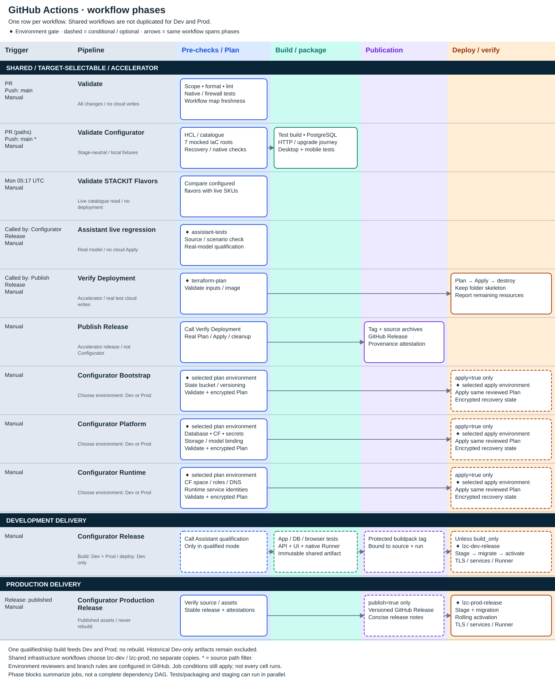

# GitHub Actions workflows

[English](workflows.md) | [Deutsch](workflows.de.md)

This is the entry point for choosing and starting a pipeline. Workflow names link
directly to their **Actions** pages; **source** links show the executable definition.
The eleven current repository workflows are listed below. Historical entries and
GitHub-managed workflows are [listed separately](#other-entries-in-the-actions-sidebar).

**A merge does not deploy the Configurator.** Configurator provisioning and
infrastructure runs are manual. Production activation uses published GitHub Releases
and requires manual approval in its own protected Environment.
Starting a workflow is not the same as approving its protected deployment job.

## Phases at a glance



[Open the full-size SVG](diagrams/generated/workflow-phases.svg).
Each workflow has one row. Blue is pre-checks/Plan, teal is build/packaging,
purple is publication and orange is deployment/verification. Arrows connect
phases within a workflow; dashed boxes are conditional, not failed or skipped
execution evidence. The diamond marks an Environment gate; reviewer/branch rules
are configured in GitHub, not inferred from the presence of an Environment name.

Shared and target-selectable workflows appear once at the top. Separate Dev and
Prod delivery rows follow below. **Configurator Release** also builds shared
production inputs; its deployment job targets Dev. Production consumes compatible
published assets and does not rebuild. One skip/qualified build can feed Dev and
Prod; historical Dev-only artifacts remain excluded.
The graphic summarizes phases rather than every step or dependency edge. For
example, browser acceptance/Runner packaging and CF staging run partly in parallel.
Calling **Verify Deployment** entails real test-cloud Apply and cleanup, even
when that call appears in the pre-check phase of **Publish Release**.

## Which workflow do I need?

| Task | Workflow |
| --- | --- |
| Check Accelerator changes without provisioning resources | **Validate** |
| Check Configurator, catalogue, database, browser and operator-IaC changes | **Validate Configurator** |
| Test Assistant answers against the real model | **Assistant live regression** |
| Build or deploy a Configurator Dev version, including API/UI and Runner | **Configurator Release** |
| Publish a stable product release and activate production | **Configurator Production Release** |
| Change the Configurator's own state storage, managed services or CF identities | **Configurator Bootstrap**, **Platform** or **Runtime** |
| Exercise a real Accelerator deployment and cleanup | **Verify Deployment** |
| Publish an Accelerator GitHub release after real deployment verification | **Publish Release** |
| Compare configured machine flavors with the live STACKIT catalogue | **Validate STACKIT Flavors** |

### Dev release without live Assistant qualification

Use **Configurator Release** on **main**. Choose **release_mode=skip** (default)
when no new live Assistant qualification is needed, or **qualified** to run the
complete repeated live suite. Changes to Assistant facts/capabilities still need
source-bound qualification according to the contributor guidance. Skipping does
not claim qualification or remove earlier failed receipts.

For Dev followed by Prod, leave **build_only=false** and **release_run_id** empty;
choose the Dev **runner_pool_size** (for example `2`). Build, database/browser/
native checks and protected buildpack publication run once, followed by the
manually approved **lzc-dev-release** deployment. The Assistant runtime setting
remains unchanged in either mode. No customer infrastructure Apply is authorized.

After the **whole run succeeds**, use its numeric run ID in **Configurator
Production Release** on the same `main` revision: **publish=true**, a curated
version tag (currently **v2.1.0**) and the **same release_mode**. Publication and
**lzc-prod-release** approval reuse the immutable packages; do not run Configurator
Release again just to create a Prod-only build. If Dev is not wanted, select
**build_only=true** in the initial run instead. Production does not rebuild.

A new `skip` manifest records stage-neutral scope, `assistantQualified=false` and
`assistantQualification=skipped`; the job is **build-skip**. `qualified` still
requires successful live qualification. Existing builds can be deployed to Dev
later through **release_run_id** without rebuilding, subject to source/tag and
artifact checks. Historical **dev-skip-assistant-qualification** artifacts remain
Dev-only/non-promotable; published **accepted-assistant-limitations** releases
remain readable for compatible redeployment. Neither legacy mode is a new-run
selection. A failed qualification cannot be relabeled as `skip`.


### Production release and infrastructure

[Configurator Production Release](https://github.com/stackitcloud/stackit-landing-zone/actions/workflows/configurator-production.yml) · [source](../.github/workflows/configurator-production.yml) publishes a stable release and deploys only after manual `lzc-prod-release` approval. It accepts `version` (default `v2.1.0`), `publish` (default `true`), `release_run_id` (required for publication) and `release_mode` (`skip` by default, or `qualified`). Reuse a fully successful **Configurator Release** from the same `main` revision and mode, whether it deployed Dev or used `build_only=true`. A second build is unnecessary. `skip` records skipped Assistant qualification without reinterpreting historical Dev-only artifacts. All non-inference checks remain mandatory.

A published stable GitHub Release with the required source-bound assets also triggers this workflow. Publication with `GITHUB_TOKEN` continues within the same run, avoiding reliance on another event. `publish=false` redeploys an existing compatible published release under a fresh manual approval. Pre-releases and arbitrary artifacts are rejected. Production uses immutable attached application/Runner assets, scoped CF credentials and rolling deployment of three web replicas.

The Bootstrap, Platform and Runtime inputs now include `environment` (`lzc-dev` by default, or `lzc-prod`). Their plan/apply Environments and mutation queues follow the selected stage. Prod platform inputs select the replica-set database; Prod runtime adds the dedicated DNS zone, public domain and space-scoped identities. The local encrypted `operator-project` bootstrap imports an existing operator project and provisions its dedicated project-limited identity. See the [complete production runbook](../landing-zone-configurator/docs/production.md) for bootstrap, bindings, credential rotation and recovery.

## Current repository workflows

**Automatic** describes repository events, not a manual click. **Reusable** means
another workflow can call it through `workflow_call`; it is not a separate UI
approval. All eleven definitions expose `workflow_dispatch`, but permissions,
branch restrictions, operator switches and environment protection still apply.

<!-- BEGIN GENERATED WORKFLOW INVENTORY -->
| Pipeline | Trigger | Scope |
| --- | --- | --- |
| [Validate](https://github.com/stackitcloud/stackit-landing-zone/actions/workflows/validate.yml) · [source](../.github/workflows/validate.yml) | PR<br>Push: main<br>Manual | All changes / no cloud writes |
| [Validate Configurator](https://github.com/stackitcloud/stackit-landing-zone/actions/workflows/validate-configurator.yml) · [source](../.github/workflows/validate-configurator.yml) | PR (paths)<br>Push: main *<br>Manual | Stage-neutral / local fixtures |
| [Validate STACKIT Flavors](https://github.com/stackitcloud/stackit-landing-zone/actions/workflows/validate-stackit-flavors.yml) · [source](../.github/workflows/validate-stackit-flavors.yml) | Mon 05:17 UTC<br>Manual | Live catalogue read / no deployment |
| [Assistant live regression](https://github.com/stackitcloud/stackit-landing-zone/actions/workflows/assistant-live.yml) · [source](../.github/workflows/assistant-live.yml) | Called by: Configurator Release<br>Manual | Real model / no cloud Apply |
| [Verify Deployment](https://github.com/stackitcloud/stackit-landing-zone/actions/workflows/verify-deployment.yml) · [source](../.github/workflows/verify-deployment.yml) | Called by: Publish Release<br>Manual | Accelerator / real test cloud writes |
| [Publish Release](https://github.com/stackitcloud/stackit-landing-zone/actions/workflows/publish-release.yml) · [source](../.github/workflows/publish-release.yml) | Manual | Accelerator release / not Configurator |
| [Configurator Bootstrap](https://github.com/stackitcloud/stackit-landing-zone/actions/workflows/configurator-bootstrap.yml) · [source](../.github/workflows/configurator-bootstrap.yml) | Manual | Choose environment: Dev or Prod |
| [Configurator Platform](https://github.com/stackitcloud/stackit-landing-zone/actions/workflows/configurator-platform.yml) · [source](../.github/workflows/configurator-platform.yml) | Manual | Choose environment: Dev or Prod |
| [Configurator Runtime](https://github.com/stackitcloud/stackit-landing-zone/actions/workflows/configurator-runtime.yml) · [source](../.github/workflows/configurator-runtime.yml) | Manual | Choose environment: Dev or Prod |
| [Configurator Release](https://github.com/stackitcloud/stackit-landing-zone/actions/workflows/configurator-release.yml) · [source](../.github/workflows/configurator-release.yml) | Manual | Build: Dev + Prod / deploy: Dev only |
| [Configurator Production Release](https://github.com/stackitcloud/stackit-landing-zone/actions/workflows/configurator-production.yml) · [source](../.github/workflows/configurator-production.yml) | Release: published<br>Manual | Published assets / never rebuild |
<!-- END GENERATED WORKFLOW INVENTORY -->

The exact Configurator path filter is in the linked YAML. A skipped
Accelerator-only job on a Configurator PR is intentional, not a deployment.
Do not make a path-filtered job a globally required check without ensuring that
it reports a result for every relevant PR.

## Start a workflow in the GitHub UI

1. Open the repository's [Actions tab](https://github.com/stackitcloud/stackit-landing-zone/actions)
   or the workflow link in the table.
2. Select the workflow, then **Run workflow**. Use **main** for ordinary
   operational runs; a branch dropdown does not override job/environment guards.
3. Fill in the inputs below and start the run. A missing button can indicate
   insufficient repository permissions, disabled Actions, or a definition without
   `workflow_dispatch` on the default branch. Old sidebar entries are not proof
   that a workflow still exists.
4. Follow the new run. For a protected job, an authorized reviewer must use
   **Review deployments**, select the environment and approve it. PR merge
   approval/admin bypass does **not** approve a deployment.
5. Check the complete run, not only dispatch success or the first green job.
   An accepted dispatch can still have skipped jobs if a gate is disabled.

### Manual start and inputs

| Workflow | Inputs and prerequisites |
| --- | --- |
| Validate / Validate Configurator / Validate STACKIT Flavors | No workflow inputs |
| Assistant live regression | `topic=all` by default, or a knowledge topic ID; `repetitions=2` by default, supported range 1-3. The continuous dialogue also runs for a topic-selected qualification. The protected `assistant-tests` environment currently permits `main` and the explicitly allowed legacy Configurator feature branch. |
| Verify Deployment | `var_file=config/hub-and-spoke-firewall.tfvars` by default; must be an existing relative path below `src/`. Manual runs use the selected revision. The reusable call also accepts `ref`; that is not a dispatch input. |
| Publish Release | `version` is required. Select `main`; other branches do not pass the verification-job guard. |
| Configurator Bootstrap | `root=bootstrap` by default, or `backend`; `apply=false` by default. `environment=lzc-dev\|lzc-prod`; Apply uses the selected stage's bootstrap-apply Environment. |
| Configurator Platform | `root=platform`; `apply=false` by default. Requires the platform operator switch above; `environment=lzc-dev\|lzc-prod`; Apply uses the matching platform-apply Environment. |
| Configurator Runtime | `root=runtime`; `apply=false` by default. Requires the runtime operator switch above; `environment=lzc-dev\|lzc-prod`; Apply uses the matching runtime-apply Environment. |
| Configurator Release | `release_mode=skip` and `build_only=false` by default; `release_run_id` empty means a fresh build under the selected mode. Set `build_only=true` to build without CF deployment; protected tag publication still occurs; live-model calls run in `qualified` mode. To promote an existing skip/qualified build, leave build-only unchecked and enter its numeric run ID; the retained artifact/tag must remain valid. |
| Configurator Production Release | `publish=true`, `version=v2.1.0`, `release_run_id` of the fully successful Configurator Release run; `release_mode=skip` by default (or `qualified`, matching the build). The same build may already have deployed Dev; no extra build-only run. `publish=false` uses an existing compatible release without rebuilding. Production activation requires `lzc-prod-release` approval. |

Release build browser acceptance and native packaging run concurrently; deployment
stages Runner, the minimal migration payload and Web/API concurrently with isolated
CF homes. App activation waits for all checks and the completed Runner binding.
The release remains one immutable source; component reuse is deferred to
[issue #167](https://github.com/stackitcloud/stackit-landing-zone/issues/167).

For the normal Configurator deployment: select **Configurator Release**, `main`,
choose **runner_pool_size=1** to maintain one prepared one-shot Dev Runner
(`0` disables/drains the pool; default `0`, maximum `4`, 1 GiB RAM per reserve),
leave **build_only unchecked** and **release_run_id empty**, then approve
`lzc-dev-release` when prompted. This deploys development, not a new production
environment. See the [release runbook](../landing-zone-configurator/deploy/cloud-foundry/README.md#manual-development-release-in-github)
for promotion and failure handling.

Bootstrap, Platform, Runtime and Release reject **Re-run jobs** attempts:
start a **new Run workflow** instead. Infrastructure Apply uses the reviewed
encrypted Plan from that same run, not an older run's Plan. A fresh promotion run
can reuse an existing qualified release build; do not confuse this with re-running
the original deployment. Failed qualifications remain failures.

Mutating Configurator workflows share a queue per environment:
`configurator-lzc-dev-mutation` or `configurator-lzc-prod-mutation` and do not cancel an active mutation.
Assistant model runs have their own serialized queue. Never start parallel local
cloud writes to bypass these safeguards.

### CLI equivalent

From a terminal authenticated with GitHub CLI, for example to check the Configurator:

```sh
gh workflow run validate-configurator.yml \
  --repo stackitcloud/stackit-landing-zone --ref main
```

Use the workflow filename from the **source** link to select another workflow.
Pass its inputs using `-f name=value`; this has the same effects and authorization
requirements as the UI. For example, `-f root=backend -f apply=false` selects a
Plan-only Bootstrap run. Do not put credentials, raw Plans or state in inputs.
`gh run list --repo stackitcloud/stackit-landing-zone --workflow validate-configurator.yml --limit 5`
shows recent runs; `gh run watch RUN_ID --repo stackitcloud/stackit-landing-zone`
watches one run. Dispatch success alone does not mean its jobs succeeded.

## Other entries in the Actions sidebar

GitHub retains workflow history after files are removed and also shows workflows
managed by GitHub itself. These are not additional current repository definitions.

| Sidebar entry | Where it comes from | How it starts / what to do |
| --- | --- | --- |
| [Terraform Plan](https://github.com/stackitcloud/stackit-landing-zone/actions/workflows/terraform-plan.yml) | Historical workflow; its YAML no longer exists on `main` | Not a current manual entry point. Use the current inventory above; an old run or GitHub's workflow-state label does not restore the deleted definition. |
| [Terraform Apply](https://github.com/stackitcloud/stackit-landing-zone/actions/workflows/terraform-apply.yml) | Historical workflow; its YAML no longer exists on `main` | Do not rerun historical cloud writes as a substitute for an authorized current Plan/Apply flow. No current `Run workflow` definition on `main`. |
| Copilot cloud agent | GitHub-managed agent workflow, not YAML in this repository | Starts through GitHub's Copilot agent task interface, subject to repository policy and access; not via our `workflow_dispatch` inputs |
| Dependabot Updates | GitHub-managed update jobs configured in [dependabot.yml](../.github/dependabot.yml) | Weekly on Sundays for Terraform providers and GitHub Actions; GitHub's Dependabot UI manages update checks. Resulting PRs go through normal repository validation, not automatic deployment. |

## Maintaining this catalogue

Workflow YAML remains the executable source of truth. `workflow-map.json` owns
bilingual phase summaries and maps every job to at least one phase. Trigger text,
workflow names, reusable callers and the inventory are read directly from YAML.
Adding/removing a workflow or job requires updating that mapping; source changes
to triggers, inputs, named steps, dependencies or gates make the generated diagrams
stale. Action pin-only updates do not. Review the phase summaries when changing
workflow semantics; the generator does not infer intent from arbitrary shell code.

Regenerate both diagrams and the marked inventory blocks after editing YAML or
[the phase mapping](workflow-map.json):

```sh
python3 -m venv /tmp/lzc-workflow-docs
/tmp/lzc-workflow-docs/bin/python -m pip install -r .github/scripts/requirements-workflows.txt
/tmp/lzc-workflow-docs/bin/python .github/scripts/workflow-map.py
/tmp/lzc-workflow-docs/bin/python -m unittest discover -s .github/scripts -p 'test_workflow_map.py'
/tmp/lzc-workflow-docs/bin/python .github/scripts/workflow-map.py --check
```

The **Workflow documentation** job in **Validate** runs the freshness/coverage
checks on PRs, main pushes and manual validation. Commit the YAML, phase mapping,
English/German SVGs and inventory updates together. The SVGs are vector graphics
without external assets and can be opened/exported independently. Keep manual
input descriptions and operator runbooks synchronized too. This catalogue is not
deployment authorization.

Related references: [contributing](../CONTRIBUTING.md),
[Configurator development](../landing-zone-configurator/docs/development.md),
[operator CI and environment gates](../landing-zone-configurator/infra/ci/README.md).

The `Isolated recovery lab` job in **Validate Configurator** verifies a local
PostgreSQL restore and native OpenTofu 1.12.6 interruption with synthetic fixtures.
It interrupts no hosted Runner and performs no cloud Apply. See the
[lab runbook](../landing-zone-configurator/infra/recovery-lab/README.md).

The recovery lab also exercises the real OpenTofu HTTP/S3 backend code against
loopback protocol fixtures, including retained checkpoints and an orphaned-lock
block before explicit fixture-only reconciliation. This remains local evidence.
