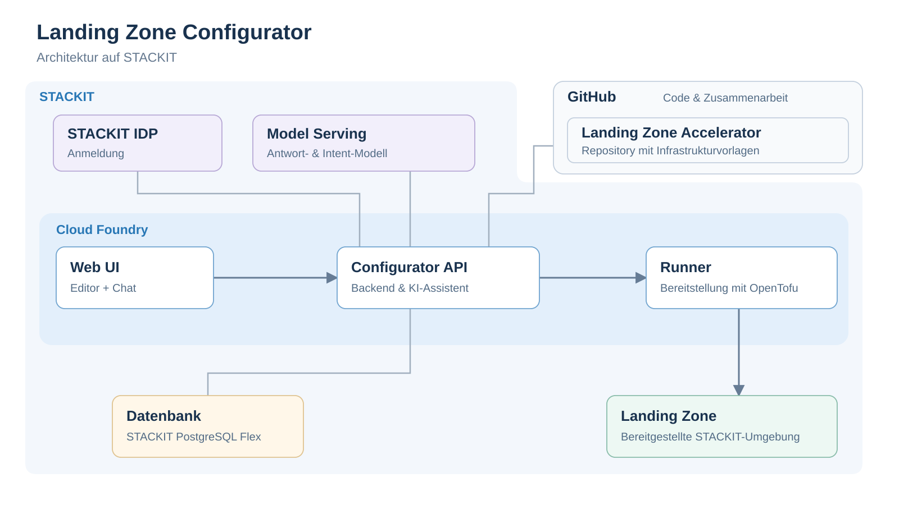
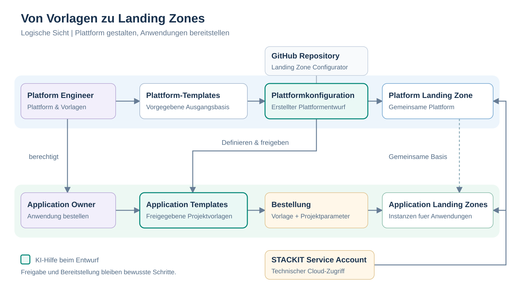

# STACKIT-Zielarchitektur des Landing Zone Configurators

Diese Referenz beschreibt die implementierten Komponenten und ihre
Vertrauensgrenzen. Die Entwicklungsumgebung verwendet STACKIT OIDC; eine eigene
Passwortverwaltung ist nicht vorgesehen. Der Betrieb in der Entwicklungsumgebung
ist kein Nachweis einer produktiv qualifizierten Umgebung. Die getrennten
[MVP-Grenzen](mvp-scope.md) und [Entwicklungsreferenzen](development.md) benennen
verbleibende Aufgaben.

## Technische Praesentationssicht

[Uebersicht als SVG in voller Groesse](architecture/stackit-overview.svg) ·
[PNG fuer Praesentationen](architecture/stackit-overview.png)

Die Uebersicht ist eine bewusst vereinfachte 16:9-Praesentationsgrafik:
Kernkomponenten mit jeweils einem Titel und Untertitel. Sie zeigt den
Hauptablauf UI -> Backend -> Runner -> Landing Zone und die angebundenen
Identitaets-, Repository-, Datenbank- und KI-Dienste. Linien zeigen grundlegende
Beziehungen, keine einzelnen Protokolle oder Datenfluesse. Die blaue
Hinterlegung kennzeichnet die STACKIT-Infrastruktur; nur GitHub mit dem
Accelerator-Repository liegt ausserhalb. Die dunklere CF-Flaeche umfasst
Web UI, Configurator API und Runner.

Editor und Chat sind Teile derselben Web UI. Die Configurator API beherbergt
die Assistant-Logik, Wissen, Validierung und Orchestrierung. Model Serving stellt
die beiden Modellrollen fuer Antworten und Intent-Erkennung bereit; es betreibt
nicht den eigentlichen Configurator-Assistenten. Zwei Modellrollen muessen nicht
zwei verschiedene Modelle sein: ohne separaten Intent-Override verwenden beide
Rollen das konfigurierte Antwortmodell.

GitHub und das darin liegende Accelerator-Repository sind an die API angebunden:
die API arbeitet mit den daraus abgeleiteten Templates und Eingabevertraegen.
Diese werden versioniert im Build uebernommen; die Grafik behauptet keinen
Live-Download beliebiger Repository-Staende. Der Runner fuehrt den dazu passenden
gepinnten Accelerator-/Provider-Stand mit OpenTofu aus.

Die CF-Gruppierung zeigt die Hosting-Plattform, keine gemeinsame CF-Organisation
oder Service-Bindings aller Komponenten. Web UI und API werden gemeinsam
ausgeliefert; Runner bleiben isoliert. Router, Secrets-/State-Verwaltung,
CI/CD und Migrationen sind in der Praesentationsansicht bewusst ausgeblendet.
Die SVG ist direkt editierbar.

## Logische Praesentationssicht

[Logische Sicht als SVG](architecture/landing-zone-logical.svg) ·
[PNG fuer Praesentationen](architecture/landing-zone-logical.png)

Die zweite Zeichnung zeigt den fachlichen Zusammenhang ohne Laufzeitdienste:

- Der **Platform Engineer** nutzt Plattform-Templates als Ausgangsbasis,
  erstellt die Plattformkonfiguration und stellt die **Platform Landing Zone**
  bereit.
- In diesem Entwurf definiert er auch **Application-Templates** und gibt
  gepruefte Versionen fuer den Katalog frei.
- Der **Application Owner** waehlt eine freigegebene Vorlage und ergaenzt die
  konkreten Projektparameter in einer Bestellung. Daraus entstehen
  **Application Landing Zones** auf Basis der gemeinsamen Plattform.

Ergaenzungen in der logischen Sicht:

- **GitHub Repository / Landing Zone Configurator:** Versionsbasis der
  Anwendung und ihrer Konfigurationsvertraege. Der Configurator-Code liegt
  derzeit im Unterverzeichnis `landing-zone-configurator` des gemeinsamen
  `stackitcloud/stackit-landing-zone`-Repos; die Zeichnung behauptet kein
  zusaetzliches eigenstaendiges Repository. Kundenkonfigurationen koennen
  separat in persoenlichen Accelerator-Forks versioniert werden. Die Linie
  bedeutet nicht, dass Kundendokumente im Configurator-Quellrepo landen.
- **Gruene KI-Markierung:** Unterstuetzung bei der Plattformkonfiguration und
  den Application-Template-Entwuerfen. Sie bezeichnet Vorschlaege und
  Rueckfragen, nicht automatische Veroeffentlichung, Rollenvergabe oder
  Cloud-Ausfuehrung. Bei bereits freigegebenen Templates bezieht sich die
  Markierung auf deren vorgelagerten Entwurf, nicht auf eine stille Aenderung
  veroeffentlichter Versionen.
- **Platform Engineer -> Application Owner / berechtigt:** Vergabe der
  tenantgebundenen Mitgliedschaft beziehungsweise Katalogberechtigung.
  Mitgliederverwaltung setzt die separat delegierte Verwaltungsfaehigkeit
  voraus; die Platform-Engineer-Rolle allein verleiht sie nicht automatisch.
- **STACKIT Service Account:** Autorisierter technischer Cloud-Zugang fuer
  die Bereitstellung von Plattform und Anwendungen. Er ist kein Benutzerlogin
  und ersetzt weder die Configurator-Rollen noch eine erforderliche Freigabe.
  Zugangsdaten werden nicht an den Application Owner herausgegeben; die
  Nutzung erfolgt serverseitig und auftragsgebunden.

Die Pfeile verdichten bewusste Arbeitsschritte, keine automatische
Veroeffentlichung oder Apply-Freigabe. Die Plattformkonfiguration erzeugt nicht
bereits die Anwendungsinstanzen. Template-Versionen und konkrete Bestellungen
bleiben getrennte Objekte; Rollen gelten pro Arbeitsumgebung.

## Technische Detailreferenz

Fuer die vollstaendigen Beziehungen, die separate CF Control Plane,
die Migration-App und die Remote-State-Pruefung gibt es zusaetzlich die
[Detailzeichnung als SVG](architecture/stackit-target.svg) und ihre
[editierbare Mermaid-Quelle](architecture/stackit-target.mmd).

**Leserichtung der Detailzeichnung:** Pfeile zeigen Aufrufe beziehungsweise den bezeichneten
Datenfluss. Doppelpfeile fassen Anfrage und Antwort zusammen. Gestrichelte
Pfeile beschreiben den Release-/Migrationspfad, nicht Kunden-Provisionierung.
Die Boxen unterscheiden Betreiber-Laufzeit, Runner-Isolation, Managed Services,
GitHub und Kundenressourcen; sie sind keine Zusage privater Netzwerkverbindungen.
Die STACKIT-API-Box steht fuer die adressierte Zielorganisation, nicht fuer
physisch darin betriebene API-Server.

## Bereitstellung und Verantwortlichkeiten

| Komponente | Bereitstellungsmodell | Aufgabe |
|---|---|---|
| Web UI | React-SPA, vom CF-Webprozess ausgeliefert | Editor und Chat, Templates, Auftragsstatus und ausdrueckliche Freigaben |
| Configurator API | Node.js/Fastify in derselben CF-App | Authentifizierung, Mandanten/Rollen, Validierung, Konfigurationscompiler, KI-Assistent, GitHub-Integration und Job-Broker |
| CF Router | Cloud-Foundry-Routing und HTTPS-Route | Browserzugang zur UI und API; keine direkte Browserverbindung zu DB oder Secrets Manager |
| Runner | Eigene CF-Organisation und Space; kurzlebige App/Task je Auftrag | Gepinnte OpenTofu-/Provider-/Accelerator-Ausfuehrung; danach Cleanup |
| PostgreSQL Flex | STACKIT Managed Database | Sessions, Mitgliedschaften, Entwuerfe, Templates, Jobs, Audit sowie verschluesselte Plan-/Recovery-Artefakte |
| Secrets Manager | STACKIT Managed Service | Geschuetzte Service-Account-Schluessel, GitHub-Tokens und Backend-Zugangsdaten |
| Model Serving | STACKIT AI Model Serving | Vom Backend genutzte Modelle fuer Antworten und Intent-Erkennung |
| STACKIT IDP | STACKIT Production; eigener Client je Anwendungsumgebung | OIDC Authorization Code Flow mit PKCE S256; Dev-CF-App bedeutet nicht Dev-IDP |
| GitHub | Externe Plattform | Optionale Benutzerverbindung fuer Forks, Konfigurationen und Pull Requests; getrennt vom STACKIT-Login |
| Landing Zone Accelerator Repo | `stackitcloud/stackit-landing-zone` auf GitHub | Versionierte Infrastrukturquelle; freigegebene Revision wird im Build gepinnt und paketiert |
| GitHub Actions | Geschuetzte CI/CD-Pipeline | Tests, Release-Artefakte, Promotion, Runner-Staging und Migrationen |
| Object Storage / S3 | State-Backend der Kunden-Landing-Zone | Dauerhafter OpenTofu-State, Lockfiles und getrennte State-Keys |
| STACKIT APIs / Zielressourcen | Ausgewaehlte Kundenorganisation und Projekte | Technischer Berechtigungsnachweis, Kataloge und freigegebene Provisionierung |
| Migration-App | Kurzlebige CF-App ohne Route | Versionierte DB-Migrationen mit separater Owner-Rolle; keine Owner-Credentials im Webprozess |

**UI und Backend sind logische Dienste, keine bereits beschlossenen getrennten
CF-Microservices.** Das aktuelle Release liefert beide in einer CF-App aus.
Eine spaetere physische Trennung ist moeglich, aber nicht Teil dieser Zeichnung.
Auch die Backend-Funktionen sind momentan Module eines API-Prozesses.

## Die vier wesentlichen Ablaeufe

### 1. Anmeldung und Organisationszugriff

Der Browser wird zum STACKIT IDP umgeleitet. Der Backend-Callback tauscht den
Authorization Code mit PKCE aus, prueft die Identitaet und erzeugt eine opaque
Configurator-Session. Organisationszugriff und Bindungsautoritaet werden separat
ueber die vorgesehenen STACKIT-APIs geprueft. Login, Mandantenmitgliedschaft und
Cloud-Berechtigungen sind unterschiedliche Nachweise.

GitHub bleibt eine optionale zweite Verbindung **fuer Repository-Funktionen**,
nicht der Ersatz fuer STACKIT-Login oder Organisationsrechte.

### 2. Entwurf und Assistant

UI-Eingaben und Assistant-Vorschlaege durchlaufen dieselben nativen
Konfigurationsvertraege. Nur das Backend ruft Model Serving auf. Es uebergibt
den begrenzten Konfigurationskontext, keine Service-Account-Schluessel oder
GitHub-Tokens. Der Modellaufruf startet weder einen Runner noch einen Apply.
Vorschlagsuebernahme, Speicherung, Plan und Apply bleiben getrennte Schritte.

### 3. Freigegebene Ausfuehrung

Das Backend prueft Rolle, Mandant, Ziel, Konfigurations-/Quellversion,
State-Bindung und die erforderliche Freigabe. Es dispatcht den Auftrag ueber
die CF API in die **separate Runner-Organisation**. Der Runner erhaelt nur
auftragsspezifische Inputs und Credentials ueber ein begrenztes Job-Ticket.
Er besitzt keine Configurator-DB-/Secrets-Manager-Service-Bindings und keine
CF-Dispatcher-Zugangsdaten.

Der Runner meldet Status und Ergebnisse an den Broker zurueck; dieser persistiert
sie in PostgreSQL. Die Cloud-Operationen verwenden den explizit autorisierten
Service-Account, nicht das menschliche Login-Token. Plan und Apply sind
unterschiedliche Operationen; Apply setzt den geprueften gespeicherten Plan
und die passende Freigabe voraus.

### Execution and state

**State ist nicht gleich Konfigurationsdatenbank:** Der erste Plattform-Bootstrap
verwendet temporaer das persistente, verschluesselte HTTP-State-Backend der API.
Erst nach dem freigegebenen Bootstrap-Apply wird der State in den vom Accelerator
erzeugten Kunden-S3-Bucket migriert und verifiziert. Plattform- und
Application-States erhalten getrennte Keys mit Lockfiles. Der
Configurator-eigene Infrastruktur-State ist wiederum davon getrennt.

Planartefakte werden vom Backend verschluesselt in PostgreSQL gespeichert.
CI-Release-Artefakte liegen in GitHub Actions. Der zusaetzlich in der Betreiber-IaC
definierte Artifacts-Bucket ist **kein** Beleg dafuer, dass diese Artefakte bereits
dorthin ausgelagert werden; er wird deshalb nicht als aktiver Datenpfad gezeichnet.

### 4. Software-Lieferkette

CI baut und testet eine festgelegte Accelerator-Revision, den API-/UI-Release
und das Runner-Paket. Das qualifizierte Artefakt wird ueber eine geschuetzte
Promotion ausgeliefert; Runner-Jobs laden nicht beliebig den aktuellen
Repository-Head. Versionierte DB-Migrationen laufen vorher in einer separaten
kurzlebigen Migration-App. Application-Release und Kunden-Plan/Apply sind
unabhaengige Freigaben.

## Wesentliche Ergaenzungen zur urspruenglichen Komponentenliste

1. **Secrets Manager:** notwendig fuer die technische Credential-Verwaltung.
2. **Object Storage / State-Backend inklusive Locking:** notwendig fuer
   reproduzierbare und konfliktfreie Infrastrukturverwaltung.
3. **STACKIT APIs und Kundenressourcen:** machen sichtbar, was der Runner
   tatsaechlich verwaltet und mit welchen technischen Credentials.
4. **CF Router und Control Plane:** trennen Benutzerzugang von Task-Dispatch.
5. **CI/CD, Release-Artefakte und Migration-App:** zeigen Quelle, Lieferkette und
   die Trennung von DB-Owner- und Runtime-Berechtigungen.

Fuer eine produktionsreife Betriebsarchitektur sind ausserdem festzulegen:

- Zentrale Logs, Metriken, Alarmierung und deren Aufbewahrung. CF-Logs und
  Datenbank-Audit ersetzen kein vollstaendiges Monitoring-/Alerting-Konzept.
  Eine konkrete Observability-/Telemetry-Router-Anbindung des **Configurators**
  wird hier nicht als bereits eingerichtet dargestellt.
- Verifizierte DB-Backups, Secret-/Artefaktschluessel-Recovery, S3-Versionierung
  und Wiederherstellungstests. Der Verlust des bestehenden Artefaktschluessels
  darf nicht durch spontane Rotation verdeckt werden.
- Skalierung/HA sowie gemeinsame Ablage oder Sticky Routing fuer laufende
  OIDC-Flows. Die aktuelle Ein-Instanz-Anwendung ist kein HA-Nachweis.
- Netzwerkpfade, ACLs und Egress-Regeln. Ein CF-Runner hat nicht automatisch
  Zugriff auf private Kubernetes-/Helm-/Firewall-Endpunkte in Kunden-SNAs.
  Diese Ausfuehrungsgrenze bleibt separat zu loesen (#37).
- Eng begrenzte Betriebs-/Deployment-Identitaeten, kontrollierte CF-Space-Rechte
  und eine Least-Privilege-Qualifikation des OIDC-Clients.

Es wird **kein** zusaetzlicher Queue-Service vorausgesetzt: Auftragsmetadaten
liegen in PostgreSQL, der Broker dispatcht CF-Tasks. Ein allgemeiner Scheduler
waere eine eigene spaetere Architekturentscheidung.

## Grundlagen und Weiterfuehrung

- [CF-Release und Service-Bindings](../deploy/cloud-foundry/README.md)
- [Runner-Paket und Accelerator-Pin](../deploy/runner/README.md)
- [Plan-Ausfuehrung, Broker und State-Lebenszyklus](plan-execution.md)
- [Login und Organisationsnachweis](github-login.md)
- [Plattform-/Application-Vertraege](platform-application-architecture.md)
- [PostgreSQL Flex](../infra/platform/2-database.tf),
  [Secrets Manager](../infra/platform/3-secrets.tf) und
  [Model Serving](../infra/platform/5-model-serving.tf)

Die Detail-SVG wird lokal mit Mermaid CLI 11.12.0 aus der Mermaid-Quelle gerendert.
Die Uebersicht verwendet ausschliesslich lokale SVG-Formen und Systemschriften.
Keine Zugangsdaten, Konfigurationen oder Diagrammquellen werden an einen
Online-Renderer gesendet.
