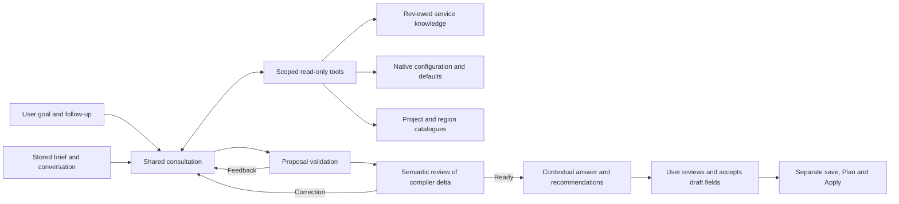

# Model-led Assistant consultation

[English](assistant-consultation.md) | [Deutsch](assistant-consultation.de.md)

The Editor chat uses one consultation driver for all selected Accelerator topics.
The model interprets the goal, existing platform context and follow-up answers;
application code supplies authoritative facts and validates proposed local changes.
A product no longer needs a separate conversational state machine.

The initial template adviser remains read-only. Its request includes the registered
template topology facts and relevant network/project rules with mandatory
dependencies; unrelated editable-field schemas and product contracts are omitted.
It may reference only rules actually supplied in that request.

The default model is `Qwen/Qwen3.8-27B` on the existing STACKIT EU01 endpoint;
operators may override it. It supports reasoning and native tools according to
the [STACKIT model catalogue](https://docs.stackit.cloud/products/data-and-ai/ai-model-serving/basics/available-shared-models/).
Model comparisons and qualification receipts must record the exact selection.
A comparison success never qualifies another model or an older source snapshot.

Qwen3.8 uses its published reasoning sampling profile (`temperature=1.0`,
`top_p=0.95`) with `reasoning_effort=medium` for the bounded interactive workflow,
using standard API parameters; other model selections retain their
existing sampling. This is an inference configuration, not evidence of quality:
the complete source-bound qualification still applies. See the
[official model card](https://huggingface.co/Qwen/Qwen3.8-27B#api-usage).

Bounded provider `reasoning`/`reasoning_content` fields remain in the private native
tool conversation for this turn, as required for reasoning-model continuation.
They are not user-facing explanations, tool authority or confirmed decisions and
never enter stored chat history, the brief, public responses or qualification logs.
An isolated EU01 compatibility probe verified that the endpoint accepts its own
returned reasoning field on the subsequent tool-result request; this does not
qualify answer quality.

Qwen3.8 requests allow 16,384 completion tokens for reasoning plus final output;
other model selections retain the previous 4,096-token default. Operators may set
`LZC_MODEL_SERVING_MAX_COMPLETION_TOKENS` between 1,024 and 16,384 for a separately
qualified selection. The final user-facing text remains bounded to 16,384
characters. A truncated completion is a failure, never silently retried.
Qwen3.8 requests default to a 120-second timeout, within the existing configurable
request bounds; other models retain 60 seconds. The entire consultation still has
a three-minute deadline, including its reads and reviews.



## Consultation and tools

Mandatory rules and the active brief are supplied initially. The model retrieves
reviewed service facts and dependencies through native OpenAI function calls. The
first inference names `read_knowledge` explicitly in `tool_choice`, so general model
knowledge cannot bypass the initial source lookup; later calls use automatic selection.
The knowledge tool ranks the current request and an optional English search query
against the selected curated corpus with BM25. Relevant matches augment requested
topic IDs, so choosing a neighbouring topic does not omit the actual service facts.
Short generic follow-ups do not create an unrelated search result; the active brief
and explicit topic selection remain available. This reads no remote documents or
customer data. Independent reads may be batched. Already delivered rules are referenced instead
of repeated. The service catalogue and relevant editable roots are discoverable
without a separate intent classifier. Schemas are read with the actual configuration,
rather than embedding thousands of unrelated field paths in every tool definition.

Immutable service contracts and root schemas are delivered once per consultation;
subsequent reads retain source references and actual requested values. Readiness
summaries identify actual template read paths separately from computed metadata,
which is not exposed as invented configuration fields.

Tools read already scoped public configuration and catalogue snapshots. They cannot
select another tenant, arbitrary HTTP endpoints, credentials, live State or a Plan.
Native schemas and defaults come from the generated Accelerator input contract;
the model does not maintain a second list of default values.

### Read and response latency

Editor consultation loads product catalogues only when a catalogue tool or a
catalogue-backed selector needs them. Requests for the same region share one
in-flight lookup within that turn. Authenticated offerings are read again on the
next turn and remain scoped to the current user's project access. Only public
PIM metadata is cached across turns: at most 60 seconds, by region, with its
original fetch timestamp. Failed public lookups are not cached or served stale;
each consumer receives an independent copy.

For configuration work, `read_knowledge` can request `includeConfiguration` to
receive the selected topics' editable roots and authoritative native defaults
alongside their knowledge. Advice-only reads omit that bundle. Bounded bundles
explicitly list remaining paths for further reads. Independent reads run together;
validation and dependent writes still wait for their actual inputs. Bundled values
and default provenance also reach the semantic reviewer. Its output should cite
specific evidence rather than repeat whole documents; its completeness, intent,
language and boundary checks remain mandatory. Folder proposals include a localized
summary of the exact validated folder names before review.

The browser negotiates phase events with `X-LZC-Assistant-Progress: 1` on NDJSON
requests. It displays preparation, catalogue lookup, consultation, semantic review
and finalization separately. Older clients retain the original event protocol.
Progress contains fixed phase codes, never unfinished model prose or proposals;
acceptance remains possible only after validated completion.

`assistant_phase_completed` logs include an opaque turn correlation ID, phase,
elapsed milliseconds and success. `assistant_inference_usage` logs include model,
phase, elapsed time and token counts. Neither includes prompts, configuration,
credentials or tool arguments. These measurements distinguish catalogue latency,
model iterations and semantic review without reducing the model's reasoning budget
or changing the three-minute consultation deadline.

Catalogue requests can carry user requirements with a source turn and quotation.
Concrete setup recommendations use this project/region lookup even when the model
already knows the documented plan ceilings. The lookup drives recommendation cards
and source-backed selectors; a prose plan name alone does not replace that UI.
General advice about product limits remains independent of project availability.
The shared evaluator compares them with reviewed numeric ceilings and matched
catalogue facts. It distinguishes eligible, excluded and unknown offerings. Known
Git user limits and supplied VM/VPN characteristics use the same evaluator; unknown
capacity or unverified RAM units cannot become a performance claim.

The native validator exposes optional `nativeDefaults` evidence only for actual
native variable defaults. Literal values, catalogue selections and registered presets
do not need this evidence. All still pass source/schema/compiler checks.

A uniquely fitting option appears as a source-bound recommendation with its
requirements and characteristics. This remains visible even while another decision
is open. New selections absent from a complete available project/region catalogue
are rejected before a proposal handle is issued. Existing values may be retained;
missing or truncated catalogue data is not proof of unavailability. The model supplies the contextual explanation. The application does not
replace that explanation with a generic catalogue preamble. Recommendation cards
are informational and grant neither configuration acceptance nor execution rights.

Reviewed workflow bundles include their operational dependencies and typed source
selection. A natural-language capability request uses that bundle instead of
reconstructing an incomplete list from individual verbs. Explicit exact lists of
technical permission identifiers remain exact. Regressions cover both paths.

Nine native functions expose the shared consultation operations. Two template
helpers distinguish adding permissions from selecting a complete access profile;
they use the same proposal validator. Explicit custom permission lists replace
the previous lists exactly. Full Owner selection uses the registered atomic preset.
The initial template summary identifies existing profiles and legacy inputs.

Interactive decisions use `ask_question` with one flat path/text/options payload
per question. Independent questions may be returned as several calls in one reply.
`finish=false` stages a question privately while further reads or questions continue.
The final question with `finish=true`, or a final explanation, assembles all staged
questions before ordinary validation and review. Staging grants no authority and
does not expose a partial response. The same eight-question and turn budgets apply.
The adapter assembles the existing public question list and retains the validated
proposal. `send_answer` can also finish already-staged questions without adding a
dummy question. Registered initial-owner fields receive choices from scoped
application identities, plus a manual email option, like source-owned catalogue
pickers; model-supplied option labels never establish an identity or select it.
Registered source-network questions use the same application-owned choice
renderer: actual Accelerator defaults, saved allowlists and manual public-egress
input. Model wording does not have to match private labels character for character.
Unsupported model-written options cannot enter the displayed choice list. This
changes no value: the user's selection and proposal/default evidence remain required.
Actual native defaults may supply unspecified proposal fields as visible assumptions,
without pretending they are user decisions. Omitted required creation fields are
materialized only from real native defaults; explicit null, false and empty lists
retain their semantics. Existing unrelated configuration and explicit restrictions
take precedence. Access profiles and identities are not native variable defaults.
Defaults are rendered beside the active proposal's field changes. Unrestricted IPv4/IPv6 sources are named explicitly, from server-owned
metadata rather than a model claim. The notice is hidden when its field is no longer
part of the pending proposal. Rendering a notice does not select or accept a value.
Absent reference metadata uses only already observed source references; explicit
foreign references remain subject to rejection. This avoids nested lists
of question objects that the candidate model repeatedly returned as malformed JSON
strings. Only valid JSON containers at explicitly typed schema fields may be
decoded for transport compatibility; malformed JSON and literal/free-form values
are not repaired or coerced. Bounds and all proposal checks still apply.

For provider compatibility, a response consisting entirely of valid tagged
`tool_call` blocks is normalized into native calls. Mixed prose, malformed blocks
and unknown functions cannot become executable operations or published advice.
Source references prioritize selected topics and remain bounded. Answer review
receives relevant source facts and the actual compiler delta, including checks
against requested names, keys and exact lists, without repeated discovery schemas.

The model submits draft changes to the validator and receives feedback before its
final answer. There is no tool for saving, granting permissions, provisioning,
publishing, approving or executing cloud changes. All tool envelopes, native paths,
protected fields, source values and proposal shapes are checked server-side. In the
application, the existing compiler also validates the candidate during consultation
and again before persistence. Current authorization, ownership, revision and expiry
checks remain authoritative on acceptance.

The transport uses standard assistant `tool_calls` and corresponding `tool` results,
with call IDs; results are never simulated as new user messages. Normal explanations
may be natural-language replies. Structured questions use `ask_question`. A textual
reply can carry only the latest successfully validated local proposal; a rejected
replacement clears that handle. Neither text nor a function name can execute cloud
changes. The final answer still passes the same semantic review before publication.

A rejected final answer withholds the candidate's automatic attachment to later
prose or questions. Schema/compiler validity alone does not establish a suitable
answer. The model can ask a genuinely missing decision without that proposal,
explicitly select the same validated handle after an explanation-only correction,
or validate a changed candidate. Typed mutation tools can still explicitly extend
the validated working batch, whose complete effects are reviewed again. This
changes no accepted draft and grants no additional authority.

Typed mutation tools extend the latest validated proposal in the current turn.
The validator accepts only proposal handles it issued in that turn, replays the
bounded operation batch from the original configuration and revalidates its full
effect. Rejected candidates cannot become a base or the final response. A generic
validation call can explicitly select a base or start a fresh candidate.
When a valid proposal still needs a user decision, the answer tool returns both
the proposal and a structured question; a question in prose alone is insufficient.

The tool schemas remain compact. An empty question list, reference list or proposal
is normalized as empty; omitted fields cannot activate a component or grant access.
Generated replies use the same bounded 16,384-character budget as the native transport, and adding a draft notice never silently cuts
off an explanation or an important boundary. A turn has at most twelve consultation
steps, three bounded reviews and a three-minute deadline. Configured individual
request limits remain enforced. HTTP failures do not trigger a hidden controller fallback or
an unbounded inference retry.

The total turn deadline is diagnosed separately as `consultation_timeout`, while
an individual serving request retains `service_timeout`; both use the existing
public timeout message. Server logs can include the failing inference phase and
an allowlisted upstream category (grammar backend mismatch, unsupported schema,
context limit, rate limit or unknown). Error bodies are bounded and classified
only in memory. Provider text, prompts, reasoning and credentials are never copied
into those diagnostics. HTTP rejections are not retried or converted to success.
Synthetic receipts also bind a hash of the actual API, contracts, domain and test
source bytes, and the journey records timed tool/review events. Its Git catalogue
is explicitly synthetic; this is not a claim about customer entitlement.

Explicit knowledge-topic requests take precedence over neighbouring search hits.
Missing-knowledge feedback names the unread topics and explains whether to read them
or remove irrelevant historical references; it never approves an unread source.
The journey uses the canonical eight-question budget, restricts questions to the
current task and rejects questions for an already resolved Git size. Independent
audit decisions may require more than three questions. Audit query advice distinguishes
Grafana SSO from native technical credentials and the separate Logs fallback.
Mandatory credential boundaries also reach every final review without requiring
a model citation: Secrets Manager does not remove provisioned secrets from
Terraform/OpenTofu state, whose storage and access remain sensitive.

The complete repeated CI qualification is serialized against the project quota
and has a six-hour job limit. This does not extend any individual request/turn
deadline, retry a failed repetition, or change the release acceptance criteria.

A shared semantic review compares the request, follow-up decisions, reviewed facts
and actual compiler-produced delta before the final answer is streamed or stored.
Its response uses the existing projected JSON Schema on the serving wire, followed
by validation against the original review schema. A generic JSON object alone is
not the review contract. Invalid types or missing decisions cannot become approval.
The delta separates added/removed rights by principal and product group; unchanged
identities and IAM metadata are omitted. Review findings return to the same
consultation for correction. This is an internal quality check, not another user
approval or a guarantee that every answer is correct. Critical capability boundaries
require explicit coverage and references to server-numbered answer paragraphs.
Large registered preset and named catalogue-union permission effects are compacted
only after the actual compiler candidate matches the native factory/materialized
result exactly. The model receives the proven selection, templates and principals,
actual added/removed product counts and an effect hash instead of hundreds of
repeated permission names. Small lists stay explicit. Custom literal lists,
unrecognized operations and mismatching compiler outputs
retain the full delta. Other changed fields and removed product groups remain
visible. The reviewer must still check the user's intent and explain critical
boundaries; a compiler proof grants no rights. Draft acceptance and the public
reviewable proposal retain the complete native changes.
Ordered registered preset, owner and catalogue operations retain their sequence
and compare the final materialized profile with the compiler candidate. Removed
legacy settings and changed owner values remain explicit; a later operation is
never verified against an intermediate preset alone.

Readiness describes correct progress in the current turn. Each requirement must
be addressed by a validated proposal, observed existing configuration, advice,
or a necessary structured question. Pending decisions reference actual question
indices; prose alone does not substitute for a question. A required clarification
does not require premature configuration changes. A validated default reset may
remove an override even when the effective compiler value remains unchanged.
Existing explicit Owner profiles already cover catalogue service permissions for
both principals. Adding a service must not silently narrow that profile. A
requested migration to granular permissions is a separate, confirmed transition.

The reviewer first records user requirements with expected and actual results and
references the numbered user turn, then decides readiness. An unmet check or an
invalid user-turn reference cannot approve the answer. Registered preset identifiers in an explanation also
require their documented critical boundary; the reviewer cannot mark that boundary
inapplicable. These checks improve qualification but do not make semantic review
infallible. The reviewer does not have to regenerate a verbatim copy of the answer. Validated native-default
choices are supplied with their source value and user evidence, so a later explicit
default choice is not reinterpreted as an earlier access preference. HTTP failures are not retried
through the review loop; acceptance and execution boundaries remain unchanged.

The chat capabilities are read-only/local; the Configurator product separately runs
approved jobs. Describing the product must not confuse those two scopes. Proposal
effects are described as proposed effects, not already granted cloud access.

Typed `union`, `add_permissions` and registered `preset` operations materialize complete native
values locally. The model selects a reviewed operation rather than reproducing
hundreds of permission strings. Application access profiles remain atomic:
permission additions name the selected templates and principals explicitly and retain
the initial owner, the other principal and unrelated rights. Registered presets include workload, VM and full Owner variants. Granular profiles
need an initial owner; the native Owner variant has no granular owner/permission-list
fields. Local batches update a private working snapshot in order and preserve atomic
profiles, including an earlier owner edit followed by permission additions.
Each permission-addition operation chooses
one source: service groups, a registered permission set, or exact identifiers.
Unused optional arguments cannot accidentally enable an unrelated permission set. Official service groups are resolved from the existing catalogue; IAM
requires explicit permission identifiers. The materialized proposal passes the
same schema, source and compiler checks and grants no permissions by itself.
Platform context distinguishes reusable project-template principal lists from
concrete project members, so template changes do not request individual user
addresses. New presets still require a confirmed initial owner.
Profile and initial-owner question paths are registered from actual templates or
compiler-validated local proposals. The synthetic harness uses the same registry.
Owner choices receive source-authored labels from prepared accounts and the verified
signed-in identity; model-authored labels cannot claim another identity is verified.
This changes question associations, not mutation paths or tenant authorization.

Project-IAM permission edits apply to Public, Corporate and Sandbox templates;
they do not provision a cluster or depend on an SNA, node pools or cluster names.
The person receiving rights when ordering identifies the requester; automation
and the central initial owner are separate roles.
Service additions target only the requested recipients; lack of an explicit
prohibition does not select automation. Ambiguous recipients need a question.
Documented setting defaults never authorize additional IAM recipients.
Before issuing a handle, the server also checks newly added permission service
groups against actual user statements and the existing reviewed service aliases.
Catalogue membership is not a request for a service. Quoted question alternatives
do not select their services. Registered native presets, the requested key-management
workflow, literal permission identifiers and actual defaults for new templates
retain their source semantics. This check applies to materialized whole-profile
edits as well as typed unions, so changing the JSON operation cannot bypass it.
It establishes a service source, not consent: current-turn semantic review still
checks negation, purpose, recipients and exact requested scope.
Multiple templates of a requested singular kind require a choice of actual keys,
rather than an implicit edit of all.
Compact readiness metadata exposes missing publication prerequisites without
copying unchanged owner addresses into review. A missing initial owner is asked
once across affected granular templates; independent local rights additions can
still be proposed.
These source-derived decisions are checked against real question indices, or a
literal user-bound deferral, rather than a general review verdict. Unrelated
settings edits and templates with an existing owner do not create that decision.

For a confirmed legacy access transition, the profile tool accepts
`replaceLegacyAccess: true` and calls the editor's native transition function.
It removes incompatible legacy role settings and their parameter policy while
preserving other settings, template identities and subsequent permission additions.
The complete resulting template map is compiler-validated; service-right additions
alone never implicitly migrate a legacy or full-Owner profile.

## Context and native defaults

The final review also produces a compact brief. The brief records the goal, confirmed decisions, recommendations and open questions.
Confirmed entries carry a quotation from an actual user turn. Unsupported memory
claims are discarded; an otherwise valid answer does not fail merely because an
advisory summary quoted a source incorrectly. Actual configuration values remain
authoritative, and recommendations do not become confirmed user decisions.

The server also retains the actual displayed questions (canonical field paths and
source-authored choices) and recommendation cards in that source-bound private
state. The next turn receives these alongside the brief, so a short answer can
refer to a concrete pending decision without rebuilding it from prose. They are
context, not consent; a topic switch can close them and a new answer replaces the
pending question list. The final review must check the current user turn explicitly;
passing checks for historical requests cannot qualify a new response or authorize
replaying earlier changes.

The previous unaccepted proposal is also supplied as a compiler delta only while
its knowledge hash, revision, expiry and public baseline still match. This is advisory
context, not an accepted configuration or an additional source of permission. Discarding
it removes that context; changed local values suppress a stale proposal. Unchanged
folder IAM metadata is not copied into the delta.

The brief is stored with the assistant message in the existing owner-scoped
conversation JSON, under the same RLS, revision, deletion and expiry controls. It is
not accepted from the browser and is omitted from the public response. A knowledge
hash change invalidates the cached brief; the original conversation remains
available. Discarded proposals close their pending context. No database migration
or new customer infrastructure is required.

“Use the default” is a selection of the actual Accelerator default for the pending
field. The model obtains that value from the native-default facts/tool and includes
it in the reviewable proposal. It does not demand another confirmation or require
the user to spell the literal JSON/CIDR. An unanswered question alone is not that
selection, and a company/VPN restriction does not reveal actual public egress
addresses. Existing compatible allowlists and the native default can be offered as
concrete choices. A later explicit default choice supersedes the earlier restriction.

For example, the complete company Git dialogue retains the Hub-and-Spoke context,
fits approximately 80 developers to Git100, carries the answered reachability
choice and resolves a subsequent default request to:

```hcl
devops = {
  git_flavor             = "git-100"
  allowed_network_ranges = ["0.0.0.0/0"]
}
```

The answer explains the default's public reachability. It does not repeat the plan
or access question, modify the existing network layout, or imply private managed
Git connectivity through SNA. User acceptance changes only the local draft.

## Verification and transition

Runtime tests cover the shared tool protocol, all topic lookups, native defaults,
compiler feedback, protected inputs, quotation-bound memory, recommendation facts,
streaming and multi-turn context. The real-model suite always imports the public
runtime class; it must qualify the new driver, including the complete user task and
cross-service dialogue. Failed experiments remain failures and are retained.
Assertions check outcomes, native values, factual limits and user constraints;
equivalent useful wording does not need a canned sentence.

The former controller is temporarily retained as `LegacyAssistantModelServing`
for explicitly labelled comparison tests. Editor chat has no routing or fallback
to it. Those tests are not evidence that the new consultation is qualified. The
existing initial template-advice API keeps its separate typed contract. Retiring
the historical controller must preserve that API and transport/error tests.

## Qualification traffic

Synthetic test admission considers observed prompt/completion usage and the reported
project token limit, with headroom. STACKIT counts output tokens with a factor of five.
This paces future requests; it never retries a received HTTP failure to turn a failed
repetition into a pass. See [STACKIT shared-model rate limits](https://docs.stackit.cloud/products/data-and-ai/ai-model-serving/how-tos/rate-limits-on-shared-models-_stackit-ai-model-serving/).
Native function calls follow the [STACKIT tool-calling contract](https://docs.stackit.cloud/products/data-and-ai/ai-model-serving/how-tos/integration-of-tool-calling/).
