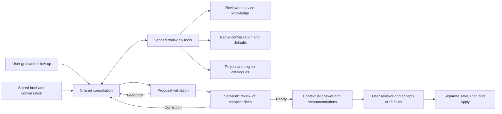

# Model-led Assistant consultation

[English](assistant-consultation.md) | [Deutsch](assistant-consultation.de.md)

The Editor chat uses one consultation driver for all selected Accelerator topics.
The model interprets the goal, existing platform context and follow-up answers;
application code supplies authoritative facts and validates proposed local changes.
A product no longer needs a separate conversational state machine.



## Consultation and tools

Mandatory rules and the active brief are supplied initially. The model retrieves
reviewed service facts and dependencies through native OpenAI function calls. The
first inference names `read_knowledge` explicitly in `tool_choice`, so general model
knowledge cannot bypass the initial source lookup; later calls use automatic selection.
The knowledge tool ranks the current request and an optional English search query
against the selected curated corpus with BM25. Relevant matches augment requested
topic IDs, so choosing a neighbouring topic does not omit the actual service facts.
Short generic follow-ups do not create an unrelated search result; the active brief
and explicit topic selection remain available. This reads no remote documents or
customer data. Independent reads may be batched. Already delivered rules are referenced instead
of repeated. The service catalogue and relevant editable roots are discoverable
without a separate intent classifier. Schemas are read with the actual configuration,
rather than embedding thousands of unrelated field paths in every tool definition.

Tools read already scoped public configuration and catalogue snapshots. They cannot
select another tenant, arbitrary HTTP endpoints, credentials, live State or a Plan.
Native schemas and defaults come from the generated Accelerator input contract;
the model does not maintain a second list of default values.

Catalogue requests can carry user requirements with a source turn and quotation.
The shared evaluator compares them with reviewed numeric ceilings and matched
catalogue facts. It distinguishes eligible, excluded and unknown offerings. Known
Git user limits and supplied VM/VPN characteristics use the same evaluator; unknown
capacity or unverified RAM units cannot become a performance claim.

The native validator exposes optional `nativeDefaults` evidence only for actual
native variable defaults. Literal values, catalogue selections and registered presets
do not need this evidence. All still pass source/schema/compiler checks.

A uniquely fitting option appears as a source-bound recommendation with its
requirements and characteristics. This remains visible even while another decision
is open. New selections absent from a complete available project/region catalogue
are rejected before a proposal handle is issued. Existing values may be retained;
missing or truncated catalogue data is not proof of unavailability. The model supplies the contextual explanation. The application does not
replace that explanation with a generic catalogue preamble. Recommendation cards
are informational and grant neither configuration acceptance nor execution rights.

Eight native functions expose the shared consultation operations. Two template
helpers distinguish adding permissions from selecting a complete access profile;
they use the same proposal validator. Explicit custom permission lists replace
the previous lists exactly. Full Owner selection uses the registered atomic preset.
The initial template summary identifies existing profiles and legacy inputs.

For provider compatibility, a response consisting entirely of valid tagged
`tool_call` blocks is normalized into native calls. Mixed prose, malformed blocks
and unknown functions cannot become executable operations or published advice.
Source references prioritize selected topics and remain bounded. Answer review
receives relevant source facts and the actual compiler delta, including checks
against requested names, keys and exact lists, without repeated discovery schemas.

The model submits draft changes to the validator and receives feedback before its
final answer. There is no tool for saving, granting permissions, provisioning,
publishing, approving or executing cloud changes. All tool envelopes, native paths,
protected fields, source values and proposal shapes are checked server-side. In the
application, the existing compiler also validates the candidate during consultation
and again before persistence. Current authorization, ownership, revision and expiry
checks remain authoritative on acceptance.

The transport uses standard assistant `tool_calls` and corresponding `tool` results,
with call IDs; results are never simulated as new user messages. Normal explanations
may be natural-language replies. Structured questions use the answer tool. A textual
reply can carry only the latest successfully validated local proposal; a rejected
replacement clears that handle. Neither text nor a function name can execute cloud
changes. The final answer still passes the same semantic review before publication.

The tool schemas remain compact. An empty question list, reference list or proposal
is normalized as empty; omitted fields cannot activate a component or grant access.
Generated replies use the same bounded 16,384-character budget as the native transport, and adding a draft notice never silently cuts
off an explanation or an important boundary. A turn has at most eight consultation
steps, two bounded reviews and a three-minute deadline. Individual requests retain
their existing limits. HTTP failures do not trigger a hidden controller fallback or
an unbounded inference retry.

A shared semantic review compares the request, follow-up decisions, reviewed facts
and actual compiler-produced delta before the final answer is streamed or stored.
The delta separates added/removed rights by principal and product group; unchanged
identities and IAM metadata are omitted. Review findings return to the same
consultation for correction. This is an internal quality check, not another user
approval or a guarantee that every answer is correct. Critical capability boundaries
require explicit coverage and references to server-numbered answer paragraphs.
The reviewer does not have to regenerate a verbatim copy of the answer. Validated native-default
choices are supplied with their source value and user evidence, so a later explicit
default choice is not reinterpreted as an earlier access preference. HTTP failures are not retried
through the review loop; acceptance and execution boundaries remain unchanged.

The chat capabilities are read-only/local; the Configurator product separately runs
approved jobs. Describing the product must not confuse those two scopes. Proposal
effects are described as proposed effects, not already granted cloud access.

Typed `union`, `add_permissions` and registered `preset` operations materialize complete native
values locally. The model selects a reviewed operation rather than reproducing
hundreds of permission strings. Application access profiles remain atomic:
permission additions name the selected templates and principals explicitly and retain
the initial owner, the other principal and unrelated rights. Registered presets include workload, VM and full Owner variants. Granular profiles
need an initial owner; the native Owner variant has no granular owner/permission-list
fields. Local batches update a private working snapshot in order and preserve atomic
profiles, including an earlier owner edit followed by permission additions.
Each permission-addition operation chooses
one source: service groups, a registered permission set, or exact identifiers.
Unused optional arguments cannot accidentally enable an unrelated permission set. Official service groups are resolved from the existing catalogue; IAM
requires explicit permission identifiers. The materialized proposal passes the
same schema, source and compiler checks and grants no permissions by itself.
Platform context distinguishes reusable project-template principal lists from
concrete project members, so template changes do not request individual user
addresses. New presets still require a confirmed initial owner.

## Context and native defaults

The final review also produces a compact brief. The brief records the goal, confirmed decisions, recommendations and open questions.
Confirmed entries carry a quotation from an actual user turn. Unsupported memory
claims are discarded; an otherwise valid answer does not fail merely because an
advisory summary quoted a source incorrectly. Actual configuration values remain
authoritative, and recommendations do not become confirmed user decisions.

The previous unaccepted proposal is also supplied as a compiler delta only while
its knowledge hash, revision, expiry and public baseline still match. This is advisory
context, not an accepted configuration or an additional source of permission. Discarding
it removes that context; changed local values suppress a stale proposal. Unchanged
folder IAM metadata is not copied into the delta.

The brief is stored with the assistant message in the existing owner-scoped
conversation JSON, under the same RLS, revision, deletion and expiry controls. It is
not accepted from the browser and is omitted from the public response. A knowledge
hash change invalidates the cached brief; the original conversation remains
available. Discarded proposals close their pending context. No database migration
or new customer infrastructure is required.

“Use the default” is a selection of the actual Accelerator default for the pending
field. The model obtains that value from the native-default facts/tool and includes
it in the reviewable proposal. It does not demand another confirmation or require
the user to spell the literal JSON/CIDR. An unanswered question alone is not that
selection, and a company/VPN restriction does not reveal actual public egress
addresses. Existing compatible allowlists and the native default can be offered as
concrete choices. A later explicit default choice supersedes the earlier restriction.

For example, the complete company Git dialogue retains the Hub-and-Spoke context,
fits approximately 80 developers to Git100, carries the answered reachability
choice and resolves a subsequent default request to:

```hcl
devops = {
  git_flavor             = "git-100"
  allowed_network_ranges = ["0.0.0.0/0"]
}
```

The answer explains the default's public reachability. It does not repeat the plan
or access question, modify the existing network layout, or imply private managed
Git connectivity through SNA. User acceptance changes only the local draft.

## Verification and transition

Runtime tests cover the shared tool protocol, all topic lookups, native defaults,
compiler feedback, protected inputs, quotation-bound memory, recommendation facts,
streaming and multi-turn context. The real-model suite always imports the public
runtime class; it must qualify the new driver, including the complete user task and
cross-service dialogue. Failed experiments remain failures and are retained.
Assertions check outcomes, native values, factual limits and user constraints;
equivalent useful wording does not need a canned sentence.

The former controller is temporarily retained as `LegacyAssistantModelServing`
for explicitly labelled comparison tests. Editor chat has no routing or fallback
to it. Those tests are not evidence that the new consultation is qualified. The
existing initial template-advice API keeps its separate typed contract. Retiring
the historical controller must preserve that API and transport/error tests.

## Qualification traffic

Synthetic test admission considers observed prompt/completion usage and the reported
project token limit, with headroom. STACKIT counts output tokens with a factor of five.
This paces future requests; it never retries a received HTTP failure to turn a failed
repetition into a pass. See [STACKIT shared-model rate limits](https://docs.stackit.cloud/products/data-and-ai/ai-model-serving/how-tos/rate-limits-on-shared-models-_stackit-ai-model-serving/).
Native function calls follow the [STACKIT tool-calling contract](https://docs.stackit.cloud/products/data-and-ai/ai-model-serving/how-tos/integration-of-tool-calling/).
