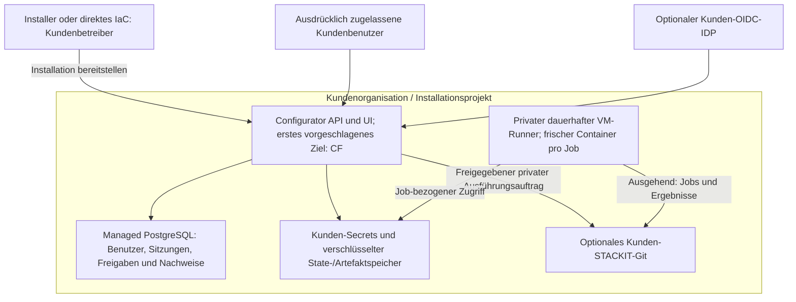

# Konzept für einen kundenseitig installierten Configurator

[English](customer-installation-concept.md) | [Deutsch](customer-installation-concept.de.md)

Status: Architekturvorschlag zur Diskussion vom 16.11.2026. Dieses Dokument
implementiert weder Installer noch Anmeldemodus oder Kundeninstallation.
Der bestehende gehostete Dienst und seine STACKIT-Identitätsprüfungen bleiben
unverändert.

## 1. Produktziel

Den Configurator als versionierte Software während des Bootstraps in der
STACKIT-Organisation eines Kunden installieren. Nur vom Kunden ausdrücklich
zugelassene Benutzer erhalten Zugang. Anwendungsdaten, State,
Ausführungsidentitäten und Betriebsnachweise liegen in kundenseitig kontrollierten
Diensten. Ein vom Anbieter gehosteter Configurator, ein GitHub-Repository des
Kunden oder ein Betreiberkonto des Anbieters werden nicht benötigt. Der native
Accelerator bleibt ohne Configurator nutzbar.

Zielablauf: freigegebenes Release beziehen, einen geeigneten Service-Account-Key
und wenige Zielreferenzen angeben, Installationsplan prüfen, installieren,
erzeugte HTTPS-Adresse öffnen und den ersten Administratorzugang übernehmen.
Kein verpflichtendes STACKIT-Webclient-Ticket, kein Kunden-Mailserver und kein
externer Identity Provider. Dies ist ein Installationsziel, keine Behauptung,
dass jeder Service Account beliebige Projekte oder Dienste anlegen kann.

Vereinbarte Anmelderichtung: lokale Passkeys als Standard, direktes Kunden-OIDC-SSO
als optionale Ergänzung. Für die erste Anmeldung sind weder Mailserver noch
externer Identity Provider erforderlich. Registrierung und Wiederherstellung
gehören zum lokalen Modus.

Kundeneigenes Cloud-Foundry-Hosting und ausdrücklich delegierte Service-Account-
Ausführung bleiben Diskussionsvorschläge. VM-Hosting ist die Alternative für rein
privaten Anwendungszugriff. Die Login-Entscheidung legt weder Hosting noch
Cloud-Berechtigungsmodell fest.

## 2. Anmeldeoptionen

| Option | Voraussetzung beim Kunden | Vorteil | Abwägung / vorgeschlagene Rolle |
| --- | --- | --- | --- |
| Lokale Passkeys (WebAuthn) | Stabile HTTPS-Adresse und kompatibler Authenticator/Browser | Kein externer IDP-Client, Mailserver oder Passwortversand | Registrierung, Wiederherstellung und lokale Benutzerverwaltung implementieren; vereinbarter Standard ohne Ticket |
| Direktes Kunden-OIDC-SSO | Kunde registriert die App in seinem eigenen IDP, etwa Entra ID oder Keycloak | Vorhandene Anmeldung/MFA und Mitarbeiteridentitäten nutzen | Benötigt Kunden-IDP-Administration; optionaler Unternehmensweg, keine Föderation über STACKIT IDP |
| Lokales Passwort plus zweiter Faktor | Erstzugang und Wiederherstellungsprozess | Vertraute Alternative bei inkompatiblen Umgebungen | Zusätzlicher Passwort-/TOTP-Schutz und Reset-Betrieb; nicht der vorgeschlagene erste Standard |
| E-Mail-Magic-Link | Funktionierender Mailversand, Absenderkonfiguration und Postfachzugriff | Einfacher Empfängereinstieg | MailOut/DNS/Zustellung werden Anmeldeabhängigkeiten; optional, nicht minimaler Bootstrap |
| STACKIT Git als OAuth-Identitätsanbieter | Kompatible Git-Instanz, Kundenkonten und OAuth-App-Registrierung | Vorhandenes Entwickler-Identitätssystem nutzen | Koppelt alle Benutzer an Git; nur für Kunden mit bereits genutztem Git bewerten |
| Mitgelieferter Identitätsserver | Weitere betriebene zustandsbehaftete Komponente | Könnte mehrere Anmeldeverfahren bündeln | Zusätzliche Updates, Sicherungen und Konfiguration; für eine Anwendung nicht erforderlich |

Direktes Firmen-SSO bedeutet, dass der Configurator dem Kunden-IDP selbst vertraut.
Das ist etwas anderes als die Registrierung einer neuen App beim STACKIT IDP
oder die Föderation des Firmen-IDP in STACKIT. Die STACKIT-Föderationsanleitung
beschreibt eine Ticketpflicht und belegt keine Self-Service-Registrierung
beliebiger Configurator-Webclients. Die heutige installationsspezifische
STACKIT-Client-Abhängigkeit entfällt daher in diesem Profil. Sie wird nicht durch
Mitnutzung des offiziellen CLI-Clients, Portal-Cookies oder Service-Account-
Browseranmeldung umgangen.

### Lokaler Passkey-Weg

Der erste Administrator übernimmt die Installation mit einer kurzlebigen,
einmalig nutzbaren Setup-Berechtigung, die der Installer dem autorisierten
Betreiber privat übergibt. Erst nach Prüfung dieser Berechtigung einen Passkey
registrieren; keine öffentliche Erstbenutzerregistrierung. Benutzer-IDs und
öffentliche Credential-Daten in der Kundendatenbank speichern; private Schlüssel
bleiben beim Authenticator. Benutzerverifikation sowie geprüfte Challenge,
Origin und Relying-Party-ID über eine gepflegte WebAuthn-Bibliothek verlangen.

Weitere Benutzer erhalten ablaufende, widerrufbare, einmalig nutzbare
Einladungslinks vom Administrator über einen bestehenden Kundenkanal. Ein Link
gewährt nur die ausdrücklich zugewiesene lokale Mitgliedschaft. Weder öffentliche
Registrierung noch eine E-Mail-Domain-Allowlist gewähren Zugriff. Der Empfänger
muss die Registrierung abschließen. Der Administrator bestätigt die Zugehörigkeit
des Empfängers zum Kunden. Eine Kontakt-E-Mail gilt nicht automatisch als
verifizierte STACKIT-Identität.

Mehrere Passkeys pro Konto und einen separat geschützten Wiederherstellungsweg
vorsehen. Für Administratoren vor Abschluss des Setups einen dokumentierten
unabhängigen Wiederherstellungsweg verlangen, etwa einen zweiten Authenticator
oder außerhalb der Instanz verwahrte Einmal-Wiederherstellungscodes. Dafür sind
Versuchsbegrenzung, Widerruf, Audit und Tests nötig; eine E-Mail-Adresse wird nicht
zur Berechtigung. Wird Wiederherstellung allein mit Codes begonnen, bleiben
sensible Ausführungen bis zur Registrierung eines neuen verifizierten
Authenticators gesperrt. Betreiberunterstützter Notfall-Reset ist ausdrücklich,
eng autorisiert und protokolliert, niemals ein dauerhaft offener öffentlicher
Setup-Endpunkt. Geräteverlust darf keine Neuinstallation erfordern.

Passkeys benötigen eine stabile HTTPS-Origin und Relying-Party-Kennung. Hostnamen
vor Registrierung wählen, stille Änderungen verbieten und Domainwechsel als
eigenen Registrierungs-/Wiederherstellungsprozess entwerfen. Eine CF-Plattformroute
kann nach Prüfung von TLS und Browserverhalten die minimale initiale Origin sein.
Eine eigene Domain ist optional, sollte aber möglichst vor Benutzerregistrierung
gewählt werden. IP-Adresse und selbstsigniertes Zertifikat sind kein regulärer
produktiver Onboarding-Weg.

### Kunden-SSO-Weg

OIDC Authorization Code mit PKCE, State und Nonce verwenden; Issuer, Audience,
Subject, Signatur und exakte Callbacks prüfen. Benutzer über Issuer plus Subject
identifizieren, nicht über E-Mail. Akzeptierten Issuer/Mandanten und zugelassene
Gruppen oder explizite lokale Mitgliedschaften begrenzen. Identitäten nicht
allein wegen gleicher E-Mail verbinden oder alle IDP-Benutzer still zu
Administratoren machen. Gruppenabbildung und Widerruf benötigen zeitlich
begrenzte erneute Prüfung/Sitzungsinvalidierung; SSO-Anmeldung allein garantiert
keinen sofortigen Benutzerentzug. SAML über eine Kundenbrücke später bewerten.

Ob lokale Wiederherstellungszugänge nach SSO-Aktivierung bestehen bleiben, ist
eine bewusste Kundenrichtlinie. Bestehende Benutzer verknüpfen Identitäten nur
über geprüfte Verknüpfungsabläufe. Der Installer erzeugt keine Anbieter-Hintertür.

## 3. Kundenidentität ist keine STACKIT-Cloud-Berechtigung

Der heutige gehostete Dienst bindet geschützte Aktionen an einen aktuellen
persönlichen STACKIT-Organisations-Owner-Nachweis. Lokale Passkeys oder ein
Firmen-OIDC-Token liefern diesen Nachweis nicht und dürfen nicht als gleichwertige
STACKIT-Identität dargestellt werden.

Ein ausdrückliches Deployment-/Berechtigungsprofil `customer-managed` mit eigenen
geprüften Verträgen einführen. Kein `auth=false`, kein Umgehen von
Nachweisprüfungen und kein Datenbank-Update, das bestehende Organisationsbindungen
als verifiziert markiert. Installationsidentität, erlaubte STACKIT-Organisation,
Region und Ressourcenumfang beim Setup festlegen. Workspaces bleiben innerhalb
dieser Grenze separat autorisiert. Organisationswechsel ist eine explizite
Neukonfiguration/Migration, keine Formularänderung.

Berechtigungsprofil an Installations-ID, Datenbankmetadaten und vertrauenswürdige
Release-Konfiguration binden; widersprüchliche Profile ablehnen. Kundenseitig
verwaltete Identitäten und Freigaben dürfen nie im gehosteten SaaS-Anmeldebereich
akzeptiert werden. Ein Wechsel bestehender Installationen zwischen diesen
Berechtigungsmodellen verlangt eine geprüfte Migration, keinen
Umgebungsvariablen-Schalter. Kundendelegation getrennt von persönlicher
STACKIT-Organisationsverifikation anzeigen.

| Identität / Rolle | Berechtigung |
| --- | --- |
| Bootstrap-Betreiber und initialer Service Account | Installation innerhalb ihrer tatsächlichen Cloud-Rechte erzeugen; ersten lokalen Administrator autorisieren |
| Installationsadministrator | Kundenbenutzer-/SSO-Verwaltung, Zulassung von Ausführungsprofilen und Installationseinstellungen; keine automatische persönliche STACKIT-Rolle |
| Platform Engineer / Application Owner | Bestehende lokale Workspace-/Produktberechtigungen, ausdrücklich zugewiesen und begrenzt |
| Kunden-Ausführungs-Service-Account | Tatsächliche STACKIT-API-Aktionen innerhalb nativer IAM-Rechte und delegierter Ausführungsregeln der Anwendung |
| Installer-/Upgrade-Identität | Configurator-Infrastruktur warten; von gewöhnlicher Workload-Ausführung getrennt |

Der Kundenadministrator delegiert Ausführungsprofile ausdrücklich an freigegebene
Rollen, Workspaces und Operationen. Eine lokale Rolle erbt nicht alle Rechte des
Installationskontos. Plan/Apply binden weiterhin handelnden Benutzer, Organisation,
Quellstand, Konfigurationsrevision, State und exakten geprüften Plan. Getrennte
Cloud-Identitäten für Plattformbereitstellung und Workload-Ausführung; kein
breiter Bootstrap-Key in jedem Job oder dauerhaft in der App-Umgebung. Nach der
Erstinstallation kann Cloud-Ausführung deaktiviert bleiben, bis der Kunde ein
geeignet begrenztes Profil zulässt.

Dies ist ein vom Kunden betriebenes Automatisierungs-Delegationsmodell. Verlangt
der Kunde stattdessen die nativen STACKIT-Rechte jeder Person für jede Aktion,
ist ein separater unterstützter persönlicher Delegations-/Anmeldeweg nötig.
Lokale Anmeldung allein erfüllt das nicht. Lokalen Benutzer, zugelassene
Ausführungsidentität und Freigabe im Anwendungs-Audit anzeigen. STACKIT-Audit-
Ereignisse nennen grundsätzlich den verwendeten Service Account, nicht automatisch
den Menschen, der den Job freigegeben hat. Zuordnung erhalten, keine native
personenbezogene Nichtabstreitbarkeit behaupten.

„Nur Kundenbenutzer“ bedeutet die vom Kunden freigegebene lokale Benutzerliste
oder ausdrücklich zugelassene Firmenidentitäten. Es beweist weder ein persönliches
STACKIT-Portal-Konto noch Organisationsmitgliedschaft jedes Benutzers. Eine
strenge Nachweispflicht dafür ist eine eigene Produktentscheidung und kann die
persönliche STACKIT-Integration wieder erfordern.

## 4. Hosting- und Ausführungsvarianten

| Hosting | Eignung | Aufwand / Grenze |
| --- | --- | --- |
| Kundeneigene CF-Organisation/Space plus Managed Services | Empfohlenes erstes Paketierungsziel: nutzt heutige API/UI, PostgreSQL und CF-Betriebsabläufe | Geteilte STACKIT-Plattform bleibt geteilt; kundeneigene logische Ressourcen sind keine dedizierte Hardware oder SNA-Anbindung |
| Eigene Anwendungs-VM(s) mit Container-Paket | Rein private Oberfläche, engere Netzwerkplatzierung oder keine CF-Präferenz | Neue App-Paketierung, Ingress/TLS, Betriebssystem-/Laufzeitwartung und HA-/Patchdesign nötig |
| Bestehendes Kunden-Kubernetes | Kunde betreibt bereits geeigneten Management-Cluster | Clusterzugriff und weiterer Paketierungs-/Upgrade-Weg nötig; keine Bootstrap-Voraussetzung |

Das erste Profil sollte ausdrücklich bepreiste kompakte und verfügbarkeitsorientierte
Größen anbieten. Kompakt ist nicht HA; mehrere Replikate bzw. Managed-Datenbank-
Topologie benötigen Failover-Nachweise vor einer Verfügbarkeitszusage. Die heutige
Produktionskonfiguration mit drei Replikaten und warmen Runnern nicht ungeprüft
bei jedem Kunden installieren.



Der private Runner-Zweig ist eine vorgeschlagene optionale Funktion, keine
Voraussetzung zum Anmelden oder Bearbeiten einer Konfiguration. Er folgt dem
vereinbarten [privaten VM-Runner-Konzept (PR #257)](https://github.com/stackitcloud/stackit-landing-zone/pull/257):
STACKIT Git plus dauerhafte VMs in der Kunden-SNA und frische Container pro Job.
Die App wird nie auf einem privilegierten Runner-Host installiert. Eine rein
private App benötigt auch Benutzer-/VPN-Konnektivität; ein Service Account
stellt keine Browser-Erreichbarkeit her.

Ein erstes CF-Profil kann qualifizierte CF-Ausführung für unterstützte öffentliche
Endpunkte behalten. Private Provider-Phasen bleiben gesperrt, bis ihr Git-/VM-Weg
umgesetzt und qualifiziert ist. Die Installation löst #37 nicht automatisch.

## 5. Minimale Voraussetzungen und Installer-Vertrag

Der normale Weg verlangt eine bestehende abrechenbare Kundenorganisation mit
Zielprojekt, einen Service-Account-Key mit dokumentierten Installationsrechten,
eine Region und einen lokalen Administratornamen. Ein Projekt nur bei expliziter
Eindeutigkeit aus dem Key übernehmen. Tatsächliches Ziel bestätigen, nicht das
Heimatprojekt des Keys annehmen. Unterstützte Quoten/Plattformen ermitteln und
Auswahl erklären, bevor Kosten entstehen. Ein neues Projekt benötigt zusätzlich
Parent-/Ordnerrechte und gegebenenfalls einen initialen Projekt-Owner-Bezug.
Ein bestehendes Zielprojekt hält die initiale Berechtigung enger.

Ein projektbegrenzter Provisionierungsaccount darf nicht automatisch eine ganze
Landing Zone organisationsweit aufbauen. Ausführungsumfang, IAM-Zuweisungen,
Dienstverfügbarkeit/-Freischaltungen, Quoten, unterstützte Regionen und
Betreibernetzwerkzugriff bleiben echte Voraussetzungen. Private Ausführung,
E-Mail, Assistant, eigene DNS-Domain und Firmen-SSO ergänzen Anforderungen nur
bei Auswahl.

Einen signierten/versionierten Installer und einen versionierten IaC-Einstieg aus
demselben geprüften Manifest liefern. Beispieloberfläche, keine vorhandenen Befehle:

```text
lzc-installer plan --credentials /private/bootstrap.json --project-id PROJECT_UUID --region eu01
lzc-installer install --plan /private/installation-plan
lzc-installer status --installation-id INSTALLATION_UUID
lzc-installer upgrade --installation-id INSTALLATION_UUID --version RELEASE
```

Der Installer kapselt gepinnte OpenTofu-/Provider-/Werkzeugversionen und dieselben
Module; keine zweite Cloud-Provisionierungsimplementierung. Direkte IaC-Nutzer
setzen gleichwertige Variablen und verwenden explizite Registrierungs-/Release-
Schritte, wo Terraform Einmalzugänge nicht sicher verwalten kann. Kein
verpflichtendes GitHub-Konto, keine manuell eingerichteten GitHub Environments
oder Anbieter-CI-Zugänge aus den heutigen Betreiberhandbüchern übernehmen.
Ein Installer darf keinen bereits laufenden Configurator oder privaten Pool
voraussetzen, um diese erst zu installieren.

## 6. Installationsablauf

1. **Lesender Preflight:** Key, Zielorganisation/-projekt, benötigte Rechte,
   Dienst-/API-Verfügbarkeit, Quoten, Netzwerk und Profil prüfen. Fehlende Rechte
   konkret erklären; nicht still erweitern oder den Modus wechseln.
2. **Prüfung:** Ressourcen-/Kostenübersicht, Umfang, Region, URLs und optionale
   Funktionen zeigen. Installationsfreigabe autorisiert keine späteren
   Workload-Applies.
3. **Dauerhaften State initialisieren:** geschütztes Installations-Backend,
   Installations-ID und unabhängige Wiederherstellungsverwahrung anlegen.
   Lokalen Seed-State, Plan und Secrets schon vor dem Remote-Backend schützen.
   Teilinstallationen anhand State/IDs fortsetzen statt Duplikate erzeugen.
   Installations-State bleibt von Landing-Zone-/Workload-States getrennt und
   wird nicht durch die App verwaltet, die damit gelöscht werden könnte.
4. **Provisionierung:** gewählte App-Laufzeit, PostgreSQL, begrenzte Secrets und
   Speicher, erzeugtes Verschlüsselungsmaterial und unabhängige Laufzeit-/Upgrade-
   Identitäten anlegen. Secrets im State schützen; nicht alle sensiblen
   Provider-Werte ausgeben.
5. **Gewähltes Release deployen:** Manifest/Signaturen/Prüfsummen prüfen,
   prüfsummengeschützte Migrationen mit getrennter Identität ausführen, App
   aktivieren und TLS, Bereitschaft und anonyme Zugriffsgrenzen prüfen. Fehlende
   optionale E-Mail-/KI-Integration verhindert keine lokale Anmeldung.
6. **Erster Administrator:** kurzlebige, nur gehasht gespeicherte Setup-Berechtigung
   an Installations-ID und Origin binden. Privat an Betreiber übergeben, niemals
   in Query-Strings, CI-Logs, gewöhnlichen Outputs oder Supportpaketen. Geschützte
   interaktive Ausgabe oder eine nur dem Eigentümer zugängliche Übergabedatei für
   unbeaufsichtigte Installation nutzen. Bei Administratorregistrierung atomar
   verbrauchen; abgelaufene/wiederholte Übernahmen ablehnen. Abgelaufene ungenutzte
   Berechtigung über autorisierten Installer erneuern.
7. **Übergabe:** Administrator-/Recovery-Setup, Backups, Zielbindung und
   Zugangsdatenverwahrung dokumentieren. Ursprünglichen Bootstrap-Key aus lokalen
   temporären Dateien und App-Konfiguration entfernen; nötigenfalls ausschließlich
   separate geschützte Wartungsverwahrung beim Kunden behalten. Ausführungsprofile
   separat zulassen.

Keine öffentliche Erstbesucher-Übernahme, Standardpasswörter oder universellen
Installations-Secrets. Die CLI löscht nicht still den einzigen Kundenschlüssel
oder dessen Wiederherstellungsmaterial.

## 7. Paketierung, Updates und Betrieb

Ein Kundeninstallations-Artefakt-/Kompatibilitätsmanifest zu GitHub Releases
veröffentlichen: Anwendung, Installer, IaC, Migrationen, native Verträge,
Engine-/Provider-Locks und optionale Runner-Versionen über Prüfsummen und Herkunft
verbinden. Die Kundeninstallation pinnt ein Release; unsere SaaS-Deployment-
Pipeline schiebt keine Updates auf Kundeninstanzen. Laufzeitdownloads, Images und
Abhängigkeiten benötigen eine unterstützte Verteilungs-/Aufbewahrungsstrategie
ohne Entwicklerkonten des Kunden. Bestehende CF-Pakete enthalten betreiberspezifische
Vertrauensgrenzen. Installationsbezogene Broker-Origins, Schlüssel und
Artefaktvertrauen müssen parametrisiert und getestet werden, nicht deaktiviert,
damit ein umgezogenes Paket startet.

Ein Update-Workflow prüft Ausgangs-/Zielkompatibilität, erzeugt/prüft notwendige
Backups, lässt Infrastruktur-/Schemaänderungen prüfen und deployt freigegebene
Artefakte. Backup, Migration, Aktivierung und Verifikation getrennt zeigen.
Code-Rollback macht keine Schema-Migration rückgängig; Wiederherstellung braucht
einen getesteten kompatiblen Restore-/Vorwärtsreparaturweg. Benutzer, Passkeys,
Origin/RP-ID, States, Secret-Referenzen, offene Jobs und Audit-Zuordnung erhalten.
Konfigurationsdrift und teilweise abgeschlossene Updates ausdrücklich abgleichen.
Die Instanz nicht aktualisieren, während sie selbst ihren Infrastruktur-Austausch
ausführt.

Kundenbetreiber verantworten Verfügbarkeit, Patchfreigabe, Backup-Aufbewahrung und
Zugangsverwaltung. Softwarebetreuer verantworten unterstützte Artefakte,
Release-Informationen und Kompatibilitäts-/Sicherheitshinweise. Supportpakete sind
bereinigt und freiwillig. Kein implizites Anbieter-Supportkonto, keine Telemetrie
oder Kundendatenausleitung. Assistant-Inferenz ist optional und wird ausdrücklich
mit Kunden-Modellzugang und offengelegtem Datenfluss aktiviert. Kein SaaS-Modell-
Token oder versteckter Anbieter-Fallback. E-Mail ist für Benachrichtigungen und
Einladungsversand optional, nicht für lokale Anmeldung. Deinstallation erhält
States/Backups standardmäßig und zeigt Löschfolgen vorab. Installationsentfernung
zerstört nicht implizit verwaltete Landing Zones.

## 8. Erforderliche Umsetzung und Qualifikation

Dies ist mehr als ein neuer Login-Button. Arbeitspakete:

1. Ausdrückliche Deployment-Identitäts-/Berechtigungsprofile, feste Organisationsgrenze,
   unveränderte SaaS-Prüfungen. Lokale Rollen gegen delegierte native Rechte testen.
2. WebAuthn, Registrierung, Wiederherstellung, Benutzerentzug und Kontoverknüpfung;
   optionale allgemeine OIDC-Integration und reine Kunden-Zulassungsregeln.
3. Wiederverwendbare Kundeninfrastruktur-/Release-Module, signierter Installer,
   private Secret-Übergabe und automatisierte Installation ohne unsere GitHub
   Environments.
4. Release-/Update-/Restore-Kompatibilität und Service-Account-Lebenszyklus/Rotation.
5. Optionaler Private-Runner-Adapter nach Umsetzung dieser unabhängigen Architektur.

Abnahme umfasst Neuinstallation mit ausschließlich dokumentierten Eingaben und
ohne STACKIT-Webclient-Ticket; abgelehnte unberechtigte Setup-Übernahme; zweiten
Kundenbenutzer aufnehmen; fremdes Konto/fremde Organisation ablehnen; abgelaufene
Einladungen und Sitzungen; lokale Wiederherstellung; Firmen-SSO-Verknüpfung und
Widerruf; begrenzte Service-Account-Nutzung; Plan-/Apply-Freigabe ohne erfundenen
persönlichen STACKIT-Nachweis; Fortsetzung abgebrochener Installation/Updates;
verschlüsseltes Backup/Restore einschließlich Verschlüsselungsmaterial;
Origin-/Passkey-Kontinuität; Betrieb ohne verfügbaren Configurator-Anbieter und
weiterhin eigenständigen Accelerator. Tatsächliche Installationsdauer und
unvermeidbare Betreiberhandlungen messen, kein unbelegtes „ein Klick“ versprechen.

## 9. Diskussionsentscheidungen

Vereinbart: lokale Passkeys als Standard, direktes Kunden-OIDC-SSO optional.
Die verbleibenden Entscheidungen sind:

- Ist kundeneigenes CF akzeptabel oder eine SNA-private Oberfläche bereits für das
  erste Release nötig? Letzteres spricht für VM-Hosting und benötigt
  Benutzer-Netzwerkkonnektivität.
- Bedeutet „Kundenbenutzer“ freigegebene App-Benutzerliste/Firmenverzeichnis oder
  native STACKIT-Organisationsmitgliedschaft jeder Person? Es sind verschiedene
  Nachweise.
- Akzeptiert der Kunde ausdrücklich delegierte Service-Account-Ausführung oder
  verlangt er native persönliche STACKIT-Autorisierung je Aktion? Davon hängt ab,
  ob das Ziel ohne STACKIT-Client mit diesem Modell erreichbar ist.
- Welche kompakten/HA-Profile, Dienste und Kostenrahmen soll der erste Installer
  qualifizieren? Nicht jede optionale Plattformfunktion verpflichtend paketieren.

Empfohlener erster vollständiger Ablauf: Kunden-CF-Installation, lokale Passkeys,
geschlossene Einladungen, feste Organisation und ein eng zugelassenes
Ausführungsprofil für öffentliche Endpunkte. Danach allgemeines Kunden-OIDC,
HA-/Restore-Qualifikation und private Git-/VM-Ausführung unabhängig getestet
ergänzen. Diese Reihenfolge ist ein Diskussionsvorschlag, keine Erlaubnis zum
Deployment oder Absenken bestehender Schutzmechanismen.

## 10. Quellen und verwandte Entwürfe

Am 16.11.2026 geprüft. Quellenfakten sind von vorgeschlagenen Produkt- und
Sicherheitsverträgen getrennt; Links belegen keinen funktionierenden Installer.

- [STACKIT-IDP-Föderation](https://docs.stackit.cloud/platform/access-and-identity/stackit-idp/getting-started/): Richtung externer Föderation und Ticketpflicht; keine Self-Service-API zur Configurator-Client-Registrierung.
- [WebAuthn-Standard](https://www.w3.org/TR/webauthn-3/): browserbasierte Public-Key-Anmeldung, Relying-Party-/Origin-Prüfung; gewählte Bibliothek und Kundenbrowser qualifizieren.
- [OIDC Core](https://openid.net/specs/openid-connect-core-1_0.html): Benutzeridentitätsprotokoll, keine STACKIT-IAM-Delegation.
- [CF-Provisionierung mit Terraform](https://docs.stackit.cloud/products/runtime/cloud-foundry/how-tos/provision-cloud-foundry-via-terraform/) und [CF-Service-Accounts](https://docs.stackit.cloud/products/runtime/cloud-foundry/how-tos/create-cloud-foundry-service-accounts/): Automatisierungsbausteine, kein Nachweis eines vollständigen minimalen Installers.
- [Heutiger Produktionsbetrieb](production.de.md), [Anmeldung](github-login.de.md) und [Architektur](architecture.de.md): betreiberspezifische Provisionierung, persönliche Nachweise und CF-Laufzeitgrenzen ausdrücklich überarbeiten.
- [Privater VM-Runner-Vorschlag, PR #257](https://github.com/stackitcloud/stackit-landing-zone/pull/257): dauerhafte SNA-VMs mit frischen Containern pro Job; optionale ergänzende Ausführungsarchitektur.
