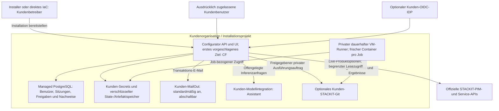

# Konzept für einen kundenseitig installierten Configurator

[English](customer-installation-concept.md) | [Deutsch](customer-installation-concept.de.md)

Status: Architekturvorschlag zur Diskussion vom 16.11.2026. Dieses Dokument
implementiert weder Installer noch Anmeldemodus oder Kundeninstallation.
Der bestehende gehostete Dienst und seine STACKIT-Identitätsprüfungen bleiben
unverändert.

## 1. Produktziel

Den Configurator als versionierte Software während des Bootstraps in der
STACKIT-Organisation eines Kunden installieren. Nur vom Kunden ausdrücklich
zugelassene Benutzer erhalten Zugang. Anwendungsdaten, State,
Ausführungsidentitäten und Betriebsnachweise liegen in kundenseitig kontrollierten
Diensten. Ein vom Anbieter gehosteter Configurator, ein GitHub-Repository des
Kunden oder ein Betreiberkonto des Anbieters werden nicht benötigt. Der native
Accelerator bleibt ohne Configurator nutzbar.

Zielablauf: freigegebenes Release beziehen, einen geeigneten Service-Account-Key
und wenige Zielreferenzen angeben, Installationsplan prüfen, installieren,
erzeugte HTTPS-Adresse öffnen und den ersten Administratorzugang übernehmen.
Kein verpflichtendes STACKIT-Webclient-Ticket, kein bestehender Kunden-Mailserver
und kein externer Identity Provider. MailOut ist standardmäßig aktiviert und kann
ausdrücklich abgewählt werden. Dies ist ein Installationsziel, keine Behauptung,
dass jeder Service Account beliebige Projekte oder Dienste anlegen kann.

Vereinbarte Anmelderichtung: lokale Passkeys als Standard, direktes Kunden-OIDC-SSO
als optionale Ergänzung. Für die erste Anmeldung sind weder Mailserver noch
externer Identity Provider erforderlich. Registrierung und Wiederherstellung
gehören zum lokalen Modus.

Kundeneigenes Cloud-Foundry-Hosting und ausdrücklich delegierte Service-Account-
Ausführung bleiben Diskussionsvorschläge. VM-Hosting ist die Alternative für rein
privaten Anwendungszugriff. Die Login-Entscheidung legt weder Hosting noch
Cloud-Berechtigungsmodell fest.

## 2. Anmeldeoptionen

| Option | Voraussetzung beim Kunden | Vorteil | Abwägung / vorgeschlagene Rolle |
| --- | --- | --- | --- |
| Lokale Passkeys (WebAuthn) | Stabile HTTPS-Adresse und kompatibler Authenticator/Browser | Kein externer IDP-Client, Mailserver oder Passwortversand | Registrierung, Wiederherstellung und lokale Benutzerverwaltung implementieren; vereinbarter Standard ohne Ticket |
| Direktes Kunden-OIDC-SSO | Kunde registriert die App in seinem eigenen IDP, etwa Entra ID oder Keycloak | Vorhandene Anmeldung/MFA und Mitarbeiteridentitäten nutzen | Benötigt Kunden-IDP-Administration; optionaler Unternehmensweg, keine Föderation über STACKIT IDP |
| Lokales Passwort plus zweiter Faktor | Erstzugang und Wiederherstellungsprozess | Vertraute Alternative bei inkompatiblen Umgebungen | Zusätzlicher Passwort-/TOTP-Schutz und Reset-Betrieb; nicht der vorgeschlagene erste Standard |
| E-Mail-Magic-Link | Funktionierender Mailversand, Absenderkonfiguration und Postfachzugriff | Einfacher Empfängereinstieg | MailOut/DNS/Zustellung werden Anmeldeabhängigkeiten; optional, nicht minimaler Bootstrap |
| STACKIT Git als OAuth-Identitätsanbieter | Kompatible Git-Instanz, Kundenkonten und OAuth-App-Registrierung | Vorhandenes Entwickler-Identitätssystem nutzen | Koppelt alle Benutzer an Git; nur für Kunden mit bereits genutztem Git bewerten |
| Mitgelieferter Identitätsserver | Weitere betriebene zustandsbehaftete Komponente | Könnte mehrere Anmeldeverfahren bündeln | Zusätzliche Updates, Sicherungen und Konfiguration; für eine Anwendung nicht erforderlich |

Direktes Firmen-SSO bedeutet, dass der Configurator dem Kunden-IDP selbst vertraut.
Das ist etwas anderes als die Registrierung einer neuen App beim STACKIT IDP
oder die Föderation des Firmen-IDP in STACKIT. Die STACKIT-Föderationsanleitung
beschreibt eine Ticketpflicht und belegt keine Self-Service-Registrierung
beliebiger Configurator-Webclients. Die heutige installationsspezifische
STACKIT-Client-Abhängigkeit entfällt daher in diesem Profil. Sie wird nicht durch
Mitnutzung des offiziellen CLI-Clients, Portal-Cookies oder Service-Account-
Browseranmeldung umgangen.

### Lokaler Passkey-Weg

Der erste Administrator übernimmt die Installation mit einer kurzlebigen,
einmalig nutzbaren Setup-Berechtigung, die der Installer dem autorisierten
Betreiber privat übergibt. Erst nach Prüfung dieser Berechtigung einen Passkey
registrieren; keine öffentliche Erstbenutzerregistrierung. Benutzer-IDs und
öffentliche Credential-Daten in der Kundendatenbank speichern; private Schlüssel
bleiben beim Authenticator. Benutzerverifikation sowie geprüfte Challenge,
Origin und Relying-Party-ID über eine gepflegte WebAuthn-Bibliothek verlangen.

Weitere Benutzer erhalten ablaufende, widerrufbare, einmalig nutzbare
Einladungslinks vom Administrator über einen bestehenden Kundenkanal. Ein Link
gewährt nur die ausdrücklich zugewiesene lokale Mitgliedschaft. Weder öffentliche
Registrierung noch eine E-Mail-Domain-Allowlist gewähren Zugriff. Der Empfänger
muss die Registrierung abschließen. Der Administrator bestätigt die Zugehörigkeit
des Empfängers zum Kunden. Eine Kontakt-E-Mail gilt nicht automatisch als
verifizierte STACKIT-Identität.

Mehrere Passkeys pro Konto und einen separat geschützten Wiederherstellungsweg
vorsehen. Für Administratoren vor Abschluss des Setups einen dokumentierten
unabhängigen Wiederherstellungsweg verlangen, etwa einen zweiten Authenticator
oder außerhalb der Instanz verwahrte Einmal-Wiederherstellungscodes. Dafür sind
Versuchsbegrenzung, Widerruf, Audit und Tests nötig; eine E-Mail-Adresse wird nicht
zur Berechtigung. Wird Wiederherstellung allein mit Codes begonnen, bleiben
sensible Ausführungen bis zur Registrierung eines neuen verifizierten
Authenticators gesperrt. Betreiberunterstützter Notfall-Reset ist ausdrücklich,
eng autorisiert und protokolliert, niemals ein dauerhaft offener öffentlicher
Setup-Endpunkt. Geräteverlust darf keine Neuinstallation erfordern.

Passkeys benötigen eine stabile HTTPS-Origin und Relying-Party-Kennung. Hostnamen
vor Registrierung wählen, stille Änderungen verbieten und Domainwechsel als
eigenen Registrierungs-/Wiederherstellungsprozess entwerfen. Eine CF-Plattformroute
kann nach Prüfung von TLS und Browserverhalten die minimale initiale Origin sein.
Eine eigene Domain ist optional, sollte aber möglichst vor Benutzerregistrierung
gewählt werden. IP-Adresse und selbstsigniertes Zertifikat sind kein regulärer
produktiver Onboarding-Weg.

### Kunden-SSO-Weg

OIDC Authorization Code mit PKCE, State und Nonce verwenden; Issuer, Audience,
Subject, Signatur und exakte Callbacks prüfen. Benutzer über Issuer plus Subject
identifizieren, nicht über E-Mail. Akzeptierten Issuer/Mandanten und zugelassene
Gruppen oder explizite lokale Mitgliedschaften begrenzen. Identitäten nicht
allein wegen gleicher E-Mail verbinden oder alle IDP-Benutzer still zu
Administratoren machen. Gruppenabbildung und Widerruf benötigen zeitlich
begrenzte erneute Prüfung/Sitzungsinvalidierung; SSO-Anmeldung allein garantiert
keinen sofortigen Benutzerentzug. SAML über eine Kundenbrücke später bewerten.

Ob lokale Wiederherstellungszugänge nach SSO-Aktivierung bestehen bleiben, ist
eine bewusste Kundenrichtlinie. Bestehende Benutzer verknüpfen Identitäten nur
über geprüfte Verknüpfungsabläufe. Der Installer erzeugt keine Anbieter-Hintertür.

## 3. Kundenidentität ist keine STACKIT-Cloud-Berechtigung

Der heutige gehostete Dienst bindet geschützte Aktionen an einen aktuellen
persönlichen STACKIT-Organisations-Owner-Nachweis. Lokale Passkeys oder ein
Firmen-OIDC-Token liefern diesen Nachweis nicht und dürfen nicht als gleichwertige
STACKIT-Identität dargestellt werden.

Ein ausdrückliches Deployment-/Berechtigungsprofil `customer-managed` mit eigenen
geprüften Verträgen einführen. Kein `auth=false`, kein Umgehen von
Nachweisprüfungen und kein Datenbank-Update, das bestehende Organisationsbindungen
als verifiziert markiert. Installationsidentität, erlaubte STACKIT-Organisation,
Region und Ressourcenumfang beim Setup festlegen. Workspaces bleiben innerhalb
dieser Grenze separat autorisiert. Organisationswechsel ist eine explizite
Neukonfiguration/Migration, keine Formularänderung.

Berechtigungsprofil an Installations-ID, Datenbankmetadaten und vertrauenswürdige
Release-Konfiguration binden; widersprüchliche Profile ablehnen. Kundenseitig
verwaltete Identitäten und Freigaben dürfen nie im gehosteten SaaS-Anmeldebereich
akzeptiert werden. Ein Wechsel bestehender Installationen zwischen diesen
Berechtigungsmodellen verlangt eine geprüfte Migration, keinen
Umgebungsvariablen-Schalter. Kundendelegation getrennt von persönlicher
STACKIT-Organisationsverifikation anzeigen.

| Identität / Rolle | Berechtigung |
| --- | --- |
| Bootstrap-Betreiber und initialer Service Account | Installation innerhalb ihrer tatsächlichen Cloud-Rechte erzeugen; ersten lokalen Administrator autorisieren |
| Installationsadministrator | Kundenbenutzer-/SSO-Verwaltung, Zulassung von Ausführungsprofilen und Installationseinstellungen; keine automatische persönliche STACKIT-Rolle |
| Platform Engineer / Application Owner | Bestehende lokale Workspace-/Produktberechtigungen, ausdrücklich zugewiesen und begrenzt |
| Kunden-Ausführungs-Service-Account | Tatsächliche STACKIT-API-Aktionen innerhalb nativer IAM-Rechte und delegierter Ausführungsregeln der Anwendung |
| Installer-/Upgrade-Identität | Configurator-Infrastruktur warten; von gewöhnlicher Workload-Ausführung getrennt |

Der Kundenadministrator delegiert Ausführungsprofile ausdrücklich an freigegebene
Rollen, Workspaces und Operationen. Eine lokale Rolle erbt nicht alle Rechte des
Installationskontos. Plan/Apply binden weiterhin handelnden Benutzer, Organisation,
Quellstand, Konfigurationsrevision, State und exakten geprüften Plan. Getrennte
Cloud-Identitäten für Plattformbereitstellung und Workload-Ausführung; kein
breiter Bootstrap-Key in jedem Job oder dauerhaft in der App-Umgebung. Nach der
Erstinstallation kann Cloud-Ausführung deaktiviert bleiben, bis der Kunde ein
geeignet begrenztes Profil zulässt.

Dies ist ein vom Kunden betriebenes Automatisierungs-Delegationsmodell. Verlangt
der Kunde stattdessen die nativen STACKIT-Rechte jeder Person für jede Aktion,
ist ein separater unterstützter persönlicher Delegations-/Anmeldeweg nötig.
Lokale Anmeldung allein erfüllt das nicht. Lokalen Benutzer, zugelassene
Ausführungsidentität und Freigabe im Anwendungs-Audit anzeigen. STACKIT-Audit-
Ereignisse nennen grundsätzlich den verwendeten Service Account, nicht automatisch
den Menschen, der den Job freigegeben hat. Zuordnung erhalten, keine native
personenbezogene Nichtabstreitbarkeit behaupten.

„Nur Kundenbenutzer“ bedeutet die vom Kunden freigegebene lokale Benutzerliste
oder ausdrücklich zugelassene Firmenidentitäten. Es beweist weder ein persönliches
STACKIT-Portal-Konto noch Organisationsmitgliedschaft jedes Benutzers. Eine
strenge Nachweispflicht dafür ist eine eigene Produktentscheidung und kann die
persönliche STACKIT-Integration wieder erfordern.

## 4. Hosting- und Ausführungsvarianten

| Hosting | Eignung | Aufwand / Grenze |
| --- | --- | --- |
| Kundeneigene CF-Organisation/Space plus Managed Services | Empfohlenes erstes Paketierungsziel: nutzt heutige API/UI, PostgreSQL und CF-Betriebsabläufe | Geteilte STACKIT-Plattform bleibt geteilt; kundeneigene logische Ressourcen sind keine dedizierte Hardware oder SNA-Anbindung |
| Eigene Anwendungs-VM(s) mit Container-Paket | Rein private Oberfläche, engere Netzwerkplatzierung oder keine CF-Präferenz | Neue App-Paketierung, Ingress/TLS, Betriebssystem-/Laufzeitwartung und HA-/Patchdesign nötig |
| Bestehendes Kunden-Kubernetes | Kunde betreibt bereits geeigneten Management-Cluster | Clusterzugriff und weiterer Paketierungs-/Upgrade-Weg nötig; keine Bootstrap-Voraussetzung |

Das erste Profil sollte ausdrücklich bepreiste kompakte und verfügbarkeitsorientierte
Größen anbieten. Kompakt ist nicht HA; mehrere Replikate bzw. Managed-Datenbank-
Topologie benötigen Failover-Nachweise vor einer Verfügbarkeitszusage. Die heutige
Produktionskonfiguration mit drei Replikaten und warmen Runnern nicht ungeprüft
bei jedem Kunden installieren.



Der private Runner-Zweig ist eine vorgeschlagene optionale Funktion, keine
Voraussetzung zum Anmelden oder Bearbeiten einer Konfiguration. Er folgt dem
vereinbarten [privaten VM-Runner-Konzept (PR #257)](https://github.com/stackitcloud/stackit-landing-zone/pull/257):
STACKIT Git plus dauerhafte VMs in der Kunden-SNA und frische Container pro Job.
Die App wird nie auf einem privilegierten Runner-Host installiert. Eine rein
private App benötigt auch Benutzer-/VPN-Konnektivität; ein Service Account
stellt keine Browser-Erreichbarkeit her.

Ein erstes CF-Profil kann qualifizierte CF-Ausführung für unterstützte öffentliche
Endpunkte behalten. Private Provider-Phasen bleiben gesperrt, bis ihr Git-/VM-Weg
umgesetzt und qualifiziert ist. Die Installation löst #37 nicht automatisch.

### Funktionale Gleichwertigkeit ist das Produktziel

Die Kundeninstallation ist dasselbe Configurator-Produkt, kein reduzierter Editor
und kein eigenständiger Fork. Denselben qualifizierten Anwendungsstand, UI, native
Verträge, Assistant-Wissensstand, Projektvorlagen, Workspace-Rollen, Freigaben,
Plan/Apply, Recovery, Upgrade-Abläufe, Benachrichtigungen und Audit-Verhalten wie
im zugehörigen SaaS-Release verwenden. Feature-Flags und Versionskompatibilität
in einem gemeinsamen Release-Manifest führen. Neue SaaS-Funktionen benötigen einen
Abnahmeweg für das Kundenprofil oder eine ausdrücklich dokumentierte
Integrationsvoraussetzung; sie entfallen nicht still in der installierten Variante.

Betriebsverantwortung und Anmeldung unterscheiden sich. Funktionen mit persönlicher
STACKIT-Identitätsabhängigkeit benötigen geprüfte Kundenprofil-Entsprechungen:
Katalogzugriff, verifizierte Mailempfänger, Einladungseinlösung und native
IAM-/Projekt-Owner-Zuweisungen. App-Benutzer, Passkey und Kontaktadresse sind keine
nativen STACKIT-Subjekte. Wo Cloud-APIs einen solchen Bezug brauchen, eine explizit
zugelassene und validierte native Benutzer-/Owner-Zuordnung verlangen. Fehlt sie,
wird die betroffene Veröffentlichung/Aktion erklärbar gesperrt, keine Identität
erfunden oder still ein Service Account zum Owner gemacht.

Das Standardprofil orientiert sich an Funktionsumfang und unterstützter Topologie
der qualifizierten SaaS-Produktion. Ein kompaktes/kostenoptimiertes Profil ist
eine ausdrückliche Kundenwahl, kein standardmäßig reduzierter Funktionsumfang der
ersten Ausgabe. Assistant, E-Mail und Ausführung nutzen Kundenintegrationen und
-zugänge. Standardmäßig aktive Integrationen benötigen sichtbare Bereitschafts-/
Zustimmungsprüfungen, keinen Anbieterzugang als Fallback. Private Ausführung hat
bis zur separaten Git-/VM-Qualifikation dieselbe Implementierungsgrenze wie SaaS.
Gleiche Topologie beweist keine gleiche gemessene Verfügbarkeit oder Recovery-Zeit.

### Wie der Service-Katalog geladen und genutzt wird

Drei verschiedene Kataloge haben getrennte Verantwortliche und Aktualisierungswege:

| Katalog | Quelle und Verhalten bei Installation | Nutzung / Aussage |
| --- | --- | --- |
| Unterstützte Accelerator-Funktionen, Referenzentwürfe und IAM-Snapshot | Dieselben geprüften/generierten Assets je Software-Release mitliefern; Herkunft und Kompatibilität prüfen | Definieren ausdrückbare/ausführbare Funktionen der Version; keine Anbieter-SaaS-API nötig |
| Aktuelle STACKIT-Produktmetadaten und Dienstoptionen | Kunden-Backend fragt offizielle PIM- und Service-APIs ab, nach Bedarf mit konfiguriertem Projekt-/Regionsbezug | Unterstützte Versionen, Flavors, Images, Pläne und Berechtigungswahl befüllen; Metadaten sind keine Freischaltung, Quote oder Ausführungsberechtigung |
| Vom Kunden veröffentlichter Application-Katalog | Kunden-PostgreSQL hält freigegebene Vorlagenversionen, Sichtbarkeit/Gruppen, Parameter, Plattformbindungen und Bestellungen | Platform Engineers veröffentlichen; berechtigte Application Owners sehen/bestellen mit denselben Abläufen wie in SaaS |

`StackitCatalogueClient` liest heute bereits PIM-Metadaten und Dienstoptionen.
`PostgresCloudCatalogues` wählt gespeicherte Zugangsprofile mit ausdrücklichen
Mandanten- und Benutzerfiltern. Das Kundenprofil ergänzt eine explizit zugelassene
Installations-/Workspace-Katalog-Leseidentität. Es leiht weder private Profile
anderer Benutzer aus noch behält es den breiten Bootstrap-Key. Das Setup erzeugt
oder übernimmt diesen begrenzten Leser, wählt standardmäßig das Installationsprojekt
als Referenz und prüft konfigurierte Regionen. Weitere Referenzprojekte sind
explizite Auswahlen innerhalb der erlaubten Organisation. Weder das Heimatprojekt
des Keys annehmen noch von jedem Passkey-Benutzer einen Cloud-Key verlangen.

Die App lädt bei erster Nutzung und aktualisiert im Hintergrund mit begrenzten
Anfragen/Timeouts. Nur freigegebene Metadaten normalisieren und cachen, mit Quelle,
Ladezeit, Projekt, Region, Leser-/Richtlinienrevision und Aktualitätsstatus.
Workspace-/Vertrauensbereiche trennen; bei Zugangsdatenrotation/-widerruf,
Rechte- oder Zieländerung invalidieren. Externe IAM-Änderungen durch zeitlich
begrenzte erneute Prüfung erkennen, nicht sofortige Cloud-Ereignisse voraussetzen.
Ein Cache autorisiert keine Ausführung. Cache-TTL/Aktualisierung sind konfigurierbare
Konzeptvorgaben, keine Aussage über heutige Implementierung. Nicht verfügbare,
unvollständige und veraltete Teile kennzeichnen. Fehlgeschlagene Abfragen sind
keine maßgebliche leere Liste oder Kapazitätszusage. Vorhandene/importierte Werte
sichtbar erhalten. Ein Snapshot kann während einer Störung das Bearbeiten
unterstützen; neue Rechte, Veröffentlichung und Ausführung benötigen weiterhin
die jeweils nötigen aktuellen maßgeblichen Prüfungen.

Öffentliche PIM-Metadaten benötigen keine persönliche IDP-Anmeldung des Kunden;
manche Projekt-/Dienstoptionen brauchen authentifizierte Lesezugriffe. Nur
normalisierte Metadaten zurückgeben, nie Tokens, Keys oder sensible Rohantworten.
Genaue Leserechte im Preflight prüfen. Ein Referenzprojekt beweist keine
Verfügbarkeit in einem künftigen Workload-Projekt. Lesefehler lösen weder breitere
IAM-Zuweisungen noch Diensterstellung aus. Neue PIM-Produkte werden nicht
automatisch zu unterstützten Accelerator-Funktionen: Paketierte Provider,
Verträge und Qualifikation bleiben maßgeblich.

Geprüfte Referenzentwürfe als Ausgangspunkte liefern, keine automatisch
veröffentlichten Produktionsangebote mit Beispiel-Ownern. Der Kunde prüft und
veröffentlicht eigene Versionen. Weder Zugriff auf unsere SaaS-Datenbank noch auf
Vorlagen anderer Kunden ist nötig. Kundeneigene bestehende Vorlagen werden
explizit autorisiert exportiert/importiert, mit Quellen-/Schemaprüfung, stabiler
Identitätszuordnung und frischen Zielbindungen. Softwareupdates überschreiben
keine lokalen Veröffentlichungen und aktualisieren keine bestehenden Bestellungen.

### E-Mail: optional, im Standardprofil aktiviert

Vereinbarter Standard: Transaktions-E-Mail über kundeneigenes STACKIT MailOut ist
aktiviert. Der Installer bietet bewusstes Abschalten oder ein qualifiziertes
Kunden-SMTP-Relay. Kein vollständiger Mailserver oder Postfachdienst wird
installiert. E-Mail bleibt von Passkey-Anmeldung unabhängig und wird nie zum
einzigen Wiederherstellungsweg.

Der Plan enthält Sending Domain, autorisierten Sender, erforderliche DNS-Einträge
sowie SMTP-Bindung und Kosten. Eine ausdrücklich gewählte Kunden-DNS-Zone nutzen
oder nach Verfügbarkeit und Freigabe eine eigene verwaltete Versandzone anbieten.
App-Hostname und Versanddomain sind unabhängig. Eignung der Domain-Endung,
DNS-Kontrollrechte und MailOut-Verfügbarkeit vor einer Automatisierungszusage
prüfen. Externes DNS benötigt explizite Übergabe der Records. Bestehende SPF-/
DMARC-Regeln niemals blind überschreiben. Eine Standarddomain muss für Versand
qualifiziert werden; ein verfügbarer freier DNS-Suffix beweist das nicht.

Die von MailOut erforderliche SPF-/DKIM-/DMARC-Prüfung und Senderbereitschaft
verwenden, einmalig ausgegebene Sender-Zugangsdaten privat erfassen und SMTP nur
ans Backend binden. Records und Zugänge in geschützter Installationsverwahrung
des Kunden halten, nicht in unseren GitHub Environments. Das geschützte API-
Verhalten des heutigen Reconcilers wiederverwenden/refaktorieren, wenn der gepinnte
Provider keine Ressourcen anbietet. Der Dev-spezifische Reconciler installiert
nicht bereits beliebige Kunden. Bei DNS-/Rechte-/Validierungsfehlern ausstehendes
oder fehlgeschlagenes Mail-Setup anzeigen und explizite Reparatur oder Abwahl
anbieten. Gewählten Versand nie still deaktivieren oder als bereit melden.
Passkey-Anmeldung und App-Inbox bleiben bei Mail-Ausfall nutzbar. Ein initialer
Mailtest benötigt einen ausdrücklichen Empfänger. SMTP-Annahme ist kein Beleg
für Postfachzustellung.

SaaS-Mailverhalten erhalten: STACKIT-gestaltetes DE/EN-HTML und Klartext,
Benutzereinstellungen je Thema, einladendengesteuerter Einladungsversand,
Outbox-Deduplizierung, begrenzte Wiederholungen und Behandlung unklarer
Versandresultate. Lokale/SSO-Konten benötigen separat verifizierte
Benachrichtigungsadressen. E-Mail-Einladungen an eine geprüfte Zuordnung von
Kundenkonto und Empfänger anpassen; die heutige Prüfung verifizierter
STACKIT-E-Mail nicht einfach entfernen. Postfachverifikation beweist keine
STACKIT-IAM-Mitgliedschaft. Nach Passkey-Registrierung eine separate Verifikation der Benachrichtigungsadresse anbieten; SSO-E-Mail nur nach qualifizierter Verified-Email-Regel des vertrauenswürdigen Issuers übernehmen. Fehlende/unverifizierte Adresse sperrt keine lokale Anmeldung, erhält aber keine gewöhnlichen Benachrichtigungsmails. Bei abgeschaltetem Versand funktionieren manuelle
Einladungslinks und App-Benachrichtigungen weiter.

## 5. Minimale Voraussetzungen und Installer-Vertrag

Der normale Weg verlangt eine bestehende abrechenbare Kundenorganisation, ein
explizit gewähltes Zielprojekt, Service-Account-Key mit dokumentierten
Installationsrechten, Region und lokalen Administratornamen. Der interaktive
Installer bietet Projektauswahl; unbeaufsichtigter Betrieb und direktes IaC
nehmen die UUID ausdrücklich entgegen. Tatsächliche Organisation/Projekt
bestätigen, nie das Heimatprojekt des Keys einsetzen. Bestehende Projekte werden
referenziert, nicht still vollständig als Installer-Ressourcen übernommen.
Deinstallation darf weder dieses Projekt noch fremde Ressourcen löschen.
Optionale Projekterstellung ist ein separat geprüfter Modus mit Parent-/
Ordnerrechten und gegebenenfalls initialem Projekt-Owner-Bezug.

Ein projektbegrenzter Provisionierungsaccount darf nicht automatisch eine ganze
Landing Zone organisationsweit aufbauen. Ausführungsumfang, IAM-Zuweisungen,
Dienstverfügbarkeit/-Freischaltungen, Quoten, unterstützte Regionen und
Betreibernetzwerkzugriff bleiben echte Voraussetzungen. Standardmäßig aktives
MailOut benötigt Versanddomain-/DNS-Rechte; fehlen sie, Voraussetzungen und
explizite Abwahl zeigen. Kein bestehender Kunden-Mailserver erforderlich.
Firmen-SSO, eigene App-DNS-Domain und private Ausführung ergänzen Anforderungen
bei Auswahl. Assistant nutzt Kunden-Modellzugang und ausdrückliche Offenlegung/
Freigabe des Datenflusses.

### Implementierungssprache und gemeinsames IaC

Empfohlene Umsetzung: Go-CLI als Installer und OpenTofu/HCL für Infrastruktur.
Pro unterstütztem Betriebssystem/Architektur eine ausführbare Datei liefern,
ohne vorausgesetzte Go- oder Node-Installation. Go übernimmt interaktive/
unbeaufsichtigte Eingaben, strikte Konfigurationsprüfung, Preflight,
Plan-Zusammenfassungen, Release-Prüfung, Secret-Übergabe und Steuerung von
Installation, Update und Wiederherstellung. Es ruft eine qualifizierte gepinnte
OpenTofu-Binärdatei mit denselben versionierten Modulen wie direkte IaC-Nutzer
auf. Keine zweite allgemeine Ressourcen-Provisionierung in Go.

Den offiziellen STACKIT Go SDK verwenden, soweit seine qualifizierte Version die
benötigten APIs abdeckt; andernfalls enge authentifizierte API-Adapter für fehlende
Schritte, etwa geschützte MailOut-Provisionierung oder einmalige Registrierung,
mit expliziter dauerhafter Verantwortung/Wiederherstellung. Dieselbe Ressource
nicht gleichzeitig über HCL und API-Reconciler verwalten. Bestehende Node-
Betreiberskripte sind Refactoring-/Wiederverwendungsreferenzen hinter diesem
Vertrag, keine versteckte Node-Voraussetzung beim Kunden. Werkzeuge/Artefakte
mitliefern oder mit Signatur-/Prüfsummenprüfung aus freigegebenen Quellen beziehen.
Keine beliebigen Shell-Strings ausführen oder still systemweite Abhängigkeiten
installieren.

Direktes IaC ist gleichwertig unterstützt, mit expliziten Registrierungs-/Release-
Schritten, wo Terraform Einmalzugänge nicht sicher verwalten kann. Beide Wege
benötigen weder GitHub-Konto noch unsere GitHub Environments oder Anbieter-CI-
Zugänge. Der Installer darf keinen bereits laufenden Configurator/privaten Pool
voraussetzen.

### Zielprojekt, HA und Sizing einstellen

Interaktive Abfragen, versionierte Konfigurationsdatei, CLI-Parameter und
gleichwertige IaC-Variablen bilden dieselben geprüften Einstellungen ab.
Explizite Parameter überschreiben Dateiwert, Dateiwert überschreibt Release-
Profilstandard. Zielprojekt explizit wählen, nicht auf das Key-Heimatprojekt
zurückfallen. Unbekannte Felder, unzulässige Werte und Widersprüche vor Änderungen
ablehnen. Defaults folgen dem qualifizierten SaaS-Profil des gewählten Releases;
erweiterte Werte sind bewusste Kundenabweichungen.

| Einstellung | Installer-Verhalten |
| --- | --- |
| Zielprojekt / Organisation / Region | Bestehende Projekt-UUID auswählen/angeben; exakte IDs und Umfang vor Freigabe zeigen; neues Projekt als separater Modus |
| Verfügbarkeit | SaaS-nahes/HA-Profil als Standard; kompaktes Profil bewusst wählbar; tatsächliche Topologie und Qualifikationsgrenzen kennzeichnen |
| App-Sizing | Replikazahl, unterstützter RAM/Plattenplatz je Instanz und passende CF-Quota/Plattform bzw. VM-Klasse |
| Datenbank-Sizing | Unterstützter Flavor, Speicher, Replikatopologie und Backup/Aufbewahrung; Kombinationen und Migrations-/Wachstumsgrenzen prüfen |
| Ausführungskapazität | Qualifizierte öffentliche Runner-Reserve/Parallelität und optionale private VM-Anzahl/-Klasse; Ressourcen- und State-Lock-Grenzen erhalten |
| Integrationen | MailOut standardmäßig an mit Abwahl/SMTP-Auswahl, Kunden-Modellzugang, Katalog-Referenzprojekte/-regionen, optionales SSO/private Ausführung |

Beispielkonfiguration/-oberfläche, keine implementierten Befehle oder zugesicherten
Flavor-Kennungen:

```yaml
project_id: PROJECT_UUID
region: eu01
profile: saas-equivalent
availability: ha
sizing:
  app_instances: 3
  database_flavor: QUALIFIED_REPLICA_FLAVOR
mail:
  enabled: true
  provider: stackit-mailout
```

```text
lzc-installer plan --credentials /private/bootstrap.json --project-id PROJECT_UUID --config /private/install.yaml
lzc-installer install --plan /private/installation-plan
lzc-installer status --installation-id INSTALLATION_UUID
lzc-installer upgrade --installation-id INSTALLATION_UUID --version RELEASE
```

Verfügbare Flavors/Quoten/Regionen im Preflight ermitteln und endgültige
Einstellungen, Ressourcen, erwartete laufende/temporäre Kostenfolgen sowie
HA-Grenzen im gespeicherten Plan zeigen. Eine einzelne App-/Datenbankinstanz nicht
als HA bezeichnen. Bei Quotenfehlern nicht herunterstufen. Zielprojekt-/Sizing-/
HA-Änderungen machen den geprüften Plan ungültig; ausdrücklich neu planen.
Spätere Größenänderung ist eine eigene geprüfte Infrastrukturänderung, kein
impliziter Nebeneffekt jedes Softwareupdates.

## 6. Installationsablauf

1. **Lesender Preflight:** Key, Zielorganisation/-projekt, benötigte Rechte,
   Dienst-/API-Verfügbarkeit, Quoten, Netzwerk und Profil prüfen. Fehlende Rechte
   konkret erklären; nicht still erweitern oder den Modus wechseln.
2. **Prüfung:** Ressourcen-/Kostenübersicht, Umfang, Region, URLs und optionale
   Funktionen zeigen. Installationsfreigabe autorisiert keine späteren
   Workload-Applies.
3. **Dauerhaften State initialisieren:** geschütztes Installations-Backend,
   Installations-ID und unabhängige Wiederherstellungsverwahrung anlegen.
   Lokalen Seed-State, Plan und Secrets schon vor dem Remote-Backend schützen.
   Teilinstallationen anhand State/IDs fortsetzen statt Duplikate erzeugen.
   Installations-State bleibt von Landing-Zone-/Workload-States getrennt und
   wird nicht durch die App verwaltet, die damit gelöscht werden könnte.
4. **Provisionierung:** gewählte App-Laufzeit, PostgreSQL, begrenzte Secrets und
   Speicher, erzeugtes Verschlüsselungsmaterial und unabhängige Laufzeit-/Upgrade-
   Identitäten anlegen. Secrets im State schützen; nicht alle sensiblen
   Provider-Werte ausgeben.
5. **Gewähltes Release deployen:** Manifest/Signaturen/Prüfsummen prüfen,
   prüfsummengeschützte Migrationen mit getrennter Identität ausführen, App
   aktivieren und TLS, Bereitschaft und anonyme Zugriffsgrenzen prüfen. Fehlende
   oder noch nicht bereite Integration ausdrücklich anzeigen; sie verhindert keine
   lokale Anmeldung. Gewählte Standardfunktionen nicht still überspringen oder
   als bereit melden.
6. **Erster Administrator:** kurzlebige, nur gehasht gespeicherte Setup-Berechtigung
   an Installations-ID und Origin binden. Privat an Betreiber übergeben, niemals
   in Query-Strings, CI-Logs, gewöhnlichen Outputs oder Supportpaketen. Geschützte
   interaktive Ausgabe oder eine nur dem Eigentümer zugängliche Übergabedatei für
   unbeaufsichtigte Installation nutzen. Bei Administratorregistrierung atomar
   verbrauchen; abgelaufene/wiederholte Übernahmen ablehnen. Abgelaufene ungenutzte
   Berechtigung über autorisierten Installer erneuern.
7. **Übergabe:** Administrator-/Recovery-Setup, Backups, Zielbindung und
   Zugangsdatenverwahrung dokumentieren. Ursprünglichen Bootstrap-Key aus lokalen
   temporären Dateien und App-Konfiguration entfernen; nötigenfalls ausschließlich
   separate geschützte Wartungsverwahrung beim Kunden behalten. Ausführungsprofile
   separat zulassen.

Keine öffentliche Erstbesucher-Übernahme, Standardpasswörter oder universellen
Installations-Secrets. Die CLI löscht nicht still den einzigen Kundenschlüssel
oder dessen Wiederherstellungsmaterial.

## 7. Paketierung, Updates und Betrieb

### Ein Produkt, versionierte Kunden-Release-Pakete

Kundeninstallationspakete zu GitHub Releases veröffentlichen. Ein signiertes
Kompatibilitätsmanifest bindet Anwendung, Go-Installer, IaC, Datenbankmigrationen,
native Verträge/Schemata, Assistant-Wissensstand, unterstützte Accelerator-
Revisionen, Engine-/Provider-Locks und optionale Runner-Versionen über
unveränderliche Prüfsummen/Herkunft. Installierte Versionen und Kompatibilität in
Kundendatenbank und geschütztem Installationsbestand festhalten. Configurator und
Accelerator dürfen unterschiedliche Versionsreihen haben; gleiche Versionsnummern
beweisen keine Kompatibilität.

Denselben qualifizierten Produktstand/Funktionsumfang wie SaaS mit ausdrücklichen
Kundenprofil-Adaptern verwenden. Kundeninstallationen pinnen Releases; unsere
SaaS-Deployment-Pipeline schiebt keine Updates darauf. Kurze Release-Informationen,
Upgrade-Voraussetzungen, unterstützte Ausgangs-/Zielpfade, Sicherheitshinweise und
bekannte Grenzen veröffentlichen. Authentifizierte/prüfsummenverifizierte
Verteilung und Aufbewahrung ohne Entwicklerkonten des Kunden vorsehen.
Installationsbezogene Broker-Origins, Schlüssel und Vertrauensgrenzen
parametrisieren/testen, nicht zum Umzug heutiger Betreiberpakete deaktivieren.

### Configurator-Installation aktualisieren

1. **Ermitteln:** optional öffentliches Release-Manifest prüfen und unterstützte
   Updates in App/CLI anzeigen; keine Kundendatenausleitung oder automatische
   Aktualisierung. Release-/Kanalauswahl autorisiert keine Cloud-Änderung.
   Gepinnter/Offline-Betrieb mit freigegebenem prüfbarem Paket bleibt möglich.
2. **Planen:** `lzc-installer upgrade ... --version RELEASE` ermittelt installierten
   Stand, Zielkompatibilität sowie Infrastruktur-/Schemaänderungen und zeigt
   genaue Versionen, Funktionen, Ausfall-/Kostenfolgen und nötige Zwischenreleases.
   Qualifizierte Installer-Version verlangen; nötiges CLI-Update verifiziert
   bereitstellen. Projekt, Sizing und Anpassungen erhalten, wenn keine separat
   geprüfte Änderung gewünscht ist. Direktes IaC pinnt dieselben Zielmodule/-artefakte
   und führt denselben Migrations-/Aktivierungsablauf aus. Unbeaufsichtigt den
   prüfbaren Plan erzeugen und dessen ausdrückliche Freigabe abwarten. Eine
   Versionswahl darf ihren Apply nicht automatisch freigeben.
3. **Vorbereiten:** getrennte Wartungsidentität verwenden; neue Aufträge,
   Veröffentlichungen und konkurrierende Schreibzugriffe nach Bedarf stoppen;
   aktive Jobs beenden oder ausdrücklich abgleichen. PostgreSQL,
   Verschlüsselungsmaterial/Secret-Referenzen, State, nötige Artefakte und
   Installationsbestand als gemeinsamen Recovery-Checkpoint sichern. Lesbarkeit
   und Kompatibilität vor zerstörenden Migrationen prüfen.
4. **Anwenden:** nach ausdrücklicher Freigabe nur Installationsinfrastruktur ändern,
   geordnete prüfsummengeschützte Migrationen einmal mit getrennter Identität
   ausführen, exaktes Paket aktivieren und begrenzte Bereitschafts-/Auth-/Dienst-
   Prüfungen durchführen. Rolling-Aktivierung nur bei geeigneter Topologie und
   Schema; andernfalls erforderliches Wartungsfenster ankündigen.
5. **Prüfen/fortsetzen:** Anmeldung, lokale/SSO-Identitätsgrenzen, Katalogzugriff,
   Benachrichtigungen/MailOut, Assistant-Bindungen, Freigaben und Executor prüfen.
   Ausgangs-/Zielversionen, Betreiber und Ergebnis dokumentieren. Betrieb erst nach
   bestandenen nötigen Prüfungen freigeben; Teil-/Fehlzustand nachvollziehbar erhalten.

Der Installer wartet die App außerhalb ihres eigenen Job-Executors. Kein
In-App-Button hält den Bootstrap-Key oder ersetzt einen aktiven Worker selbst.
Restore/Rollback richtet sich nach dem Manifest: Code-Rollback kann vor oder bei
rückwärtskompatiblen Schemaänderungen möglich sein, nicht nach beliebigen
Migrationen. Bei inkompatiblem Fehler geprüftes kompatibles Backup-/Artefaktset
oder qualifizierte Vorwärtsreparatur nutzen. Nachweise nicht überschreiben und
uneindeutigen Infrastruktur-Apply nicht blind wiederholen. Fortsetzbares Journal
und Sperre lassen unterbrochene Aufrufe abgleichen statt Operationen verdoppeln.

### Accelerator-Versionen und bestehende Landing Zones

Ein Softwareupdate kann neue Accelerator-Funktionen installieren/registrieren,
ändert aber keine bestehenden Konfigurationen, veröffentlichten Vorlagen,
Bestellungen, State-Adressen, Projektberechtigungen oder laufenden Ressourcen.
Exaktes Quell-/Schema-/Engine-/Provider-/Laufzeittupel unterstützter Datensätze
vorhalten. Kann ein Tupel nicht unterstützt bleiben, Kompatibilitäts-/
Sicherheitsgrenze und nötige Migration vor dem Update zeigen. Alten State nicht
mit einem beliebigen neuen Root ausführen.

Für gespeicherte Konfiguration/Vorlage explizite Accelerator-Zielwahl und
Migrationsvorschau anbieten: stabile Identitäten und native/importierte Werte
erhalten, Änderungen zeigen, neue geprüfte Revision erzeugen und gegebenenfalls
neue Vorlagenversion veröffentlichen. Bestehende Bestellungen behalten ihre
Version. Plattform-/Vorlagenupgrades nutzen bisherige Prüf-/Zielbindungsabläufe
mit frischem Cloud-Plan; Apply des exakten gespeicherten Plans bleibt eine
ausdrücklich autorisierte Aktion. Eine neue Live-Katalogauswahl ist allein weder
Dienstversions-Upgrade noch neue Produktfunktion.

Offene Freigaben/Pläne bleiben nur ausführbar, wenn das Zielrelease ihr gesamtes
gespeichertes Plan-Tupel und die Berechtigungsbedingungen qualifiziert. Andernfalls
mit Begründung als veraltet markieren und neuen Plan verlangen. Alte Pläne nie
still als neue Laufzeit interpretieren/neu signieren. Keine für aktive unterstützte
Bestellungen oder Recovery nötigen Versionen/Artefakte entfernen. Kunden bestimmen
Wartungs- und Workload-Upgrade-Zeitpunkt innerhalb dokumentierter Support-/
Sicherheitsgrenzen. Kritische Hinweise können ausdrückliche Einschränkungen
verlangen, keine versteckten Änderungen an Kundenressourcen.

### Betriebsverantwortung

Kundenbetreiber verantworten Verfügbarkeit, Patchfreigabe, Aufbewahrung und
Zugangsverwaltung; Softwarebetreuer Artefakte, Kompatibilität und Hinweise.
Supportpakete sind bereinigt/freiwillig. Kein implizites Anbieter-Supportkonto,
keine Telemetrie/Kundendatenausleitung. Assistant nutzt Kunden-Modellintegration
mit ausdrücklich offengelegtem Datenfluss, keinen SaaS-Token/Anbieter-Fallback.
Standard-MailOut, Benachrichtigungen und Katalogregeln folgen obigen Verträgen;
Mail lässt sich ausdrücklich abschalten, ohne lokale Anmeldung zu deaktivieren.
Deinstallation erhält State/Backups standardmäßig, zeigt Auswirkungen vorab und
zerstört keine verwalteten Landing Zones.

## 8. Erforderliche Umsetzung und Qualifikation

Dies ist mehr als ein neuer Login-Button. Arbeitspakete:

1. Ausdrückliche Deployment-Identitäts-/Berechtigungsprofile, feste Organisationsgrenze,
   unveränderte SaaS-Prüfungen. Lokale Rollen gegen delegierte native Rechte testen.
2. WebAuthn, Registrierung, Wiederherstellung, Benutzerentzug und Kontoverknüpfung;
   optionale allgemeine OIDC-Integration und reine Kunden-Zulassungsregeln.
3. Wiederverwendbare Kundeninfrastruktur-/Release-Module und Go-Installer mit
   gemeinsamen Einstellungen für Zielprojekt, HA und Sizing; private Secret-Übergabe
   ohne Anbieter-CI.
4. Standardmäßig aktives optionales MailOut und geprüfte Kunden-Empfänger-/
   Einladungsbindungen; drei Katalogquellen mit begrenzten automatischen Lesezugriffen
   und Kundenveröffentlichung.
5. Configurator-/Accelerator-Versionstrennung, qualifizierte SaaS-Funktionsgleichheit,
   Update-/Restore-Kompatibilität und Service-Account-Lebenszyklus/Rotation.
6. Optionaler Private-Runner-Adapter nach Umsetzung dieser unabhängigen Architektur.

Abnahme umfasst Neuinstallation mit ausschließlich dokumentierten Eingaben und
ohne STACKIT-Webclient-Ticket; abgelehnte unberechtigte Setup-Übernahme; zweiten
Kundenbenutzer aufnehmen; fremdes Konto/fremde Organisation ablehnen; abgelaufene
Einladungen und Sitzungen; lokale Wiederherstellung; Firmen-SSO-Verknüpfung und
Widerruf; begrenzte Service-Account-Nutzung; Plan-/Apply-Freigabe ohne erfundenen
persönlichen STACKIT-Nachweis; Fortsetzung abgebrochener Installation/Updates;
verschlüsseltes Backup/Restore einschließlich Verschlüsselungsmaterial;
Origin-/Passkey-Kontinuität; Betrieb ohne verfügbaren Configurator-Anbieter und
weiterhin eigenständigen Accelerator. Zusätzlich explizite Projektauswahl,
HA-/Sizing-Prüfung, Katalogaktualisierung/-trennung/-widerruf, Erhalt veralteter
Werte, Kundenveröffentlichung, Standard-MailOut und Abwahl, lokale
Empfängerverifikation, unterbrochene Upgrades, Rollback-Grenzen und Erhalt älterer
Accelerator-Ausführungen qualifizieren. Dieselben SaaS-Abläufe im Kundenprofil
prüfen, einschließlich Assistant, Bestellungen/Freigaben, Plan/Apply, Recovery
und Benachrichtigungen. Tatsächliche Installationsdauer und
unvermeidbare Betreiberhandlungen messen, kein unbelegtes „ein Klick“ versprechen.

## 9. Diskussionsentscheidungen

Vereinbart: lokale Passkeys als Standard, direktes Kunden-OIDC-SSO optional,
optionales MailOut standardmäßig aktiviert und weitgehende funktionale
Gleichwertigkeit mit SaaS. Zielprojekt und HA/Sizing sind einstellbar. Go-CLI plus
gemeinsames OpenTofu/HCL ist die Umsetzungsempfehlung. Verbleibende Entscheidungen:

- Ist kundeneigenes CF akzeptabel oder eine SNA-private Oberfläche bereits für das
  erste Release nötig? Letzteres spricht für VM-Hosting und benötigt
  Benutzer-Netzwerkkonnektivität.
- Bedeutet „Kundenbenutzer“ freigegebene App-Benutzerliste/Firmenverzeichnis oder
  native STACKIT-Organisationsmitgliedschaft jeder Person? Es sind verschiedene
  Nachweise.
- Akzeptiert der Kunde ausdrücklich delegierte Service-Account-Ausführung oder
  verlangt er native persönliche STACKIT-Autorisierung je Aktion? Davon hängt ab,
  ob das Ziel ohne STACKIT-Client mit diesem Modell erreichbar ist.
- Welche konkreten HA-/Sizing-Bereiche, Modellintegrationen, Versanddomain-Defaults
  und Kostenrahmen qualifizieren? SaaS-nah ist das Referenzprofil; kompakte Größen
  und Mail-Abwahl sind ausdrückliche Kundenentscheidungen.

Inkrementell mit Kunden-CF, lokalen Passkeys und fester Organisation beginnen;
anschließend den gesamten zugehörigen SaaS-Funktionsumfang, Katalogwege,
Standard-Mail, unterstütztes Sizing und Software-/Accelerator-Upgrades
qualifizieren, bevor das installierte Produkt als gleichwertig gilt. Ein erster
technischer Durchstich ist keine Freigabe für eine reine Editor- oder funktional
reduzierte Ausgabe. Optionales Kunden-OIDC und private Git-/VM-Ausführung haben
explizite Integrations-/Qualifikationswege. Dieses Konzept autorisiert weder
Deployment noch Absenkung bestehender Schutzmechanismen.

## 10. Quellen und verwandte Entwürfe

Am 16.11.2026 geprüft. Quellenfakten sind von vorgeschlagenen Produkt- und
Sicherheitsverträgen getrennt; Links belegen keinen funktionierenden Installer.

- [STACKIT-IDP-Föderation](https://docs.stackit.cloud/platform/access-and-identity/stackit-idp/getting-started/): Richtung externer Föderation und Ticketpflicht; keine Self-Service-API zur Configurator-Client-Registrierung.
- [WebAuthn-Standard](https://www.w3.org/TR/webauthn-3/): browserbasierte Public-Key-Anmeldung, Relying-Party-/Origin-Prüfung; gewählte Bibliothek und Kundenbrowser qualifizieren.
- [OIDC Core](https://openid.net/specs/openid-connect-core-1_0.html): Benutzeridentitätsprotokoll, keine STACKIT-IAM-Delegation.
- [CF-Provisionierung mit Terraform](https://docs.stackit.cloud/products/runtime/cloud-foundry/how-tos/provision-cloud-foundry-via-terraform/) und [CF-Service-Accounts](https://docs.stackit.cloud/products/runtime/cloud-foundry/how-tos/create-cloud-foundry-service-accounts/): Automatisierungsbausteine, kein Nachweis eines vollständigen minimalen Installers.
- [Heutiger Produktionsbetrieb](production.de.md), [Anmeldung](github-login.de.md) und [Architektur](architecture.de.md): betreiberspezifische Provisionierung, persönliche Nachweise und CF-Laufzeitgrenzen ausdrücklich überarbeiten.
- [Privater VM-Runner-Vorschlag, PR #257](https://github.com/stackitcloud/stackit-landing-zone/pull/257): dauerhafte SNA-VMs mit frischen Containern pro Job; optionale ergänzende Ausführungsarchitektur.
- [Heutiger Katalogclient und Eigentümerprüfungen](../app/apps/api/src/credentials/catalogues.ts), [Vorlagenveröffentlichung](project-template-drafts.de.md) und [Benachrichtigungen](notifications.de.md): heutiges Verhalten mit ausdrücklichen Kundenidentitäts-Adaptern erhalten.
- [MailOut-Betrieb](../infra/mailout/README.de.md) und [offizielles Sending-Domain-Setup](https://docs.stackit.cloud/products/messaging/mailout/how-tos/create-setup-and-manage-sending-domains/): Zugangs-/DNS-Bereitschaft und heutiger betreiberspezifischer Reconciler zur Verallgemeinerung.
- [STACKIT-MailOut-Übersicht](https://docs.stackit.cloud/products/messaging/mailout/): ausgehender Versand, kein eingehender Postfachserver.
