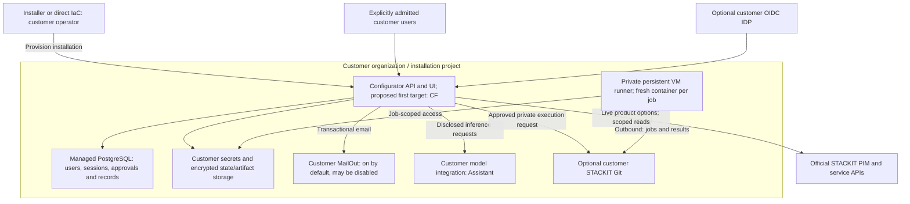

# Customer-installed Configurator concept

[English](customer-installation-concept.md) | [Deutsch](customer-installation-concept.de.md)

Status: architecture proposal for discussion, 2026-11-16. No installer,
authentication mode or customer deployment is implemented by this document.
The existing hosted service and its STACKIT identity checks remain unchanged.

## 1. Product objective

Offer the Configurator as versioned software installed in a customer's STACKIT
organization during bootstrap. Only users explicitly admitted by that customer
can use it. Customer-owned application data, state, execution identities and
operational records stay in customer-controlled services; no vendor-hosted
Configurator, customer GitHub repository or vendor operator account is required.
The native Accelerator remains usable without any Configurator.

Target experience: obtain an approved release, provide a suitable service-account
key and a small set of target references, review one installation plan, install,
open the generated HTTPS address and claim the initial administrator account.
There is no mandatory STACKIT web-client ticket, pre-existing customer mail server
or external identity provider. MailOut is enabled by default and may be explicitly
disabled. This is an installation goal, not a claim that any service
account can create arbitrary projects or provision every service.

Agreed authentication direction: local passkeys are the default; direct customer
OIDC SSO is optional. Neither a mail server nor an external identity provider is
required for initial login. Enrollment and recovery are part of the local mode.

Customer-owned Cloud Foundry hosting and explicitly delegated service-account
execution remain proposals for discussion. VM hosting is the alternative for
private-only application access. The login decision does not approve either
hosting or the cloud authorization model.

## 2. Authentication options

| Option | Customer prerequisite | Benefit | Trade-off / proposed role |
| --- | --- | --- | --- |
| Local passkeys (WebAuthn) | Stable HTTPS origin and a compatible authenticator/browser | No external IDP client, mail server or password distribution | Implement enrollment, recovery and local account administration; agreed ticket-free default |
| Direct customer OIDC SSO | Customer registers an app in its own IDP, e.g. Entra ID or Keycloak | Existing sign-in/MFA and employee identity lifecycle | Requires customer IDP administration; optional enterprise path, not federation through STACKIT IDP |
| Local password plus second factor | Initial credential and recovery process | Familiar fallback for incompatible environments | Additional password/TOTP protection and reset burden; not the proposed first default |
| Email magic link | Working transactional email, sender configuration and mailbox access | Simple recipient onboarding | MailOut/DNS/delivery become login dependencies; optional, not the minimal bootstrap |
| STACKIT Git as OAuth identity provider | Compatible Git instance, customer accounts and OAuth app registration | Reuses an existing development identity system | Couples every user to Git; evaluate only for customers already using it |
| Bundled identity server | Another operated stateful component | Could centralize several login methods | Adds upgrades, backup and configuration; not required for one application |

Direct corporate SSO means the Configurator trusts the customer's IDP itself.
It is different from registering a new application at STACKIT IDP or federating
the corporate IDP into STACKIT. The STACKIT federation guide documents a
support-ticket requirement and does not establish self-service registration of
arbitrary Configurator web clients. The current installation-specific STACKIT
client dependency is therefore removed in this profile, not worked around using
the official CLI client, portal cookies or service-account browser login.

### Local passkey path

The initial administrator claims the installation using a short-lived, single-use
setup capability delivered by the installer to the authorized operator. Register
a passkey only after that capability is checked; there is no public first-user
registration. Store user IDs and public credential data in the customer database;
private keys remain with the authenticator. Require user verification, validated
challenge, origin and relying-party ID using a maintained WebAuthn library.

Invite additional users through expiring, revocable, single-use links delivered
by the administrator through an existing customer channel. A link grants only
its explicitly assigned local membership; no public signup or email-domain
allowlist grants access. A recipient must complete enrollment. The administrator
is responsible for confirming the recipient's customer affiliation. A contact
email is not automatically a verified STACKIT identity.

Allow multiple passkeys per account and provide a separately protected recovery
procedure. For administrators, require a documented independent recovery method
before completing setup, such as a second authenticator or one-time recovery
codes stored outside the instance. Recovery needs rate limits, revocation,
audit records and tests; it must not turn an email address into authority.
If recovery codes alone initiate recovery, sensitive execution remains blocked
until a new verified authenticator is enrolled. An operator-assisted emergency
reset is explicit, narrowly authorized and auditable, never an always-enabled
public setup endpoint. Lost devices must not require reinstalling the instance.

Passkeys need a stable HTTPS origin and relying-party identifier. Choose the
hostname before enrollment, prohibit silent changes, and design domain migration
as a separate enrollment/recovery process. A CF platform route can be a minimal
initial origin once its TLS/browser behavior is qualified. A custom domain is
optional but preferably chosen before users enroll. An IP address and self-signed
certificate are not the normal production onboarding path.

### Customer SSO path

Use OIDC Authorization Code with PKCE, state and nonce; validate issuer, audience,
subject, signature and exact callbacks. Identify users by issuer plus subject,
not email. Restrict the accepted issuer/tenant and admitted groups or explicit
local memberships. Do not merge identities solely because emails match or
silently make all IDP users administrators. Group mapping and revocation need
bounded revalidation/session invalidation; SSO login by itself does not guarantee
immediate deprovisioning. SAML through a customer bridge can be evaluated later.

Local recovery access, if retained after SSO activation, is a deliberate customer
policy. Existing users link identities only through verified account-linking
flows; the installer does not create a vendor backdoor.

## 3. Customer identity is not STACKIT cloud authority

The current hosted product ties protected actions to fresh personal STACKIT
organization-owner proof. Local passkeys or a corporate OIDC token cannot supply
that proof or be presented as an equivalent STACKIT identity.

Introduce an explicit `customer-managed` deployment/authorization profile with
its own reviewed contracts. It is not an `auth=false`, a bypass of proof checks,
or a database update setting existing organization bindings to verified. Fix
installation identity, allowed STACKIT organization, region and resource scopes
at setup. Workspaces remain separately authorized within that boundary; changing
the organization is an explicit reconfiguration/migration, not a form edit.

Bind the authorization profile to installation ID, database metadata and trusted
release configuration; reject inconsistent profiles. Customer-managed identities
and approval receipts must never be accepted by the hosted SaaS realm. Switching
an existing installation between authority models needs a reviewed migration,
not an environment-variable toggle. Display customer delegation status separately
from personal STACKIT organization verification.

| Identity / role | Authority |
| --- | --- |
| Bootstrap operator and initial service account | Provision the installation within their actual cloud permissions; authorize the first local administrator |
| Installation administrator | Customer user/SSO management, execution-profile admission and installation settings; no automatic personal STACKIT role |
| Platform Engineer / Application Owner | Existing local workspace/product permissions, explicitly assigned and bounded |
| Customer execution service account | Actual STACKIT API actions within its native IAM scope and the application's delegated execution policy |
| Installer/upgrader identity | Maintain the Configurator infrastructure; separated from routine workload execution |

The customer administrator explicitly delegates execution profiles to approved
roles/workspaces/operations. A local role does not inherit every permission of
the installation account. Plan/Apply still bind actor, organization, source,
configuration revision, state and exact reviewed plan. Separate cloud identities
for platform provisioning and workload execution; no broad bootstrap key in every
job or permanent app environment. The first installation may have no enabled
cloud execution profile until the customer admits an appropriately scoped one.

This is a customer-operated automation delegation model. If the customer instead
requires every action to use each person's native STACKIT rights, a separate
supported human delegation/authentication mechanism is required; local login alone
cannot meet that requirement. Show local user, admitted execution identity and
approval in application audit records. STACKIT audit events will generally name
the service account used, not magically the human who approved the job. Preserve
correlation, not an assertion of native per-user non-repudiation.

"Customer users only" means the customer's approved local roster or explicitly
admitted corporate identities. It does not prove that each user has a STACKIT
Portal account or organization membership. A strict requirement for that proof
is a separate product decision and may reintroduce human STACKIT integration.

## 4. Hosting and execution choices

| Hosting | Fit | Cost / limitation |
| --- | --- | --- |
| Customer CF organization/space plus managed services | Recommended first packaging target: reuses the current API/UI, PostgreSQL and CF operations | Shared STACKIT platform remains shared; customer-owned logical resources are not dedicated hardware or an SNA attachment |
| Dedicated application VM(s) with a packaged container | Private-only UI, tighter network placement, or no CF preference | Requires new app packaging, ingress/TLS, OS/runtime maintenance and HA/patching design |
| Existing customer Kubernetes | Customer already operates a suitable management cluster | Requires cluster access and another packaging/upgrade path; not a bootstrap prerequisite |

The first profile should offer explicitly priced compact and availability-oriented
sizes. Compact is not HA; multiple replicas/managed database topology require
failover evidence before an availability promise. Do not install production's
current three-replica/warm-runner configuration blindly for every customer.



The private runner branch is a proposed optional feature, not required merely to
sign in or edit a configuration. It follows the agreed [private VM runner
concept](../../docs/private-runner-concept.md):
STACKIT Git plus persistent VMs in the customer SNA and fresh containers per job.
The app is never installed on a privileged runner host. A private-only app also
needs user/VPN connectivity; a service account cannot create browser reachability.

An initial CF profile may retain qualified CF execution for supported public
endpoints. Private provider phases stay unavailable until their Git/VM path is
delivered and qualified. No installation feature claims to resolve #37 by itself.

### Functional parity is the product target

The customer installation is the same Configurator product, not a reduced editor
or an independent fork. Use the same qualified application source, UI, native
contracts, Assistant knowledge, project templates, workspace roles, approvals,
Plan/Apply, recovery, upgrade workflows, notifications and audit behavior as the
corresponding SaaS release. Keep feature flags/version compatibility in a common
release manifest. New SaaS functionality must have a customer-profile acceptance
path or an explicitly documented integration prerequisite; it is not silently
omitted from the installed edition.

Deployment ownership and login differ. Functions depending on personal STACKIT
identity need reviewed customer-profile equivalents: catalog access, verified mail
recipients, invitation acceptance and native IAM/project-owner assignments. An
app user/passkey/contact address is not a native STACKIT subject. Require an
explicitly admitted, validated native user/owner mapping where cloud APIs need
one; missing mapping blocks the affected publication/action with an explanation,
not an invented identity or silent change to a service-account owner.

The standard installation profile follows the qualified SaaS production feature
set and supported topology. A compact/cost-optimized profile is an explicit
customer selection, not the first edition's default reduced functionality.
Assistant, email and execution use customer-owned integrations and credentials;
standard-on integrations require visible readiness/consent checks and no vendor
credential fallback. Private execution has the same implementation boundary as
SaaS until the separate Git/VM design is qualified. Matching topology is not proof
of equal measured availability or recovery performance.

### How the service catalogue is loaded and used

There are three different catalogues, with distinct owners and update paths:

| Catalogue | Source and installation behavior | Use / authority |
| --- | --- | --- |
| Supported Accelerator capabilities, reference drafts and IAM snapshot | Bundle the same reviewed/generated assets with each software release; verify provenance and compatibility | Define what this release can express and execute; do not need a vendor SaaS API |
| Current STACKIT product metadata and service options | Customer backend queries official PIM and service APIs, scoped by configured project and region where required | Populate supported versions, flavors, images, plans and permission choices; metadata is not entitlement, quota or execution authority |
| Customer's published Application catalogue | Customer PostgreSQL holds approved template versions, visibility/groups, parameters, platform bindings and orders | Platform Engineers publish; authorized Application Owners browse/order through the same workflows as SaaS |

Today `StackitCatalogueClient` already reads PIM metadata and service options;
`PostgresCloudCatalogues` selects stored credential profiles with explicit tenant
and user ownership filters. The customer profile must add an explicitly admitted
installation/workspace catalogue-read identity rather than borrowing another
user's private profile or keeping the broad bootstrap key. Initial setup creates
or admits that scoped reader, chooses the installation project as the default
reference project and validates the configured regions. More reference projects
are explicit selections within the allowed organization. Do not infer the key's
home project or require each passkey user to upload a cloud key.

The app fetches on initial use and refreshes in the background with bounded
requests/timeouts. Normalize and cache only approved metadata, including source,
fetch time, project, region, reader/policy revision and freshness status. Separate
workspace/trust scopes; invalidate on credential rotation/revocation, permission
changes or target changes. Detect external IAM changes through bounded
revalidation, not assumed immediate cloud events. A cache does not authorize
execution. Cache TTL/refresh policy is configurable and is not a
claim about today's implementation. Label unavailable, incomplete or stale parts;
do not turn a failed lookup into an authoritative empty list or advertise
unavailable capacity. Preserve existing/imported values visibly. A snapshot can
support editing during an outage, but current authoritative checks still gate
new permissions, publication and execution where required.

Public PIM metadata does not require the customer's personal IDP login; some
project/service options need authenticated reads. Return normalized metadata,
never tokens, keys or raw sensitive responses. Confirm exact read permissions in
preflight; a reference project does not prove availability in a future workload
project. Read failures must not trigger broader IAM grants or create services.
New products appearing in PIM are not automatically new supported Accelerator
features: the packaged provider/contracts and qualification remain authoritative.

Ship approved reference drafts as starting points, not auto-published production
orders with example owners. The customer reviews and publishes its own versions.
No access to our SaaS database or other customers' templates is required. Import
of customer-owned existing templates is an explicit, authorized export/import with
source/schema validation, stable identity mapping and fresh target bindings; a
software update does not overwrite local publications or upgrade existing orders.

### Email: optional integration, enabled in the standard profile

Agreed default: transactional email is enabled through customer-owned STACKIT
MailOut. The installer offers an explicit opt-out or a qualified customer SMTP
relay. No full mail server or mailbox service is installed. Email remains
independent of passkey authentication and never becomes the only recovery path.

The plan includes sending domain, authorized sender, required DNS records and
SMTP binding/costs. Reuse an explicitly selected customer DNS zone, or offer a
dedicated managed sending zone where available and approved. App hostname and
sending domain are independent. Validate suffix eligibility, DNS-control rights
and MailOut availability before promising automated setup. External DNS requires
an explicit record handoff; never rewrite an existing SPF/DMARC policy blindly.
A standard domain choice must be qualified for sending, not assumed from the
availability of a free DNS suffix.

Use the service's required SPF/DKIM/DMARC validation and sender readiness, capture
the one-time sender credential privately, and bind SMTP only to the backend.
Keep records and credentials in protected customer installation custody, not our
GitHub Environments. Reuse/refactor the current reconciler's guarded API behavior
when the pinned provider lacks resources; do not assume today's Dev-specific
reconciler already installs arbitrary customers. On DNS/permission/validation
failure report pending/failed email setup and offer explicit repair or opt-out;
never silently disable selected mail or report it ready. Passkey login and the
in-app inbox remain usable while mail is unavailable. Initial mail tests need an
explicit recipient; SMTP acceptance is not proof of inbox delivery.

Keep SaaS email behavior: STACKIT-branded DE/EN HTML/text, user topic preferences,
inviter-controlled invitation delivery, outbox deduplication, bounded retries and
uncertain-send handling. Local/SSO accounts need separately verified notification
addresses; adapt email invitation acceptance to a validated customer-account/
recipient binding, not by dropping today's verified-STACKIT-email check. Verifying
a mailbox does not verify STACKIT IAM membership. After passkey enrollment, offer a separate notification-email verification; accept an SSO email as verified only under the trusted issuer's qualified verified-email policy. A missing/unverified address does not block local login, but receives no ordinary notification email. If the customer disables mail,
manual invitation links and in-app notifications continue to work.

## 5. Minimal prerequisites and installer contract

The normal path takes an existing billed customer organization, an explicitly
selected target project, a service-account key with documented installation
rights, region and a local administrator handle. The interactive installer offers
project selection; headless use and direct IaC accept its UUID explicitly. Confirm
the actual organization/project and never substitute the credential's home
project. Existing projects are referenced, not silently adopted as entirely
installer-owned resources. Uninstall must not delete that project or unrelated
resources. Optional project creation is a separate reviewed mode requiring the
parent/folder rights and any initial project-owner reference.

A project-scoped provisioning account is not automatically allowed to build a
whole Landing Zone across the organization. Execution scopes, IAM grants, service
availability/entitlements, quotas, supported regions and operator network access
remain real prerequisites. Standard-on MailOut requires sending-domain/DNS rights;
if these are unavailable, expose the missing prerequisites and an explicit
opt-out. No pre-existing customer mail server is required. Corporate SSO, custom
app DNS and private execution add requirements when selected. Assistant uses the
customer's model access and explicit disclosure/approval of its data flow.

### Implementation language and shared IaC

Recommended implementation: a Go CLI for the installer and OpenTofu/HCL for
infrastructure. Ship an executable per supported OS/architecture, without a Go or
Node installation prerequisite. The Go layer handles interactive/headless input,
strict configuration validation, preflight, plan summaries, release verification,
secret handoff and install/update/recovery orchestration. It invokes a qualified,
pinned OpenTofu binary and the same versioned modules exposed to direct IaC users;
there is no second general resource-provisioning implementation in Go.

Use the official STACKIT Go SDK where its qualified version covers required APIs;
otherwise narrow authenticated API adapters for missing steps, such as guarded
MailOut provisioning or one-time enrollment, with explicit durable ownership and
recovery. Do not manage the same resource through both HCL and an API reconciler.
Existing Node-based operator scripts are references to refactor/reuse behind this
contract, not an undisclosed customer Node prerequisite. Bundle tools/artifacts
or acquire them from approved sources with verified signatures/digests. Do not
execute arbitrary shell strings or silently install system-wide dependencies.

Direct IaC is an equally supported interface with explicit enrollment/release
steps where Terraform cannot safely manage one-time credentials. Neither route
requires a GitHub account, our GitHub Environments or vendor CI credentials. The
installer cannot depend on an already running Configurator/private pool.

### Target project, HA and sizing settings

Interactive prompts, a versioned configuration file, CLI flags and equivalent IaC
variables expose the same validated settings. Explicit flags override file values;
file values override release-profile defaults. Target project is explicit, not a
fallback to the key's home project. Reject unknown fields, unsupported values and
conflicting settings before mutation. Defaults follow the selected release's
qualified SaaS profile; advanced values are intentional customer overrides.

| Setting | Installer behavior |
| --- | --- |
| Target project / organization / region | Select or specify existing project UUID; show exact IDs and scope before approval; new-project mode separate |
| Availability | SaaS-equivalent/HA profile by default; explicitly selectable compact profile; label actual topology and qualification limits |
| Application sizing | Replica count, supported per-instance memory/disk and applicable CF quota/platform or VM class |
| Database sizing | Supported flavor, storage, replica topology and backup/retention; validate combinations and migration/growth limitations |
| Execution capacity | Qualified public Runner reserves/concurrency and optional private VM count/class; preserve resource and state-lock limits |
| Integrations | MailOut on by default with opt-out/SMTP selection, customer model access, catalogue reference projects/regions, optional SSO/private execution |

Illustrative configuration/interface, not implemented commands or guaranteed
flavor identifiers:

```yaml
project_id: PROJECT_UUID
region: eu01
profile: saas-equivalent
availability: ha
sizing:
  app_instances: 3
  database_flavor: QUALIFIED_REPLICA_FLAVOR
mail:
  enabled: true
  provider: stackit-mailout
```

```text
lzc-installer plan --credentials /private/bootstrap.json --project-id PROJECT_UUID --config /private/install.yaml
lzc-installer install --plan /private/installation-plan
lzc-installer status --installation-id INSTALLATION_UUID
lzc-installer upgrade --installation-id INSTALLATION_UUID --version RELEASE
```

Resolve available flavors/quotas/regions in preflight and show the final settings,
resources, expected recurring/temporary cost impact and HA limitations in the saved
plan. A single app replica/single database is not labeled HA. Do not downgrade on
quota failure. Changed project/size/HA settings invalidate the reviewed plan;
replan explicitly. Later resizing is a separate reviewed infrastructure change,
not an implicit side effect of every software upgrade.

## 6. Installation sequence

1. **Read-only preflight:** validate key, target organization/project, permission
   requirements, service/API availability, quotas, network and chosen profile.
   A missing permission is actionable; do not silently broaden it or switch modes.
2. **Review:** present resource/cost-impact summary, scope, region, URLs and optional
   features. Installation approval does not authorize later workload Applies.
3. **Bootstrap durable state:** establish a protected installation backend,
   installation ID and independent recovery custody. Protect local seed state,
   plan and secrets before a remote backend exists; resume partial installs by
   state/IDs instead of creating duplicates. Installation state is separate from
   customer Landing Zone/workload states and not managed by the app it can delete.
4. **Provision:** create selected app runtime, PostgreSQL, scoped secrets/storage,
   generated encryption material and independent runtime/upgrade identities.
   Protect secrets in state; never output all sensitive provider values.
5. **Deploy the selected release:** verify manifest/signatures/digests, perform
   checksum-guarded migrations with a separate identity, activate app and check
   TLS, readiness and unauthenticated authorization boundaries. A missing/unready
   integration is reported explicitly and does not prevent local login; selected
   standard features are not silently skipped or reported ready.
6. **Initial administrator:** generate a short-lived, hashed-at-rest setup capability
   bound to installation ID and origin. Deliver privately to the operator, never
   in query strings, CI logs, ordinary outputs or customer support bundles. Use
   protected interactive output or an owner-only handoff file for unattended use.
   Atomically consume it when the administrator enrolls; expired/replayed claims
   fail. Rotate an expired unclaimed capability through the authorized installer.
7. **Handover:** record administrator/recovery setup, backups, target binding and
   credential custody. Remove the original bootstrap key from local temporary
   files and deployed app configuration; retain only the customer's separate
   protected maintenance custody if needed. Admit execution profiles separately.

No public first-visitor claim, default password or universal installation secret.
The CLI does not silently delete the customer's only key or recovery material.

## 7. Packaging, updates and operations

### One product, versioned customer release bundles

Publish customer-installation bundles alongside GitHub releases. A signed
compatibility manifest binds application, Go installer, IaC, database migrations,
native contract/schema, Assistant knowledge, supported Accelerator revisions,
engine/provider locks and optional runner versions by immutable digest/provenance.
Record installed versions and compatibility in the customer database and protected
installation inventory. Configurator and Accelerator may evolve on different
version tracks; matching version numbers are not a compatibility guarantee.

Use the same qualified product source and feature set as SaaS with explicit
customer-profile adapters. Customer installations pin releases; our SaaS deployment
pipeline does not push them. Publish concise release notes, upgrade prerequisites,
supported source-to-target paths, security advisories and known limitations. Provide
an authenticated/digest-verified distribution/retention path without customer
developer accounts. Installation-specific broker origins/keys/trust must be
parameterized and tested, not disabled to relocate today's operator packages.

### Updating the Configurator installation

1. **Discover:** optionally check a public release manifest and show available
   supported updates in the app/CLI; no customer data upload or automatic upgrade.
   Selecting a release/channel does not authorize cloud mutation. Pinned/offline
   operation remains possible with an approved verifiable bundle.
2. **Plan:** `lzc-installer upgrade ... --version RELEASE` resolves the installed
   manifest, target compatibility and infrastructure/schema changes; shows exact
   versions, features, downtime/cost impacts and any needed intermediate release.
   Require the qualified installer version, with verified bootstrap/update of the
   CLI when necessary. Preserve project, sizing and custom settings unless a
   separately reviewed change is requested. Direct IaC pins the same target
   modules/artifacts and follows the same migration/activation sequence. In
   unattended mode, produce the reviewable plan and wait for explicit approval
   of that plan; selecting a version must not auto-approve its Apply.
3. **Prepare:** obtain the separate maintenance identity; stop new dispatch,
   publication and conflicting writes as needed; finish or explicitly reconcile
   active jobs. Back up PostgreSQL, encryption material/secrets references, state,
   required artifacts and installation inventory under one recovery checkpoint.
   Verify readability/compatibility before destructive migration.
4. **Apply:** after explicit approval, apply only installation infrastructure
   changes, run ordered checksum-guarded migrations once with a dedicated identity,
   activate the exact package and perform bounded readiness/auth/service checks.
   Rolling activation is used only where the topology and schema permit it;
   otherwise announce the required maintenance window.
5. **Verify/resume:** test login, local/SSO identity boundaries, catalog access,
   notifications/MailOut, Assistant bindings, approvals and the selected executor.
   Record source/target versions, operator and results; resume work only after
   required gates pass. Preserve an actionable partial/failed upgrade state.

The installer maintains the app from outside its own job executor; it is not an
in-app button holding the bootstrap key or self-replacing an active worker.
Restore/rollback availability follows the manifest: code rollback may be possible
before or with backward-compatible schema changes, but not after arbitrary
migrations. For incompatible failures, use the verified compatible backup and
artifact set or a qualified forward repair. Do not overwrite evidence or replay
an ambiguous infrastructure Apply blindly. Keep a resumable journal/lock so
interrupted upgrade invocations reconcile instead of duplicating operations.

### Accelerator versions and existing Landing Zones

A software update may install/register new Accelerator capabilities but does not
change existing configurations, published templates, orders, state addresses,
project permissions or running resources. Keep the exact source/schema/engine/
provider/runtime tuple needed by supported existing records. If a tuple cannot
remain supported, expose the compatibility/security restriction and required
migration before upgrade; do not run old state through an arbitrary new root.

Offer explicit Accelerator target selection and migration preview for a saved
configuration/template: preserve stable identities and native/imported values,
show changes, create a new reviewed revision and publish a new template version
where applicable. Existing orders retain their version. Platform and template
upgrades use their existing review/target-binding behavior and a fresh cloud
Plan; Apply of the exact saved plan remains an explicit authorized action. A
new live catalogue choice is neither a service-version upgrade nor a new product
capability by itself.

Pending approvals/plans remain executable only if the target release qualifies
their complete saved-plan tuple and authorization conditions. Otherwise mark them
stale with a reason and require a new Plan; never silently reinterpret/re-sign an
old plan as the new runtime. Do not prune versions/artifacts required for active
supported orders or recovery. The customer chooses maintenance and workload
upgrade timing within documented support/security limits; critical advisories
may require explicit restrictions, not hidden changes to customer resources.

### Operational ownership

Customer operators own availability, patch approval, retention and access
administration; software maintainers own artifacts, compatibility and advisories.
Support bundles are redacted/opt-in. No implicit vendor support account, telemetry
or customer-data export. Assistant uses the customer's model integration with
explicit disclosed data flow, no SaaS token/vendor fallback. Standard MailOut,
notifications and catalogue policy follow the contracts above; mail can be
explicitly disabled without disabling local login. Uninstall preserves state and
backups by default and previews effects; it does not destroy managed Landing Zones.

## 8. Required implementation and qualification

This is more than adding a login button. Work packages are:

1. Explicit deployment identity/authorization profiles; fixed organization scope;
   existing SaaS checks unchanged. Test local roles versus delegated native rights.
2. WebAuthn, enrollment, recovery, user revocation and account linking; optional
   generic OIDC integration and customer-only admission policy.
3. Reusable customer infrastructure/release modules and Go installer with shared
   settings for target project, HA and sizing; private secret handoff, no vendor CI.
4. Standard-on optional MailOut and verified customer notification/invitation bindings;
   three catalogue sources with scoped automatic reads and customer publication.
5. Configurator/Accelerator version separation, qualified SaaS feature parity,
   upgrade/restore compatibility and service-account lifecycle/rotation.
6. Optional private-runner adapter once that independent architecture is delivered.

Acceptance includes a clean install with only documented inputs and no STACKIT
web-client ticket; rejected unauthorized setup claims; second customer user
onboarding; foreign account/organization denial; expired invitations and sessions;
local recovery; corporate SSO linkage/revocation; bounded service-account use;
Plan/Apply approval without invented personal STACKIT proof; interrupted install
and upgrade resume; encrypted backup/restore including encryption material; fixed
origin/passkey continuity; continued operation with the Configurator vendor unavailable;
and continued independent Accelerator use. Also qualify explicit project selection,
HA/sizing validation, catalogue refresh/scoping/revocation, retained stale values,
customer publication, default MailOut and opt-out, local recipient verification,
interrupted upgrades, rollback limits and retained old Accelerator executions.
Run matching SaaS workflows against the customer profile, including Assistant,
orders/approvals, Plan/Apply, recovery and notifications. Measure installation time and
unavoidable operator steps, not a promised "one click" before evidence exists.

## 9. Discussion decisions

Agreed: local passkeys by default, optional direct customer OIDC SSO, optional
MailOut enabled by default, and broad functional parity with the SaaS offering.
Target project and HA/sizing must be configurable. Go CLI plus shared OpenTofu/HCL
is the recommended implementation approach. Remaining decisions are:

- Is customer-owned CF acceptable, or is an SNA-private UI a first-release
  requirement? The latter favors VM hosting and needs user network connectivity.
- Does "customer users" mean an approved app roster/corporate directory, or native
  STACKIT organization membership for every individual? These are different proofs.
- Will customers accept explicitly delegated service-account execution, or require
  native personal STACKIT authorization for every action? This determines whether
  the no-STACKIT-client goal is achievable with the proposed model.
- Which concrete HA/sizing ranges, model integrations, sending-domain defaults and
  cost envelopes should be qualified? SaaS-equivalent is the reference profile;
  compact sizing and email opt-out are explicit customer choices.

Develop incrementally from customer CF, local passkeys and one fixed organization,
then qualify the entire corresponding SaaS feature set, catalogue paths, standard
mail, supported sizing and software/Accelerator upgrades before calling the
installed product equivalent. An initial technical slice is not approval to ship
an editor-only or functionally reduced edition. Optional customer OIDC and private
Git/VM execution have explicit integration/qualification paths. No deployment or
reduction of existing safeguards is authorized by this concept.

## 10. Sources and related designs

Reviewed 2026-11-16. Source facts are distinguished from our proposed product and
security contracts; these links are not evidence of a working installer.

- [STACKIT IDP federation](https://docs.stackit.cloud/platform/access-and-identity/stackit-idp/getting-started/): external federation direction and ticket requirement; not a self-service Configurator client-registration API.
- [WebAuthn standard](https://www.w3.org/TR/webauthn-3/): public-key browser authentication, relying-party/origin checks; qualify the chosen library and customer browsers.
- [OIDC Core](https://openid.net/specs/openid-connect-core-1_0.html): user identity protocol; not STACKIT IAM delegation.
- [CF provisioning with Terraform](https://docs.stackit.cloud/products/runtime/cloud-foundry/how-tos/provision-cloud-foundry-via-terraform/) and [CF service accounts](https://docs.stackit.cloud/products/runtime/cloud-foundry/how-tos/create-cloud-foundry-service-accounts/): automation building blocks, not proof of the complete minimal installer.
- [Current production operations](production.md), [authentication](github-login.md) and [architecture](architecture.md): current operator-specific provisioning, personal proofs and CF runtime boundaries to refactor explicitly.
- [Private VM runner concept](../../docs/private-runner-concept.md): persistent SNA VMs with fresh containers per job; optional complementary execution design.
- [Current catalogue client and ownership checks](../app/apps/api/src/credentials/catalogues.ts), [template publication](project-template-drafts.md) and [notification behavior](notifications.md): current behavior to preserve with explicit customer identity adapters.
- [MailOut operations](../infra/mailout/README.md) and [official sending-domain setup](https://docs.stackit.cloud/products/messaging/mailout/how-tos/create-setup-and-manage-sending-domains/): credential/DNS readiness and the current operator-specific reconciler to generalize.
- [STACKIT MailOut overview](https://docs.stackit.cloud/products/messaging/mailout/): outbound delivery, not an inbound mailbox server.
