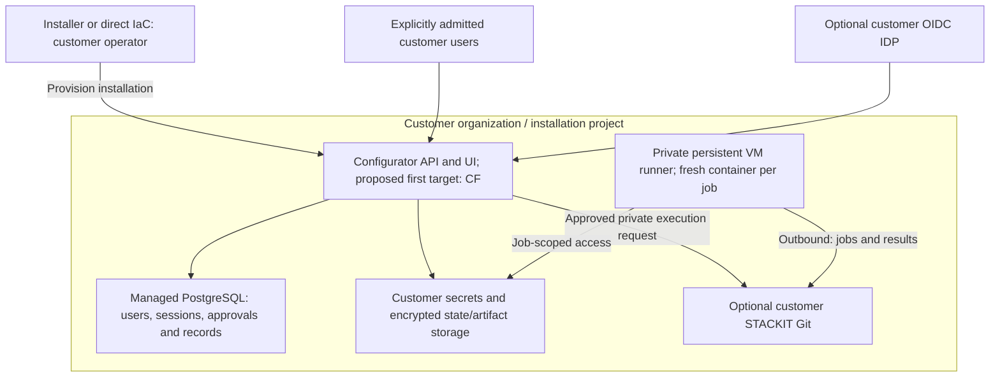

# Customer-installed Configurator concept

[English](customer-installation-concept.md) | [Deutsch](customer-installation-concept.de.md)

Status: architecture proposal for discussion, 2026-11-16. No installer,
authentication mode or customer deployment is implemented by this document.
The existing hosted service and its STACKIT identity checks remain unchanged.

## 1. Product objective

Offer the Configurator as versioned software installed in a customer's STACKIT
organization during bootstrap. Only users explicitly admitted by that customer
can use it. Customer-owned application data, state, execution identities and
operational records stay in customer-controlled services; no vendor-hosted
Configurator, customer GitHub repository or vendor operator account is required.
The native Accelerator remains usable without any Configurator.

Target experience: obtain an approved release, provide a suitable service-account
key and a small set of target references, review one installation plan, install,
open the generated HTTPS address and claim the initial administrator account.
There is no mandatory STACKIT web-client ticket, customer mail server or external
identity provider. This is an installation goal, not a claim that any service
account can create arbitrary projects or provision every service.

Recommended discussion baseline: customer-owned Cloud Foundry hosting, local
passkey login plus optional customer OIDC SSO, and an explicitly delegated
service-account execution model. These choices are proposals, not yet product
commitments. VM hosting is the alternative for private-only application access.

## 2. Authentication options

| Option | Customer prerequisite | Benefit | Trade-off / proposed role |
| --- | --- | --- | --- |
| Local passkeys (WebAuthn) | Stable HTTPS origin and a compatible authenticator/browser | No external IDP client, mail server or password distribution | Implement enrollment, recovery and local account administration; recommended ticket-free starting point |
| Direct customer OIDC SSO | Customer registers an app in its own IDP, e.g. Entra ID or Keycloak | Existing sign-in/MFA and employee identity lifecycle | Requires customer IDP administration; optional enterprise path, not federation through STACKIT IDP |
| Local password plus second factor | Initial credential and recovery process | Familiar fallback for incompatible environments | Additional password/TOTP protection and reset burden; not the proposed first default |
| Email magic link | Working transactional email, sender configuration and mailbox access | Simple recipient onboarding | MailOut/DNS/delivery become login dependencies; optional, not the minimal bootstrap |
| STACKIT Git as OAuth identity provider | Compatible Git instance, customer accounts and OAuth app registration | Reuses an existing development identity system | Couples every user to Git; evaluate only for customers already using it |
| Bundled identity server | Another operated stateful component | Could centralize several login methods | Adds upgrades, backup and configuration; not required for one application |

Direct corporate SSO means the Configurator trusts the customer's IDP itself.
It is different from registering a new application at STACKIT IDP or federating
the corporate IDP into STACKIT. The STACKIT federation guide documents a
support-ticket requirement and does not establish self-service registration of
arbitrary Configurator web clients. The current installation-specific STACKIT
client dependency is therefore removed in this profile, not worked around using
the official CLI client, portal cookies or service-account browser login.

### Local passkey path

The initial administrator claims the installation using a short-lived, single-use
setup capability delivered by the installer to the authorized operator. Register
a passkey only after that capability is checked; there is no public first-user
registration. Store user IDs and public credential data in the customer database;
private keys remain with the authenticator. Require user verification, validated
challenge, origin and relying-party ID using a maintained WebAuthn library.

Invite additional users through expiring, revocable, single-use links delivered
by the administrator through an existing customer channel. A link grants only
its explicitly assigned local membership; no public signup or email-domain
allowlist grants access. A recipient must complete enrollment. The administrator
is responsible for confirming the recipient's customer affiliation. A contact
email is not automatically a verified STACKIT identity.

Allow multiple passkeys per account and provide a separately protected recovery
procedure. For administrators, require a documented independent recovery method
before completing setup, such as a second authenticator or one-time recovery
codes stored outside the instance. Recovery needs rate limits, revocation,
audit records and tests; it must not turn an email address into authority.
If recovery codes alone initiate recovery, sensitive execution remains blocked
until a new verified authenticator is enrolled. An operator-assisted emergency
reset is explicit, narrowly authorized and auditable, never an always-enabled
public setup endpoint. Lost devices must not require reinstalling the instance.

Passkeys need a stable HTTPS origin and relying-party identifier. Choose the
hostname before enrollment, prohibit silent changes, and design domain migration
as a separate enrollment/recovery process. A CF platform route can be a minimal
initial origin once its TLS/browser behavior is qualified. A custom domain is
optional but preferably chosen before users enroll. An IP address and self-signed
certificate are not the normal production onboarding path.

### Customer SSO path

Use OIDC Authorization Code with PKCE, state and nonce; validate issuer, audience,
subject, signature and exact callbacks. Identify users by issuer plus subject,
not email. Restrict the accepted issuer/tenant and admitted groups or explicit
local memberships. Do not merge identities solely because emails match or
silently make all IDP users administrators. Group mapping and revocation need
bounded revalidation/session invalidation; SSO login by itself does not guarantee
immediate deprovisioning. SAML through a customer bridge can be evaluated later.

Local recovery access, if retained after SSO activation, is a deliberate customer
policy. Existing users link identities only through verified account-linking
flows; the installer does not create a vendor backdoor.

## 3. Customer identity is not STACKIT cloud authority

The current hosted product ties protected actions to fresh personal STACKIT
organization-owner proof. Local passkeys or a corporate OIDC token cannot supply
that proof or be presented as an equivalent STACKIT identity.

Introduce an explicit `customer-managed` deployment/authorization profile with
its own reviewed contracts. It is not an `auth=false`, a bypass of proof checks,
or a database update setting existing organization bindings to verified. Fix
installation identity, allowed STACKIT organization, region and resource scopes
at setup. Workspaces remain separately authorized within that boundary; changing
the organization is an explicit reconfiguration/migration, not a form edit.

Bind the authorization profile to installation ID, database metadata and trusted
release configuration; reject inconsistent profiles. Customer-managed identities
and approval receipts must never be accepted by the hosted SaaS realm. Switching
an existing installation between authority models needs a reviewed migration,
not an environment-variable toggle. Display customer delegation status separately
from personal STACKIT organization verification.

| Identity / role | Authority |
| --- | --- |
| Bootstrap operator and initial service account | Provision the installation within their actual cloud permissions; authorize the first local administrator |
| Installation administrator | Customer user/SSO management, execution-profile admission and installation settings; no automatic personal STACKIT role |
| Platform Engineer / Application Owner | Existing local workspace/product permissions, explicitly assigned and bounded |
| Customer execution service account | Actual STACKIT API actions within its native IAM scope and the application's delegated execution policy |
| Installer/upgrader identity | Maintain the Configurator infrastructure; separated from routine workload execution |

The customer administrator explicitly delegates execution profiles to approved
roles/workspaces/operations. A local role does not inherit every permission of
the installation account. Plan/Apply still bind actor, organization, source,
configuration revision, state and exact reviewed plan. Separate cloud identities
for platform provisioning and workload execution; no broad bootstrap key in every
job or permanent app environment. The first installation may have no enabled
cloud execution profile until the customer admits an appropriately scoped one.

This is a customer-operated automation delegation model. If the customer instead
requires every action to use each person's native STACKIT rights, a separate
supported human delegation/authentication mechanism is required; local login alone
cannot meet that requirement. Show local user, admitted execution identity and
approval in application audit records. STACKIT audit events will generally name
the service account used, not magically the human who approved the job. Preserve
correlation, not an assertion of native per-user non-repudiation.

"Customer users only" means the customer's approved local roster or explicitly
admitted corporate identities. It does not prove that each user has a STACKIT
Portal account or organization membership. A strict requirement for that proof
is a separate product decision and may reintroduce human STACKIT integration.

## 4. Hosting and execution choices

| Hosting | Fit | Cost / limitation |
| --- | --- | --- |
| Customer CF organization/space plus managed services | Recommended first packaging target: reuses the current API/UI, PostgreSQL and CF operations | Shared STACKIT platform remains shared; customer-owned logical resources are not dedicated hardware or an SNA attachment |
| Dedicated application VM(s) with a packaged container | Private-only UI, tighter network placement, or no CF preference | Requires new app packaging, ingress/TLS, OS/runtime maintenance and HA/patching design |
| Existing customer Kubernetes | Customer already operates a suitable management cluster | Requires cluster access and another packaging/upgrade path; not a bootstrap prerequisite |

The first profile should offer explicitly priced compact and availability-oriented
sizes. Compact is not HA; multiple replicas/managed database topology require
failover evidence before an availability promise. Do not install production's
current three-replica/warm-runner configuration blindly for every customer.



The private runner branch is a proposed optional feature, not required merely to
sign in or edit a configuration. It follows the agreed [private VM runner
concept (PR #257)](https://github.com/stackitcloud/stackit-landing-zone/pull/257):
STACKIT Git plus persistent VMs in the customer SNA and fresh containers per job.
The app is never installed on a privileged runner host. A private-only app also
needs user/VPN connectivity; a service account cannot create browser reachability.

An initial CF profile may retain qualified CF execution for supported public
endpoints. Private provider phases stay unavailable until their Git/VM path is
delivered and qualified. No installation feature claims to resolve #37 by itself.

## 5. Minimal prerequisites and installer contract

The normal path takes an existing billed customer organization and target
project, a service-account key with documented installation rights, a region and
a local administrator handle. Infer a project from the key only when explicit
and unambiguous; confirm the actual target, never assume it is the key's home
project. Discover supported quotas/platforms and explain selections before costs
are incurred. Creating a new project additionally needs parent/folder permissions
and any required initial project-owner reference. Starting from an existing
project keeps the initial authority narrower.

A project-scoped provisioning account is not automatically allowed to build a
whole Landing Zone across the organization. Execution scopes, IAM grants, service
availability/entitlements, quotas, supported regions and operator network access
remain real prerequisites. Optional private execution, email, Assistant, custom
DNS and corporate SSO add requirements only when selected.

Deliver a signed/versioned installer and a versioned IaC entry point built from
the same reviewed manifest. Illustrative interface, not existing commands:

```text
lzc-installer plan --credentials /private/bootstrap.json --project-id PROJECT_UUID --region eu01
lzc-installer install --plan /private/installation-plan
lzc-installer status --installation-id INSTALLATION_UUID
lzc-installer upgrade --installation-id INSTALLATION_UUID --version RELEASE
```

The installer wraps pinned OpenTofu/provider/tool versions and the same modules;
it does not maintain another cloud provisioning implementation. Direct IaC users
supply equivalent variables and use explicit enrollment/release steps where
Terraform cannot safely manage one-time credentials. No mandatory GitHub account,
manual GitHub Environment configuration or vendor CI credentials are inherited
from today's operator runbooks. An installer must not depend on an already
running Configurator or private pool to install either.

## 6. Installation sequence

1. **Read-only preflight:** validate key, target organization/project, permission
   requirements, service/API availability, quotas, network and chosen profile.
   A missing permission is actionable; do not silently broaden it or switch modes.
2. **Review:** present resource/cost-impact summary, scope, region, URLs and optional
   features. Installation approval does not authorize later workload Applies.
3. **Bootstrap durable state:** establish a protected installation backend,
   installation ID and independent recovery custody. Protect local seed state,
   plan and secrets before a remote backend exists; resume partial installs by
   state/IDs instead of creating duplicates. Installation state is separate from
   customer Landing Zone/workload states and not managed by the app it can delete.
4. **Provision:** create selected app runtime, PostgreSQL, scoped secrets/storage,
   generated encryption material and independent runtime/upgrade identities.
   Protect secrets in state; never output all sensitive provider values.
5. **Deploy the selected release:** verify manifest/signatures/digests, perform
   checksum-guarded migrations with a separate identity, activate app and check
   TLS, readiness and unauthenticated authorization boundaries. A missing optional
   email/AI integration does not prevent local login.
6. **Initial administrator:** generate a short-lived, hashed-at-rest setup capability
   bound to installation ID and origin. Deliver privately to the operator, never
   in query strings, CI logs, ordinary outputs or customer support bundles. Use
   protected interactive output or an owner-only handoff file for unattended use.
   Atomically consume it when the administrator enrolls; expired/replayed claims
   fail. Rotate an expired unclaimed capability through the authorized installer.
7. **Handover:** record administrator/recovery setup, backups, target binding and
   credential custody. Remove the original bootstrap key from local temporary
   files and deployed app configuration; retain only the customer's separate
   protected maintenance custody if needed. Admit execution profiles separately.

No public first-visitor claim, default password or universal installation secret.
The CLI does not silently delete the customer's only key or recovery material.

## 7. Packaging, upgrades and operations

Publish a customer-installation artifact/compatibility manifest alongside a
GitHub release: application, installer, IaC, migrations, native contracts,
engine/provider locks and optional runner versions bound by digests/provenance.
The customer's installation pins a release; our SaaS deployment pipeline does
not push updates to it. Runtime downloads, images and dependencies need a
supported distribution/retention strategy without customer developer accounts.
Existing CF packages contain operator-specific trust boundaries; installation-
scoped broker origins, keys and artifact trust must be parameterized and tested,
not disabled to make a relocated package start.

An upgrade workflow checks current/target compatibility, creates/verifies required
backups, reviews the infrastructure/schema change and deploys the approved
artifacts. Show backup, migration, activation and verification separately. Code
rollback may not undo a schema migration; recovery needs a tested compatible
restore/forward-recovery path. Preserve users, passkeys, origin/RP ID, states,
secrets references, pending jobs and audit correlation. Configuration drift and
partially completed upgrades need explicit reconciliation. Do not upgrade the
instance while it is itself executing its infrastructure replacement.

Customer operators own availability, patch approval, backup retention and access
administration; software maintainers own supported artifacts, release notes and
compatibility/security guidance. Support bundles are redacted and opt-in. No
vendor support account, telemetry or customer-data export is enabled implicitly.
Assistant inference is optional and explicitly enabled with the customer's model
access and disclosed data flow; no SaaS model token or hidden vendor fallback.
Email is optional for notifications and invitation delivery, not local sign-in.
Uninstall preserves state/backups by default and previews destructive effects;
installation removal does not implicitly destroy managed Landing Zones.

## 8. Required implementation and qualification

This is more than adding a login button. Work packages are:

1. Explicit deployment identity/authorization profiles; fixed organization scope;
   existing SaaS checks unchanged. Test local roles versus delegated native rights.
2. WebAuthn, enrollment, recovery, user revocation and account linking; optional
   generic OIDC integration and customer-only admission policy.
3. Reusable customer infrastructure/release modules, signed installer, private
   secret handoff and automated installation without our GitHub Environments.
4. Release/upgrade/restore compatibility and service-account lifecycle/rotation.
5. Optional private-runner adapter once that independent architecture is delivered.

Acceptance includes a clean install with only documented inputs and no STACKIT
web-client ticket; rejected unauthorized setup claims; second customer user
onboarding; foreign account/organization denial; expired invitations and sessions;
local recovery; corporate SSO linkage/revocation; bounded service-account use;
Plan/Apply approval without invented personal STACKIT proof; interrupted install
and upgrade resume; encrypted backup/restore including encryption material; fixed
origin/passkey continuity; no access with the Configurator vendor unavailable;
and continued independent Accelerator use. Measure actual installation time and
unavoidable operator steps, not a promised "one click" before evidence exists.

## 9. Discussion decisions

- Is local passkey login the default, with optional corporate SSO, or must corporate
  SSO be mandatory? Passkeys best match the minimal external-prerequisite goal.
- Is customer-owned CF acceptable, or is an SNA-private UI a first-release
  requirement? The latter favors VM hosting and needs user network connectivity.
- Does "customer users" mean an approved app roster/corporate directory, or native
  STACKIT organization membership for every individual? These are different proofs.
- Will customers accept explicitly delegated service-account execution, or require
  native personal STACKIT authorization for every action? This determines whether
  the no-STACKIT-client goal is achievable with the proposed model.
- Which compact/HA profiles, supported services and cost envelopes should the first
  installer qualify? Avoid packaging every optional platform feature as mandatory.

Recommended first vertical slice: customer CF installation, local passkeys,
closed invitations, one fixed organization and a narrowly admitted public-endpoint
execution profile. Then add generic customer OIDC, HA/restore qualification and
private Git/VM execution as independently tested capabilities. The order is a
proposal for discussion, not permission to deploy or reduce existing safeguards.

## 10. Sources and related designs

Reviewed 2026-11-16. Source facts are distinguished from our proposed product and
security contracts; these links are not evidence of a working installer.

- [STACKIT IDP federation](https://docs.stackit.cloud/platform/access-and-identity/stackit-idp/getting-started/): external federation direction and ticket requirement; not a self-service Configurator client-registration API.
- [WebAuthn standard](https://www.w3.org/TR/webauthn-3/): public-key browser authentication, relying-party/origin checks; qualify the chosen library and customer browsers.
- [OIDC Core](https://openid.net/specs/openid-connect-core-1_0.html): user identity protocol; not STACKIT IAM delegation.
- [CF provisioning with Terraform](https://docs.stackit.cloud/products/runtime/cloud-foundry/how-tos/provision-cloud-foundry-via-terraform/) and [CF service accounts](https://docs.stackit.cloud/products/runtime/cloud-foundry/how-tos/create-cloud-foundry-service-accounts/): automation building blocks, not proof of the complete minimal installer.
- [Current production operations](production.md), [authentication](github-login.md) and [architecture](architecture.md): current operator-specific provisioning, personal proofs and CF runtime boundaries to refactor explicitly.
- [Private VM runner proposal, PR #257](https://github.com/stackitcloud/stackit-landing-zone/pull/257): persistent SNA VMs with fresh containers per job; optional complementary execution design.
