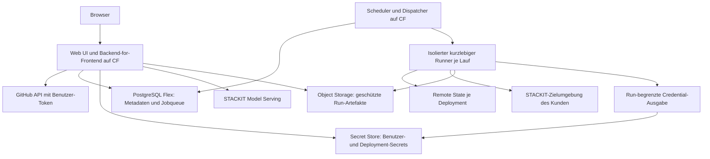
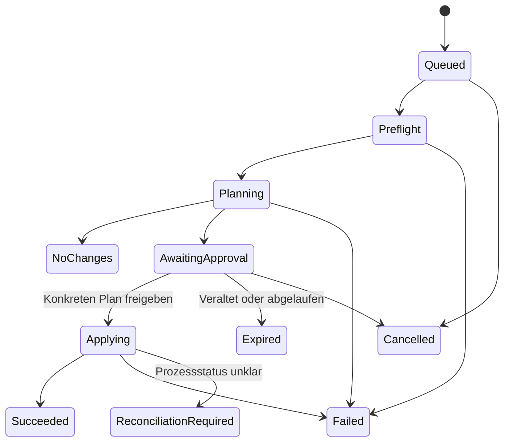

# Landing Zone Configurator – architecture and planning

[English](planning.md) | [Deutsch](planning.de.md)

<a id="landing-zone-configurator--architektur-und-planung"></a>

> As of: 2026-10-01 · Architecture baseline: `2161871`
> Historical decision log, not current operational or acceptance status.
> Current references: [architecture](architecture.md), [MVP boundaries](mvp-scope.md), [development](development.md) and [GitHub issues](https://github.com/stackitcloud/stackit-landing-zone/issues).
> The following architecture sections and dated progress notes form the decision log; older status statements describe the state at that time.
> `[x]` = decided or implemented with the stated evidence, depending on the section; a decision alone is not live acceptance.

<a id="aktueller-umsetzungsschritt"></a>
## Current implementation step

**Current template step:** [Typed order inputs and resource bindings](template-parameters-and-bindings.md), including stage selection and Observability access from the project's own network. The parameter contract with five approved fields, editor and local order preview is implemented. Production project-network/egress binding remains open in #96; publication and Application Owner orders follow separately.

**Role-workflow correction:** New platform configurations contain [project template drafts](project-template-drafts.md) rather than concrete application projects. The Platform Engineer defines them; instances are later created by the Application Owner from published versions. Old combined configurations remain unchanged; adoption only as an explicit copy.

Governance Plans also cover organization roles and folder permissions; empty folder descriptions no longer block. Optional service-account federation receives its own explained CI/CD editor. [Scope and qualification](plan-execution.md).

The MVP inventory separates editor coverage from execution approval. First, the checked standalone subset of the common editor is connected to the existing initial-provisioning Plan. Durable bootstrap state and approved Apply follow. Verified organization tenants, published Application templates and the Model Serving Assistant are developed in parallel. Work packages #89–#95 contain specific acceptance criteria.

Customer Apply still needs explicit approval; organizations remain unverified drafts until permission evidence exists. The feature branch is not merged to main in this step.

<a id="1-zielbild-und-bestätigte-entscheidungen"></a>
## 1. Target design and confirmed decisions

An application hosted centrally on STACKIT Cloud Foundry guides users from Landing Zone template to verifiable deployment. The UI works with organizations, network areas, platform services and workloads. A deterministic compiler translates this business information into Accelerator configuration. Terraform stays in the background; technical details can be inspected when needed.

**Confirmed in the planning discussion:**

- [x] Product name: Landing Zone Configurator.
- [x] All Configurator services, including activation, are created through IaC; no manual portal provisioning.
- [x] First development environment: lzc-dev in eu01.
- [x] Organize app, IaC and documentation under `landing-zone-configurator/`, separate from the Accelerator.
- [x] Operator project and service-account file provided locally; `NAME=WERT` format checked; project access and platform/runtime provisioning demonstrated through CI Applies.
- [x] Support multiple independent customer organizations from the start. Tenant separation is a prerequisite for first release, not a later extension.
- [x] Initially change configurations only and execute them with approved Accelerator code. Custom Terraform modifications from forks follow later.
- [x] GitHub access uses the user's identity and permissions, without central repository credentials.
- [x] App hosting on STACKIT Cloud Foundry; build platform environment through IaC.
- [x] STACKIT Model Serving as chat backend; provide its operator credentials server-side through CF variables.

Operators need technical identities for CF, database, secret management and Runner. These must not have blanket permission for customer repositories or deployments. The requested central Model Serving credentials are an explicitly bounded operator function.

<a id="anforderungskatalog"></a>
### Requirements catalogue

| ID | Capability | Classification |
| --- | --- | --- |
| F01 | GitHub login and user-bound repository access | First version |
| F02 | Create fork and select multiple existing repository connections | First version; consider GitHub limits |
| F03 | Offer and copy existing `src/config/` examples as templates | First version |
| F04 | Business editor matching modules and features | Incremental implementation; make coverage visible |
| F05 | Save configurations in the selected personal fork | First version |
| F06 | Securely manage personal credentials and deployment profiles | Before first deployment |
| F07 | Visually accompany and execute Terraform/OpenTofu Plan and Apply | Core scope |
| F08 | Optional drift detection and optional drift correction | After stable Apply |
| F09 | Chat with follow-ups, complete version-specific feature knowledge and topic restrictions | Core scope |
| F10 | Graphical configuration display, later Plan delta and known actual state | Core scope |
| F11 | STACKIT PaaS database for persistence | Recommendation: PostgreSQL Flex |
| F12 | Optional STACKIT IdP login | Check feasibility; no MVP dependency |
| F13 | Model Serving service as prerequisite and platform setup through IaC | Core scope |

<a id="2-ausgangslage-dieses-repositories"></a>
## 2. Repository baseline

Based on [root variables](../../src/variables.tf), [providers](../../src/providers.tf), [engine/provider requirements](../../src/terraform.tf), [backend example](../../src/backend.tf), [Getting Started](../../docs/getting-started.md), [architecture](../../docs/architecture.md), [mise.toml](../../mise.toml) and [contribution rules](../../CONTRIBUTING.md).

<a id="template-katalog"></a>
### Template catalogue

| File under `src/config/` | Business representation |
| --- | --- |
| `standalone.tfvars` | Independent Landing Zones without central network hub |
| `hub-and-spoke.tfvars` | Central network hub with connected Landing Zones |
| `hub-and-spoke-firewall.tfvars` | Hub-and-spoke with OPNsense firewall |
| `hub-and-spoke-multi-area.tfvars` | Separate areas for regulated and shared workloads |
| `hub-and-spoke-finance-research.tfvars` | Separate areas for business organizations |
| `hub-and-spoke-prod-nonprod-firewall.tfvars` | Separate Prod/Nonprod areas with appliances |
| `hub-and-spoke-tenant-isolation.tfvars` | Network isolation within a STACKIT organization |
| `hub-and-spoke-multi-region.tfvars` | Regional hubs, Landing Zones and platform clusters in `eu01`/`eu02` |

**Important limitations and implications:**

- Templates contain placeholders and commented-out optional features. An HCL parser alone therefore does not discover all functionality. An explicit feature catalogue is needed.
- `src/providers.tf` supports static regional aliases for `eu01` and `eu02`. The UI must not present further regions as automatically supported.
- `connectivity_regions` is modeled as `map(any)`. Business-level UI validation must go beyond Terraform type checking.
- According to repository documentation, a project belongs to exactly one SNA; multiple SNAs or regions are not automatically privately connected.
- `firewall_config` currently configures one appliance. Multiple appliances do not imply automatic policy distribution. This remains a visible limitation.
- Firewall bootstrap needs multiple steps, an image and shell tools. The guide describes an initially public admin interface with a shared initial password. Approve automation only after secure bootstrap and password rotation.
- Private firewall/Kubernetes endpoints need suitable Runner connectivity. Central CF operation alone does not provide it.
- Backend is commented out; the guide migrates local state into the created management bucket only after initial provisioning. Short-lived Runners, however, need remote state before the first run.
- `mise.toml` pins OpenTofu `1.12.6`; `src/terraform.tf` requires at least `1.11`. README/Getting Started sometimes state different minimum versions. Recommendation: first qualify pinned OpenTofu; test Terraform separately as another engine.
- Repository promises no blanket migration compatibility. Upgrades need explicit migration, version checking and a new Plan.
- Network isolation of the “Tenant Isolation” template does not replace tenant separation in the central application.

<a id="3-zielarchitektur"></a>
## 3. Target architecture

Recommendation: modular backend service with clear internal boundaries; Terraform execution as a separate runtime. No unnecessary division into many microservices at the start.



| Component | Recommendation | Responsibility |
| --- | --- | --- |
| Frontend | React/TypeScript with Vite; graph library still to select | Wizard, business forms, topology, chat and run view |
| Backend/BFF | TypeScript with Fastify on Node.js 24 LTS | Sessions, authorization, GitHub, configuration, chat orchestration |
| HCL adapter | Small Go adapter with HCL parser | Read existing `.tfvars` structurally, no regex conversion |
| Configuration core | Versioned JSON Schema, domain rules and compiler | Common contract for editor, import, chat and output |
| Database | STACKIT PostgreSQL Flex | Tenants, drafts, revisions, runs, audit and queue |
| Scheduler/queue | Durable PostgreSQL queue and separate CF process | Leases, heartbeats, recovery, fair tenant quotas |
| Secrets | STACKIT Secrets Manager, after checking required policies | DB contains references; no plaintext credentials |
| Artifacts | STACKIT Object Storage | Protected plans, sanitized logs and run manifest |
| Runner | Immutable artifact with pinned engine and providers | Only credentials of the specific deployment |
| Chat | STACKIT Model Serving through backend | Advice and validated proposals; no execution permissions |

PostgreSQL Flex is documented as a managed service and supports management through Terraform and Cloud Foundry. Specific region, plan, HA, backup, ACLs and CF binding must be defined before provisioning. [PostgreSQL Flex](https://docs.stackit.cloud/products/databases/postgresql-flex/)

<a id="cf-hosting-und-runner"></a>
### CF hosting and Runner

Web/API and scheduler/dispatcher run on CF. Sessions and jobs are stored externally. Plan for multiple web instances, health checks, DB pooling and backward-compatible DB migrations. SSE for progress/chat, polling as fallback; test proxy timeouts and reconnection.

STACKIT documents up to 32 GB RAM and 6 GB ephemeral local storage for processes/tasks. The local filesystem is not persistent. Check these limits especially for provider binaries, firewall image and plan artifacts. [Application requirements](https://docs.stackit.cloud/products/runtime/cloud-foundry/basics/requirements-for-applications/)

CF tasks run in their own containers but inherit their app's environment variables, bindings and security groups. Therefore **do not start a Terraform task of the backend app**. A dedicated Runner app without backend bindings is recommended, if necessary with separate apps/spaces per customer. Tests must demonstrate whether this provides required isolation and private connectivity. Task logs flow into app logs; redaction must therefore happen before stdout/stderr. [CF tasks](https://docs.cloudfoundry.org/devguide/using-tasks.html)

If CF resource limits, network or isolation are insufficient: isolated jobs on SKE or short-lived compute Runners. For private targets, possibly Runners in customer networks with outbound control connection. Web application remains on CF. This extension needs an explicit architecture decision.

**Approval criterion:** A Runner can access neither other customers' secrets/states, Model Serving credentials nor app database. A separate directory alone is insufficient. Even approved Terraform code executes providers and sometimes scripts.

<a id="4-mandantenmodell-und-berechtigungen"></a>
## 4. Tenant model and permissions

A tenant represents a customer organization. Under it are workspaces, repository connections, configurations and deployments. Users can belong to multiple tenants; current context must always be visible in the UI. GitHub organization, app tenant and STACKIT organization are distinct objects with explicit mapping.

Initial recommendation: shared PostgreSQL instance with `tenant_id` on all customer objects and row-level security as an additional protection layer. Design roles and DB access so the application path does not bypass RLS. Separate databases/instances for heightened isolation requirements as a later operational option. Secrets, state, artifacts, queue, caches and chat history need the same separation; a DB filter alone is insufficient.

- Tenant membership only through confirmed invitation/administration or verified organization assignment; no automatic mapping by email domain.
- Roles: Viewer, Editor, Deployer, Tenant Admin. Credential use is additionally authorized.
- Continue checking GitHub permissions for repository actions; an app role extends no GitHub permission.
- Personal credentials are private by default. Sharing with workspace or background job needs explicit revocable delegation.
- Every request and job is authorized server-side for tenant, workspace and object. Request IDs are not permission evidence.
- Limit rate, active Runners, queue share, artifact storage and AI budget per tenant; no customer may consume all capacity.
- Design operator access as a traceable emergency process. No normal support UI displaying customer secrets.
- Before the first external release, negative tests for horizontal access, foreign job IDs, artifact URLs, cache keys, secret references and chat sessions.

<a id="5-benutzerablauf"></a>
## 5. User workflow

1. **Sign in and choose tenant:** Connect GitHub, create own customer context or accept invitation.
2. **Select repository:** Choose an existing accessible fork or create a new one; check write permission.
3. **Copy template:** See target design, features, limitations and prerequisites; assign own configuration ID and name.
4. **Design:** Wizard or chat; both work on the same business model. Topology responds to validated changes.
5. **Review and save:** Show diff; make repository, branch and path visible; create Git commit or optional PR.
6. **Prepare deployment:** Check target organization, region, credential profile, remote state and Runner network.
7. **Plan:** Use fixed revision; explain Create/Update/Delete/Replace in business terms.
8. **Apply:** Explicitly approve the specific plan; follow progress and errors.
9. **Operate:** See last successfully deployed revision, last known actual state and optional drift checks.

Navigation: dashboard, templates, configurations, graphical editor with chat, repository connections, deployment profiles, personal credentials, runs/drift and tenant management. Terms such as “network area” replace Terraform variable names in normal use. Technical details remain available for diagnostics and export.

<a id="6-github-und-login"></a>
## 6. GitHub and login

<a id="benutzergebundener-zugriff"></a>
### User-bound access

Recommendation: GitHub App with user authorization and user access tokens. Every user authorizes the app themselves. Repository actions use exclusively their token, no installation tokens or central PAT. Rights are limited by user permissions, app permissions and installation. [User-based GitHub App authentication](https://docs.github.com/en/enterprise-cloud%40latest/apps/creating-github-apps/authenticating-with-a-github-app/authenticating-with-a-github-app-on-behalf-of-a-user)

Provide OAuth state, secure callback allowlist, supported PKCE, CSRF protection and secure HttpOnly/Secure/SameSite sessions. Keep tokens only server-side in the secret store. Test expiry, refresh, revocation, SSO and organization policies. Block repository access after revocation. Reference repositories through stable GitHub IDs.

**Important fork prerequisite:** According to GitHub, the fork API for GitHub Apps needs an installation on the target account with all-repository access and an installation on the source account with access to the source repository. `Administration: write` and `Contents: read` are stated for this endpoint. Creation is asynchronous. This is a central onboarding check, especially for upstream `stackitcloud/stackit-landing-zone`. [Fork API](https://docs.github.com/en/rest/repos/forks)

In the spike, check the full permission matrix for fork, read, branch/commit and optional PR. If required source installation or target permission is unavailable: guided manual forking in GitHub followed by connecting; alternatively a separately assessed OAuth App. No silent switch to central credentials. An OAuth App may need broader scopes; do not decide prematurely solely because forking is easier. [GitHub Apps and OAuth Apps](https://docs.github.com/en/apps/oauth-apps/building-oauth-apps/differences-between-github-apps-and-oauth-apps)

<a id="mehrere-forks-und-speichern"></a>
### Multiple forks and saving

Support multiple repository connections per user/tenant, e.g. personal fork and forks in authorized organizations. Do not promise arbitrary numbers of real forks of the same upstream in one owner namespace: check current fork-network limit in the spike. Multiple configurations/branches in one fork are the preferred alternative; a standalone repository copy would be offered separately and is not a real fork.

Handle fork creation idempotently, poll readiness and display understandable errors. At saving, commit multiple files atomically and check expected base revision. Do not overwrite conflicts. Use working branch/PR for protected branches. Process webhooks with signature checks and idempotency; they permit no automatic Apply.

<a id="optionaler-stackit-idp"></a>
### Optional STACKIT IdP

The STACKIT guide found describes federation where STACKIT as relying party trusts an external IdP. It **does not** demonstrate that customers can easily register their own web app as an OIDC client of the STACKIT IdP. Clarify client registration, discovery, claims and usage approval separately. GitHub remains initial login. [STACKIT IdP introduction](https://docs.stackit.cloud/platform/access-and-identity/stackit-idp/getting-started/)

Additional IdP login grants neither GitHub nor cloud API permissions. GitHub connection remains necessary. Link identities only after proof of both accounts, never solely through equal email addresses.

<a id="7-fachmodell-templates-und-compiler"></a>
## 7. Business model, templates and compiler

<a id="versionierte-ablage"></a>
### Versioned storage

Proposed UI configuration storage in the selected fork:

```text
src/config/custom/<config-id>/
  landing-zone.json          # kanonisches Fachmodell, ohne Secrets
  landing-zone.tfvars       # deterministisch erzeugte Terraform-Eingaben
  manifest.json             # Schema-, Compiler-, Template-/Accelerator-Versionen
```

The business model is the source for UI-managed configurations. Generated file continues to enable CLI use. Recompile and compare hashes before runs; treat manual changes to generated files as a conflict. Original `.tfvars` are retained. Import report for unknown fields and comment loss; no silent deletion of unsupported settings.

Manifest: template path/commit, Accelerator commit/release, schema/compiler version and content hashes. Deployment bindings and secret references live outside Git. DB drafts are not “saved” until the Git commit succeeds. Runs use exclusively immutable Git revisions.

Template catalogue starts with the eight upstream files of an approved version. Fork-specific configurations are own configurations, not automatically trusted global templates. Initially offer upstream updates as explicit upgrades with diff and migration. Configuration rollback means new revision and Plan, not automatic infrastructure rollback.

<a id="feature-katalog"></a>
### Feature catalogue

| Business area | Repository reference | UI behavior and rules |
| --- | --- | --- |
| Organization | Owner, company/code, organization ID, labels, parent folder | Required values, replace placeholders, valid references |
| Governance | `rm_folders`, organization owners/auditors, roles | Hierarchy and role model |
| Management | State bucket, Secrets Manager, service accounts, federation | Distinguish bootstrap and operating identity |
| Observability/audit | `observability`, `audit_logs` | Explain retention, access, Object Lock consequences |
| Connectivity | `connectivity`, `connectivity_regions` | SNA, CIDRs, DNS, regional assignments |
| Firewall/VPN | Firewall/HA, `firewall_config`, VPN | Connectivity, bootstrap and traffic-inspection limits |
| Landing Zones | `landing_zones`, module `landing-zone` | Projects, owners, environment, RBAC, network, DNS, buckets, secrets |
| Kubernetes platform | `platform_kubernetes` | Cluster, node pools, network, encrypted volumes, bastion |
| Kubernetes services | `landing_zone_namespace_services`, namespace demo, root Kubernetes resources | Platform dependencies and reachable API endpoint |
| DevOps | `devops` | Git service and permitted network areas |
| Sandboxes | `sandboxes` | Project and owner |

Every feature receives a stable ID, business description, mapping, defaults, dependencies, regional limits, secret needs, compiler rules, graph semantics and tests. Derive structure partly from HCL; maintain business descriptions/dependencies explicitly. CI reports variable/module changes without updated catalogue.

Validation: references between areas/Landing Zones/clusters, naming rules, supported regions and combinations, CIDR conflicts in connected networks. Assess reused address ranges in genuinely isolated networks separately. Preserve stable Terraform resource keys; renaming must not cause invisible Destroy/Create.

Label each feature separately: **displayable, editable, plannable, executable**. An importable firewall template is not yet fully automatically deployable.

<a id="grenze-zum-terraform-code"></a>
### Boundary with Terraform code

Compiler generates only data, no freely entered HCL expressions or shell commands. In MVP, Accelerator code is materialized at an approved commit; only permitted configuration files are read from the user fork. Clearly report divergent modules. Do not implicitly load arbitrary `.auto.tfvars`, providers, backend files or scripts from forks.

Custom Terraform code is a later trust mode with stronger isolation and explicit provider/module/network policies. Make current restriction visible because the repository generally permits module customization.

<a id="8-credentials-und-persistenz"></a>
## 8. Credentials and persistence

| Category | Storage / owner | Use |
| --- | --- | --- |
| GitHub user/refresh token | Secret store, personal user | Repository access on user's behalf |
| STACKIT service-account key or supported federation | Personal or explicitly shared deployment profile | Assigned customer deployment |
| S3 backend access | Deployment profile | Exactly associated state area |
| VPN PSKs, firewall login/API key, possibly kubeconfig | Secret store per deployment | Only required run phase |
| Model Serving token | Operator, backend CF variables | Chat service |
| CF/DB/secret operating identity | Operator | Platform operation, no customer-cloud authority |

“Create credentials” initially means creating a profile and securely storing existing credentials. The app can create new STACKIT service accounts/keys only with explicitly delegated cloud permissions; GitHub login is insufficient. Later prefer short-lived federation if required flows are supported.

Check STACKIT Secrets Manager for tenant policies, credential lifecycle and run-specific issuance. Do not assume arbitrary Vault features are available in the managed service. If capabilities are missing, decide an explicit alternative, e.g. tenant-separated secret instances or reviewed envelope encryption with separately managed keys; no unencrypted DB fallback.

Runners receive only a short-lived issuance ticket limited to run and secret version. No general secret-store token. Personal profiles show status, purpose, expiry and “Replace/Revoke”, no raw values. Plan rotation, backup, restoration and emergency access.

`Sensitive` markings do not prevent Terraform state or saved plans from containing secrets. Protect these artifacts like secrets. Browser, Git, chat, audit and ordinary logs receive no raw secrets. Protect freely specified endpoints against SSRF; approve target networks per profile rather than addressing arbitrary internal addresses from the backend.

<a id="datenmodell"></a>
### Data model

All customer objects carry `tenant_id`, optionally `workspace_id`, checked server-side.

| Entity | Content |
| --- | --- |
| User / Identity / Session | Internal UUID, provider ID, linked identities, session lifecycle |
| Tenant / Workspace / Membership | Customer context, membership, roles and invitations |
| RepositoryConnection | GitHub ID, user authorization, branch, access status |
| TemplateVersion | Path/commit, metadata, supported features |
| Configuration / Revision | Business model, schema, Git target, base SHA and save status |
| CredentialProfile / Delegation | Secret reference/version, owner, permitted use, expiry |
| Deployment | Revision, target organization, backend/state ID and Runner profile |
| Run / Approval / Artifact | Status, manifest, plan hash, approval, result and artifact references |
| DriftSchedule / DriftFinding | Opt-in, reference revision, check and correction policy |
| ChatSession / Proposal | Version context, follow-ups, patch and adoption state |
| AuditEvent | Actor, action, resource, time, result; no secret values |

Define retention separately for chat, logs, plans, audit and state. Never delete state through normal artifact cleanup. Account/configuration deletion destroys no infrastructure; offboarding includes configuration/state export, access revocation and documented deletion of remaining data.

<a id="9-plan-apply-und-state"></a>
## 9. Plan, Apply and state

<a id="unveränderlicher-laufvertrag"></a>
### Immutable run contract

Every run binds tenant, deployment, Git commit, configuration hash, Accelerator commit, schema/compiler version, engine version, provider lockfile, Runner artifact digest, backend/state ID and relevant credential versions.



1. Check permission, profile, compatibility, quota, backend and connectivity.
2. Materialize checked code and exactly one selected configuration; generate backend settings without secrets in Git.
3. `init` with defined backend and pinned providers; `validate` and domain/policy checks.
4. `plan -out=<planfile> -detailed-exitcode`: 0 = no changes, 2 = changes, 1 = error. Test CLI contract with pinned engine.
5. Evaluate `show -json`, redact sensitive values using sensitivity markings and additional rules. Never give raw JSON directly to browser or chat.
6. Show Create/Update/Delete/Replace and unknown values; explain effects on business objects. Label costs as estimates only with a sound data source.
7. Bind approval to plan hash and manifest; record approver and time. Tenant policy can require two-person approval.
8. Apply exactly the saved binary plan with same engine/platform. Changed revision, state or relevant execution conditions require new Plan and approval.
9. Persist result, state version and sanitized outputs; remove temporary secrets/files.

Limit plan validity. Cloud changes outside the system can occur during approval time; state comparison alone does not detect everything. Replan on detected risk. No unnoticed replan between approval and Apply.

<a id="remote-state-und-sperren"></a>
### Remote state and locks

Decision 2026-09-30: follow existing LZA bootstrap. The first Plan for explicitly new creation uses local empty state and already stored bootstrap credentials. At the separately approved first Apply, the management module creates the future customer backend. Then migrate state exclusively with `tofu init -migrate-state`, verify and switch to the management service account.

Configurator must durably and encryptedly save initial state, including Runner loss and partial Apply. This recovery is a prerequisite for Apply. Existing deployments must never be planned as new empty states. No additional permanent central customer-state bucket. Platform IaC and customer deployments never share state. [Details](plan-execution.md).

- Practically test backend locking with selected engine and STACKIT Object Storage, including concurrent CLI access. S3 compatibility is not locking evidence.
- Additionally, DB lease per canonical state ID; prevent duplicate deployment registration of the same state. Lease does not replace backend lock.
- Versioning, encryption, restore test and logged manual unlock before production release.
- Do not blindly repeat Apply after Runner crash. Reconcile process status, lock and state; create new Plan if needed.
- Apply can succeed partially. No automatic rollback; recovery through new Plan. Cancellation is best effort and can leave partial changes.
- Initially one deployment corresponds to one Accelerator root. Larger state splitting needs separate migration and dependency planning.

<a id="spezielle-runbooks"></a>
### Special runbooks

Implement firewall bootstrap, policy configuration, secret handover, HA and possibly Kubernetes provider bootstrap as versioned workflows. Every writing phase with changed plan needs matching approval. No UI for arbitrary `-target` arguments.

For firewall: test image provenance/checksum, storage needs, tools, private API connectivity, password rotation and TLS verification. An abort while the admin interface is open must be visible and provide concrete securing/resumption instructions. Without successful evidence, do not approve this variant as automatically executable.

<a id="10-drift-detection-und-correction"></a>
## 10. Drift detection and correction

Per deployment: off, detect only, correct after approval, later narrowly bounded automatic correction. Default: off. Background credential use needs explicit revocable delegation separate from an interactive session.

- Reference is last successfully deployed Git/Accelerator revision, not current branch head.
- Refresh-only Plan can show cloud/state differences. Normal Plan against the same revision shows changes needed to restore desired state. Distinguish these statements.
- No automatic `apply -refresh-only` merely to make findings disappear.
- Schedules with jitter, backoff, tenant quotas and run locks; no checking parallel to a writing run on the same state.
- API errors or expired credentials mean “check failed”, not “no drift”.
- Correction restores approved desired state. “Adopt actual as desired” is a separate configuration change with Git commit and review.
- Automatic correction only after explicit opt-in with testable allowlist, maintenance window, resource limit, audit and emergency stop.
- Delete/Replace, IAM, firewall/routing changes, secret rotation and unknown actions initially always need approval.
- Pause after errors instead of looping; never smuggle new configuration changes in as drift correction.

<a id="11-chatbot-mit-stackit-model-serving"></a>
## 11. Chatbot with STACKIT Model Serving

<a id="bestätigte-produktentscheidungen-2026-10-10"></a>
### Confirmed product decisions (2026-10-10)

- Scope: all actually implemented Configurator features are permanently covered 1:1 by the AI component, including complex components and dependencies; not all STACKIT services. A version-bound coverage matrix makes support and execution limitations visible. New or changed features need matching knowledge, dialogue, validation and test coverage in the same qualified release; this does not lift existing execution guards.
- Dialogue: select a suitable configuration template, incrementally add wishes and ask specifically about missing details or contradictions. Completeness is checked by schema and domain rules, not claimed solely by the model.
- Templates: select existing authorized Application Landing Zone templates and create new template drafts. Publication remains a separate action for authorized Platform Engineers.
- Existing changes: analyze existing configuration and collect revision-bound proposals in the chat working draft. Only an explicitly confirmed overall diff changes the configuration draft; no automatic change to published templates or existing instances.
- Knowledge: ingest current official STACKIT information in a controlled way, detect changes automatically and release after review before use. Module, provider and Configurator knowledge remains bound to the respective configuration version. No automatic upgrades or arbitrary model web access.
- Model: `Qwen/Qwen3-VL-235B-A22B-Instruct-FP8` as preferred initial value; model, endpoint and technical limits remain operator-configurable. Existing Terraform-provisioned dev token is used exclusively backend-side.
- Inputs: text and configurations; no images in MVP.
- Scope decision 2026-10-13: guided firewall-policy editing and Assistant proposals for rules/NAT/aliases/routes are post-MVP ([#101](https://github.com/stackitcloud/stackit-landing-zone/issues/101)). Assistant states this boundary immediately; in MVP the firewall administrator maintains policy manually in OPNsense after provisioning. Generic native editor fields remain but are not execution evidence. Firewall infrastructure/HA remains in scope and alone guarantees neither isolation, connectivity nor NAT.
- Access and purpose: only authenticated users with currently valid session and appropriate tenant/configuration permissions. Advice and proposals are limited to Configurator tasks above; server-side tool, schema and permission checks enforce this boundary. No general chat, shell, secret or cloud execution function.
- Budget: no monetary budget limit in MVP. Bounded request sizes, context/output lengths, concurrency, request rates, timeouts and repair attempts remain necessary for abuse and operational protection. Usage is observed without secrets.
- Conversations: persistent server-side and continuable after re-login, with mandatory tenant, workspace and configuration reference. Access is rechecked on every read, continuation and adoption. Bound initial revision is reconciled with current configuration; stale proposals are not adopted unchecked.
- Deletion and age: deleting a configuration or its workspace also deletes associated conversations with messages, summaries and proposals; no orphaned conversation data. Maximum conversation age is three calendar months from creation, not last activity. Continuation does not extend the deadline. After expiry, an existing configuration can be analyzed again in a new conversation.
- Load target: at most five concurrent chat sessions for MVP acceptance. This is not a limit on saved conversation count. Inference concurrency, bounded queue and timeouts additionally consider actual Model Serving limits.

Business acceptance covers every implemented feature 1:1, not just selected example templates. Specific reference configurations and measurable response-time goals are refined during the model spike and feature matrix setup. A preliminary overall estimate is 30–50 engineering person-days including tests and documentation, excluding external waiting times or additional missing module/compiler capabilities. Model and component qualification must refine this range including complete feature coverage. Concept approval is neither implementation nor inference evidence.

<a id="gesprächslebenszyklus-und-abnahme"></a>
### Conversation lifecycle and acceptance

The specific [feature matrix and dialogue acceptance](assistant-feature-coverage.md) covers all 29 current root inputs, 501 field/container paths, eight feature groups, five cross-cutting workflow areas and 24 scenarios. The [generated matrix](assistant-feature-coverage.json) contains nine protected field/container paths without secret values; every entry remains `not-qualified` until actual model evidence. Its freshness test is integrated into existing unit suite. This is the first qualified concept step, not Assistant implementation.

Persisted conversation state is separate from short-lived login session and bounded model context. After re-login, only currently authorized, undeleted and unexpired conversations are loaded. Before template selection, create a regular authorized configuration draft if needed; even a new conversation is thereby bound to a workspace and configuration. No chat access without valid parent object.

Deletion path must consider messages, conversation working drafts, summaries and derived cache/index data. Authorized parent deletion and deletion of persisted conversation data are atomic; late model responses must not restore deleted or expired conversations. Expiry is checked before every access and physically implemented through monitored cleanup. Logs contain no conversation content. Backup retention and restore must preserve deletion and age limits; deleted and expired data are removed before renewed access after restore. A DB cascade alone is not evidence of deletion of all copies.

Required tests: continuation after re-login or backend restart, workspace/configuration and tenant isolation, current permission revocation, configuration revision conflicts, both parent deletion paths including running inference, fixed three-month limit without activity extension and sanitized restore. Five parallel sessions must neither mix contexts nor cause silent request loss or unbounded queues.

Coverage matrix assigns every implemented feature at least analysis, creation/modification where editor-supported, missing information, dependencies, validated diff and matching negative cases. Common schema/compiler checks remain authoritative. CI/release check missing assignments and tests; real model evaluations additionally qualify dialogue quality because a complete matrix alone does not prove reliable answers.

<a id="fachlicher-vertrag"></a>
### Business contract

Chat handles exclusively planning and configuration of the version-bound Accelerator. It explains features and limits, actively asks for missing information and produces reviewable changes. Outside this scope, it redirects to supported topics.

Knowledge: feature catalogue, schema, approved repository/module documentation and templates of the selected version. No arbitrary web/repository access. Document references in responses; do not invent unknown features. System prompt alone does not guarantee restriction: backend tool/data access enforces it.

Workflow:

1. User describes their goal.
2. Backend supplies minimal secret-free configuration and relevant versioned knowledge sections.
3. Chat asks for required information: owner, organization, regions, isolation, network planning. Explain contradictions, e.g. separate SNAs alongside a desired shared private Git service.
4. Model produces `questions`, `assumptions`, `patch`, `explanation`, `references`.
5. Backend checks schema/domain rules and patch base revision.
6. UI shows diff and topology preview. Only “Accept” changes the draft; Git saving, Plan and Apply are separate actions.

Permitted internal tools: look up features, read sanitized configuration, propose/validate patch. No secret reads, shell, Git writes or Apply by the model. Repository comments and free text are untrusted input. No other tenants' data, credentials, states or raw plans in model context.

<a id="anbindung-und-betrieb"></a>
### Integration and operation

STACKIT documents an OpenAI-compatible inference API with auth token. API keeps no conversation state; backend manages necessary context itself. [Use models](https://docs.stackit.cloud/products/data-and-ai/ai-model-serving/how-tos/use-the-models/)

Prerequisite: STACKIT project with enabled AI Model Serving, selected model, capacity and inference token. Token creation requires separate STACKIT authorization; do not confuse inference token with general STACKIT credentials. [Auth tokens](https://docs.stackit.cloud/products/data-and-ai/ai-model-serving/how-tos/manage-auth-tokens/)

Proposed app-specific CF variables:

```text
MODEL_SERVING_BASE_URL
MODEL_SERVING_MODEL
MODEL_SERVING_API_KEY
MODEL_SERVING_TIMEOUT_SECONDS
```

Documented shared-model entry uses `https://api.openai-compat.model-serving.eu01.onstackit.cloud/v1/chat/completions`. Take endpoint/model from selected service configuration; do not use management API endpoint for inference. Evaluate model capabilities such as tool calling/structured output separately. [Getting started with shared models](https://docs.stackit.cloud/products/data-and-ai/ai-model-serving/getting-started/getting-started-with-shared-models/)

Set credentials exclusively on backend/chat app, never frontend build or Runner. CF environment variables are readable by appropriately authorized space developers; these therefore belong to the operator trust boundary. Set through protected deployment injection, not Git manifests; test rotation and redaction. [CF variables and secrets](https://docs.stackit.cloud/products/runtime/cloud-foundry/how-tos/manage-environment-variables-and-secrets/)

Technical token/request limits per tenant, timeouts, bounded repair attempts for invalid JSON and circuit breaker; no monetary budget limit in MVP. Manual editor remains usable during AI outage. Make conversation retention, deletion and transmitted organization data transparent. Do not place tenant chat data in a shared knowledge index.

Evaluation cases: missing required fields, contradictory networks, unknown features, topic switch, prompt injection, secret disclosure, foreign tenants, stale revisions and invalid output. Chat is approved only with measured acceptance criteria.

<a id="12-grafische-darstellung"></a>
## 12. Graphical representation

A deterministic graph builder uses the same validated business model as the compiler. No infrastructure diagram drawn freely by the language model.

- Grouping: organization → region → network area → projects/Landing Zones → services.
- Nodes for management, DevOps, platform cluster, firewall, VPN, DNS and sandboxes.
- Edges for real relationships: SNA connection, default route, cluster assignment, explicit VPN connection. No implicit connections between SNAs/regions.
- Separate views: desired configuration, Plan delta and last known actual/state status with timestamp. State is not real-time monitoring.
- Mark Create/Update/Delete/Replace and unknown values with symbol and color.
- Map Plan resources to features through versioned mapping; unmappable resources remain technically visible.
- Nodes open business forms. Free drawing of relationships only later with the same validation rules.
- Keyboard-operable list/table alternative; secret-free graph export as extension.

<a id="13-iac-lieferung-und-betrieb"></a>
## 13. IaC, delivery and operation

The separate directory skeleton and local app development foundation are created; bootstrap, backend and platform IaC are implemented; no cloud Apply yet. Details are in the [Configurator README](../README.md). The [language decision](decisions/0001-application-stack.md) is documented as accepted.

```text
landing-zone-configurator/
  app/apps/{web,api,worker}/
  app/packages/{domain,contracts}/
  tools/hcl-adapter/
  runner/
  infra/{bootstrap,backend,platform,modules,environments}/
  deploy/cloud-foundry/
  docs/decisions/
```

Locally provided files `landing-zone-configurator.env` and `landing-zone-configurator-credentials.json` remain in repository root and are excluded from Git. They concern the operator platform, not customer deployments. Do not copy values into documentation, manifests or Git. After user correction, `.env` uses checked `NAME=WERT` format. Detected variable names: `PROJECT_ID`, `ORGANISATION_ID`. Define mapping to platform variables before IaC use. Target-project read access and selected service metadata were checked; write permissions are not yet demonstrated. See [platform check](platform-check.md).

App infrastructure and customer Landing Zones have separate states, credentials and release cycles. The app must not depend on a Landing Zone that would first need to be created by the same app. STACKIT documents CF provisioning through Terraform; specific resource coverage still needs demonstrating in the spike. [CF with Terraform](https://docs.stackit.cloud/products/runtime/cloud-foundry/how-tos/provision-cloud-foundry-via-terraform/)

<a id="plattformaufbau"></a>
### Platform setup

- [ ] Define operator project, region, CF org/spaces, quotas and operating roles.
- [ ] Provision platform remote state and bootstrap identity upfront; restricted operating identity afterwards.
- [ ] Declare CF apps/processes, routes, domain/TLS, bindings, health checks and scaling.
- [ ] Provision PostgreSQL Flex, secret store, artifact buckets, IAM, ACLs/network rules and monitoring.
- [ ] Enable/provision Model Serving or explicitly connect existing service; check provider/API coverage.
- [ ] Provide Runner and, if necessary, customer-specific network connection through dedicated modules.
- [ ] Manage GitHub App, callback/webhook URLs and keys; document registration steps that cannot be automated.
- [ ] Pin provider versions; supplement missing resources only through documented idempotent API/CLI steps.
- [ ] Inject secrets into CF protectively. `sensitive = true` does not prevent inclusion in Terraform state; avoid passing secret values through IaC resource parameters where possible.
- [ ] Separate development, staging and production; no customer secrets in development.

<a id="cicd-und-betrieb"></a>
### CI/CD and operation

- [ ] Parser/compiler fixtures for all eight templates; semantic import/export comparison.
- [ ] Check domain rules, version migrations and feature coverage.
- [ ] Authorization, RLS, Runner isolation and secret-redaction tests.
- [ ] Dependency/image scans, reproducible builds, IaC validation and staging smoke test.
- [ ] Qualify pinned engine/providers with real test organization; existing repository tests partly need STACKIT API access.
- [ ] Blue/green or tested CF rollout; backward-compatible DB migrations and app rollback.
- [ ] Practically rehearse DB, secrets and state backup/restore including required keys.
- [ ] Test CF restart, lost Runner, DB outage, token revocation and partially failed Apply.
- [ ] Metrics: queue age, Runner heartbeat, error rates, Plan/Apply duration, drift errors, AI usage and tenant quotas.
- [ ] Define RPO/RTO, availability, retention, budget, support paths and emergency access before first customer release.

<a id="14-roadmap-und-abnahme"></a>
## 14. Roadmap and acceptance

Multi-tenancy is part of every phase. Functionality can grow incrementally; customer isolation must not be deferred to a later phase. Estimate effort and dates only after spikes and team definition.

<a id="p0--machbarkeit-und-verbindliche-entscheidungen"></a>
### P0 – feasibility and binding decisions

<a id="entwicklungsbasis--erster-abgeschlossener-schritt"></a>
#### Development foundation – first completed step

- [x] Confirm stack and pin runtime/package versions.
- [x] Create dedicated npm workspace with lockfile, React/Vite and Fastify.
- [x] Create shared contracts and initial tenant/role policy.
- [x] Successfully run local lint, type checking, build and five tests.
- [x] Create separate Configurator CI workflow (not yet run on GitHub).
- [x] Check platform read-only and document limitations/results.
- [ ] Implement full sessions, DB/RLS and tenant-separated persistence.

This foundation replaces none of the following architecture spikes. Startup details: [development guide](../app/README.md).

- [x] Document requirements, repository baseline and architecture design.
- [x] Confirm multiple independent customers from the start and initially configuration changes only.
- [ ] GitHub spike: user token, upstream/target installation, fork, multiple owners, commit/PR, revocation and refresh.
- [ ] CF Runner spike: isolation, limits, cancellation, secret handover and private targets.
- [ ] State spike: first run, real locking, concurrent CLI access, restore.
- [ ] Secret-store spike: policies, tenant separation, rotation and delegation.
- [ ] Clarify service plans, regions, IaC resource coverage and optional IdP.
- [ ] Model Serving spike: auth, model, structured proposals, limits and evaluation.

**Acceptance:** Critical assumptions are evidenced or replaced by agreed alternatives. Record architecture decisions with evidence.

<a id="p1--mandanten-github-templates-und-editor"></a>
### P1 – tenants, GitHub, templates and editor

- [ ] Tenant onboarding, roles, invitations, sessions and server-side object authorization.
- [ ] Repository selection, fork flow and concurrent saving.
- [ ] Catalogue/import all eight templates and label support.
- [ ] Fully implement business model/compiler and editor initially for standalone and simple hub-and-spoke.
- [ ] Desired topology, drafts, Git versioning and upgrade metadata.
- [ ] Negative tests against foreign tenants and field loss during import.

**Acceptance:** Copy template → change business settings → check graph → save in selected fork → load semantically unchanged. No secrets in commit or overwriting others' changes.

<a id="p2--sichere-deployments-und-betriebsgrundlage"></a>
### P2 – secure deployments and operational foundation

- [ ] Staging/production foundation through IaC, backups and Observability.
- [x] Implement personal credential profiles: upload, Secrets Manager storage, own metadata and deletion.
- [x] Check STACKIT authentication and organization read access; save result per profile.
- [x] Bind saved Git configuration, organization, code reference and secret version in a preparation.
- [ ] Broader deployment permissions, delegations and customer-specific remote state.
- [ ] Runner, queue, manifest, Plan redaction, approval and exact Apply.
- [ ] Execute standalone and simple hub-and-spoke in separate test organizations.
- [ ] Check isolation, quotas, crash, cancellation, permission revocation, restore and partial failures.

**Acceptance:** At least two independent test customers can work separately. Foreign data/secrets are inaccessible; stale plans are rejected; Runner failure causes no blind second Apply. Operational goals and runbooks are defined.

<a id="p3--chat-und-vollständige-feature-abdeckung"></a>
### P3 – chat and complete feature coverage

- [ ] Integrate Model Serving with follow-ups, schema patches, diff and adoption.
- [ ] Versioned knowledge and evaluation suite.
- [ ] Cover multi-area, multi-region, Kubernetes, firewall/HA/VPN and further services.
- [ ] Demonstrate special bootstrap workflows and network connectivity.
- [ ] Graphically show Plan delta and known actual state.

**Acceptance:** Chat and form produce equivalent validated configurations. All templates have traceable support status. Repository limitations remain visible; no invented features and no Apply through chat.

<a id="p4--optionaler-betriebsausbau"></a>
### P4 – optional operational expansion

- [ ] Drift detection with explicit background delegation and status messages.
- [ ] Correction after approval, later narrow automatic allowlist with emergency stop.
- [ ] Optional STACKIT IdP after feasibility evidence.
- [ ] Custom Terraform code only after separate security/Runner decision.
- [ ] Extended team processes, audit export and customer-specific isolation options.

**Acceptance:** Automatic correction respects its policy even for unknown or destructive plans. Failure/revocation leads to controlled pause rather than uncontrolled retries.

<a id="15-entscheidungsregister"></a>
## 15. Decision register

| ID | Decision | Recommendation / result | Status | Owner |
| --- | --- | --- | --- | --- |
| D01 | Target audience | Multiple independent customer organizations from the start | Confirmed | Product |
| D02 | Terraform modifications | V1 configurations only, custom code later | Confirmed | Product |
| D03 | GitHub integration | GitHub App with user token; demonstrate fork prerequisites | Open | Backend |
| D04 | Multiple forks | Multiple owners/repos; branches/configs as additional variants | Spike | Product/Backend |
| D05 | Persistence | PostgreSQL Flex, tenant isolation plus RLS | Proposal | Platform |
| D06 | Runner hosting | Separate CF Runners, otherwise explicitly SKE/compute | Critical spike | Platform/Security |
| D07 | State ownership | LZA bootstrap, then migration to created customer backend | Decided; recovery/migration to implement | Architecture |
| D08 | Secret management | Secret store with run delegation and tenant policies | Critical spike | Security |
| D09 | Configuration format | Business JSON plus native landing-zone.tfvars | Standalone implemented; versioned deployment manifest outstanding | Architecture |
| D10 | Engine | Pinned OpenTofu 1.12.6 first; qualify Terraform separately | Proposal | Maintainer |
| D11 | STACKIT IdP | Optional, client registration not demonstrated | Open | IAM |
| D12 | Drift correction | Approval first, automatic allowlist later | Proposal | Product/Operations |
| D13 | AI model | STACKIT service with evaluated model and tenant limits | Spike | AI/Product |
| D14 | Operational goals | RPO/RTO, retention, availability and budget before customer release | Open | Operations |
| D15 | Product name and structure | Landing Zone Configurator under own top-level directory | Confirmed / skeleton created | Product |
| D16 | Application language | TypeScript for web/API/worker; Go for bounded HCL adapter | Confirmed, see ADR 0001 | Development |
| D17 | Service provisioning | All Configurator services and activations through IaC | Confirmed | Platform |
| D18 | First environment | lzc-dev in eu01; backend access initially approx. 90 days | Environment confirmed; lifetime as operational default | Platform |

<a id="16-risiken-und-definition-of-done"></a>
## 16. Risks and Definition of Done

| Risk | Countermeasure / evidence |
| --- | --- |
| Cross-tenant access | RLS plus object authorization, separate secrets/states, negative tests |
| Runner reads operator secrets | No backend bindings; targeted isolation test |
| Fork API does not fit onboarding | Early GitHub spike; manual fork/connect flow as clear alternative |
| UI and Terraform diverge | Versioned catalogue, compiler fixtures and migration checks |
| Secret in plan/state/log/chat | Protected artifacts, redaction before logging, negative tests |
| Private API unreachable from CF | Network spike, dedicated Runner profile in target network |
| Two processes write the same state | Backend lock plus canonical state ID and platform lease |
| Initially open firewall | Secure bootstrap, password rotation and error runbook before approval |
| Unexpected Destroy/Create | Stable keys, visible replacements and specific Plan approval |
| Customers block each other's capacity | Tenant quotas, fair queue, rate limits and backoff |
| AI disregards topic/schema | Backend enforces tools/data access; evaluation and fallback |
| Backup cannot be restored | Restore rehearsals including key material |

For each feature:

- [ ] Business behavior, mapping and limitations documented.
- [ ] Editor, chat, compiler and graph use the same semantics.
- [ ] Authorization, tenant separation and relevant error cases checked.
- [ ] No secrets in Git, frontend or unprotected artifacts.
- [ ] Migration and operation documented where required.
- [ ] Acceptance evidence and issue/PR link recorded.

<a id="17-quellenstatus-und-laufende-planung"></a>
## 17. Source status and ongoing planning

Local analysis: repository source `2161871`. External primary sources were checked on 2026-09-29 after network access was restored and linked directly at relevant statements. Documentation replaces no integration tests. Specific service plans/quotas, GitHub fork UX, secret policies, S3 locking, private Runner connectivity and STACKIT IdP client registration remain particularly open. Object Storage and Model Serving are activated automatically by their provider resources; the earlier 404 is thus clarified.

**Next planning step:** Prioritize P0 spikes for GitHub, Runner/network, state and secrets and assign owners. Then decide D03/D06/D07/D08 and estimate the first vertical workflow from login to approved Apply.

| Date | Result / decision | Responsible | Evidence |
| --- | --- | --- | --- |
| 2026-09-29 | Architecture design and repository feature mapping created | To be assigned | This document |
| 2026-09-29 | Multiple independent customers from start; V1 configurations only | User decision | Planning discussion, D01/D02 |
| 2026-09-29 | TypeScript/React/Fastify confirmed; local development foundation and separate CI created | Development | ADR 0001, app workspace |
| 2026-09-29 | Object Storage 404 clarified as not enabled; provider enables at first bucket | Development | platform-check.md |
| 2026-09-29 | lzc-dev/eu01 confirmed; first real bootstrap Plan with 3 Create successful | User / Development | infra/README.md |

Template for ongoing work packages:

```markdown
### <ID>: <Arbeitspaket>
- Status: offen / in Arbeit / blockiert / erledigt
- Owner:
- Ziel und Abnahmekriterium:
- Abhängigkeiten / Entscheidungen:
- Aufwand / Zieltermin:
- Issue / PR:
- [ ] Umsetzung
- [ ] Relevante Prüfungen und Abnahmenachweis
- [ ] Dokumentation und Betrieb
```

<a id="18-cicd-nach-lebenszyklus"></a>
## 18. CI/CD by lifecycle

The [CI/CD concept](cicd.md) defines separate workflows for rare bootstrap, platform changes, frequent app releases and optional drift detection. It includes state/secret dependencies, lifecycle ownership and a checkable implementation sequence. Deployment workflows are planned; validation CI already exists. Next technical step: independent management backend and secure CI key custody before first cloud Apply.

Management backend: separate bucket created in existing project by `seed`/`seed-protection`. Bootstrap connected to S3; CI key handover and deployment workflows remain next steps.

CI status: bootstrap workflow and environment setup implemented locally; secret upload awaits explicit approval. S3 locking acceptance failed (second process not blocked despite lock); remote Applies are technically blocked. Backend/locking strategy must be decided before deployment. See [CI operations](../infra/ci/README.md).

Confirmed follow-up decision: keep S3, initially deploy exclusively through serialized GitHub Actions. Local remote Applies remain blocked; all mutating workflows use one shared concurrency group. User explicitly approved the specific secret transfer into the three named GitHub environments.

<a id="feature-branch-und-code-ownership"></a>
## Feature branch and code ownership

Development is on `feature/landing-zone-configurator`; adoption into `main` is explicitly not currently planned. Only `@lweberru` is registered as CODEOWNER for `/landing-zone-configurator/` and Configurator workflows under `/.github/workflows/`. Shared repository files keep existing owners.

GitHub environment rules and deployment workflow still allow only `main`. Feature-branch development therefore enables no cloud deployments. Later test operation from the feature branch needs targeted adaptation of these rules; the branch is not automatically merged to main for this.

GitHub evaluates CODEOWNERS for PRs from the respective target branch: a later PR to main initially uses its previous rule. CODEOWNERS also overrides no branch-protection rules; own PRs cannot be self-approved.

Feature-branch test approved: push trigger for bootstrap Plan on `feature/landing-zone-configurator`, matching additional branch rule exclusively in Plan environment. Apply/recovery remain main-only. No merge to main needed for the test.

Bootstrap Apply completed: GitHub run 36601941540 on feature branch, three resources created. Encrypted remote state independently checked; one-time commit approval removed. Next step: separate backend root for versioning workload state bucket. main remains unchanged.

Backend Apply completed: run 36602706599, workload state bucket versioning enabled and directly verified through S3. Encrypted backend state checked; one-time approvals removed. [Platform preparation](platform-readiness.md) documents selected catalogue values and open network parameters.

Network correction: CF egress addresses are undocumented/unstable (user note). Previous requirement for fixed CF CIDRs is dropped. Instead, check service-specific supported access models: documented STACKIT networks for PostgreSQL with connectivity test; Secrets Manager separately. Plan migrations as CF task. Do not treat service bindings as network approval. See [platform preparation](platform-readiness.md).

Platform attempt 2026-09-30: Plan with nine Creates and validation successful; Apply run 36632950493 aborted after 45 minutes. Partial inventory exists (CF active, Secrets Manager Running, PostgreSQL last PROGRESSING), platform state missing. One-time approval removed and platform CI temporarily disabled. Next step is controlled state recovery and improved termination handling, not another original Apply. Details and checklist: [platform operational status](platform-readiness.md#vorfall-2026-09-30-erster-plattform-apply-unvollständig).

Platform recovery completed (2026-09-30): run 36675347654 imported partial inventory and completed platform. Nine resources independently checked in encrypted remote state; PostgreSQL READY, CF active, Secrets Manager Running. Lost technical credentials replaced in a controlled way. Job timeout increased to 100 minutes, orderly OpenTofu termination and encrypted diagnostic/state artifacts added. One-time approvals removed. Next expansion after no-op acceptance: CF runtime/bindings and access tests from CF. [Current acceptance](platform-readiness.md#erfolgreiche-recovery-und-plattform-abnahme).

No-op acceptance completed: platform run 36675895279 shows `no-op` for all nine resources; recovery/Apply correctly skipped. Validation 36675895374 successful. Platform is thus consistently under IaC management.

CI decision 2026-09-30: at user request, replace custom JavaScript deployment Runner with direct visible OpenTofu steps in GitHub Actions. Small helpers exclusively prepare credentials, check plan integrity and protect state snapshots. Normal CLI logs are output live again; JSON credential/state output remains private. Separate completed recovery from regular workflow. Local validation and seed operation also use direct `tofu` commands. [Current operations guide](../infra/ci/README.md).

CI simplification accepted: real direct OpenTofu Plans for bootstrap (36677111141), platform (36677111032) and backend (36677367229), each without changes; Apply skipped in each. Native logs visible and checked against known credentials. Validation including Linux timeout test successful. Temporary backend selection removed; feature branch remains separate from main.

<a id="aktueller-meilenstein-cf-hosting-und-service-verbindungen"></a>
## Current milestone: CF hosting and service connections

Owner: `@lweberru`. All changes remain on `feature/landing-zone-configurator`.
User approval of 2026-09-30 covers necessary Configurator deployment Applies until MVP.
Specific plans are still reviewed; this approval does not permit changing customer
resources or other projects.

- [x] Separate runtime IaC for CF space and roles.
- [x] Separate PostgreSQL/Secrets runtime identities; no migration or provisioning access in app.
- [x] Declarative CF manifest under `deploy/cloud-foundry/`; OpenTofu and release have separate responsibilities.
- [x] Independent release pipeline with direct `cf push`, versioned Node runtime package and connection test as CF task.
- [x] Public HTTPS route, UI/JS delivery and protected API (401) checked.
- [x] PostgreSQL: login, SELECT and verified TLS connection from CF successful.
- [x] Secrets Manager: login, TLS, authenticated KV read endpoint and rejection without token checked from CF.
- [x] Final [release run 36683898762](https://github.com/stackitcloud/stackit-landing-zone/actions/runs/36683898762) fully successful; [validation 36683898795](https://github.com/stackitcloud/stackit-landing-zone/actions/runs/36683898795) also green.

Evidence and network correction: [platform operational status](platform-readiness.md).
Skeleton is not yet a usable Configurator and processes no customer configurations
or personal cloud credentials.

Next business milestone:

- [ ] Decide GitHub App/OAuth integration, register callback URL and implement user login.
- [ ] Secure tenants, memberships and sessions with DB schema/migrations/RLS.
- [ ] Import one existing Accelerator template as first vertical workflow, edit business settings and save in personal fork.
- [ ] Personal deployment credentials: add tenant-specific access rules, secret-write identity and write/read/rotation test.
- [ ] Then integrate Plan/Apply Runner, approvals, graphical configuration and bounded chat.

Before production additionally: dedicated CF deployer with space-only permissions, narrower credential publication for releases, rotation, restore acceptance, rolling deployment and defined rollback. These are not marked complete by the first connectivity test.

<a id="portal-design-und-beginn-des-login-meilensteins-2026-09-30"></a>
## Portal design and start of login milestone (2026-09-30)

New confirmed requirement: look and feel should be identical to official STACKIT Portal. Reference is the project start page opened by the user. [Design comparison and progress](design-reference.md) document acceptance. Public portal assets were subsequently successfully captured without login through `curl`. Original NDS tokens and font definitions are documented with their brand/theme selectors; [retrieval tool](../tools/portal-reference/README.md). Rendered project view and active brand/theme selection are not yet visually confirmed.

[GitHub App draft](../deploy/github/README.md) and tested PKCE/state/session-token helpers are prepared. This enables no login yet and does not mean completed session, RLS or token-store integration.

<a id="template-auswahl-und-erster-editor-2026-09-30"></a>
## Template selection and first editor (2026-09-30)

- [x] Import eight real repository templates through pinned Go/HCL adapter.
- [x] Template catalogue with SHA-256, search and graphical organization structure.
- [x] Standalone copy: edit foundations, Landing Zones, sandboxes, environments and Secrets Manager selection.
- [x] Check placeholders, missing information and duplicate project identifiers; preserve untouched attributes.
- [x] Download versioned local draft; clearly label GitHub saving as follow-up.
- [x] Document original Nebula tokens, STACKIT logo, DIN 2014 and Univia Pro with provenance.
- [x] App tests, HCL tests and desktop/mobile browser workflow successful locally.
- [x] Include catalogue freshness and browser workflow in validation/release pipeline.
- [x] Accept feature-branch release on CF and connection tests.
- [ ] Visually confirm portal parity and close remaining component/icon differences.
- [ ] Implement GitHub login, RLS/tenant model and saving in selected fork.

Important limits: editor currently edits only standalone; complex templates are readable previews. At that time, drafts lived only in tab memory; resumption documented below now adds browser storage. Download initially was an `.lzc.json` draft. Current status adds native `.tfvars` and editable JSON storage in fork (see [forks and navigation](forks-and-navigation.md)). No customer deployment occurs.

Existing standalone template contains no explicit Corporate assignment although `variables.tf` defaults to `true`. Edited copy sets `corporate: false`, matching its missing network hub; Accelerator itself stays unchanged. Later export additionally needs schema/Plan acceptance.

Acceptance of this status: commit `76db252` on `feature/landing-zone-configurator`. [Validation 36689446249](https://github.com/stackitcloud/stackit-landing-zone/actions/runs/36689446249) and [release 36689446170](https://github.com/stackitcloud/stackit-landing-zone/actions/runs/36689446170) successful. Pipeline checks 16 app tests, HCL adapter and four browser cases (desktop/mobile). CF push, service connection tests and public smoke checks successful. Additionally checked on live URL: eight templates, standalone editor, health 200, session without login 401 and no JavaScript runtime errors. No infrastructure change or merge to main.

<a id="kunden-plan-2026-09-30"></a>
### Customer Plan, 2026-09-30

User confirms personal access test and complete deployment preparation. Customer Plan may be tested; **customer Apply only after fresh explicit approval**, no Destroy. Configurator infrastructure approval does not cover it. D07: adopt existing LZA bootstrap followed by customer backend. Value-free Plan analysis and local real OpenTofu contract test implemented; production customer Runner still outstanding. [Implementation and acceptance](plan-execution.md).

<a id="plan-only-ausführung"></a>
### Plan-only execution

Persisted personal Plan jobs and isolated CF tasks in a dedicated organization implemented; initial provisioning only after confirmation of empty state. Direct init/validate/plan/show commands, fixed engine/providers, sanitized action counts and cancellation. No Apply/Destroy endpoint. Durable bootstrap-state backup and exact Apply artifacts remain open prerequisites. [Acceptance](plan-execution.md).

<a id="wiederaufnahme-und-ordnerprüfung-2026-09-30"></a>
### Resumption and folder checks, 2026-09-30

- [x] Automatic fork list and account-bound resumption in same browser, including local draft, last page and original Git write baseline.
- [ ] Cross-device personal workspaces in PostgreSQL.
- [x] Check Accelerator folder hierarchy and document recommendation.
- [x] Implement folder editor and structure preview after explicit business confirmation.

Details: [working state](forks-and-navigation.md#arbeitsstand-beim-wiederkommen), [common editor](common-editor.md).

Resumption/folder acceptance: code `21b5529`, [release 36729582680](https://github.com/stackitcloud/stackit-landing-zone/actions/runs/36729582680) successful. Current limits: [MVP scope](mvp-scope.md). User opens existing configuration once to save first local working state. Further visits in same browser restore it. Configuration changes require a new immutable deployment preparation. Personal initial Plan can now be tested; Apply stays blocked.

<a id="architekturkorrektur-gemeinsames-feature-modell-2026-09-30"></a>
### Architecture correction: common feature model, 2026-09-30

User requires all Accelerator capabilities regardless of selected example. Templates are presets; standalone editor is not a sustainable data-model boundary. [Common feature model and implementation plan](common-feature-model.md) and [generated input inventory](accelerator-inputs.json) form the foundation.

Fixed Public/sandbox assignment in the published project step remains open. Unpublished Corporate single-area prototype was saved and not delivered. Correction uses a common project/network structure with multiple areas and regions, then complete feature coverage.

<a id="accelerator-grenzen-und-issue-verfolgung-2026-09-30"></a>
### Accelerator limitations and issue tracking, 2026-09-30

[Limitations and issue register](accelerator-limitations.md) is part of the common feature model. #37 remains separate workstream for private SNA Kubernetes APIs; #65 covers multi-appliance firewall policies. Additionally created: #80 (regional namespace assignment), #81 (Object Lock default), #82 (folder description) and #83 (missing root contract for module options).

Registering these limitations implements no runtime check yet. Backend capability checks and editor notices must be implemented before approving affected extended configurations. No customer Apply executed.

<a id="gemeinsamer-konfigurationskern-2026-09-30"></a>
### Common configuration core, 2026-09-30

- [x] Template-independent v3 document and field catalogue for all 28 root inputs.
- [x] Lossless import/export of all eight templates; checked legacy migration.
- [x] Common project/area projections and first reference/capability rules.
- [x] Add native HCL roundtrips and direct OpenTofu variable contract tests in CI.
- [x] Record newly discovered standalone default bug as Accelerator issue #84.
- [x] Switch common editor, working-state/fork storage and API to new core.
- [ ] Remaining feature editors, credential bindings and server-side execution checking.

Product API initially remains restricted to v1/v2. No customer execution or changes to Accelerator modules. Details in [domain README](../app/packages/domain/README.md).

<a id="gemeinsamer-editor-und-release"></a>
### Common editor and release

- [x] Seven editor areas, German business labels, optional settings.
- [x] Unify project types and Corporate region/area selection.
- [x] v3 saving, resumption, legacy migration and server-side execution block.
- [x] Desktop/mobile browser tests for new and existing workflows.
- [x] Publication with CF/database/Secrets Manager connection tests.

Details and user checklist: [common editor](common-editor.md).

Live acceptance: code `527bd95`, release `36745965953`, validation `36745965890` successful. New v3 configurations are editable and savable; their deployment execution remains blocked server-side. [Acceptance](common-editor.md#live-abnahme).

<a id="editor-nachbesserungen-plattformdienste-auswahlfelder-und-standalone-84"></a>
### Editor improvements: platform services, selection fields and standalone (#84)

- [x] Platform Kubernetes explicitly disableable with empty cluster list; existing dependencies remain checkable.
- [x] Central Observability and audit logging in platform tab; distinguish telemetry router from Observability.
- [x] Known enum values and regional/project/network references as selection fields.
- [x] Explicitly distinguish Accelerator default from template values.
- [x] New standalone drafts with explicit Public project; retain unchanged imports and existing exports.
- [x] 96 application tests, 22 desktop/mobile checks and 11 native OpenTofu variable tests successful.
- [ ] Connect regional live catalogues for product plans, machine types and versions.
- [x] Publication `10a6ec8` and live acceptance of this improvement status; release 36752620332 successful.

<a id="verbindliche-bedienprinzipien-und-komponentenansicht"></a>
### Binding interaction principles and component view

Decision: [design principles and VPN implementation plan](editor-design-principles.md). Product/module names, active components with add catalogue, progressive detail disclosure and product workflows close to documentation are binding guidelines. Complete feature coverage must not become a permanently expanded variable form. Implementation and acceptance are tracked in the linked plan.

<a id="platform-landing-zone-und-application-self-service-architekturdiskussion"></a>
### Platform Landing Zone and Application self-service (architecture discussion)

Target design and open decisions: [Platform/Application architecture](platform-application-architecture.md).

- [x] Distinguish platform resources, published Application templates and instances in business terms.
- [x] Plan two tenant-specific personas; treat Configurator permissions, STACKIT IAM and Git access separately.
- [x] Plan separate Accelerator roots, separate states and versioned platform contract as target.
- [x] User confirms immutable published versions, explicit upgrades and direct or approval-required provisioning selectable per template by Platform Engineer.
- [ ] Technically verify STACKIT login/OIDC client and delegated bootstrap access.
- [ ] Decide Application Owner Git storage, team assignment and template scope.
- [ ] Design Accelerator contracts and legacy migration; no automatic state splitting.
- [ ] Implement server-side authorization and template instantiation before introducing role views.

Ongoing region/SNA and VPN UI work continues independently. It is intended for the future Platform Engineer view. Until implementation, today's permissions and explicit customer Apply approval requirement remain.

<a id="regions-sna-ansicht-und-vpn-konfiguration-lokaler-prüfstand-2026-10-01"></a>
### Region/SNA view and VPN configuration: local test status 2026-10-01

- [x] Connectivity displayed by regions with SNAs and optional services; previous engine input forms retained.
- [x] New regions addable for regional configurations; no automatic conversion of existing configurations to regional modules.
- [x] VPN wizard for gateway, routing, connections/tunnels and summary.
- [x] Basic mandatory VPN information also checked in common validation model; no claim of complete provider/product validation.
- [x] VPN replication-to-all-SNAs limit checked against main and recorded as issue #85.
- [x] Lint/TypeScript/build, 97 application tests and 24 desktop/mobile browser cases successful; mobile VPN view visually checked.
- [ ] Publication and live acceptance; this status is not deployed yet.

VPN PSKs, dynamic product catalogues, actual VPN execution and new self-service role architecture remain separate work packages. No customer Apply.

<a id="veröffentlichung-und-einstieg-in-self-service-2026-10-01"></a>
### Publication and entry into self-service (2026-10-01)

- [x] Editor release `78d8f7c` published on lzc-dev; release 36830339767 and validation 36830339847 successful.
- [x] Region view, components and VPN with two tunnels checked directly live; health/session checks successful.
- [x] Prototype `src/application` for one new application instance, separate from combined root.
- [x] Pure template/platform contract compiler with owner from server context and isolated state key.
- [x] Four compiler tests (101 application tests overall) and four native mock Plan tests successful; `tofu validate` successful with existing Observability deprecation warnings.
- [ ] Separate platform publication, immutable template persistence and identity/role management.
- [ ] Server API, instance idempotency, restricted credentials, queue/Runner and actual authorized customer Plan.

Prototype activates no new permission or Apply. Besides optional services, Application root creates automation and Object Storage resources already contained in the module; this is part of the template scope to publish. Existing states are not changed.

<a id="vpn-bgp-erweiterung-erfasst"></a>
### VPN BGP extension recorded

- [x] Compare open and closed VPN/BGP issues; no dedicated open BGP issue exists.
- [x] Create [#86](https://github.com/stackitcloud/stackit-landing-zone/issues/86) for BGP support, including checking historical provider blocker with current pinned version.
- [ ] Implement Accelerator support and tests; then update Configurator schema, wizard and engine approval.

BGP remains blocked in Configurator until then. No change to live deployment.

<a id="benutzerverwaltung-und-api-gestützte-produktoptionen"></a>
### User management and API-backed product options

- [x] Separate internal user identity from external GitHub identity (migration 006).
- [x] Implement draft organization tenants, role memberships and management (migration 007).
- [x] Keep personal GitHub tokens separate during tenant switch; do not automatically promote existing users.
- [x] Query current product options through personal STACKIT access: Git performance classes, VPN plans, SKE versions, node flavors, zones and volume types.
- [x] Preserve existing values when catalogue entries are missing; make individual product API failures visible.
- [ ] Live acceptance of new management and product catalogues with user accounts and selected personal STACKIT access.
- [ ] Clarify STACKIT IDP ticket and verify organization binding.
- [ ] Recheck product availability server-side immediately before Plan/deployment; catalogues alone guarantee neither quota nor capacity.
- [ ] Add further dynamic fields as product APIs become available.

Organization tenants remain management drafts until verified STACKIT binding; customer Apply still requires approval unchanged. Details in [Platform/Application architecture](platform-application-architecture.md).

Test status for commit `59b0a04`: lint/TypeScript/build, 114 application tests, 17 PostgreSQL integration tests and all 30 desktop/mobile browser cases successful. Organization view additionally checked visually and for mobile overflow. Validation workflow [36836376140](https://github.com/stackitcloud/stackit-landing-zone/actions/runs/36836376140) successful. Catalogue tests use controlled API responses; a live query with personal user access remains outstanding.

- [x] Commit `59b0a04` published on lzc-dev: [release 36836376110](https://github.com/stackitcloud/stackit-landing-zone/actions/runs/36836376110) successful, including migrations, CF deployment and Runner checks.
- [x] Live health, new organization page and network deep link checked; delivered bundle `index-DxHvyiWG.js`. Anonymous organization API access rejected with 401.
- [ ] User acceptance: personal product catalogue query and organization member management with two accounts.

<a id="rückmeldungen-zu-komponenten-katalogen-und-arbeitsbereichen"></a>
### Feedback on components, catalogues and workspaces

- [x] Check diagnostic bastion against Accelerator: VM in cluster project/SNA network; independent component recorded as [#87](https://github.com/stackitcloud/stackit-landing-zone/issues/87).
- [x] Explain central and cluster-specific Observability separately; reference instead of creation recorded as [#88](https://github.com/stackitcloud/stackit-landing-zone/issues/88). Check permitted project/region relationships before implementation.
- [x] Add deletion of empty unverified organization drafts as auditable archiving; no cloud resources deleted.
- [x] Explain user identifier with UUID example, copy function and understandable validation; remove whitespace on paste.
- [x] Catch accidental duplicate creation of same-name accessible workspaces for same organization ID server-side.
- [ ] Implement independent bastion root contract and secure Observability references in Accelerator; no changes to existing resource addresses without migration concept.

- [x] Add Observability plan selection for eu01 and bastion machine types, public images and IaaS zones; eu02 Observability remains manual without verified API source.
- [x] Check PIM v2 offering catalogue and distinguish from technical product catalogues; no automatic SKU-to-provider-ID adapter introduced.
- [x] Local checks of this extension: 117 application tests, 18 PostgreSQL tests, 30 desktop/mobile browser cases and lint/TypeScript/build successful.

Published on lzc-dev with commit `3532645`: [release 36840987284](https://github.com/stackitcloud/stackit-landing-zone/actions/runs/36840987284) and [validation 36840987238](https://github.com/stackitcloud/stackit-landing-zone/actions/runs/36840987238) successful. Migration 008, Cloud Foundry deployment and final checks successful; live health and organization page return HTTP 200, bundle `index-DqgRf507.js`. No real workspaces deleted during development/publication; no customer Apply execution. Product APIs tested with controlled responses; personal live acceptance of newly added catalogues remains outstanding.

<a id="einladungsbasierte-mitgliederverwaltung"></a>
### Invitation-based member management

- [x] Replace UUID input with role selection and one-time invitation link.
- [x] Seven-day validity, list and revoke open invitations; no email delivery.
- [x] Store token only hashed; joining after login and explicit confirmation.
- [x] First GitHub login creates internal user; invitation intent retained in same browser tab.
- [x] No role escalation of existing members through invitations; old API no longer adds unknown members.
- [x] Audit and protection against concurrent multiple acceptance, revocation, expiry and archived tenants.
- [ ] Later optional email delivery / selection of verified STACKIT organization members.

Local acceptance: lint/TypeScript/build, 118 application tests, 21 real PostgreSQL tests and 32 desktop/mobile browser cases successful. Browser checking covers creation/revocation and invitation continuation after login; DB checking particularly covers concurrent acceptance, hash storage, expiry, revocation, archived tenants and revoked management permissions.

Invitation workflow published on lzc-dev with commit `dde3379`: [release 36846494967](https://github.com/stackitcloud/stackit-landing-zone/actions/runs/36846494967) and [validation 36846494917](https://github.com/stackitcloud/stackit-landing-zone/actions/runs/36846494917) successful. Migration 009 and final checks successful. Live health and organization page HTTP 200, bundle `index-DFtM2hCS.js`; anonymous invitation query HTTP 401. No real invitations created or sent by development/deployment. User acceptance with second account remains outstanding.
