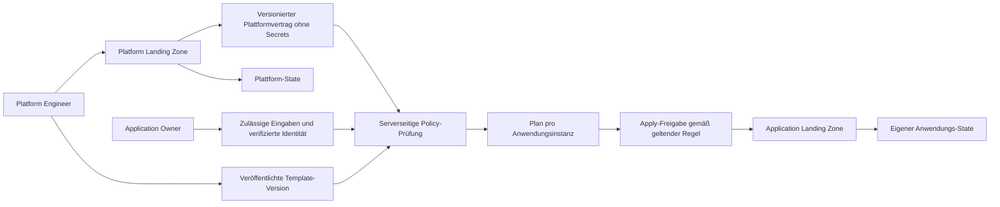

# Platform Landing Zone and Application Landing Zones

[English](platform-application-architecture.md) | [Deutsch](platform-application-architecture.de.md)

**Historical design reference, not current implementation or acceptance evidence.**
The following sections preserve the design and its questions open at that time.
For the current implementation, see [architecture](architecture.md),
[MVP boundaries](mvp-scope.md), [user guide](user-guide.md) and
[technical contracts](development.md).

The creation workflow has since switched to [project template drafts](project-template-drafts.md):
new platform configurations create no application instances.
Implementation of publication, tenant binding and orders is described in the current
contracts and tests, not in this design snapshot.

This design extends [planning](planning.md), the [common feature model](common-feature-model.md) and [editor design principles](editor-design-principles.md). It replaces no existing configurations, state addresses or permissions. Customer Apply remains blocked until explicit approval. Ongoing work on region/SNA views and VPN remains independently usable.

## Goal and boundaries

A Platform Landing Zone provides governance, approved folders, connectivity including STACKIT Network Areas (SNAs), central platform services and their infrastructure projects. Application projects will belong to independent Application Landing Zones. An Application Owner orders an instance from a published project template; they do not edit organization-wide platform configuration.

The current Accelerator combines these lifecycles in root `src/main.tf`: central modules and application projects (`landing_zones`, sandboxes, namespace services) share configuration and execution. Two views alone are therefore insufficient. Separate Accelerator entry points, an approved platform contract and independently managed application instances are needed.

## Roles and user management

Two business roles apply **per tenant**, not globally. A user can have both roles and different permissions in different customer organizations. Login, Configurator membership, STACKIT permissions and GitHub access remain separate evidence.

| Capability | Platform Engineer | Application Owner |
|---|---|---|
| Configure platform and request its Plan | Yes, in own tenant | No |
| Create, review, version and publish project templates | Yes | No |
| See published templates approved for them | Yes | Yes |
| Order own application instance and see its Plan | Yes | Yes |
| See/change other users' instances | Only under tenant policy | Only through explicit team sharing |
| Read or download platform credentials | No; authorized use only | No |
| Customer Apply | Additional run approval/policy | Additional run approval/policy |
| Manage tenant members/roles | Separately delegated management capability | No |

The previously proposed Viewer/Editor/Deployer/Tenant Admin roles from the main plan will not additionally be introduced as four visible product roles for this target design. Finer technical capabilities (member management, credential delegation, Apply approval) remain explicit grants. A Platform Engineer does not automatically receive all management permissions. Member management is delegated as a tenant-bound capability within the Platform Engineer role, not as a third business persona. Role/invitation changes require renewed server-side checking and an audit entry; nobody may grant themselves broader permissions.

Transition from previous Viewer/Editor/Deployer/Admin models proceeds incrementally after inventorying actually stored memberships. There is no blanket mapping of “Editor becomes Platform Engineer” and no automatic permission expansion. New roles are explicitly confirmed by authorized tenant representatives; until then, existing access remains within its previous, at most equivalent scope. Migration tests must also cover combined roles, revocation and open jobs.

PostgreSQL stores external identity links, tenant memberships, roles, invitations and audit events. No custom password management. Every API, queue message, artifact query and secret use checks tenant and object authorization server-side. A role switch in the browser is not a security mechanism.

## Identity, STACKIT onboarding and bootstrap

**Verified:** STACKIT uses role-based, additive permissions. Roles on organizations and folders are inherited; a weaker project role does not cancel these permissions. A Configurator login alone grants no STACKIT API permission. [STACKIT role model](https://docs.stackit.cloud/platform/access-and-identity/roles-permissions/roles-permissions/)

**Verified:** According to Resource Manager documentation, before another role assignment the user must already possess one of the listed organization roles. STACKIT recommends `organization.viewer` for this; it provides minimal organization visibility without inherited access to folders and projects. Therefore do not preemptively assign Reader or Owner to an entire application folder. Test the complete onboarding and portal workflow with a real test user. [Resource Manager Access Control](https://docs.stackit.cloud/platform/resource-manager/basics/access-control/)

**Still open:** An approved STACKIT IdP client for our own app, including discovery, client registration, claims, logout and API delegation. The public OIDC guide describes an external IdP trusted by STACKIT; it does not establish that a Configurator client can be freely registered at the STACKIT IdP. [STACKIT IdP](https://docs.stackit.cloud/platform/access-and-identity/stackit-idp/getting-started/), [OIDC federation](https://docs.stackit.cloud/platform/access-and-identity/stackit-idp/how-tos/generic-oidc-1_0-federation-guide/)

Proposed workflow:

1. User authenticates through an approved IdP; GitHub remains the existing login until clarification.
2. STACKIT user account and specific organization are verified separately. No automatic linking solely through matching email addresses; store stable issuer/subject identifier.
3. An authorized organization administrator confirms tenant assignment and first Platform Engineer membership. Possessing a service-account key does not demonstrate personal organization membership.
4. Missing organization membership of the Application Owner is treated as an explicit onboarding step. They receive only the role needed for onboarding and later the approved project role.
5. Bootstrap needs temporarily authorized permissions to create project, initial service account and backend. Login alone does not create these permissions. First demonstrate supported user API delegation; otherwise a documented one-time administrator/service-account bootstrap remains necessary.
6. After bootstrap, remove temporary permissions and operate platform/application provisioning with separate, restricted execution identities.

The specific permission matrix for project creation, role assignment, network assignment and service creation must be demonstrated through an API/provider spike. No blanket promise that `organization.viewer` suffices for provisioning: this role concerns user admission, not the provisioning identity.

## Project templates and instances

Details: [template inputs, fixed settings and resource bindings](template-parameters-and-bindings.md). The draft editor supports five approved parameter fields and a local order preview. Publication and production Application instantiation remain outstanding.

**Decided:** Published template versions remain immutable. Existing instances receive new versions only through an explicitly requested upgrade with its own Plan.

A published `ApplicationTemplateVersion` contains:

- Tenant, stable template ID, version, status (`draft`, `published`, `retired`), author and approval.
- Pinned Accelerator version, compiler/schema version and compatibility with the platform contract.
- Application profile, such as VM project, dedicated Kubernetes project or namespace on a central Kubernetes cluster. These three variants are distinct business concepts; a namespace is not an independent cluster.
- Fixed settings: permitted target folders, regions and SNAs, Public/Corporate type, mandatory services, roles, naming rules and quotas.
- Explicitly exposed inputs with type, selection values, explanation and default, e.g. name, environment and permitted size class.
- Declarative service configuration, such as STACKIT Secrets Manager and STACKIT Observability, and secure credential references. No secret values or arbitrary Terraform scripts.
- Documented results, prerequisites, technical limitations and responsibility for operation/deletion.

An `ApplicationInstance` binds a specific template version, permitted user inputs, verified requester/project owner, platform contract version, state identity and execution revision. Templates are copied/instantiated; later changes do not automatically update existing instances. Updates are separate Plans with a visible diff and approval.

The server sets organization, folder, permitted region/SNA and owner from verified bindings. It does not adopt these values unchecked from form, chat or API. The STACKIT project owner must be a suitable human account; the Application Owner product role does not automatically mean unlimited STACKIT IAM owner permissions. The specific project role/owner assignment required for business purposes is defined per template and tested with the API.

**Important open boundary:** The existing application-project module is not a complete VM/Kubernetes workload catalogue. Before naming a template “VM” or “Kubernetes”, it must be clear whether only project and basic services, or actual VMs/clusters/namespaces, are created. Missing Accelerator capabilities are separate extensions.

## Accelerator contract, state and execution

Proposed new roots (specific paths still to be decided): `platform` for central resources and `application` for exactly one application instance. Existing `src` remains compatible during migration. Reusable modules are shared; no copying of complete platform configurations for every order.

The platform publishes a **non-sensitive, versioned contract**: organization ID, approved folder IDs, regions, SNA/network references, permitted central cluster/service references, capabilities and policy version. Applications consume only this contract, not the full platform state. Server and Runner check approval, currency and target organization before every Plan and Apply. Application instances have no direct `terraform_remote_state` access to platform state and do not receive its backend credentials.

Separate backend keys and permissions for bootstrap, platform and every application instance; tenant separation remains required. Existing Accelerator bootstrap remains the basis of backend provisioning. No switch to new centralized customer state without a separate decision. State locks and queue locks per instance prevent concurrent mutations; shared quotas/network changes need additional tenant-wide coordination.

A central platform resource has exactly one state owner. Application states may reference it but not manage it again. Removing an SNA/cluster is blocked while application instances depend on it. Running executions must be considered before contract changes.

Application jobs receive a restricted, tenant-bound execution identity and exclusively approved resource references. Template instantiation is not a way to delegate the organization-wide bootstrap service account. Retry/idempotency through instance ID and order key, no second project on another click. Quotas are reserved atomically and reconciled after errors.

Clicking “Deploy” initially starts validation and Plan. Automatic Apply is a later explicit product/tenant policy; the current personal approval requirement for customer Apply applies unchanged. **Confirmed decision:** The Platform Engineer can allow both direct deployment and an approval workflow per template. This policy is checked server-side before Plan and Apply; a change does not prematurely lift today's customer Apply approval requirement. The safe initial value for new templates (approval required) is an implementation proposal.

## GitHub and the Application Owner experience

The Application Owner should not need to select a fork merely to order an approved template. Through their user-bound GitHub connection, the Platform Engineer can publish a signed/hashed, immutable snapshot to the tenant catalogue. Reading this published snapshot is not repository access under another person's credentials.

How instances are archived in Git remains open: the Application Owner's personal GitHub connection or export/review explicitly performed by the Platform Engineer. Until decided, PostgreSQL plus immutable configuration artifacts are proposed instance evidence. No silent switch to centralized GitHub tokens and no background writes under another user's token. The original requirement for user-bound repository access remains.

## UI impact

Platform Engineer: platform, project templates, publications, application overview and separately authorized tenant management. Application Owner: approved project templates, own/assigned applications, status, Plans and access. Current tenant and current role are always visible.

The current component view remains the basis of the platform editor. The later template editor uses the same business components but adds “fix value”, “let Application Owner choose” and “unavailable”. An unknown field is not automatically an exposed variable. Chat uses the same authorization and template schemas as the form.

## Migration without resource loss

- Existing combined configurations, hashes and state addresses remain readable unchanged.
- Initially support new platform-only configurations and new application instances.
- Inventory existing projects and their jointly managed resources; define a unique future state owner.
- Develop a separate, tested migration run with backup, locks, import/state-move plan, abort and rollback strategy. Cross-state migration is not an ordinary UI save.
- Before and after every migration, demonstrate that no unexpected creation or deletion is planned. No automatic migration through login, template selection or opening a document.
- Known limitations #22 (folder destroy), #37 (private Kubernetes), #65 (firewall), #80 (regional namespace wiring) also apply to the new roots.

## Discussion decisions and implementation

Recommendations for the next joint decision:

1. Two roles per tenant; both possible simultaneously. Delegate membership management separately.
2. Application Owner initially needs an already verified STACKIT account; guided organization admission, no implicit account creation.
3. First a template “Application project with basic services”, then dedicated clusters/VMs and central namespace offerings, each after demonstrated Accelerator support.
4. Template publication as immutable tenant catalogue snapshot; decide Git storage of instances separately.
5. First implement platform and application Plan separately, then controlled Apply; legacy migration last.

### Phase A – contracts and IAM evidence

- [x] Document target design, role separation and open assumptions.
- [x] Immutable published template versions and explicit upgrades confirmed by user.
- [x] Future Apply policy configurable by Platform Engineer per template: direct or requiring approval.
- [ ] Decide owner/team, Git storage and approval path.
- [ ] Clarify STACKIT IdP client and delegated user API permissions with STACKIT.
- [ ] Demonstrate organization admission and minimal permissions with a dedicated test user.
- [ ] Create inventory of existing platform/application resources and capability matrix.
- [ ] Review platform contract, template schema and separate state ownership.

### Phase B – Accelerator and Plan-only support

- [ ] Implement new roots/modules and versioned platform contract.
- [ ] Implement template compiler with permitted inputs and fixed policies.
- [ ] Connect isolated application states and restricted Runner credentials.
- [ ] Native OpenTofu contract tests and negative Plan tests for foreign folders/SNAs/organizations.
- [ ] Develop separate concept for legacy migration; do not execute yet.

### Phase C – Configurator self-service

- [ ] Implement tenant roles, invitations, identity linking and audit log.
- [ ] Implement template draft, publication, catalogue and retirement.
- [ ] Implement role-dependent views, order form and own instances.
- [ ] API/RLS/job negative tests against cross-tenant access and role escalation.
- [ ] Test idempotency, quotas, error recovery and template updates.
- [ ] Customer Apply only after specific approval; securely implement the confirmed later self-service Apply policy.

## First technical prototype (2026-10-01, not yet connected to API/Runner)

- `src/application` is a separate root for exactly one new application instance, referencing approved platform resources and having its own S3 backend key.
- `app/packages/domain/src/application-plan.ts` contains a pure compiler for published templates, verified server context and strictly limited order inputs. Tenant, organization, revision and target binding are checked.
- The compiler takes owner from server context and services from the template. It replaces neither server-side membership checking nor actual STACKIT identity verification, publication/persistence or job authorization.
- Four native mock Plan tests check Public/Corporate and tenant/revision boundaries; four compiler tests check isolated state keys, bindings and input injection.
- Execution remains explicitly disabled; `direct` is only stored future policy. This has not yet enabled any API endpoint, role switching or customer Plan.

Besides selectable services, the shared module also creates an automation service account with key and Object Storage buckets/credentials. This scope must be visible when publishing the base template and in the Plan. For its first run, the application instance uses the existing bootstrap backend, not its own bucket created only later.

## Implementation step: independent user identity (2026-10-01)

Additive migration `006_external_identities.sql` separates external login identities from the internal user UUID. Existing GitHub mappings are adopted; user, tenant, configuration and secret addresses remain unchanged. GitHub login now resolves users through provider, issuer and immutable GitHub ID. Previous GitHub columns are temporarily retained for existing session and repository interfaces and are now optional. There is no OIDC login or public account-linking API yet. Identity links have no direct runtime table permissions.

STACKIT IDP remains the preferred primary login. The user has submitted the ticket for registering a custom OIDC client; the response is pending. The public [federation guide](https://docs.stackit.cloud/platform/access-and-identity/stackit-idp/how-tos/generic-oidc-1_0-federation-guide/) describes STACKIT as relying party and does not confirm this registration path. Alternatively, an approved enterprise OIDC provider will be connected; an identity broker is planned only if needed. GitHub remains the transitional login until the switch and later a personal connection. No account merging solely on matching email addresses.

### Next implementation steps

- [x] Store external identities separately and preserve existing UUIDs.
- [x] PostgreSQL tests: legacy migration, GitHub rename, prohibited runtime access, issuer-bound subjects and users without GitHub.
- [ ] Verified OIDC login after client registration; approve provider server-side, check identity by issuer and subject.
- [ ] Secure linking of existing users with renewed proof of both accounts.
- [ ] Distinguish organization tenants from previous personal workspaces; initially exactly one verified STACKIT organization per organization tenant.
- [ ] Implement memberships with Platform Engineer / Application Owner and separate member-management capability, revocation and audit.
- [ ] Implement tenant switching with independent personal GitHub token binding.
- [ ] Migrate existing API permissions to new roles before Application Owners receive access.
- [ ] Provide “Organization & members” UI and Application catalogue.

This step activates no new roles, grants no STACKIT permissions and changes neither customer Apply approval nor existing tenant boundaries.

## Organization & members: first management status

Organization tenants can now be created separately from the personal workspace. Their STACKIT organization ID is explicitly **unverified**. A user can own or belong to multiple workspaces; the UI offers an explicit switch with full reload. Personal GitHub token binding remains bound to the original user/session path during switching.

Member management initially uses the internal UUID of an already registered user. There is no global user catalogue or automatic account merging through email. Platform Engineer and Application Owner can be combined. Member management is a separate capability for Platform Engineers. Changes are audited; the last manager must not be lost even under concurrent changes. Existing personal memberships are not promoted to new roles.

**Execution boundary of this status:** Organization tenants are management drafts. Credentials, product catalogue queries and old Plan/deployment endpoints are blocked there server-side. Application Owners also receive no access to previous platform/Git endpoints. The personal workspace remains available for previous configuration and authorized Plan use. The new view does not yet activate an Application catalogue or customer Apply.

- [x] Draft organization tenants and explicit tenant switching.
- [x] Role memberships and separate member management with audit.
- [x] “Organization & members” UI and server-side separation of old APIs.
- [ ] Verify STACKIT organization binding and acting user identity.
- [ ] Only then enable tenant-bound credentials and organization-wide execution.
- [ ] Invitations, STACKIT member reconciliation and immutable Application templates.

## Member invitations replace manual user identifiers

New memberships arise through explicit acceptance of an invitation link. The manager chooses roles and, if applicable, member management. The link is valid for seven days, usable once and revocable until acceptance. It is displayed in full only at creation; PostgreSQL stores exclusively its SHA-256 hash. The random token has 256 bits of entropy. No email is sent. The link is a transferable authorization and must be deliberately passed to the intended person; it is not bound to an email address.

The person signs in through the available login; their internal user is created automatically at first GitHub login. They see workspace and roles and confirm joining. The token is transported in the URL fragment, immediately removed from the visible URL and held only in the current tab's session storage across login. Preview and acceptance require login; acceptance additionally requires Origin/CSRF checking. Tokens do not appear in URL paths, query strings, audit events or the invitation list. After acceptance/closing, the local token is removed. An interrupted workflow can be reopened with the link.

The server serializes acceptance, revocation and member management on the tenant. Expired/used/revoked invitations, archived workspaces and inviters without current management permission are rejected. Existing members receive no additional roles through an invitation. The old membership endpoint may only edit existing memberships. The UI no longer needs internal user identifiers. Managing and accepting invitations grants no STACKIT IAM permissions and activates no customer Apply.
